# OVS & OVN Scaling Benchmark: glibc malloc vs jemalloc

**Date:** 2026-10-14 12:01:54
**System:** Linux
**CPU:** Intel(R) Core(TM) Ultra 7 165H (22 vCPUs)
**Memory:** 62Gi
**Glibc Version:** ldd (GNU libc) 2.43
**Jemalloc Version:** 5.3.0

---

## Methodology

Each benchmark evaluates individual OVN/OVS objects, OpenFlow rule scaling, or combined workloads across powers of 10 (`1, 10, 100, 1,000, 10,000, 100,000`) through 3 lifecycle phases measuring the full OVN-Kubernetes pod stack (`ovn-northd`, `ovn-controller`, `ovs-vswitchd`, and `ovsdb-servers`):
1. **Baseline (Idle)**: Total Pod and per-daemon clean process RSS before creating objects.
2. **After Add (N)**: Time taken to commit $N$ objects via native OVSDB JSON-RPC, full recompute latency (`ovn-northd-loop` stopwatch), and Total Pod peak RSS (`VmHWM`) with per-daemon breakdown.
3. **After Remove (N)**: Time taken to delete all $N$ objects via native OVSDB JSON-RPC, post-deletion recompute latency, and retained heap memory (`Post-Deletion RSS - Baseline RSS`) measured after a wait period allowing page decay (`dirty_decay_ms:0,muzzy_decay_ms:0`).

---

## Logical Switch Port (LSP with IP, MAC, port_security)

| Scale (N) | Phase / Metric | glibc malloc | jemalloc | Relative Difference |
|---|---|---|---|---|
| **1** | Total Pod Baseline Heap (RssAnon) | 27.55 MiB | 31.64 MiB | +14.8% |
| | Add Duration | 0.019 s | 0.010 s | -47.4% |
| | Add Rate | 51 ops/s | 98 ops/s | +91.1% |
| | Recompute (`ovn-northd-loop`) | 1.0 ms | 1.0 ms | ~Parity (<1ms) |
| | Logical Flow (`lflow`) | 0.0 ms | 0.0 ms | N/A |
| | Total Pod Peak Heap (RssAnon) | 29.16 MiB | 32.89 MiB | +12.8% |
| | Delete Duration | 0.010 s | 0.007 s | -30.0% |
| | Post-Delete Recompute | 0.0 ms | 1.0 ms | N/A |
| | Total Pod Post-Delete Heap (RssAnon) | 28.29 MiB | 32.89 MiB | +16.3% |
| | **Total Pod Retained Heap** | **+0.74 MiB** | **+1.25 MiB** | **+0.51 MiB** |
| | ├─ `ovn-northd` (Peak / Retained Heap) | 5.97 / -0.03 MiB | 6.90 / -0.02 MiB | +15.6% / +0.01 MiB |
| | ├─ `ovn-controller` (Peak / Retained Heap) | 4.38 / +0.84 MiB | 4.76 / +0.88 MiB | +8.7% / +0.04 MiB |
| | ├─ `ovs-vswitchd` (Peak / Retained Heap) | 12.08 / +0.31 MiB | 13.68 / +0.31 MiB | +13.2% / +0.00 MiB |
| | ├─ `ovsdb-server (SB)` (Peak / Retained Heap) | 2.65 / -0.14 MiB | 2.80 / +0.01 MiB | +5.7% / +0.15 MiB |
| | ├─ `ovsdb-server (NB)` (Peak / Retained Heap) | 2.09 / -0.14 MiB | 2.37 / -0.01 MiB | +13.4% / +0.13 MiB |
| | ├─ `ovsdb-server (OVS)` (Peak / Retained Heap) | 2.03 / -0.10 MiB | 2.41 / +0.08 MiB | +18.7% / +0.18 MiB |
|---|---|---|---|---|
| **10** | Total Pod Baseline Heap (RssAnon) | 27.55 MiB | 31.70 MiB | +15.1% |
| | Add Duration | 0.018 s | 0.015 s | -16.7% |
| | Add Rate | 569 ops/s | 659 ops/s | +15.9% |
| | Recompute (`ovn-northd-loop`) | 1.0 ms | 0.0 ms | ~Parity (<1ms) |
| | Logical Flow (`lflow`) | 1.0 ms | 0.0 ms | ~Parity (<1ms) |
| | Total Pod Peak Heap (RssAnon) | 30.16 MiB | 34.15 MiB | +13.2% |
| | Delete Duration | 0.009 s | 0.010 s | +11.1% |
| | Post-Delete Recompute | 1.0 ms | 1.0 ms | ~Parity (<1ms) |
| | Total Pod Post-Delete Heap (RssAnon) | 29.42 MiB | 34.15 MiB | +16.1% |
| | **Total Pod Retained Heap** | **+1.87 MiB** | **+2.45 MiB** | **+0.58 MiB** |
| | ├─ `ovn-northd` (Peak / Retained Heap) | 6.06 / +0.03 MiB | 7.13 / +0.21 MiB | +17.7% / +0.18 MiB |
| | ├─ `ovn-controller` (Peak / Retained Heap) | 4.86 / +1.32 MiB | 5.25 / +1.36 MiB | +8.0% / +0.04 MiB |
| | ├─ `ovs-vswitchd` (Peak / Retained Heap) | 12.43 / +0.66 MiB | 13.96 / +0.58 MiB | +12.3% / -0.08 MiB |
| | ├─ `ovsdb-server (SB)` (Peak / Retained Heap) | 2.66 / -0.09 MiB | 2.91 / +0.07 MiB | +9.4% / +0.16 MiB |
| | ├─ `ovsdb-server (NB)` (Peak / Retained Heap) | 2.09 / -0.09 MiB | 2.41 / +0.03 MiB | +15.3% / +0.12 MiB |
| | ├─ `ovsdb-server (OVS)` (Peak / Retained Heap) | 2.10 / +0.04 MiB | 2.54 / +0.20 MiB | +21.0% / +0.16 MiB |
|---|---|---|---|---|
| **100** | Total Pod Baseline Heap (RssAnon) | 27.50 MiB | 31.70 MiB | +15.3% |
| | Add Duration | 0.066 s | 0.030 s | -54.5% |
| | Add Rate | 1,513 ops/s | 3,367 ops/s | +122.4% |
| | Recompute (`ovn-northd-loop`) | 2.0 ms | 2.0 ms | ~Parity (±1%) |
| | Logical Flow (`lflow`) | 0.0 ms | 0.0 ms | N/A |
| | Total Pod Peak Heap (RssAnon) | 47.38 MiB | 47.42 MiB | ~Parity (±1%) |
| | Delete Duration | 0.030 s | 0.045 s | +50.0% |
| | Post-Delete Recompute | 1.0 ms | 1.0 ms | ~Parity (<1ms) |
| | Total Pod Post-Delete Heap (RssAnon) | 39.15 MiB | 39.08 MiB | ~Parity (±1%) |
| | **Total Pod Retained Heap** | **+11.65 MiB** | **+7.38 MiB** | **-4.27 MiB** |
| | ├─ `ovn-northd` (Peak / Retained Heap) | 8.43 / +0.85 MiB | 8.89 / +0.76 MiB | +5.5% / -0.09 MiB |
| | ├─ `ovn-controller` (Peak / Retained Heap) | 9.96 / +4.10 MiB | 9.84 / +3.40 MiB | -1.2% / -0.70 MiB |
| | ├─ `ovs-vswitchd` (Peak / Retained Heap) | 16.29 / +4.53 MiB | 17.53 / +2.19 MiB | +7.6% / -2.34 MiB |
| | ├─ `ovsdb-server (SB)` (Peak / Retained Heap) | 6.27 / +0.85 MiB | 4.80 / +0.33 MiB | -23.4% / -0.52 MiB |
| | ├─ `ovsdb-server (NB)` (Peak / Retained Heap) | 2.54 / +0.19 MiB | 2.71 / +0.20 MiB | +6.7% / +0.01 MiB |
| | ├─ `ovsdb-server (OVS)` (Peak / Retained Heap) | 4.00 / +1.13 MiB | 3.65 / +0.50 MiB | -8.8% / -0.63 MiB |
|---|---|---|---|---|
| **1000** | Total Pod Baseline Heap (RssAnon) | 27.54 MiB | 31.61 MiB | +14.8% |
| | Add Duration | 0.394 s | 0.359 s | -8.9% |
| | Add Rate | 2,537 ops/s | 2,781 ops/s | +9.6% |
| | Recompute (`ovn-northd-loop`) | 1.0 ms | 1.0 ms | ~Parity (<1ms) |
| | Logical Flow (`lflow`) | 7.0 ms | 7.0 ms | ~Parity (±1%) |
| | Total Pod Peak Heap (RssAnon) | 113.89 MiB | 91.63 MiB | -19.5% |
| | Delete Duration | 0.263 s | 0.167 s | -36.5% |
| | Post-Delete Recompute | 1.0 ms | 1.0 ms | ~Parity (<1ms) |
| | Total Pod Post-Delete Heap (RssAnon) | 57.60 MiB | 38.51 MiB | -33.1% |
| | **Total Pod Retained Heap** | **+30.06 MiB** | **+6.90 MiB** | **-23.16 MiB** |
| | ├─ `ovn-northd` (Peak / Retained Heap) | 28.95 / +2.01 MiB | 24.63 / +2.30 MiB | -14.9% / +0.29 MiB |
| | ├─ `ovn-controller` (Peak / Retained Heap) | 9.08 / +4.41 MiB | 8.93 / +0.92 MiB | -1.7% / -3.49 MiB |
| | ├─ `ovs-vswitchd` (Peak / Retained Heap) | 27.04 / +15.28 MiB | 20.57 / +1.91 MiB | -23.9% / -13.37 MiB |
| | ├─ `ovsdb-server (SB)` (Peak / Retained Heap) | 32.88 / +1.70 MiB | 20.32 / +0.81 MiB | -38.2% / -0.89 MiB |
| | ├─ `ovsdb-server (NB)` (Peak / Retained Heap) | 7.06 / +0.96 MiB | 4.88 / +0.56 MiB | -30.9% / -0.40 MiB |
| | ├─ `ovsdb-server (OVS)` (Peak / Retained Heap) | 16.21 / +5.70 MiB | 12.30 / +0.40 MiB | -24.1% / -5.30 MiB |
|---|---|---|---|---|
| **10000** | Total Pod Baseline Heap (RssAnon) | 27.56 MiB | 31.66 MiB | +14.9% |
| | Add Duration | 184.527 s | 136.079 s | -26.3% |
| | Add Rate | 54 ops/s | 73 ops/s | +35.6% |
| | Recompute (`ovn-northd-loop`) | 62.0 ms | 20.0 ms | -67.7% |
| | Logical Flow (`lflow`) | 134.0 ms | 121.0 ms | -9.7% |
| | Total Pod Peak Heap (RssAnon) | 1816.94 MiB | 1467.90 MiB | -19.2% |
| | Delete Duration | 153.060 s | 90.622 s | -40.8% |
| | Post-Delete Recompute | 1.0 ms | 1.0 ms | ~Parity (<1ms) |
| | Total Pod Post-Delete Heap (RssAnon) | 985.85 MiB | 88.50 MiB | -91.0% |
| | **Total Pod Retained Heap** | **+958.29 MiB** | **+56.84 MiB** | **-901.45 MiB** |
| | ├─ `ovn-northd` (Peak / Retained Heap) | 231.93 / +5.13 MiB | 191.04 / +6.11 MiB | -17.6% / +0.98 MiB |
| | ├─ `ovn-controller` (Peak / Retained Heap) | 626.50 / +483.85 MiB | 558.10 / +21.99 MiB | -10.9% / -461.86 MiB |
| | ├─ `ovs-vswitchd` (Peak / Retained Heap) | 470.93 / +459.16 MiB | 385.46 / +18.59 MiB | -18.1% / -440.57 MiB |
| | ├─ `ovsdb-server (SB)` (Peak / Retained Heap) | 307.79 / +3.89 MiB | 200.94 / +6.23 MiB | -34.7% / +2.34 MiB |
| | ├─ `ovsdb-server (NB)` (Peak / Retained Heap) | 48.09 / +2.30 MiB | 27.86 / +1.69 MiB | -42.1% / -0.61 MiB |
| | ├─ `ovsdb-server (OVS)` (Peak / Retained Heap) | 135.49 / +3.96 MiB | 104.50 / +2.23 MiB | -22.9% / -1.73 MiB |
|---|---|---|---|---|

### Visual Charts

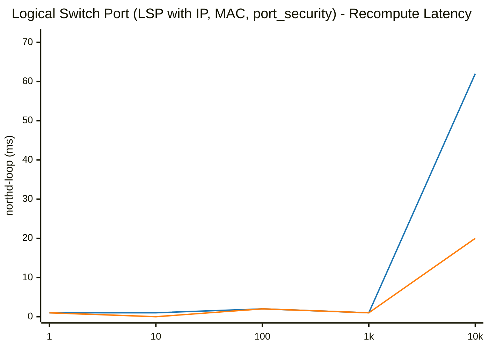

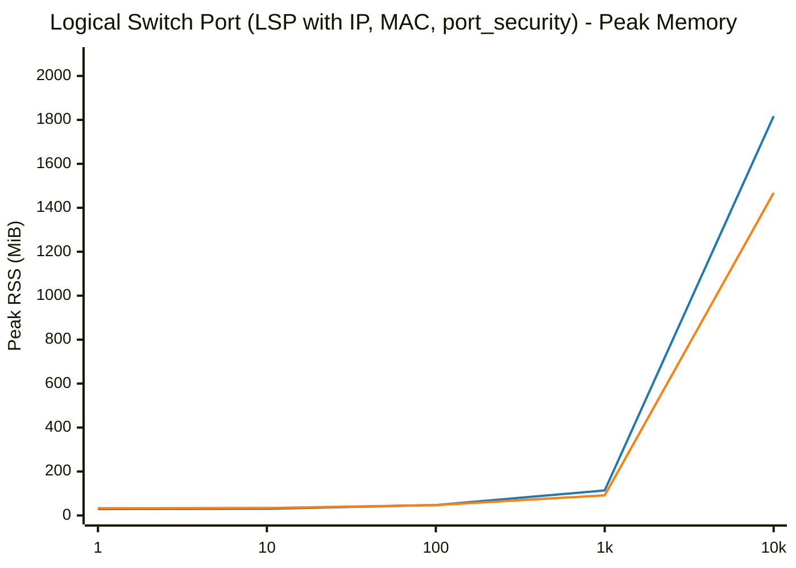

## ACL (Access Control List with stateful allow-related)

| Scale (N) | Phase / Metric | glibc malloc | jemalloc | Relative Difference |
|---|---|---|---|---|
| **1** | Total Pod Baseline Heap (RssAnon) | 30.15 MiB | 34.14 MiB | +13.2% |
| | Add Duration | 0.006 s | 0.006 s | ~Parity (±1%) |
| | Add Rate | 178 ops/s | 181 ops/s | +1.5% |
| | Recompute (`ovn-northd-loop`) | 1.0 ms | 1.0 ms | ~Parity (<1ms) |
| | Logical Flow (`lflow`) | 1.0 ms | 0.0 ms | ~Parity (<1ms) |
| | Total Pod Peak Heap (RssAnon) | 30.47 MiB | 34.72 MiB | +13.9% |
| | Delete Duration | 0.004 s | 0.005 s | +25.0% |
| | Post-Delete Recompute | 1.0 ms | 1.0 ms | ~Parity (<1ms) |
| | Total Pod Post-Delete Heap (RssAnon) | 29.85 MiB | 34.55 MiB | +15.7% |
| | **Total Pod Retained Heap** | **-0.30 MiB** | **+0.41 MiB** | **+0.71 MiB** |
| | ├─ `ovn-northd` (Peak / Retained Heap) | 6.21 / +0.12 MiB | 7.22 / +0.09 MiB | +16.3% / -0.03 MiB |
| | ├─ `ovn-controller` (Peak / Retained Heap) | 4.85 / -0.41 MiB | 5.59 / +0.09 MiB | +15.3% / +0.50 MiB |
| | ├─ `ovs-vswitchd` (Peak / Retained Heap) | 12.48 / +0.08 MiB | 14.08 / +0.11 MiB | +12.8% / +0.03 MiB |
| | ├─ `ovsdb-server (SB)` (Peak / Retained Heap) | 2.77 / +0.01 MiB | 3.00 / +0.03 MiB | +8.3% / +0.02 MiB |
| | ├─ `ovsdb-server (NB)` (Peak / Retained Heap) | 2.10 / -0.09 MiB | 2.41 / +0.02 MiB | +14.8% / +0.11 MiB |
| | ├─ `ovsdb-server (OVS)` (Peak / Retained Heap) | 2.09 / -0.01 MiB | 2.54 / +0.07 MiB | +21.5% / +0.08 MiB |
|---|---|---|---|---|
| **10** | Total Pod Baseline Heap (RssAnon) | 30.11 MiB | 34.12 MiB | +13.3% |
| | Add Duration | 0.007 s | 0.007 s | ~Parity (±1%) |
| | Add Rate | 1,442 ops/s | 1,479 ops/s | +2.5% |
| | Recompute (`ovn-northd-loop`) | 1.0 ms | 1.0 ms | ~Parity (<1ms) |
| | Logical Flow (`lflow`) | 0.0 ms | 1.0 ms | N/A |
| | Total Pod Peak Heap (RssAnon) | 30.71 MiB | 34.98 MiB | +13.9% |
| | Delete Duration | 0.006 s | 0.004 s | -33.3% |
| | Post-Delete Recompute | 1.0 ms | 1.0 ms | ~Parity (<1ms) |
| | Total Pod Post-Delete Heap (RssAnon) | 29.99 MiB | 34.62 MiB | +15.4% |
| | **Total Pod Retained Heap** | **-0.12 MiB** | **+0.50 MiB** | **+0.62 MiB** |
| | ├─ `ovn-northd` (Peak / Retained Heap) | 6.34 / +0.19 MiB | 7.31 / +0.13 MiB | +15.3% / -0.06 MiB |
| | ├─ `ovn-controller` (Peak / Retained Heap) | 4.85 / -0.39 MiB | 5.73 / +0.13 MiB | +18.1% / +0.52 MiB |
| | ├─ `ovs-vswitchd` (Peak / Retained Heap) | 12.50 / +0.11 MiB | 14.07 / +0.12 MiB | +12.6% / +0.01 MiB |
| | ├─ `ovsdb-server (SB)` (Peak / Retained Heap) | 2.90 / +0.02 MiB | 3.03 / +0.02 MiB | +4.5% / +0.00 MiB |
| | ├─ `ovsdb-server (NB)` (Peak / Retained Heap) | 2.06 / -0.04 MiB | 2.42 / +0.03 MiB | +17.5% / +0.07 MiB |
| | ├─ `ovsdb-server (OVS)` (Peak / Retained Heap) | 2.10 / -0.01 MiB | 2.54 / +0.07 MiB | +21.0% / +0.08 MiB |
|---|---|---|---|---|
| **100** | Total Pod Baseline Heap (RssAnon) | 30.14 MiB | 34.03 MiB | +12.9% |
| | Add Duration | 0.023 s | 0.014 s | -39.1% |
| | Add Rate | 4,360 ops/s | 7,406 ops/s | +69.8% |
| | Recompute (`ovn-northd-loop`) | 2.0 ms | 1.0 ms | -50.0% |
| | Logical Flow (`lflow`) | 1.0 ms | 1.0 ms | ~Parity (<1ms) |
| | Total Pod Peak Heap (RssAnon) | 34.67 MiB | 37.83 MiB | +9.1% |
| | Delete Duration | 0.009 s | 0.008 s | -11.1% |
| | Post-Delete Recompute | 1.0 ms | 1.0 ms | ~Parity (<1ms) |
| | Total Pod Post-Delete Heap (RssAnon) | 31.38 MiB | 35.65 MiB | +13.6% |
| | **Total Pod Retained Heap** | **+1.24 MiB** | **+1.62 MiB** | **+0.38 MiB** |
| | ├─ `ovn-northd` (Peak / Retained Heap) | 7.33 / +0.49 MiB | 7.93 / +0.49 MiB | +8.2% / +0.00 MiB |
| | ├─ `ovn-controller` (Peak / Retained Heap) | 5.90 / -0.15 MiB | 6.91 / +0.30 MiB | +17.1% / +0.45 MiB |
| | ├─ `ovs-vswitchd` (Peak / Retained Heap) | 12.83 / +0.44 MiB | 14.30 / +0.34 MiB | +11.5% / -0.10 MiB |
| | ├─ `ovsdb-server (SB)` (Peak / Retained Heap) | 4.18 / +0.39 MiB | 3.66 / +0.21 MiB | -12.4% / -0.18 MiB |
| | ├─ `ovsdb-server (NB)` (Peak / Retained Heap) | 2.43 / +0.09 MiB | 2.61 / +0.21 MiB | +7.4% / +0.12 MiB |
| | ├─ `ovsdb-server (OVS)` (Peak / Retained Heap) | 2.10 / -0.02 MiB | 2.53 / +0.07 MiB | +20.5% / +0.09 MiB |
|---|---|---|---|---|
| **1000** | Total Pod Baseline Heap (RssAnon) | 29.70 MiB | 34.05 MiB | +14.6% |
| | Add Duration | 0.101 s | 0.081 s | -19.8% |
| | Add Rate | 9,861 ops/s | 12,379 ops/s | +25.5% |
| | Recompute (`ovn-northd-loop`) | 1.0 ms | 0.0 ms | ~Parity (<1ms) |
| | Logical Flow (`lflow`) | 3.0 ms | 3.0 ms | ~Parity (±1%) |
| | Total Pod Peak Heap (RssAnon) | 68.07 MiB | 63.76 MiB | -6.3% |
| | Delete Duration | 0.042 s | 0.037 s | -11.9% |
| | Post-Delete Recompute | 1.0 ms | 1.0 ms | ~Parity (<1ms) |
| | Total Pod Post-Delete Heap (RssAnon) | 36.51 MiB | 38.93 MiB | +6.6% |
| | **Total Pod Retained Heap** | **+6.81 MiB** | **+4.88 MiB** | **-1.93 MiB** |
| | ├─ `ovn-northd` (Peak / Retained Heap) | 15.80 / +1.17 MiB | 14.09 / +1.31 MiB | -10.8% / +0.14 MiB |
| | ├─ `ovn-controller` (Peak / Retained Heap) | 16.74 / +0.79 MiB | 18.32 / +1.28 MiB | +9.4% / +0.49 MiB |
| | ├─ `ovs-vswitchd` (Peak / Retained Heap) | 15.89 / +3.50 MiB | 16.20 / +1.00 MiB | +2.0% / -2.50 MiB |
| | ├─ `ovsdb-server (SB)` (Peak / Retained Heap) | 13.65 / +0.72 MiB | 8.55 / +0.57 MiB | -37.4% / -0.15 MiB |
| | ├─ `ovsdb-server (NB)` (Peak / Retained Heap) | 4.65 / +0.64 MiB | 4.14 / +0.66 MiB | -11.0% / +0.02 MiB |
| | ├─ `ovsdb-server (OVS)` (Peak / Retained Heap) | 2.09 / -0.01 MiB | 2.52 / +0.06 MiB | +20.6% / +0.07 MiB |
|---|---|---|---|---|
| **10000** | Total Pod Baseline Heap (RssAnon) | 29.65 MiB | 34.06 MiB | +14.9% |
| | Add Duration | 1.067 s | 0.903 s | -15.4% |
| | Add Rate | 9,374 ops/s | 11,077 ops/s | +18.2% |
| | Recompute (`ovn-northd-loop`) | 1.0 ms | 1.0 ms | ~Parity (<1ms) |
| | Logical Flow (`lflow`) | 78.0 ms | 72.0 ms | -7.7% |
| | Total Pod Peak Heap (RssAnon) | 385.25 MiB | 320.16 MiB | -16.9% |
| | Delete Duration | 0.704 s | 0.453 s | -35.7% |
| | Post-Delete Recompute | 1.0 ms | 1.0 ms | ~Parity (<1ms) |
| | Total Pod Post-Delete Heap (RssAnon) | 65.85 MiB | 47.30 MiB | -28.2% |
| | **Total Pod Retained Heap** | **+36.20 MiB** | **+13.24 MiB** | **-22.96 MiB** |
| | ├─ `ovn-northd` (Peak / Retained Heap) | 96.71 / +1.75 MiB | 74.56 / +2.45 MiB | -22.9% / +0.70 MiB |
| | ├─ `ovn-controller` (Peak / Retained Heap) | 124.95 / +1.42 MiB | 132.95 / +5.26 MiB | +6.4% / +3.84 MiB |
| | ├─ `ovs-vswitchd` (Peak / Retained Heap) | 43.20 / +30.81 MiB | 31.84 / +1.47 MiB | -26.3% / -29.34 MiB |
| | ├─ `ovsdb-server (SB)` (Peak / Retained Heap) | 102.30 / +1.16 MiB | 60.22 / +2.39 MiB | -41.1% / +1.23 MiB |
| | ├─ `ovsdb-server (NB)` (Peak / Retained Heap) | 23.41 / +1.07 MiB | 18.13 / +1.59 MiB | -22.6% / +0.52 MiB |
| | ├─ `ovsdb-server (OVS)` (Peak / Retained Heap) | 2.09 / -0.01 MiB | 2.54 / +0.08 MiB | +21.5% / +0.09 MiB |
|---|---|---|---|---|

### Visual Charts

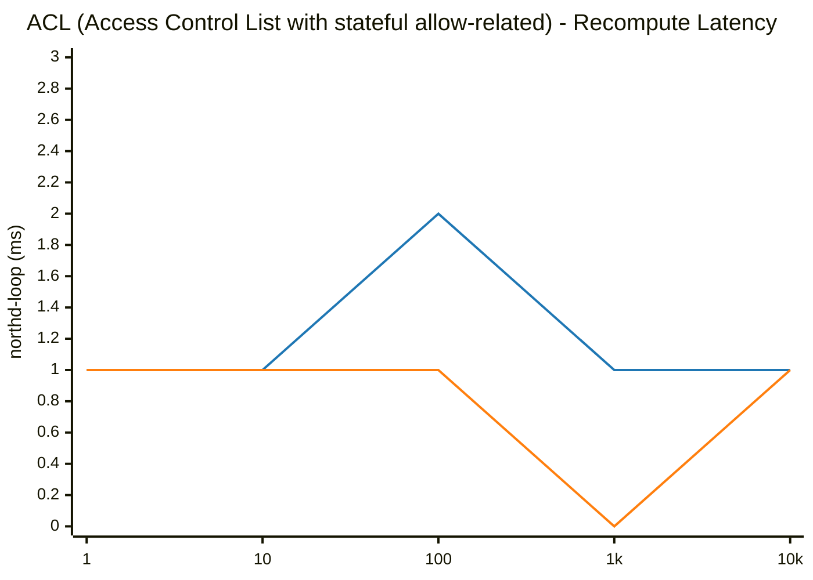

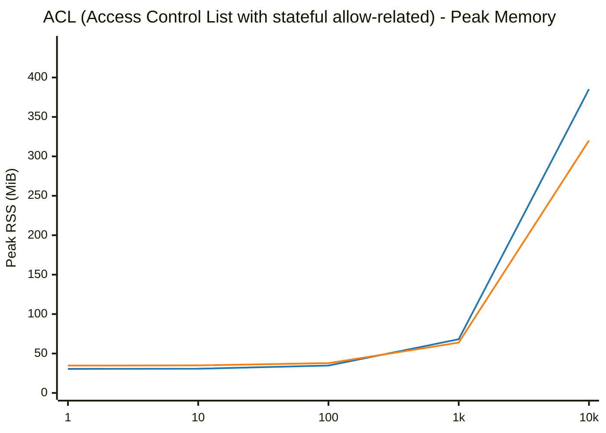

## Address Set (IP list matching ACL)

| Scale (N) | Phase / Metric | glibc malloc | jemalloc | Relative Difference |
|---|---|---|---|---|
| **1** | Total Pod Baseline Heap (RssAnon) | 30.14 MiB | 34.11 MiB | +13.2% |
| | Add Duration | 0.005 s | 0.006 s | +20.0% |
| | Address Insertion Rate | 198 addrs/s | 175 addrs/s | -11.8% |
| | Recompute (`ovn-northd-loop`) | 1.0 ms | 1.0 ms | ~Parity (<1ms) |
| | Logical Flow (`lflow`) | 1.0 ms | 0.0 ms | ~Parity (<1ms) |
| | Total Pod Peak Heap (RssAnon) | 30.47 MiB | 34.69 MiB | +13.8% |
| | Delete Duration | 0.006 s | 0.005 s | -16.7% |
| | Post-Delete Recompute | 1.0 ms | 1.0 ms | ~Parity (<1ms) |
| | Total Pod Post-Delete Heap (RssAnon) | 29.77 MiB | 34.55 MiB | +16.1% |
| | **Total Pod Retained Heap** | **-0.37 MiB** | **+0.44 MiB** | **+0.81 MiB** |
| | ├─ `ovn-northd` (Peak / Retained Heap) | 6.22 / +0.10 MiB | 7.22 / +0.10 MiB | +16.1% / +0.00 MiB |
| | ├─ `ovn-controller` (Peak / Retained Heap) | 4.85 / -0.42 MiB | 5.61 / +0.11 MiB | +15.7% / +0.53 MiB |
| | ├─ `ovs-vswitchd` (Peak / Retained Heap) | 12.47 / +0.08 MiB | 14.07 / +0.11 MiB | +12.8% / +0.03 MiB |
| | ├─ `ovsdb-server (SB)` (Peak / Retained Heap) | 2.77 / -0.01 MiB | 2.95 / +0.03 MiB | +6.5% / +0.04 MiB |
| | ├─ `ovsdb-server (NB)` (Peak / Retained Heap) | 2.10 / -0.10 MiB | 2.42 / +0.02 MiB | +15.2% / +0.12 MiB |
| | ├─ `ovsdb-server (OVS)` (Peak / Retained Heap) | 2.09 / -0.02 MiB | 2.54 / +0.07 MiB | +21.5% / +0.09 MiB |
|---|---|---|---|---|
| **10** | Total Pod Baseline Heap (RssAnon) | 30.13 MiB | 34.05 MiB | +13.0% |
| | Add Duration | 0.006 s | 0.005 s | -16.7% |
| | Address Insertion Rate | 1,636 addrs/s | 2,088 addrs/s | +27.6% |
| | Recompute (`ovn-northd-loop`) | 1.0 ms | 1.0 ms | ~Parity (<1ms) |
| | Logical Flow (`lflow`) | 0.0 ms | 1.0 ms | N/A |
| | Total Pod Peak Heap (RssAnon) | 30.49 MiB | 34.68 MiB | +13.7% |
| | Delete Duration | 0.005 s | 0.005 s | ~Parity (±1%) |
| | Post-Delete Recompute | 0.0 ms | 1.0 ms | N/A |
| | Total Pod Post-Delete Heap (RssAnon) | 29.83 MiB | 34.51 MiB | +15.7% |
| | **Total Pod Retained Heap** | **-0.30 MiB** | **+0.46 MiB** | **+0.76 MiB** |
| | ├─ `ovn-northd` (Peak / Retained Heap) | 6.23 / +0.11 MiB | 7.21 / +0.09 MiB | +15.7% / -0.02 MiB |
| | ├─ `ovn-controller` (Peak / Retained Heap) | 4.85 / -0.39 MiB | 5.63 / +0.13 MiB | +16.1% / +0.52 MiB |
| | ├─ `ovs-vswitchd` (Peak / Retained Heap) | 12.49 / +0.10 MiB | 14.07 / +0.12 MiB | +12.7% / +0.02 MiB |
| | ├─ `ovsdb-server (SB)` (Peak / Retained Heap) | 2.77 / -0.01 MiB | 2.95 / +0.02 MiB | +6.5% / +0.03 MiB |
| | ├─ `ovsdb-server (NB)` (Peak / Retained Heap) | 2.10 / -0.10 MiB | 2.41 / +0.02 MiB | +14.8% / +0.12 MiB |
| | ├─ `ovsdb-server (OVS)` (Peak / Retained Heap) | 2.09 / -0.01 MiB | 2.54 / +0.08 MiB | +21.5% / +0.09 MiB |
|---|---|---|---|---|
| **100** | Total Pod Baseline Heap (RssAnon) | 30.13 MiB | 34.05 MiB | +13.0% |
| | Add Duration | 0.006 s | 0.009 s | +50.0% |
| | Address Insertion Rate | 17,639 addrs/s | 11,518 addrs/s | -34.7% |
| | Recompute (`ovn-northd-loop`) | 1.0 ms | 0.0 ms | ~Parity (<1ms) |
| | Logical Flow (`lflow`) | 0.0 ms | 0.0 ms | N/A |
| | Total Pod Peak Heap (RssAnon) | 30.85 MiB | 35.12 MiB | +13.8% |
| | Delete Duration | 0.006 s | 0.006 s | ~Parity (±1%) |
| | Post-Delete Recompute | 1.0 ms | 1.0 ms | ~Parity (<1ms) |
| | Total Pod Post-Delete Heap (RssAnon) | 30.25 MiB | 34.94 MiB | +15.5% |
| | **Total Pod Retained Heap** | **+0.12 MiB** | **+0.89 MiB** | **+0.77 MiB** |
| | ├─ `ovn-northd` (Peak / Retained Heap) | 6.25 / +0.15 MiB | 7.24 / +0.14 MiB | +15.8% / -0.01 MiB |
| | ├─ `ovn-controller` (Peak / Retained Heap) | 4.94 / -0.32 MiB | 5.84 / +0.28 MiB | +18.2% / +0.60 MiB |
| | ├─ `ovs-vswitchd` (Peak / Retained Heap) | 12.76 / +0.37 MiB | 14.33 / +0.37 MiB | +12.3% / +0.00 MiB |
| | ├─ `ovsdb-server (SB)` (Peak / Retained Heap) | 2.78 / +0.01 MiB | 2.95 / +0.01 MiB | +6.1% / +0.00 MiB |
| | ├─ `ovsdb-server (NB)` (Peak / Retained Heap) | 2.10 / -0.09 MiB | 2.42 / +0.03 MiB | +15.2% / +0.12 MiB |
| | ├─ `ovsdb-server (OVS)` (Peak / Retained Heap) | 2.09 / +0.00 MiB | 2.53 / +0.06 MiB | +21.1% / +0.06 MiB |
|---|---|---|---|---|
| **1000** | Total Pod Baseline Heap (RssAnon) | 30.12 MiB | 34.09 MiB | +13.2% |
| | Add Duration | 0.016 s | 0.022 s | +37.5% |
| | Address Insertion Rate | 60,823 addrs/s | 45,458 addrs/s | -25.3% |
| | Recompute (`ovn-northd-loop`) | 1.0 ms | 0.0 ms | ~Parity (<1ms) |
| | Logical Flow (`lflow`) | 1.0 ms | 0.0 ms | ~Parity (<1ms) |
| | Total Pod Peak Heap (RssAnon) | 38.21 MiB | 38.63 MiB | +1.1% |
| | Delete Duration | 0.012 s | 0.011 s | -8.3% |
| | Post-Delete Recompute | 1.0 ms | 1.0 ms | ~Parity (<1ms) |
| | Total Pod Post-Delete Heap (RssAnon) | 32.91 MiB | 35.88 MiB | +9.0% |
| | **Total Pod Retained Heap** | **+2.79 MiB** | **+1.79 MiB** | **-1.00 MiB** |
| | ├─ `ovn-northd` (Peak / Retained Heap) | 6.38 / +0.18 MiB | 7.35 / +0.20 MiB | +15.2% / +0.02 MiB |
| | ├─ `ovn-controller` (Peak / Retained Heap) | 9.74 / -0.28 MiB | 7.61 / +0.70 MiB | -21.9% / +0.98 MiB |
| | ├─ `ovs-vswitchd` (Peak / Retained Heap) | 15.33 / +2.94 MiB | 15.72 / +0.65 MiB | +2.5% / -2.29 MiB |
| | ├─ `ovsdb-server (SB)` (Peak / Retained Heap) | 2.88 / +0.03 MiB | 3.04 / +0.11 MiB | +5.6% / +0.08 MiB |
| | ├─ `ovsdb-server (NB)` (Peak / Retained Heap) | 2.10 / -0.07 MiB | 2.46 / +0.06 MiB | +17.1% / +0.13 MiB |
| | ├─ `ovsdb-server (OVS)` (Peak / Retained Heap) | 2.09 / -0.01 MiB | 2.53 / +0.07 MiB | +21.1% / +0.08 MiB |
|---|---|---|---|---|
| **10000** | Total Pod Baseline Heap (RssAnon) | 30.17 MiB | 34.07 MiB | +12.9% |
| | Add Duration | 0.142 s | 0.189 s | +33.1% |
| | Address Insertion Rate | 70,551 addrs/s | 52,834 addrs/s | -25.1% |
| | Recompute (`ovn-northd-loop`) | 1.0 ms | 1.0 ms | ~Parity (<1ms) |
| | Logical Flow (`lflow`) | 0.0 ms | 0.0 ms | N/A |
| | Total Pod Peak Heap (RssAnon) | 110.31 MiB | 72.35 MiB | -34.4% |
| | Delete Duration | 0.069 s | 0.063 s | -8.7% |
| | Post-Delete Recompute | 1.0 ms | 1.0 ms | ~Parity (<1ms) |
| | Total Pod Post-Delete Heap (RssAnon) | 58.96 MiB | 37.31 MiB | -36.7% |
| | **Total Pod Retained Heap** | **+28.79 MiB** | **+3.24 MiB** | **-25.55 MiB** |
| | ├─ `ovn-northd` (Peak / Retained Heap) | 7.65 / +0.25 MiB | 8.64 / +0.18 MiB | +12.9% / -0.07 MiB |
| | ├─ `ovn-controller` (Peak / Retained Heap) | 55.77 / -0.04 MiB | 24.83 / +2.01 MiB | -55.5% / +2.05 MiB |
| | ├─ `ovs-vswitchd` (Peak / Retained Heap) | 40.94 / +28.55 MiB | 29.91 / +0.80 MiB | -26.9% / -27.75 MiB |
| | ├─ `ovsdb-server (SB)` (Peak / Retained Heap) | 3.65 / +0.10 MiB | 3.52 / +0.08 MiB | -3.6% / -0.02 MiB |
| | ├─ `ovsdb-server (NB)` (Peak / Retained Heap) | 2.79 / -0.07 MiB | 2.98 / +0.10 MiB | +6.8% / +0.17 MiB |
| | ├─ `ovsdb-server (OVS)` (Peak / Retained Heap) | 2.09 / +0.00 MiB | 2.54 / +0.07 MiB | +21.5% / +0.07 MiB |
|---|---|---|---|---|

### Visual Charts

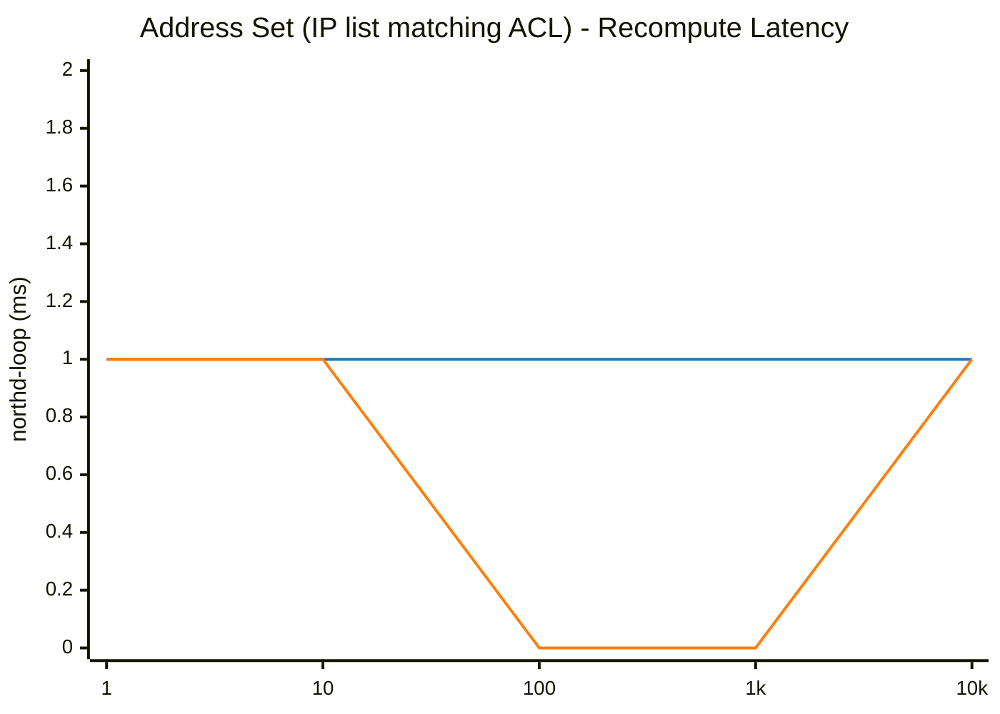

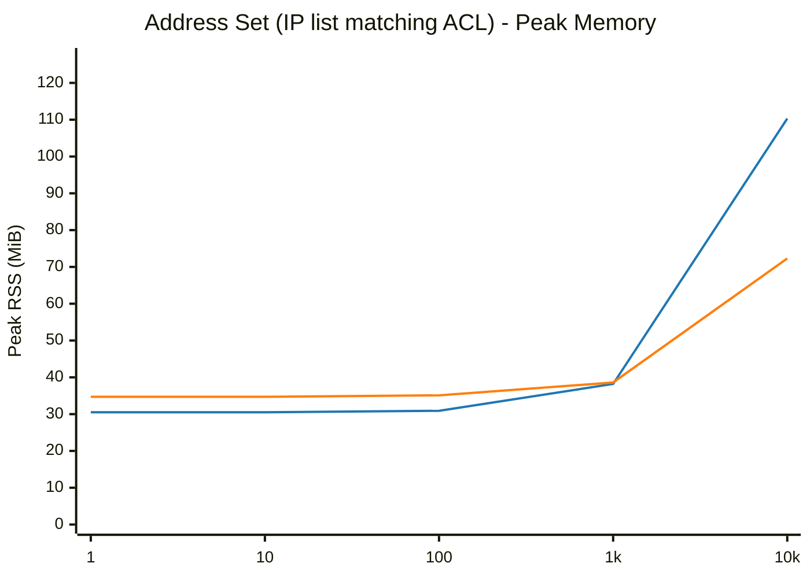

## Port Group (Ports member grouping matching ACL)

| Scale (N) | Phase / Metric | glibc malloc | jemalloc | Relative Difference |
|---|---|---|---|---|
| **1** | Total Pod Baseline Heap (RssAnon) | 27.53 MiB | 31.71 MiB | +15.2% |
| | Add Duration | 0.011 s | 0.012 s | +9.1% |
| | Add Rate | 91 ops/s | 83 ops/s | -9.2% |
| | Recompute (`ovn-northd-loop`) | 1.0 ms | 1.0 ms | ~Parity (<1ms) |
| | Logical Flow (`lflow`) | 1.0 ms | 0.0 ms | ~Parity (<1ms) |
| | Total Pod Peak Heap (RssAnon) | 29.30 MiB | 33.44 MiB | +14.1% |
| | Delete Duration | 0.007 s | 0.010 s | +42.9% |
| | Post-Delete Recompute | 1.0 ms | 1.0 ms | ~Parity (<1ms) |
| | Total Pod Post-Delete Heap (RssAnon) | 28.61 MiB | 33.18 MiB | +16.0% |
| | **Total Pod Retained Heap** | **+1.08 MiB** | **+1.47 MiB** | **+0.39 MiB** |
| | ├─ `ovn-northd` (Peak / Retained Heap) | 6.06 / +0.04 MiB | 6.97 / +0.01 MiB | +15.0% / -0.03 MiB |
| | ├─ `ovn-controller` (Peak / Retained Heap) | 4.34 / +0.99 MiB | 5.18 / +1.00 MiB | +19.4% / +0.01 MiB |
| | ├─ `ovs-vswitchd` (Peak / Retained Heap) | 12.16 / +0.39 MiB | 13.72 / +0.37 MiB | +12.8% / -0.02 MiB |
| | ├─ `ovsdb-server (SB)` (Peak / Retained Heap) | 2.64 / -0.12 MiB | 2.88 / +0.03 MiB | +9.1% / +0.15 MiB |
| | ├─ `ovsdb-server (NB)` (Peak / Retained Heap) | 2.10 / -0.13 MiB | 2.37 / -0.01 MiB | +12.9% / +0.12 MiB |
| | ├─ `ovsdb-server (OVS)` (Peak / Retained Heap) | 2.03 / -0.09 MiB | 2.41 / +0.07 MiB | +18.7% / +0.16 MiB |
|---|---|---|---|---|
| **10** | Total Pod Baseline Heap (RssAnon) | 27.52 MiB | 31.70 MiB | +15.2% |
| | Add Duration | 0.018 s | 0.019 s | +5.6% |
| | Add Rate | 545 ops/s | 527 ops/s | -3.3% |
| | Recompute (`ovn-northd-loop`) | 1.0 ms | 1.0 ms | ~Parity (<1ms) |
| | Logical Flow (`lflow`) | 0.0 ms | 1.0 ms | N/A |
| | Total Pod Peak Heap (RssAnon) | 30.97 MiB | 34.96 MiB | +12.9% |
| | Delete Duration | 0.010 s | 0.009 s | -10.0% |
| | Post-Delete Recompute | 1.0 ms | 1.0 ms | ~Parity (<1ms) |
| | Total Pod Post-Delete Heap (RssAnon) | 30.04 MiB | 34.63 MiB | +15.3% |
| | **Total Pod Retained Heap** | **+2.52 MiB** | **+2.93 MiB** | **+0.41 MiB** |
| | ├─ `ovn-northd` (Peak / Retained Heap) | 6.22 / +0.17 MiB | 7.27 / +0.34 MiB | +16.9% / +0.17 MiB |
| | ├─ `ovn-controller` (Peak / Retained Heap) | 5.27 / +1.57 MiB | 5.75 / +1.53 MiB | +9.1% / -0.04 MiB |
| | ├─ `ovs-vswitchd` (Peak / Retained Heap) | 12.58 / +0.81 MiB | 14.10 / +0.71 MiB | +12.1% / -0.10 MiB |
| | ├─ `ovsdb-server (SB)` (Peak / Retained Heap) | 2.78 / +0.00 MiB | 2.99 / +0.11 MiB | +7.6% / +0.11 MiB |
| | ├─ `ovsdb-server (NB)` (Peak / Retained Heap) | 2.06 / -0.06 MiB | 2.42 / +0.04 MiB | +17.5% / +0.10 MiB |
| | ├─ `ovsdb-server (OVS)` (Peak / Retained Heap) | 2.10 / +0.03 MiB | 2.53 / +0.20 MiB | +20.5% / +0.17 MiB |
|---|---|---|---|---|
| **100** | Total Pod Baseline Heap (RssAnon) | 27.52 MiB | 31.69 MiB | +15.2% |
| | Add Duration | 0.064 s | 0.068 s | +6.3% |
| | Add Rate | 1,556 ops/s | 1,474 ops/s | -5.3% |
| | Recompute (`ovn-northd-loop`) | 2.0 ms | 2.0 ms | ~Parity (±1%) |
| | Logical Flow (`lflow`) | 0.0 ms | 1.0 ms | N/A |
| | Total Pod Peak Heap (RssAnon) | 47.99 MiB | 48.53 MiB | +1.1% |
| | Delete Duration | 0.034 s | 0.033 s | -2.9% |
| | Post-Delete Recompute | 1.0 ms | 1.0 ms | ~Parity (<1ms) |
| | Total Pod Post-Delete Heap (RssAnon) | 40.28 MiB | 40.21 MiB | ~Parity (±1%) |
| | **Total Pod Retained Heap** | **+12.76 MiB** | **+8.52 MiB** | **-4.24 MiB** |
| | ├─ `ovn-northd` (Peak / Retained Heap) | 8.46 / +1.18 MiB | 9.00 / +1.12 MiB | +6.4% / -0.06 MiB |
| | ├─ `ovn-controller` (Peak / Retained Heap) | 10.47 / +4.26 MiB | 10.55 / +3.81 MiB | ~Parity (±1%) / -0.45 MiB |
| | ├─ `ovs-vswitchd` (Peak / Retained Heap) | 16.53 / +4.76 MiB | 17.75 / +2.25 MiB | +7.4% / -2.51 MiB |
| | ├─ `ovsdb-server (SB)` (Peak / Retained Heap) | 6.27 / +1.18 MiB | 4.82 / +0.55 MiB | -23.1% / -0.63 MiB |
| | ├─ `ovsdb-server (NB)` (Peak / Retained Heap) | 2.59 / +0.24 MiB | 2.78 / +0.27 MiB | +7.3% / +0.03 MiB |
| | ├─ `ovsdb-server (OVS)` (Peak / Retained Heap) | 4.00 / +1.14 MiB | 3.63 / +0.52 MiB | -9.3% / -0.62 MiB |
|---|---|---|---|---|
| **1000** | Total Pod Baseline Heap (RssAnon) | 27.54 MiB | 31.67 MiB | +15.0% |
| | Add Duration | 0.357 s | 0.351 s | -1.7% |
| | Add Rate | 2,800 ops/s | 2,851 ops/s | +1.8% |
| | Recompute (`ovn-northd-loop`) | 0.0 ms | 0.0 ms | N/A |
| | Logical Flow (`lflow`) | 6.0 ms | 4.0 ms | -33.3% |
| | Total Pod Peak Heap (RssAnon) | 114.21 MiB | 93.31 MiB | -18.3% |
| | Delete Duration | 0.193 s | 0.156 s | -19.2% |
| | Post-Delete Recompute | 1.0 ms | 0.0 ms | ~Parity (<1ms) |
| | Total Pod Post-Delete Heap (RssAnon) | 58.96 MiB | 39.53 MiB | -33.0% |
| | **Total Pod Retained Heap** | **+31.42 MiB** | **+7.86 MiB** | **-23.56 MiB** |
| | ├─ `ovn-northd` (Peak / Retained Heap) | 28.95 / +2.62 MiB | 24.90 / +2.70 MiB | -14.0% / +0.08 MiB |
| | ├─ `ovn-controller` (Peak / Retained Heap) | 9.34 / +4.58 MiB | 9.27 / +0.96 MiB | ~Parity (±1%) / -3.62 MiB |
| | ├─ `ovs-vswitchd` (Peak / Retained Heap) | 27.04 / +15.28 MiB | 21.23 / +1.92 MiB | -21.5% / -13.36 MiB |
| | ├─ `ovsdb-server (SB)` (Peak / Retained Heap) | 32.87 / +2.18 MiB | 20.52 / +1.18 MiB | -37.6% / -1.00 MiB |
| | ├─ `ovsdb-server (NB)` (Peak / Retained Heap) | 7.05 / +1.03 MiB | 5.09 / +0.70 MiB | -27.8% / -0.33 MiB |
| | ├─ `ovsdb-server (OVS)` (Peak / Retained Heap) | 16.20 / +5.73 MiB | 12.30 / +0.40 MiB | -24.1% / -5.33 MiB |
|---|---|---|---|---|
| **10000** | Total Pod Baseline Heap (RssAnon) | 27.55 MiB | 31.67 MiB | +15.0% |
| | Add Duration | 213.200 s | 143.085 s | -32.9% |
| | Add Rate | 46 ops/s | 69 ops/s | +49.0% |
| | Recompute (`ovn-northd-loop`) | 76.0 ms | 35.0 ms | -53.9% |
| | Logical Flow (`lflow`) | 131.0 ms | 122.0 ms | -6.9% |
| | Total Pod Peak Heap (RssAnon) | 1949.64 MiB | 1500.80 MiB | -23.0% |
| | Delete Duration | 152.832 s | 90.409 s | -40.8% |
| | Post-Delete Recompute | 1.0 ms | 1.0 ms | ~Parity (<1ms) |
| | Total Pod Post-Delete Heap (RssAnon) | 1059.44 MiB | 92.58 MiB | -91.3% |
| | **Total Pod Retained Heap** | **+1031.89 MiB** | **+60.91 MiB** | **-970.98 MiB** |
| | ├─ `ovn-northd` (Peak / Retained Heap) | 230.02 / +6.29 MiB | 188.65 / +6.76 MiB | -18.0% / +0.47 MiB |
| | ├─ `ovn-controller` (Peak / Retained Heap) | 675.12 / +508.09 MiB | 578.04 / +23.98 MiB | -14.4% / -484.11 MiB |
| | ├─ `ovs-vswitchd` (Peak / Retained Heap) | 518.79 / +507.02 MiB | 399.68 / +19.88 MiB | -23.0% / -487.14 MiB |
| | ├─ `ovsdb-server (SB)` (Peak / Retained Heap) | 341.29 / +4.52 MiB | 195.96 / +6.26 MiB | -42.6% / +1.74 MiB |
| | ├─ `ovsdb-server (NB)` (Peak / Retained Heap) | 52.52 / +2.01 MiB | 35.01 / +1.82 MiB | -33.3% / -0.19 MiB |
| | ├─ `ovsdb-server (OVS)` (Peak / Retained Heap) | 136.54 / +3.96 MiB | 103.46 / +2.21 MiB | -24.2% / -1.75 MiB |
|---|---|---|---|---|

### Visual Charts

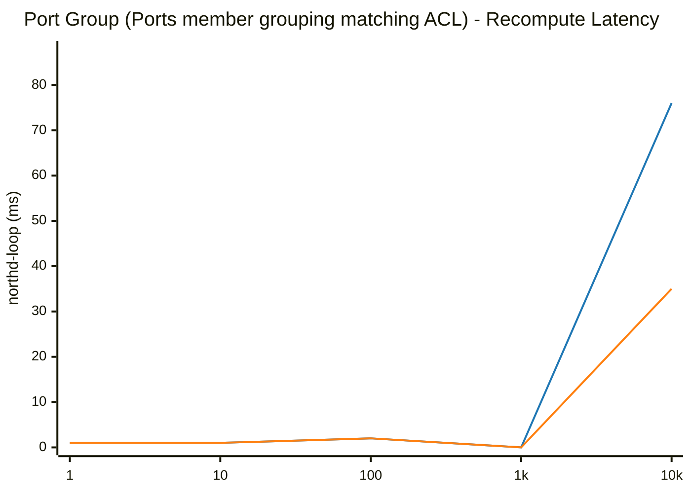

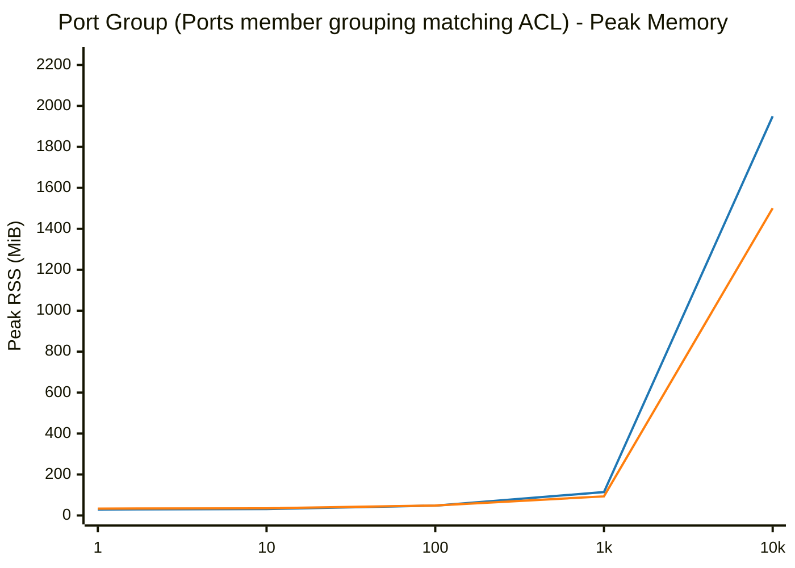

## Load Balancer (VIPs mapped to endpoints)

| Scale (N) | Phase / Metric | glibc malloc | jemalloc | Relative Difference |
|---|---|---|---|---|
| **1** | Total Pod Baseline Heap (RssAnon) | 30.14 MiB | 34.06 MiB | +13.0% |
| | Add Duration | 0.006 s | 0.005 s | -16.7% |
| | Add Rate | 170 ops/s | 186 ops/s | +9.5% |
| | Recompute (`ovn-northd-loop`) | 1.0 ms | 1.0 ms | ~Parity (<1ms) |
| | Logical Flow (`lflow`) | 1.0 ms | 0.0 ms | ~Parity (<1ms) |
| | Total Pod Peak Heap (RssAnon) | 30.36 MiB | 34.53 MiB | +13.7% |
| | Delete Duration | 0.005 s | 0.006 s | +20.0% |
| | Post-Delete Recompute | 0.0 ms | 0.0 ms | N/A |
| | Total Pod Post-Delete Heap (RssAnon) | 29.72 MiB | 34.37 MiB | +15.6% |
| | **Total Pod Retained Heap** | **-0.42 MiB** | **+0.31 MiB** | **+0.73 MiB** |
| | ├─ `ovn-northd` (Peak / Retained Heap) | 6.19 / +0.05 MiB | 7.19 / +0.06 MiB | +16.2% / +0.01 MiB |
| | ├─ `ovn-controller` (Peak / Retained Heap) | 4.85 / -0.42 MiB | 5.52 / +0.08 MiB | +13.8% / +0.50 MiB |
| | ├─ `ovs-vswitchd` (Peak / Retained Heap) | 12.45 / +0.06 MiB | 14.04 / +0.09 MiB | +12.8% / +0.03 MiB |
| | ├─ `ovsdb-server (SB)` (Peak / Retained Heap) | 2.71 / -0.02 MiB | 2.94 / +0.02 MiB | +8.5% / +0.04 MiB |
| | ├─ `ovsdb-server (NB)` (Peak / Retained Heap) | 2.10 / -0.08 MiB | 2.39 / -0.01 MiB | +13.8% / +0.07 MiB |
| | ├─ `ovsdb-server (OVS)` (Peak / Retained Heap) | 2.09 / -0.01 MiB | 2.54 / +0.07 MiB | +21.5% / +0.08 MiB |
|---|---|---|---|---|
| **10** | Total Pod Baseline Heap (RssAnon) | 30.13 MiB | 34.08 MiB | +13.1% |
| | Add Duration | 0.007 s | 0.007 s | ~Parity (±1%) |
| | Add Rate | 1,416 ops/s | 1,531 ops/s | +8.2% |
| | Recompute (`ovn-northd-loop`) | 1.0 ms | 1.0 ms | ~Parity (<1ms) |
| | Logical Flow (`lflow`) | 1.0 ms | 0.0 ms | ~Parity (<1ms) |
| | Total Pod Peak Heap (RssAnon) | 30.64 MiB | 34.81 MiB | +13.6% |
| | Delete Duration | 0.006 s | 0.004 s | -33.3% |
| | Post-Delete Recompute | 1.0 ms | 1.0 ms | ~Parity (<1ms) |
| | Total Pod Post-Delete Heap (RssAnon) | 30.02 MiB | 34.52 MiB | +15.0% |
| | **Total Pod Retained Heap** | **-0.11 MiB** | **+0.44 MiB** | **+0.55 MiB** |
| | ├─ `ovn-northd` (Peak / Retained Heap) | 6.28 / +0.13 MiB | 7.21 / +0.14 MiB | +14.8% / +0.01 MiB |
| | ├─ `ovn-controller` (Peak / Retained Heap) | 4.85 / -0.33 MiB | 5.65 / +0.14 MiB | +16.5% / +0.47 MiB |
| | ├─ `ovs-vswitchd` (Peak / Retained Heap) | 12.53 / +0.13 MiB | 14.09 / +0.14 MiB | +12.5% / +0.01 MiB |
| | ├─ `ovsdb-server (SB)` (Peak / Retained Heap) | 2.86 / +0.01 MiB | 3.00 / -0.02 MiB | +4.9% / -0.03 MiB |
| | ├─ `ovsdb-server (NB)` (Peak / Retained Heap) | 2.06 / -0.04 MiB | 2.40 / -0.02 MiB | +16.5% / +0.02 MiB |
| | ├─ `ovsdb-server (OVS)` (Peak / Retained Heap) | 2.09 / -0.01 MiB | 2.54 / +0.06 MiB | +21.5% / +0.07 MiB |
|---|---|---|---|---|
| **100** | Total Pod Baseline Heap (RssAnon) | 30.15 MiB | 34.10 MiB | +13.1% |
| | Add Duration | 0.021 s | 0.018 s | -14.3% |
| | Add Rate | 4,706 ops/s | 5,550 ops/s | +17.9% |
| | Recompute (`ovn-northd-loop`) | 1.0 ms | 1.0 ms | ~Parity (<1ms) |
| | Logical Flow (`lflow`) | 0.0 ms | 0.0 ms | N/A |
| | Total Pod Peak Heap (RssAnon) | 35.59 MiB | 38.57 MiB | +8.4% |
| | Delete Duration | 0.007 s | 0.007 s | ~Parity (±1%) |
| | Post-Delete Recompute | 0.0 ms | 1.0 ms | N/A |
| | Total Pod Post-Delete Heap (RssAnon) | 32.03 MiB | 36.11 MiB | +12.7% |
| | **Total Pod Retained Heap** | **+1.88 MiB** | **+2.01 MiB** | **+0.13 MiB** |
| | ├─ `ovn-northd` (Peak / Retained Heap) | 7.30 / +0.39 MiB | 7.89 / +0.37 MiB | +8.1% / -0.02 MiB |
| | ├─ `ovn-controller` (Peak / Retained Heap) | 6.52 / +0.15 MiB | 7.40 / +0.61 MiB | +13.5% / +0.46 MiB |
| | ├─ `ovs-vswitchd` (Peak / Retained Heap) | 13.48 / +1.09 MiB | 14.75 / +0.76 MiB | +9.4% / -0.33 MiB |
| | ├─ `ovsdb-server (SB)` (Peak / Retained Heap) | 4.17 / +0.34 MiB | 3.67 / +0.21 MiB | -12.0% / -0.13 MiB |
| | ├─ `ovsdb-server (NB)` (Peak / Retained Heap) | 2.10 / -0.09 MiB | 2.40 / -0.01 MiB | +14.3% / +0.08 MiB |
| | ├─ `ovsdb-server (OVS)` (Peak / Retained Heap) | 2.09 / +0.00 MiB | 2.53 / +0.07 MiB | +21.1% / +0.07 MiB |
|---|---|---|---|---|
| **1000** | Total Pod Baseline Heap (RssAnon) | 30.15 MiB | 34.06 MiB | +13.0% |
| | Add Duration | 0.124 s | 0.106 s | -14.5% |
| | Add Rate | 8,085 ops/s | 9,421 ops/s | +16.5% |
| | Recompute (`ovn-northd-loop`) | 1.0 ms | 0.0 ms | ~Parity (<1ms) |
| | Logical Flow (`lflow`) | 3.0 ms | 3.0 ms | ~Parity (±1%) |
| | Total Pod Peak Heap (RssAnon) | 79.39 MiB | 72.97 MiB | -8.1% |
| | Delete Duration | 0.060 s | 0.052 s | -13.3% |
| | Post-Delete Recompute | 1.0 ms | 1.0 ms | ~Parity (<1ms) |
| | Total Pod Post-Delete Heap (RssAnon) | 42.51 MiB | 39.78 MiB | -6.4% |
| | **Total Pod Retained Heap** | **+12.36 MiB** | **+5.72 MiB** | **-6.64 MiB** |
| | ├─ `ovn-northd` (Peak / Retained Heap) | 15.99 / +0.89 MiB | 14.02 / +1.32 MiB | -12.3% / +0.43 MiB |
| | ├─ `ovn-controller` (Peak / Retained Heap) | 23.47 / +1.02 MiB | 24.29 / +2.04 MiB | +3.5% / +1.02 MiB |
| | ├─ `ovs-vswitchd` (Peak / Retained Heap) | 21.70 / +9.30 MiB | 20.66 / +1.48 MiB | -4.8% / -7.82 MiB |
| | ├─ `ovsdb-server (SB)` (Peak / Retained Heap) | 14.29 / +1.23 MiB | 8.93 / +0.67 MiB | -37.5% / -0.56 MiB |
| | ├─ `ovsdb-server (NB)` (Peak / Retained Heap) | 2.22 / -0.07 MiB | 2.59 / +0.15 MiB | +16.7% / +0.22 MiB |
| | ├─ `ovsdb-server (OVS)` (Peak / Retained Heap) | 2.09 / -0.01 MiB | 2.54 / +0.06 MiB | +21.5% / +0.07 MiB |
|---|---|---|---|---|
| **10000** | Total Pod Baseline Heap (RssAnon) | 30.16 MiB | 34.08 MiB | +13.0% |
| | Add Duration | 1.419 s | 1.121 s | -21.0% |
| | Add Rate | 7,045 ops/s | 8,917 ops/s | +26.6% |
| | Recompute (`ovn-northd-loop`) | 0.0 ms | 0.0 ms | N/A |
| | Logical Flow (`lflow`) | 88.0 ms | 63.0 ms | -28.4% |
| | Total Pod Peak Heap (RssAnon) | 547.01 MiB | 385.57 MiB | -29.5% |
| | Delete Duration | 0.746 s | 0.541 s | -27.5% |
| | Post-Delete Recompute | 1.0 ms | 1.0 ms | ~Parity (<1ms) |
| | Total Pod Post-Delete Heap (RssAnon) | 117.29 MiB | 46.58 MiB | -60.3% |
| | **Total Pod Retained Heap** | **+87.13 MiB** | **+12.50 MiB** | **-74.63 MiB** |
| | ├─ `ovn-northd` (Peak / Retained Heap) | 111.15 / +1.13 MiB | 70.90 / +2.60 MiB | -36.2% / +1.47 MiB |
| | ├─ `ovn-controller` (Peak / Retained Heap) | 187.85 / +2.05 MiB | 183.38 / +5.54 MiB | -2.4% / +3.49 MiB |
| | ├─ `ovs-vswitchd` (Peak / Retained Heap) | 94.49 / +82.09 MiB | 66.42 / +1.84 MiB | -29.7% / -80.25 MiB |
| | ├─ `ovsdb-server (SB)` (Peak / Retained Heap) | 147.51 / +1.90 MiB | 58.52 / +2.24 MiB | -60.3% / +0.34 MiB |
| | ├─ `ovsdb-server (NB)` (Peak / Retained Heap) | 4.14 / -0.03 MiB | 3.88 / +0.21 MiB | -6.3% / +0.24 MiB |
| | ├─ `ovsdb-server (OVS)` (Peak / Retained Heap) | 2.09 / -0.01 MiB | 2.54 / +0.07 MiB | +21.5% / +0.08 MiB |
|---|---|---|---|---|

### Visual Charts

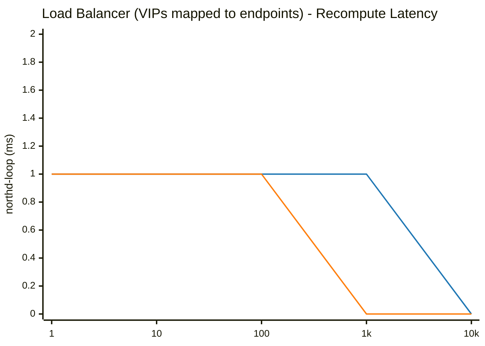

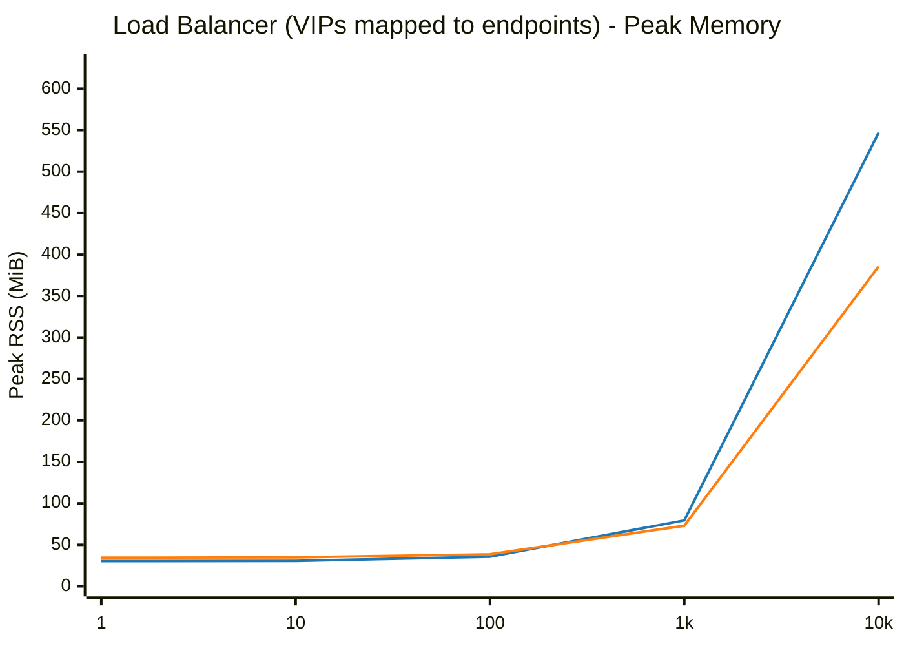

## OpenFlow Flows (OVS Control Plane)

| Scale (N) | Phase / Metric | glibc malloc | jemalloc | Relative Difference |
|---|---|---|---|---|
| **1** | Total Pod Baseline Heap (RssAnon) | 27.35 MiB | 31.46 MiB | +15.0% |
| | Add Duration | 0.005 s | 0.004 s | -20.0% |
| | Add Rate | 205 ops/s | 243 ops/s | +18.8% |
| | Total Pod Peak Heap (RssAnon) | 27.47 MiB | 31.60 MiB | +15.0% |
| | Delete Duration | 0.004 s | 0.003 s | -25.0% |
| | Total Pod Post-Delete Heap (RssAnon) | 26.88 MiB | 31.60 MiB | +17.6% |
| | **Total Pod Retained Heap** | **-0.47 MiB** | **+0.14 MiB** | **+0.61 MiB** |
| | ├─ `ovn-northd` (Peak / Retained Heap) | 5.92 / -0.10 MiB | 6.83 / +0.00 MiB | +15.4% / +0.10 MiB |
| | ├─ `ovn-controller` (Peak / Retained Heap) | 3.03 / +0.00 MiB | 3.89 / +0.00 MiB | +28.4% / +0.00 MiB |
| | ├─ `ovs-vswitchd` (Peak / Retained Heap) | 11.89 / +0.12 MiB | 13.44 / +0.08 MiB | +13.0% / -0.04 MiB |
| | ├─ `ovsdb-server (SB)` (Peak / Retained Heap) | 2.50 / -0.21 MiB | 2.66 / -0.02 MiB | +6.4% / +0.19 MiB |
| | ├─ `ovsdb-server (NB)` (Peak / Retained Heap) | 2.09 / -0.15 MiB | 2.39 / +0.01 MiB | +14.4% / +0.16 MiB |
| | ├─ `ovsdb-server (OVS)` (Peak / Retained Heap) | 2.04 / -0.13 MiB | 2.41 / +0.07 MiB | +18.1% / +0.20 MiB |
|---|---|---|---|---|
| **10** | Total Pod Baseline Heap (RssAnon) | 27.34 MiB | 31.46 MiB | +15.1% |
| | Add Duration | 0.005 s | 0.004 s | -20.0% |
| | Add Rate | 1,943 ops/s | 2,299 ops/s | +18.3% |
| | Total Pod Peak Heap (RssAnon) | 27.46 MiB | 31.61 MiB | +15.1% |
| | Delete Duration | 0.003 s | 0.003 s | ~Parity (±1%) |
| | Total Pod Post-Delete Heap (RssAnon) | 26.91 MiB | 31.61 MiB | +17.5% |
| | **Total Pod Retained Heap** | **-0.43 MiB** | **+0.15 MiB** | **+0.58 MiB** |
| | ├─ `ovn-northd` (Peak / Retained Heap) | 5.92 / -0.13 MiB | 6.81 / +0.00 MiB | +15.0% / +0.13 MiB |
| | ├─ `ovn-controller` (Peak / Retained Heap) | 3.03 / +0.00 MiB | 3.88 / +0.00 MiB | +28.1% / +0.00 MiB |
| | ├─ `ovs-vswitchd` (Peak / Retained Heap) | 11.92 / +0.15 MiB | 13.46 / +0.09 MiB | +12.9% / -0.06 MiB |
| | ├─ `ovsdb-server (SB)` (Peak / Retained Heap) | 2.50 / -0.18 MiB | 2.69 / -0.01 MiB | +7.6% / +0.17 MiB |
| | ├─ `ovsdb-server (NB)` (Peak / Retained Heap) | 2.09 / -0.15 MiB | 2.39 / +0.01 MiB | +14.4% / +0.16 MiB |
| | ├─ `ovsdb-server (OVS)` (Peak / Retained Heap) | 2.03 / -0.12 MiB | 2.39 / +0.06 MiB | +17.7% / +0.18 MiB |
|---|---|---|---|---|
| **100** | Total Pod Baseline Heap (RssAnon) | 27.46 MiB | 31.48 MiB | +14.6% |
| | Add Duration | 0.008 s | 0.008 s | ~Parity (±1%) |
| | Add Rate | 12,946 ops/s | 11,944 ops/s | -7.7% |
| | Total Pod Peak Heap (RssAnon) | 27.58 MiB | 31.71 MiB | +15.0% |
| | Delete Duration | 0.004 s | 0.003 s | -25.0% |
| | Total Pod Post-Delete Heap (RssAnon) | 26.97 MiB | 31.71 MiB | +17.6% |
| | **Total Pod Retained Heap** | **-0.49 MiB** | **+0.23 MiB** | **+0.72 MiB** |
| | ├─ `ovn-northd` (Peak / Retained Heap) | 5.92 / -0.12 MiB | 6.85 / +0.00 MiB | +15.7% / +0.12 MiB |
| | ├─ `ovn-controller` (Peak / Retained Heap) | 3.03 / +0.00 MiB | 3.89 / +0.00 MiB | +28.4% / +0.00 MiB |
| | ├─ `ovs-vswitchd` (Peak / Retained Heap) | 11.99 / +0.22 MiB | 13.52 / +0.16 MiB | +12.8% / -0.06 MiB |
| | ├─ `ovsdb-server (SB)` (Peak / Retained Heap) | 2.65 / -0.35 MiB | 2.68 / -0.01 MiB | +1.1% / +0.34 MiB |
| | ├─ `ovsdb-server (NB)` (Peak / Retained Heap) | 2.06 / -0.13 MiB | 2.39 / +0.02 MiB | +16.0% / +0.15 MiB |
| | ├─ `ovsdb-server (OVS)` (Peak / Retained Heap) | 2.03 / -0.11 MiB | 2.39 / +0.06 MiB | +17.7% / +0.17 MiB |
|---|---|---|---|---|
| **1000** | Total Pod Baseline Heap (RssAnon) | 27.38 MiB | 31.43 MiB | +14.8% |
| | Add Duration | 0.031 s | 0.033 s | +6.5% |
| | Add Rate | 32,387 ops/s | 30,479 ops/s | -5.9% |
| | Total Pod Peak Heap (RssAnon) | 28.12 MiB | 32.14 MiB | +14.3% |
| | Delete Duration | 0.003 s | 0.003 s | ~Parity (±1%) |
| | Total Pod Post-Delete Heap (RssAnon) | 27.71 MiB | 32.10 MiB | +15.8% |
| | **Total Pod Retained Heap** | **+0.33 MiB** | **+0.67 MiB** | **+0.34 MiB** |
| | ├─ `ovn-northd` (Peak / Retained Heap) | 5.92 / -0.10 MiB | 6.81 / +0.01 MiB | +15.0% / +0.11 MiB |
| | ├─ `ovn-controller` (Peak / Retained Heap) | 3.04 / +0.00 MiB | 3.89 / +0.00 MiB | +28.0% / +0.00 MiB |
| | ├─ `ovs-vswitchd` (Peak / Retained Heap) | 12.68 / +0.91 MiB | 14.07 / +0.61 MiB | +11.0% / -0.30 MiB |
| | ├─ `ovsdb-server (SB)` (Peak / Retained Heap) | 2.52 / -0.20 MiB | 2.67 / -0.02 MiB | +6.0% / +0.18 MiB |
| | ├─ `ovsdb-server (NB)` (Peak / Retained Heap) | 2.10 / -0.16 MiB | 2.39 / +0.02 MiB | +13.8% / +0.18 MiB |
| | ├─ `ovsdb-server (OVS)` (Peak / Retained Heap) | 2.03 / -0.12 MiB | 2.39 / +0.05 MiB | +17.7% / +0.17 MiB |
|---|---|---|---|---|
| **10000** | Total Pod Baseline Heap (RssAnon) | 27.47 MiB | 31.43 MiB | +14.4% |
| | Add Duration | 0.285 s | 0.280 s | -1.8% |
| | Add Rate | 35,049 ops/s | 35,761 ops/s | +2.0% |
| | Total Pod Peak Heap (RssAnon) | 35.04 MiB | 38.84 MiB | +10.8% |
| | Delete Duration | 0.006 s | 0.004 s | -33.3% |
| | Total Pod Post-Delete Heap (RssAnon) | 35.04 MiB | 32.47 MiB | -7.3% |
| | **Total Pod Retained Heap** | **+7.57 MiB** | **+1.04 MiB** | **-6.53 MiB** |
| | ├─ `ovn-northd` (Peak / Retained Heap) | 5.94 / -0.13 MiB | 6.80 / +0.00 MiB | +14.5% / +0.13 MiB |
| | ├─ `ovn-controller` (Peak / Retained Heap) | 3.04 / +0.00 MiB | 3.90 / +0.00 MiB | +28.3% / +0.00 MiB |
| | ├─ `ovs-vswitchd` (Peak / Retained Heap) | 20.05 / +8.28 MiB | 20.77 / +0.98 MiB | +3.6% / -7.30 MiB |
| | ├─ `ovsdb-server (SB)` (Peak / Retained Heap) | 2.62 / -0.32 MiB | 2.66 / -0.01 MiB | +1.5% / +0.31 MiB |
| | ├─ `ovsdb-server (NB)` (Peak / Retained Heap) | 2.06 / -0.13 MiB | 2.39 / +0.02 MiB | +16.0% / +0.15 MiB |
| | ├─ `ovsdb-server (OVS)` (Peak / Retained Heap) | 2.04 / -0.13 MiB | 2.39 / +0.05 MiB | +17.2% / +0.18 MiB |
|---|---|---|---|---|
| **100000** | Total Pod Baseline Heap (RssAnon) | 27.37 MiB | 31.45 MiB | +14.9% |
| | Add Duration | 2.929 s | 2.879 s | -1.7% |
| | Add Rate | 34,141 ops/s | 34,737 ops/s | +1.7% |
| | Total Pod Peak Heap (RssAnon) | 106.12 MiB | 102.90 MiB | -3.0% |
| | Delete Duration | 0.033 s | 0.027 s | -18.2% |
| | Total Pod Post-Delete Heap (RssAnon) | 106.12 MiB | 32.89 MiB | -69.0% |
| | **Total Pod Retained Heap** | **+78.75 MiB** | **+1.44 MiB** | **-77.31 MiB** |
| | ├─ `ovn-northd` (Peak / Retained Heap) | 5.92 / -0.13 MiB | 6.82 / +0.00 MiB | +15.2% / +0.13 MiB |
| | ├─ `ovn-controller` (Peak / Retained Heap) | 3.03 / +0.00 MiB | 3.89 / +0.00 MiB | +28.4% / +0.00 MiB |
| | ├─ `ovs-vswitchd` (Peak / Retained Heap) | 91.12 / +79.35 MiB | 84.80 / +1.37 MiB | -6.9% / -77.98 MiB |
| | ├─ `ovsdb-server (SB)` (Peak / Retained Heap) | 2.52 / -0.20 MiB | 2.68 / -0.01 MiB | +6.3% / +0.19 MiB |
| | ├─ `ovsdb-server (NB)` (Peak / Retained Heap) | 2.09 / -0.14 MiB | 2.39 / +0.02 MiB | +14.4% / +0.16 MiB |
| | ├─ `ovsdb-server (OVS)` (Peak / Retained Heap) | 2.04 / -0.13 MiB | 2.40 / +0.06 MiB | +17.6% / +0.19 MiB |
|---|---|---|---|---|

### Visual Charts

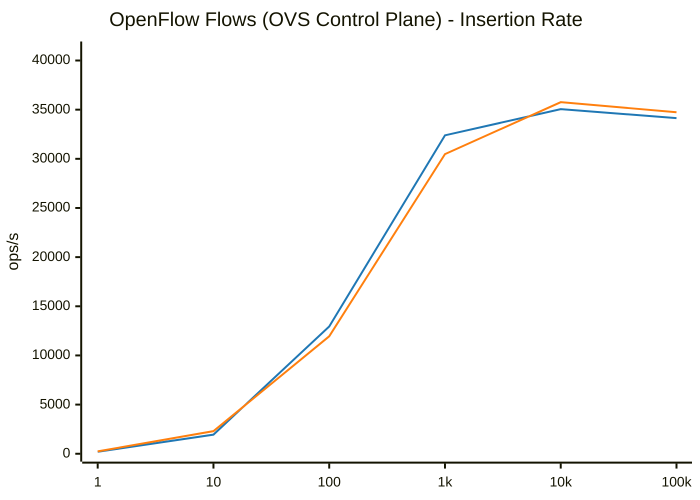

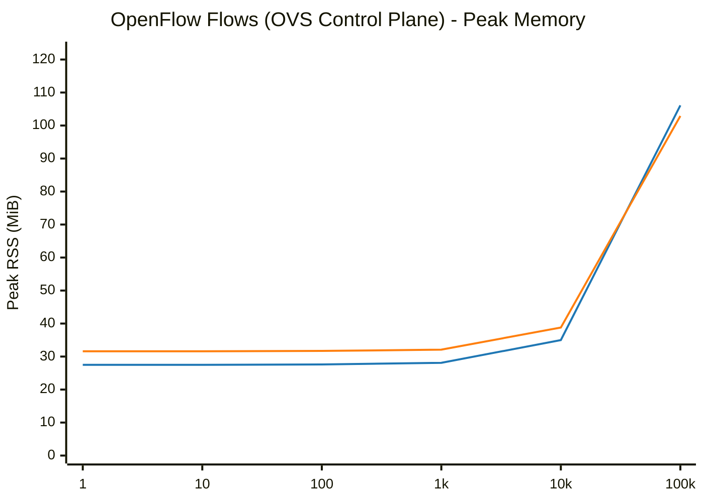

## Combined Workload (All objects scaled proportionally)

| Scale (N) | Phase / Metric | glibc malloc | jemalloc | Relative Difference |
|---|---|---|---|---|
| **1** | Total Pod Baseline Heap (RssAnon) | 27.39 MiB | 31.45 MiB | +14.8% |
| | Add Duration | 0.018 s | 0.014 s | -22.2% |
| | Add Rate | 55 ops/s | 70 ops/s | +26.8% |
| | Recompute (`ovn-northd-loop`) | 1.0 ms | 1.0 ms | ~Parity (<1ms) |
| | Logical Flow (`lflow`) | 0.0 ms | 1.0 ms | N/A |
| | Total Pod Peak Heap (RssAnon) | 31.28 MiB | 35.44 MiB | +13.3% |
| | Delete Duration | 0.010 s | 0.011 s | +10.0% |
| | Post-Delete Recompute | 0.0 ms | 1.0 ms | N/A |
| | Total Pod Post-Delete Heap (RssAnon) | 29.27 MiB | 33.64 MiB | +14.9% |
| | **Total Pod Retained Heap** | **+1.88 MiB** | **+2.19 MiB** | **+0.31 MiB** |
| | ├─ `ovn-northd` (Peak / Retained Heap) | 6.39 / +0.18 MiB | 7.35 / +0.44 MiB | +15.0% / +0.26 MiB |
| | ├─ `ovn-controller` (Peak / Retained Heap) | 5.27 / +0.98 MiB | 6.25 / +0.76 MiB | +18.6% / -0.22 MiB |
| | ├─ `ovs-vswitchd` (Peak / Retained Heap) | 12.62 / +0.85 MiB | 14.15 / +0.79 MiB | +12.1% / -0.06 MiB |
| | ├─ `ovsdb-server (SB)` (Peak / Retained Heap) | 3.11 / +0.09 MiB | 3.19 / +0.14 MiB | +2.6% / +0.05 MiB |
| | ├─ `ovsdb-server (NB)` (Peak / Retained Heap) | 2.10 / -0.13 MiB | 2.38 / +0.01 MiB | +13.3% / +0.14 MiB |
| | ├─ `ovsdb-server (OVS)` (Peak / Retained Heap) | 2.04 / -0.09 MiB | 2.39 / +0.05 MiB | +17.2% / +0.14 MiB |
|---|---|---|---|---|
| **10** | Total Pod Baseline Heap (RssAnon) | 27.48 MiB | 31.45 MiB | +14.4% |
| | Add Duration | 0.024 s | 0.019 s | -20.8% |
| | Add Rate | 424 ops/s | 517 ops/s | +22.1% |
| | Recompute (`ovn-northd-loop`) | 1.0 ms | 1.0 ms | ~Parity (<1ms) |
| | Logical Flow (`lflow`) | 0.0 ms | 1.0 ms | N/A |
| | Total Pod Peak Heap (RssAnon) | 33.03 MiB | 37.24 MiB | +12.7% |
| | Delete Duration | 0.013 s | 0.012 s | -7.7% |
| | Post-Delete Recompute | 1.0 ms | 1.0 ms | ~Parity (<1ms) |
| | Total Pod Post-Delete Heap (RssAnon) | 30.52 MiB | 34.60 MiB | +13.4% |
| | **Total Pod Retained Heap** | **+3.04 MiB** | **+3.15 MiB** | **+0.11 MiB** |
| | ├─ `ovn-northd` (Peak / Retained Heap) | 6.69 / +0.35 MiB | 7.69 / +0.58 MiB | +14.9% / +0.23 MiB |
| | ├─ `ovn-controller` (Peak / Retained Heap) | 5.95 / +1.41 MiB | 6.95 / +0.99 MiB | +16.8% / -0.42 MiB |
| | ├─ `ovs-vswitchd` (Peak / Retained Heap) | 12.91 / +1.14 MiB | 14.45 / +1.11 MiB | +11.9% / -0.03 MiB |
| | ├─ `ovsdb-server (SB)` (Peak / Retained Heap) | 3.53 / +0.13 MiB | 3.40 / +0.23 MiB | -3.7% / +0.10 MiB |
| | ├─ `ovsdb-server (NB)` (Peak / Retained Heap) | 2.06 / -0.03 MiB | 2.44 / +0.06 MiB | +18.4% / +0.09 MiB |
| | ├─ `ovsdb-server (OVS)` (Peak / Retained Heap) | 2.10 / +0.04 MiB | 2.52 / +0.18 MiB | +20.0% / +0.14 MiB |
|---|---|---|---|---|
| **100** | Total Pod Baseline Heap (RssAnon) | 27.32 MiB | 31.44 MiB | +15.1% |
| | Add Duration | 0.080 s | 0.073 s | -8.8% |
| | Add Rate | 1,254 ops/s | 1,369 ops/s | +9.1% |
| | Recompute (`ovn-northd-loop`) | 0.0 ms | 2.0 ms | N/A |
| | Logical Flow (`lflow`) | 1.0 ms | 1.0 ms | ~Parity (<1ms) |
| | Total Pod Peak Heap (RssAnon) | 52.23 MiB | 53.48 MiB | +2.4% |
| | Delete Duration | 0.035 s | 0.042 s | +20.0% |
| | Post-Delete Recompute | 1.0 ms | 0.0 ms | ~Parity (<1ms) |
| | Total Pod Post-Delete Heap (RssAnon) | 38.91 MiB | 39.57 MiB | +1.7% |
| | **Total Pod Retained Heap** | **+11.59 MiB** | **+8.13 MiB** | **-3.46 MiB** |
| | ├─ `ovn-northd` (Peak / Retained Heap) | 9.36 / +1.05 MiB | 9.98 / +1.09 MiB | +6.6% / +0.04 MiB |
| | ├─ `ovn-controller` (Peak / Retained Heap) | 12.38 / +3.36 MiB | 13.11 / +2.93 MiB | +5.9% / -0.43 MiB |
| | ├─ `ovs-vswitchd` (Peak / Retained Heap) | 16.79 / +5.02 MiB | 18.15 / +2.91 MiB | +8.1% / -2.11 MiB |
| | ├─ `ovsdb-server (SB)` (Peak / Retained Heap) | 7.29 / +0.63 MiB | 5.66 / +0.29 MiB | -22.4% / -0.34 MiB |
| | ├─ `ovsdb-server (NB)` (Peak / Retained Heap) | 2.79 / +0.46 MiB | 2.94 / +0.36 MiB | +5.4% / -0.10 MiB |
| | ├─ `ovsdb-server (OVS)` (Peak / Retained Heap) | 4.00 / +1.07 MiB | 3.64 / +0.55 MiB | -9.0% / -0.52 MiB |
|---|---|---|---|---|
| **1000** | Total Pod Baseline Heap (RssAnon) | 27.35 MiB | 31.42 MiB | +14.9% |
| | Add Duration | 0.433 s | 0.416 s | -3.9% |
| | Add Rate | 2,311 ops/s | 2,402 ops/s | +3.9% |
| | Recompute (`ovn-northd-loop`) | 0.0 ms | 0.0 ms | N/A |
| | Logical Flow (`lflow`) | 9.0 ms | 9.0 ms | ~Parity (±1%) |
| | Total Pod Peak Heap (RssAnon) | 123.74 MiB | 110.84 MiB | -10.4% |
| | Delete Duration | 0.270 s | 0.213 s | -21.1% |
| | Post-Delete Recompute | 1.0 ms | 1.0 ms | ~Parity (<1ms) |
| | Total Pod Post-Delete Heap (RssAnon) | 64.38 MiB | 38.70 MiB | -39.9% |
| | **Total Pod Retained Heap** | **+37.03 MiB** | **+7.28 MiB** | **-29.75 MiB** |
| | ├─ `ovn-northd` (Peak / Retained Heap) | 36.51 / +3.13 MiB | 33.20 / +2.51 MiB | -9.1% / -0.62 MiB |
| | ├─ `ovn-controller` (Peak / Retained Heap) | 9.25 / +4.71 MiB | 9.18 / +0.80 MiB | ~Parity (±1%) / -3.91 MiB |
| | ├─ `ovs-vswitchd` (Peak / Retained Heap) | 27.04 / +15.27 MiB | 23.32 / +1.93 MiB | -13.8% / -13.34 MiB |
| | ├─ `ovsdb-server (SB)` (Peak / Retained Heap) | 31.79 / +1.23 MiB | 26.52 / +0.91 MiB | -16.6% / -0.32 MiB |
| | ├─ `ovsdb-server (NB)` (Peak / Retained Heap) | 7.22 / +1.11 MiB | 6.30 / +0.74 MiB | -12.7% / -0.37 MiB |
| | ├─ `ovsdb-server (OVS)` (Peak / Retained Heap) | 16.20 / +11.58 MiB | 12.32 / +0.39 MiB | -24.0% / -11.19 MiB |
|---|---|---|---|---|
| **10000** | Total Pod Baseline Heap (RssAnon) | 27.36 MiB | 31.49 MiB | +15.1% |
| | Add Duration | 211.438 s | 153.396 s | -27.5% |
| | Add Rate | 47 ops/s | 65 ops/s | +37.8% |
| | Recompute (`ovn-northd-loop`) | 60.0 ms | 26.0 ms | -56.7% |
| | Logical Flow (`lflow`) | 119.0 ms | 102.0 ms | -14.3% |
| | Total Pod Peak Heap (RssAnon) | 2246.03 MiB | 1868.17 MiB | -16.8% |
| | Delete Duration | 149.018 s | 89.321 s | -40.1% |
| | Post-Delete Recompute | 1.0 ms | 1.0 ms | ~Parity (<1ms) |
| | Total Pod Post-Delete Heap (RssAnon) | 1236.54 MiB | 92.79 MiB | -92.5% |
| | **Total Pod Retained Heap** | **+1209.18 MiB** | **+61.30 MiB** | **-1147.88 MiB** |
| | ├─ `ovn-northd` (Peak / Retained Heap) | 309.78 / +7.19 MiB | 255.04 / +8.13 MiB | -17.7% / +0.94 MiB |
| | ├─ `ovn-controller` (Peak / Retained Heap) | 847.84 / +620.46 MiB | 776.75 / +22.51 MiB | -8.4% / -597.95 MiB |
| | ├─ `ovs-vswitchd` (Peak / Retained Heap) | 582.34 / +570.58 MiB | 459.45 / +19.22 MiB | -21.1% / -551.36 MiB |
| | ├─ `ovsdb-server (SB)` (Peak / Retained Heap) | 312.54 / +3.73 MiB | 224.69 / +7.70 MiB | -28.1% / +3.97 MiB |
| | ├─ `ovsdb-server (NB)` (Peak / Retained Heap) | 71.35 / +3.13 MiB | 42.61 / +1.51 MiB | -40.3% / -1.62 MiB |
| | ├─ `ovsdb-server (OVS)` (Peak / Retained Heap) | 140.95 / +4.09 MiB | 109.63 / +2.23 MiB | -22.2% / -1.86 MiB |
|---|---|---|---|---|

### Visual Charts

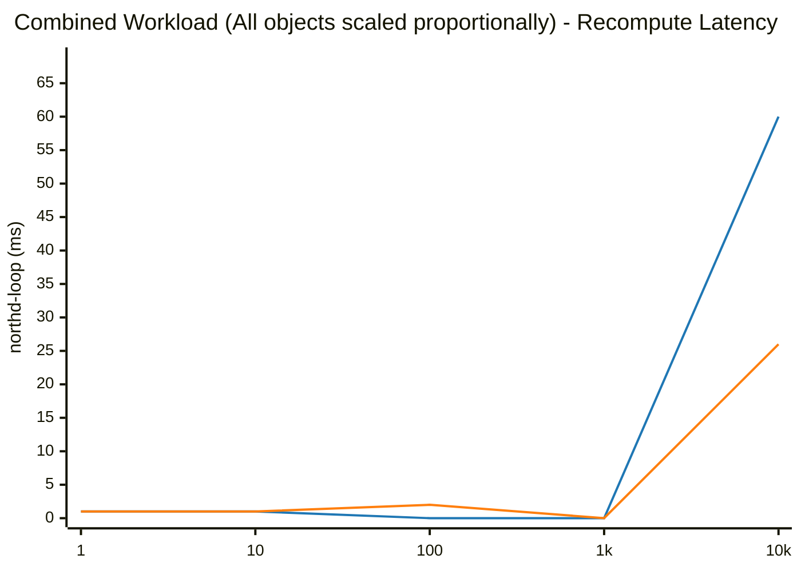

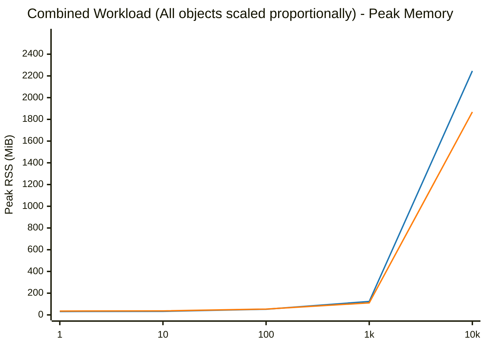

