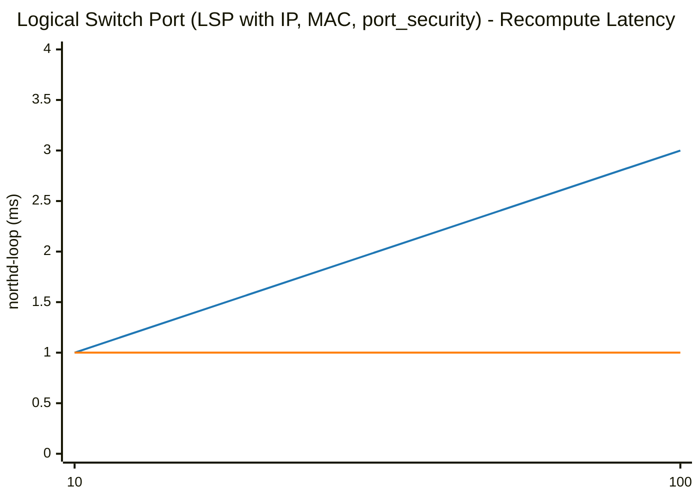
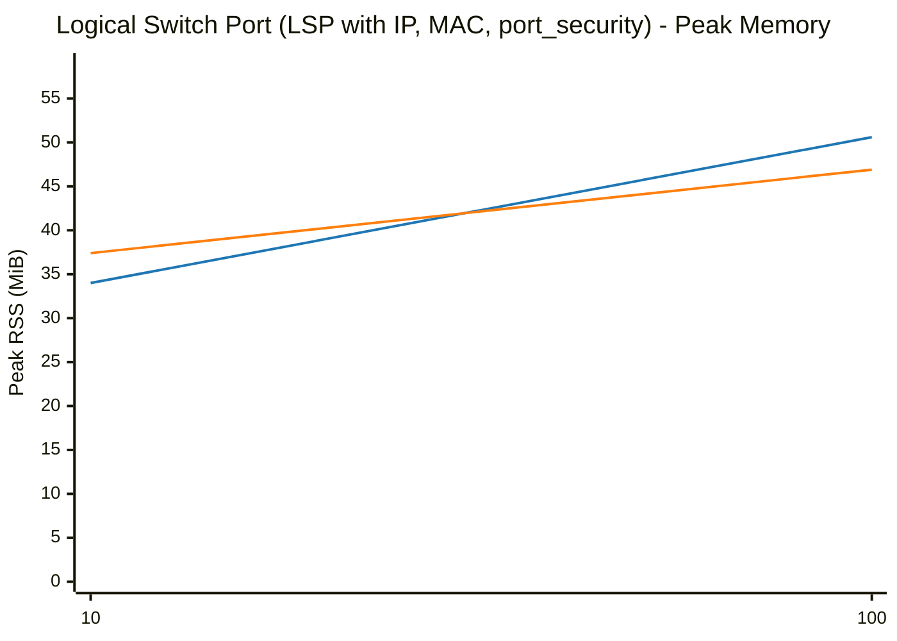
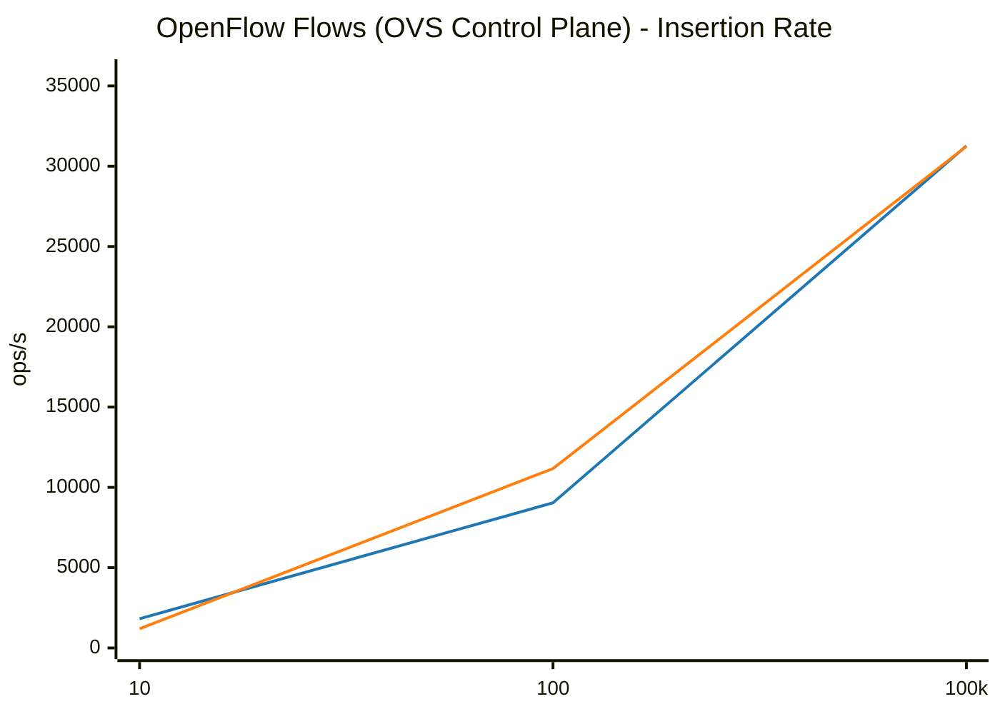
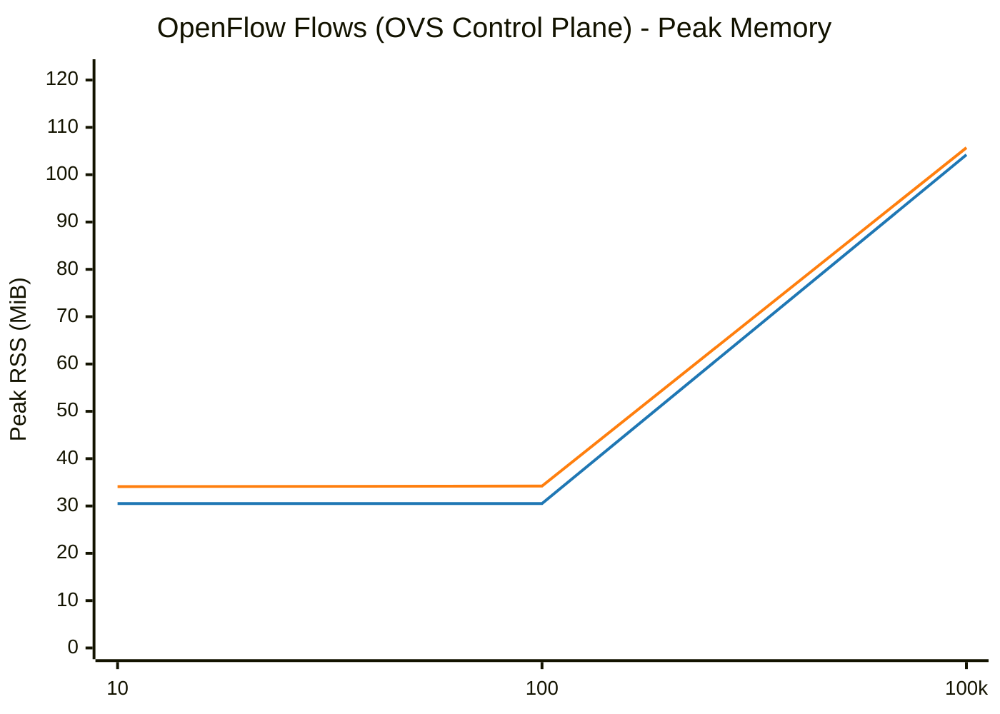

# OVS & OVN Scaling Benchmark: glibc malloc vs jemalloc

**Date:** 2026-10-13 22:25:09
**System:** Linux
**CPU:** Intel(R) Core(TM) Ultra 7 165H (22 vCPUs)
**Memory:** 62Gi
**Glibc Version:** ldd (GNU libc) 2.43
**Jemalloc Version:** 5.3.0

---

## Methodology

Each benchmark evaluates individual OVN/OVS objects, OpenFlow rule scaling, or combined workloads across powers of 10 (`1, 10, 100, 1,000, 10,000, 100,000`) through 3 lifecycle phases measuring the full OVN-Kubernetes pod stack (`ovn-northd`, `ovn-controller`, `ovs-vswitchd`, and `ovsdb-servers`):
1. **Baseline (Idle)**: Total Pod and per-daemon clean process RSS before creating objects.
2. **After Add (N)**: Time taken to commit $N$ objects via native OVSDB JSON-RPC, full recompute latency (`ovn-northd-loop` stopwatch), and Total Pod peak RSS (`VmHWM`) with per-daemon breakdown.
3. **After Remove (N)**: Time taken to delete all $N$ objects via native OVSDB JSON-RPC, post-deletion recompute latency, and retained heap memory (`Post-Deletion RSS - Baseline RSS`) measured after a wait period allowing page decay (`dirty_decay_ms:0,muzzy_decay_ms:0`).

---

## Logical Switch Port (LSP with IP, MAC, port_security)

| Scale (N) | Phase / Metric | glibc malloc | jemalloc | Relative Difference |
|---|---|---|---|---|
| **10** | Total Pod Baseline RSS | 31.36 MiB | 34.88 MiB | +11.2% |
| | Add Duration | 0.006 s | 0.008 s | +33.3% |
| | Add Rate | 1,608 ops/s | 1,274 ops/s | -20.8% |
| | Recompute (`ovn-northd-loop`) | 1.0 ms | 1.0 ms | ~Parity (±1%) |
| | Logical Flow (`lflow`) | 0.0 ms | 0.0 ms | N/A |
| | Total Pod Peak RSS (`VmHWM`) | 33.97 MiB | 37.41 MiB | +10.1% |
| | Delete Duration | 0.012 s | 0.010 s | -16.7% |
| | Post-Delete Recompute | 1.0 ms | 1.0 ms | ~Parity (±1%) |
| | Total Pod Post-Delete RSS | 33.59 MiB | 37.39 MiB | +11.3% |
| | **Total Pod Retained Heap** | **+2.23 MiB** | **+2.51 MiB** | **+0.28 MiB** |
| | ├─ `ovn-northd` (Peak / Retained) | 6.72 / +0.07 MiB | 7.69 / +0.23 MiB | +14.4% / +0.16 MiB |
| | ├─ `ovn-controller` (Peak / Retained) | 5.42 / +1.38 MiB | 5.75 / +1.43 MiB | +6.1% / +0.05 MiB |
| | ├─ `ovs-vswitchd` (Peak / Retained) | 12.85 / +0.69 MiB | 14.36 / +0.62 MiB | +11.8% / -0.07 MiB |
| | ├─ `ovsdb-server (SB)` (Peak / Retained) | 3.39 / +0.01 MiB | 3.61 / +0.08 MiB | +6.5% / +0.07 MiB |
| | ├─ `ovsdb-server (NB)` (Peak / Retained) | 2.79 / +0.01 MiB | 2.96 / +0.02 MiB | +6.1% / +0.01 MiB |
| | ├─ `ovsdb-server (OVS)` (Peak / Retained) | 2.80 / +0.07 MiB | 3.04 / +0.13 MiB | +8.6% / +0.06 MiB |
|---|---|---|---|---|
| **100** | Total Pod Baseline RSS | 31.33 MiB | 34.88 MiB | +11.3% |
| | Add Duration | 0.019 s | 0.019 s | ~Parity (±1%) |
| | Add Rate | 5,319 ops/s | 5,216 ops/s | -1.9% |
| | Recompute (`ovn-northd-loop`) | 3.0 ms | 1.0 ms | -66.7% |
| | Logical Flow (`lflow`) | 0.0 ms | 0.0 ms | N/A |
| | Total Pod Peak RSS (`VmHWM`) | 50.60 MiB | 46.86 MiB | -7.4% |
| | Delete Duration | 0.021 s | 0.021 s | ~Parity (±1%) |
| | Post-Delete Recompute | 1.0 ms | 1.0 ms | ~Parity (±1%) |
| | Total Pod Post-Delete RSS | 47.18 MiB | 42.12 MiB | -10.7% |
| | **Total Pod Retained Heap** | **+15.85 MiB** | **+7.24 MiB** | **-8.61 MiB** |
| | ├─ `ovn-northd` (Peak / Retained) | 9.06 / +0.82 MiB | 9.48 / +0.61 MiB | +4.6% / -0.21 MiB |
| | ├─ `ovn-controller` (Peak / Retained) | 10.61 / +4.24 MiB | 7.88 / +3.34 MiB | -25.7% / -0.90 MiB |
| | ├─ `ovs-vswitchd` (Peak / Retained) | 15.79 / +4.55 MiB | 15.83 / +1.82 MiB | ~Parity (±1%) / -2.73 MiB |
| | ├─ `ovsdb-server (SB)` (Peak / Retained) | 7.23 / +3.86 MiB | 6.11 / +0.56 MiB | -15.5% / -3.30 MiB |
| | ├─ `ovsdb-server (NB)` (Peak / Retained) | 3.21 / +0.42 MiB | 3.41 / +0.29 MiB | +6.2% / -0.13 MiB |
| | ├─ `ovsdb-server (OVS)` (Peak / Retained) | 4.70 / +1.96 MiB | 4.15 / +0.62 MiB | -11.7% / -1.34 MiB |
|---|---|---|---|---|

### Visual Charts

## OpenFlow Flows (OVS Control Plane)

| Scale (N) | Phase / Metric | glibc malloc | jemalloc | Relative Difference |
|---|---|---|---|---|
| **10** | Total Pod Baseline RSS | 30.38 MiB | 34.01 MiB | +11.9% |
| | Add Duration | 0.005 s | 0.008 s | +60.0% |
| | Add Rate | 1,818 ops/s | 1,191 ops/s | -34.5% |
| | Total Pod Peak RSS (`VmHWM`) | 30.50 MiB | 34.11 MiB | +11.8% |
| | Delete Duration | 0.005 s | 0.004 s | -20.0% |
| | Total Pod Post-Delete RSS | 30.55 MiB | 34.15 MiB | +11.8% |
| | **Total Pod Retained Heap** | **+0.17 MiB** | **+0.14 MiB** | **-0.03 MiB** |
| | ├─ `ovn-northd` (Peak / Retained) | 6.25 / -0.01 MiB | 7.13 / +0.01 MiB | +14.1% / +0.02 MiB |
| | ├─ `ovn-controller` (Peak / Retained) | 3.61 / +0.01 MiB | 4.34 / +0.01 MiB | +20.2% / +0.00 MiB |
| | ├─ `ovs-vswitchd` (Peak / Retained) | 12.35 / +0.15 MiB | 13.79 / +0.12 MiB | +11.7% / -0.03 MiB |
| | ├─ `ovsdb-server (SB)` (Peak / Retained) | 2.76 / +0.00 MiB | 3.00 / +0.00 MiB | +8.7% / +0.00 MiB |
| | ├─ `ovsdb-server (NB)` (Peak / Retained) | 2.79 / +0.01 MiB | 2.92 / +0.00 MiB | +4.7% / -0.01 MiB |
| | ├─ `ovsdb-server (OVS)` (Peak / Retained) | 2.74 / +0.01 MiB | 2.93 / +0.00 MiB | +6.9% / -0.01 MiB |
|---|---|---|---|---|
| **100** | Total Pod Baseline RSS | 30.27 MiB | 33.85 MiB | +11.8% |
| | Add Duration | 0.011 s | 0.009 s | -18.2% |
| | Add Rate | 9,037 ops/s | 11,170 ops/s | +23.6% |
| | Total Pod Peak RSS (`VmHWM`) | 30.49 MiB | 34.19 MiB | +12.1% |
| | Delete Duration | 0.005 s | 0.005 s | ~Parity (±1%) |
| | Total Pod Post-Delete RSS | 30.63 MiB | 34.26 MiB | +11.9% |
| | **Total Pod Retained Heap** | **+0.36 MiB** | **+0.41 MiB** | **+0.05 MiB** |
| | ├─ `ovn-northd` (Peak / Retained) | 6.25 / -0.01 MiB | 7.13 / +0.01 MiB | +14.1% / +0.02 MiB |
| | ├─ `ovn-controller` (Peak / Retained) | 3.61 / +0.07 MiB | 4.34 / +0.10 MiB | +20.2% / +0.03 MiB |
| | ├─ `ovs-vswitchd` (Peak / Retained) | 12.34 / +0.27 MiB | 13.87 / +0.28 MiB | +12.4% / +0.01 MiB |
| | ├─ `ovsdb-server (SB)` (Peak / Retained) | 2.76 / +0.01 MiB | 3.01 / +0.01 MiB | +9.1% / +0.00 MiB |
| | ├─ `ovsdb-server (NB)` (Peak / Retained) | 2.79 / +0.01 MiB | 2.92 / +0.00 MiB | +4.7% / -0.01 MiB |
| | ├─ `ovsdb-server (OVS)` (Peak / Retained) | 2.74 / +0.01 MiB | 2.92 / +0.01 MiB | +6.6% / +0.00 MiB |
|---|---|---|---|---|
| **100000** | Total Pod Baseline RSS | 30.39 MiB | 34.03 MiB | +12.0% |
| | Add Duration | 3.198 s | 3.201 s | ~Parity (±1%) |
| | Add Rate | 31,265 ops/s | 31,236 ops/s | ~Parity (±1%) |
| | Total Pod Peak RSS (`VmHWM`) | 104.20 MiB | 105.70 MiB | +1.4% |
| | Delete Duration | 0.032 s | 0.030 s | -6.3% |
| | Total Pod Post-Delete RSS | 109.76 MiB | 35.74 MiB | -67.4% |
| | **Total Pod Retained Heap** | **+79.37 MiB** | **+1.71 MiB** | **-77.66 MiB** |
| | ├─ `ovn-northd` (Peak / Retained) | 6.25 / +0.00 MiB | 7.15 / +0.01 MiB | +14.4% / +0.01 MiB |
| | ├─ `ovn-controller` (Peak / Retained) | 3.63 / +0.01 MiB | 4.35 / +0.01 MiB | +19.8% / +0.00 MiB |
| | ├─ `ovs-vswitchd` (Peak / Retained) | 86.00 / +79.34 MiB | 85.34 / +1.67 MiB | ~Parity (±1%) / -77.67 MiB |
| | ├─ `ovsdb-server (SB)` (Peak / Retained) | 2.77 / +0.01 MiB | 3.01 / +0.01 MiB | +8.7% / +0.00 MiB |
| | ├─ `ovsdb-server (NB)` (Peak / Retained) | 2.80 / +0.00 MiB | 2.92 / +0.00 MiB | +4.3% / +0.00 MiB |
| | ├─ `ovsdb-server (OVS)` (Peak / Retained) | 2.75 / +0.01 MiB | 2.93 / +0.01 MiB | +6.5% / +0.00 MiB |
|---|---|---|---|---|

### Visual Charts

