# OVS & OVN Scaling Benchmark: glibc malloc vs jemalloc

**Date:** 2026-10-13 19:52:46
**System:** Linux
**CPU:** Intel(R) Core(TM) Ultra 7 165H (22 vCPUs)
**Memory:** 62Gi
**Glibc Version:** ldd (GNU libc) 2.43
**Jemalloc Version:** 5.3.0

---

## Methodology

Each benchmark evaluates individual OVN/OVS objects, dataplane forwarding, or combined workloads across powers of 10 (`1, 10, 100, 1,000, 10,000, 100,000`) through 3 lifecycle phases using **native libovsdb** for database transactions:
1. **Baseline (Idle)**: Clean process RSS before creating objects.
2. **After Add (N)**: Time taken to commit $N$ objects via native OVSDB JSON-RPC, full recompute latency (`ovn-northd-loop` stopwatch), and peak RSS (`VmHWM`).
3. **After Remove (N)**: Time taken to delete all $N$ objects via native OVSDB JSON-RPC, post-deletion recompute latency, and retained heap memory (`Post-Deletion RSS - Baseline RSS`) measured after a wait period allowing page decay (`dirty_decay_ms:0,muzzy_decay_ms:0`).

---

## Logical Switch Port (LSP with IP, MAC, port_security)

| Scale (N) | Phase / Metric | glibc malloc | jemalloc | Relative Difference |
|---|---|---|---|---|
| **1** | Baseline RSS | 10.66 MiB | 12.37 MiB | +16.0% |
| | Add Duration | 0.003 s | 0.004 s | +33.3% |
| | Add Rate | 305 ops/s | 245 ops/s | -19.7% |
| | Recompute (`ovn-northd-loop`) | 1.0 ms | 1.0 ms | ~Parity (±1%) |
| | Logical Flow (`lflow`) | 1.0 ms | 1.0 ms | ~Parity (±1%) |
| | Peak RSS (`VmHWM`) | 10.67 MiB | 12.40 MiB | +16.2% |
| | Delete Duration | 0.003 s | 0.003 s | ~Parity (±1%) |
| | Post-Delete Recompute | 4.8 ms | 4.4 ms | -9.6% |
| | Post-Delete RSS | 10.67 MiB | 12.41 MiB | +16.3% |
| | **Retained Heap vs Baseline** | **+0.01 MiB** | **+0.04 MiB** | **+0.03 MiB** |
|---|---|---|---|---|
| **10** | Baseline RSS | 10.73 MiB | 12.31 MiB | +14.7% |
| | Add Duration | 0.005 s | 0.004 s | -20.0% |
| | Add Rate | 2,209 ops/s | 2,421 ops/s | +9.6% |
| | Recompute (`ovn-northd-loop`) | 1.0 ms | 1.0 ms | ~Parity (±1%) |
| | Logical Flow (`lflow`) | 0.0 ms | 1.0 ms | N/A |
| | Peak RSS (`VmHWM`) | 10.95 MiB | 12.68 MiB | +15.8% |
| | Delete Duration | 0.003 s | 0.003 s | ~Parity (±1%) |
| | Post-Delete Recompute | 4.4 ms | 1.0 ms | -77.5% |
| | Post-Delete RSS | 10.95 MiB | 12.62 MiB | +15.3% |
| | **Retained Heap vs Baseline** | **+0.22 MiB** | **+0.31 MiB** | **+0.09 MiB** |
|---|---|---|---|---|
| **100** | Baseline RSS | 10.56 MiB | 12.35 MiB | +17.0% |
| | Add Duration | 0.020 s | 0.021 s | +5.0% |
| | Add Rate | 4,895 ops/s | 4,662 ops/s | -4.8% |
| | Recompute (`ovn-northd-loop`) | 2.0 ms | 2.0 ms | ~Parity (±1%) |
| | Logical Flow (`lflow`) | 1.0 ms | 1.0 ms | ~Parity (±1%) |
| | Peak RSS (`VmHWM`) | 13.46 MiB | 14.65 MiB | +8.8% |
| | Delete Duration | 0.007 s | 0.006 s | -14.3% |
| | Post-Delete Recompute | 1.0 ms | 1.0 ms | ~Parity (±1%) |
| | Post-Delete RSS | 13.46 MiB | 13.29 MiB | -1.3% |
| | **Retained Heap vs Baseline** | **+2.90 MiB** | **+0.94 MiB** | **-1.96 MiB** |
|---|---|---|---|---|
| **1000** | Baseline RSS | 10.52 MiB | 12.18 MiB | +15.8% |
| | Add Duration | 0.199 s | 0.181 s | -9.0% |
| | Add Rate | 5,034 ops/s | 5,515 ops/s | +9.6% |
| | Recompute (`ovn-northd-loop`) | 14.0 ms | 9.0 ms | -35.7% |
| | Logical Flow (`lflow`) | 7.0 ms | 4.0 ms | -42.9% |
| | Peak RSS (`VmHWM`) | 36.56 MiB | 31.96 MiB | -12.6% |
| | Delete Duration | 0.100 s | 0.056 s | -44.0% |
| | Post-Delete Recompute | 1.0 ms | 1.0 ms | ~Parity (±1%) |
| | Post-Delete RSS | 36.61 MiB | 14.71 MiB | -59.8% |
| | **Retained Heap vs Baseline** | **+26.09 MiB** | **+2.53 MiB** | **-23.56 MiB** |
|---|---|---|---|---|
| **10000** | Baseline RSS | 10.57 MiB | 12.41 MiB | +17.4% |
| | Add Duration | 3.329 s | 2.325 s | -30.2% |
| | Add Rate | 3,003 ops/s | 4,300 ops/s | +43.2% |
| | Recompute (`ovn-northd-loop`) | 240.0 ms | 130.0 ms | -45.8% |
| | Logical Flow (`lflow`) | 123.0 ms | 75.0 ms | -39.0% |
| | Peak RSS (`VmHWM`) | 274.67 MiB | 227.43 MiB | -17.2% |
| | Delete Duration | 2.069 s | 0.774 s | -62.6% |
| | Post-Delete Recompute | 88.0 ms | 35.0 ms | -60.2% |
| | Post-Delete RSS | 275.01 MiB | 19.21 MiB | -93.0% |
| | **Retained Heap vs Baseline** | **+264.44 MiB** | **+6.80 MiB** | **-257.64 MiB** |
|---|---|---|---|---|

### Visual Charts

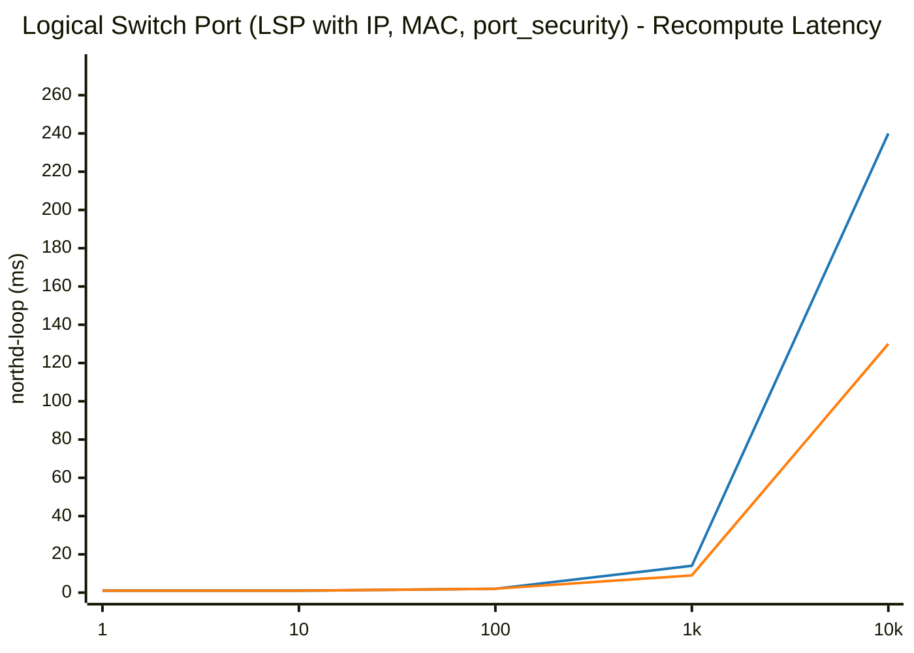

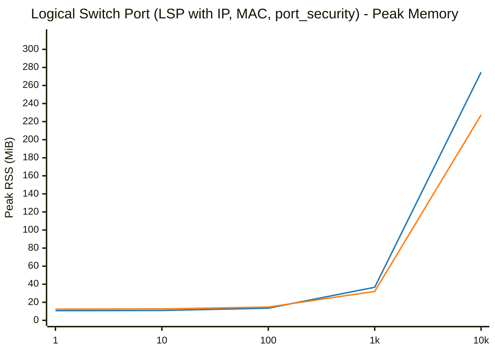

## ACL (Access Control List with stateful allow-related)

| Scale (N) | Phase / Metric | glibc malloc | jemalloc | Relative Difference |
|---|---|---|---|---|
| **1** | Baseline RSS | 10.61 MiB | 12.43 MiB | +17.2% |
| | Add Duration | 0.004 s | 0.004 s | ~Parity (±1%) |
| | Add Rate | 256 ops/s | 257 ops/s | ~Parity (±1%) |
| | Recompute (`ovn-northd-loop`) | 5.7 ms | 1.0 ms | -82.5% |
| | Logical Flow (`lflow`) | 0.0 ms | 0.0 ms | N/A |
| | Peak RSS (`VmHWM`) | 10.70 MiB | 12.52 MiB | +17.0% |
| | Delete Duration | 0.003 s | 0.004 s | +33.3% |
| | Post-Delete Recompute | 4.4 ms | 1.0 ms | -77.2% |
| | Post-Delete RSS | 10.70 MiB | 12.52 MiB | +17.0% |
| | **Retained Heap vs Baseline** | **+0.09 MiB** | **+0.09 MiB** | **+0.00 MiB** |
|---|---|---|---|---|
| **10** | Baseline RSS | 10.56 MiB | 12.25 MiB | +16.0% |
| | Add Duration | 0.005 s | 0.004 s | -20.0% |
| | Add Rate | 2,110 ops/s | 2,392 ops/s | +13.4% |
| | Recompute (`ovn-northd-loop`) | 5.4 ms | 1.0 ms | -81.4% |
| | Logical Flow (`lflow`) | 0.0 ms | 1.0 ms | N/A |
| | Peak RSS (`VmHWM`) | 10.75 MiB | 12.43 MiB | +15.6% |
| | Delete Duration | 0.003 s | 0.003 s | ~Parity (±1%) |
| | Post-Delete Recompute | 4.6 ms | 1.0 ms | -78.4% |
| | Post-Delete RSS | 10.75 MiB | 12.43 MiB | +15.6% |
| | **Retained Heap vs Baseline** | **+0.19 MiB** | **+0.18 MiB** | **-0.01 MiB** |
|---|---|---|---|---|
| **100** | Baseline RSS | 10.66 MiB | 12.34 MiB | +15.8% |
| | Add Duration | 0.010 s | 0.009 s | -10.0% |
| | Add Rate | 10,393 ops/s | 10,687 ops/s | +2.8% |
| | Recompute (`ovn-northd-loop`) | 1.0 ms | 1.0 ms | ~Parity (±1%) |
| | Logical Flow (`lflow`) | 1.0 ms | 0.0 ms | -100.0% |
| | Peak RSS (`VmHWM`) | 11.89 MiB | 13.27 MiB | +11.6% |
| | Delete Duration | 0.006 s | 0.004 s | -33.3% |
| | Post-Delete Recompute | 1.0 ms | 5.2 ms | +416.3% |
| | Post-Delete RSS | 11.89 MiB | 12.89 MiB | +8.4% |
| | **Retained Heap vs Baseline** | **+1.23 MiB** | **+0.55 MiB** | **-0.68 MiB** |
|---|---|---|---|---|
| **1000** | Baseline RSS | 10.73 MiB | 12.31 MiB | +14.7% |
| | Add Duration | 0.070 s | 0.066 s | -5.7% |
| | Add Rate | 14,388 ops/s | 15,149 ops/s | +5.3% |
| | Recompute (`ovn-northd-loop`) | 3.0 ms | 3.0 ms | ~Parity (±1%) |
| | Logical Flow (`lflow`) | 3.0 ms | 2.0 ms | -33.3% |
| | Peak RSS (`VmHWM`) | 20.78 MiB | 20.00 MiB | -3.8% |
| | Delete Duration | 0.035 s | 0.023 s | -34.3% |
| | Post-Delete Recompute | 5.8 ms | 5.6 ms | -4.9% |
| | Post-Delete RSS | 20.78 MiB | 13.43 MiB | -35.4% |
| | **Retained Heap vs Baseline** | **+10.05 MiB** | **+1.12 MiB** | **-8.93 MiB** |
|---|---|---|---|---|
| **10000** | Baseline RSS | 14.46 MiB | 15.48 MiB | +7.1% |
| | Add Duration | 0.846 s | 0.681 s | -19.5% |
| | Add Rate | 11,815 ops/s | 14,686 ops/s | +24.3% |
| | Recompute (`ovn-northd-loop`) | 97.0 ms | 70.0 ms | -27.8% |
| | Logical Flow (`lflow`) | 73.0 ms | 50.0 ms | -31.5% |
| | Peak RSS (`VmHWM`) | 108.59 MiB | 87.06 MiB | -19.8% |
| | Delete Duration | 0.501 s | 0.292 s | -41.7% |
| | Post-Delete Recompute | 1.0 ms | 1.0 ms | ~Parity (±1%) |
| | Post-Delete RSS | 107.57 MiB | 18.42 MiB | -82.9% |
| | **Retained Heap vs Baseline** | **+93.11 MiB** | **+2.94 MiB** | **-90.17 MiB** |
|---|---|---|---|---|

### Visual Charts

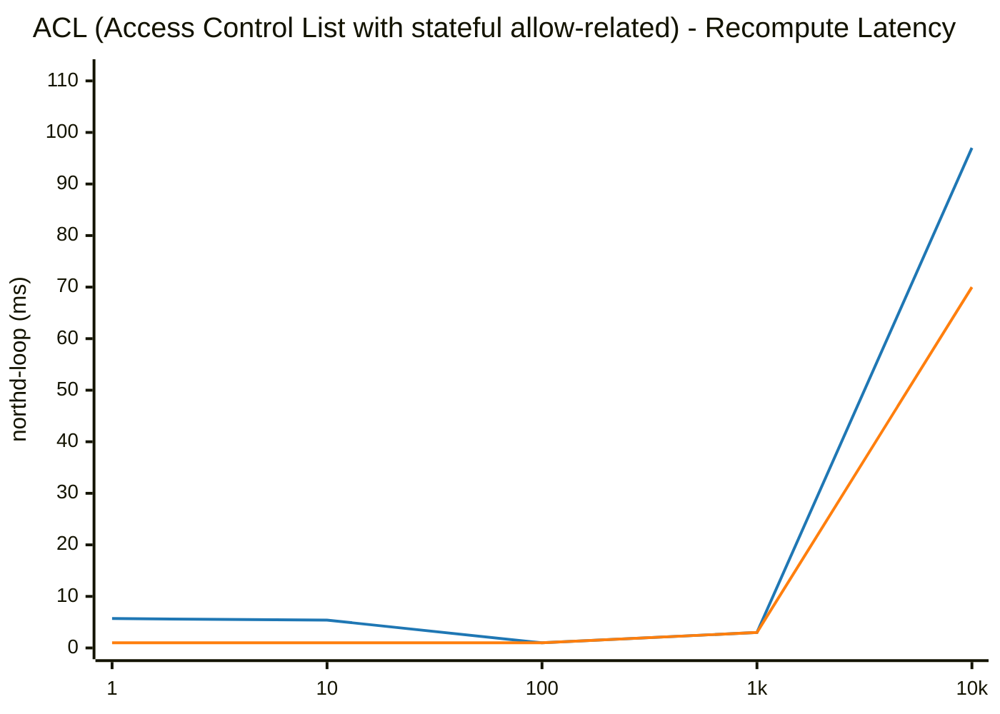

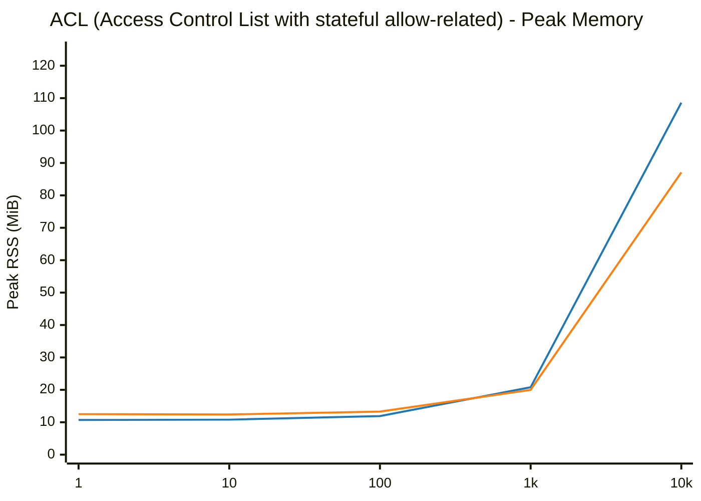

## Address Set (IP list matching ACL)

| Scale (N) | Phase / Metric | glibc malloc | jemalloc | Relative Difference |
|---|---|---|---|---|
| **1** | Baseline RSS | 10.57 MiB | 12.34 MiB | +16.7% |
| | Add Duration | 0.004 s | 0.003 s | -25.0% |
| | Add Rate | 250 ops/s | 303 ops/s | +21.1% |
| | Recompute (`ovn-northd-loop`) | 1.0 ms | 5.1 ms | +405.8% |
| | Logical Flow (`lflow`) | 0.0 ms | 0.0 ms | N/A |
| | Peak RSS (`VmHWM`) | 10.65 MiB | 12.49 MiB | +17.3% |
| | Delete Duration | 0.004 s | 0.003 s | -25.0% |
| | Post-Delete Recompute | 5.3 ms | 4.7 ms | -12.3% |
| | Post-Delete RSS | 10.65 MiB | 12.45 MiB | +16.9% |
| | **Retained Heap vs Baseline** | **+0.08 MiB** | **+0.11 MiB** | **+0.03 MiB** |
|---|---|---|---|---|
| **10** | Baseline RSS | 10.62 MiB | 12.35 MiB | +16.3% |
| | Add Duration | 0.004 s | 0.004 s | ~Parity (±1%) |
| | Add Rate | 2,322 ops/s | 2,794 ops/s | +20.3% |
| | Recompute (`ovn-northd-loop`) | 1.0 ms | 1.0 ms | ~Parity (±1%) |
| | Logical Flow (`lflow`) | 0.0 ms | 1.0 ms | N/A |
| | Peak RSS (`VmHWM`) | 10.71 MiB | 12.44 MiB | +16.2% |
| | Delete Duration | 0.004 s | 0.004 s | ~Parity (±1%) |
| | Post-Delete Recompute | 1.0 ms | 5.0 ms | +399.6% |
| | Post-Delete RSS | 10.71 MiB | 12.44 MiB | +16.2% |
| | **Retained Heap vs Baseline** | **+0.09 MiB** | **+0.09 MiB** | **+0.00 MiB** |
|---|---|---|---|---|
| **100** | Baseline RSS | 10.58 MiB | 12.35 MiB | +16.7% |
| | Add Duration | 0.004 s | 0.004 s | ~Parity (±1%) |
| | Add Rate | 26,867 ops/s | 25,773 ops/s | -4.1% |
| | Recompute (`ovn-northd-loop`) | 5.1 ms | 1.0 ms | -80.5% |
| | Logical Flow (`lflow`) | 0.0 ms | 0.0 ms | N/A |
| | Peak RSS (`VmHWM`) | 10.70 MiB | 12.46 MiB | +16.4% |
| | Delete Duration | 0.004 s | 0.003 s | -25.0% |
| | Post-Delete Recompute | 4.9 ms | 5.1 ms | +2.9% |
| | Post-Delete RSS | 10.70 MiB | 12.45 MiB | +16.4% |
| | **Retained Heap vs Baseline** | **+0.12 MiB** | **+0.10 MiB** | **-0.02 MiB** |
|---|---|---|---|---|
| **1000** | Baseline RSS | 10.66 MiB | 12.36 MiB | +15.9% |
| | Add Duration | 0.007 s | 0.006 s | -14.3% |
| | Add Rate | 151,011 ops/s | 174,886 ops/s | +15.8% |
| | Recompute (`ovn-northd-loop`) | 1.0 ms | 1.0 ms | ~Parity (±1%) |
| | Logical Flow (`lflow`) | 0.0 ms | 0.0 ms | N/A |
| | Peak RSS (`VmHWM`) | 10.97 MiB | 12.64 MiB | +15.2% |
| | Delete Duration | 0.004 s | 0.004 s | ~Parity (±1%) |
| | Post-Delete Recompute | 1.0 ms | 1.0 ms | ~Parity (±1%) |
| | Post-Delete RSS | 10.97 MiB | 12.59 MiB | +14.8% |
| | **Retained Heap vs Baseline** | **+0.31 MiB** | **+0.23 MiB** | **-0.08 MiB** |
|---|---|---|---|---|
| **10000** | Baseline RSS | 10.58 MiB | 12.24 MiB | +15.7% |
| | Add Duration | 0.026 s | 0.022 s | -15.4% |
| | Add Rate | 380,430 ops/s | 449,236 ops/s | +18.1% |
| | Recompute (`ovn-northd-loop`) | 1.0 ms | 1.0 ms | ~Parity (±1%) |
| | Logical Flow (`lflow`) | 0.0 ms | 0.0 ms | N/A |
| | Peak RSS (`VmHWM`) | 12.71 MiB | 14.05 MiB | +10.5% |
| | Delete Duration | 0.005 s | 0.004 s | -20.0% |
| | Post-Delete Recompute | 1.0 ms | 5.5 ms | +448.4% |
| | Post-Delete RSS | 12.55 MiB | 12.43 MiB | ~Parity (±1%) |
| | **Retained Heap vs Baseline** | **+1.97 MiB** | **+0.19 MiB** | **-1.78 MiB** |
|---|---|---|---|---|

### Visual Charts

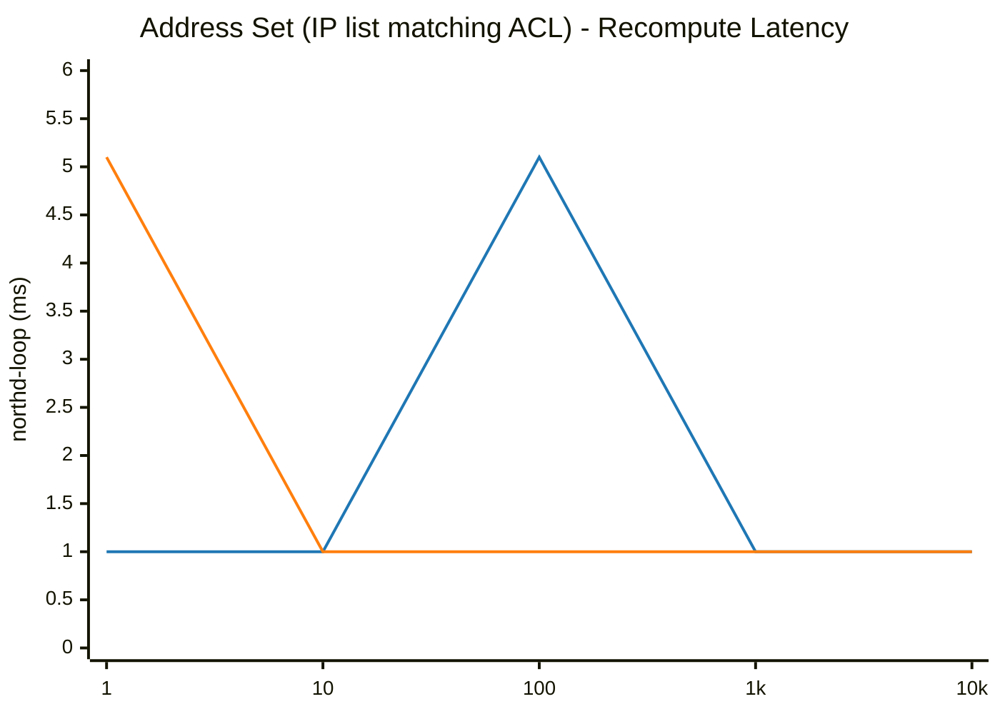

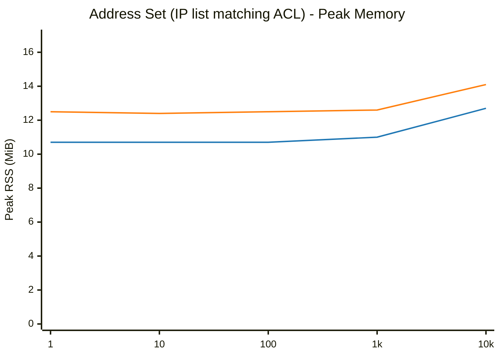

## Port Group (Ports member grouping matching ACL)

| Scale (N) | Phase / Metric | glibc malloc | jemalloc | Relative Difference |
|---|---|---|---|---|
| **1** | Baseline RSS | 10.63 MiB | 12.39 MiB | +16.6% |
| | Add Duration | 0.005 s | 0.004 s | -20.0% |
| | Add Rate | 220 ops/s | 246 ops/s | +12.2% |
| | Recompute (`ovn-northd-loop`) | 1.0 ms | 1.0 ms | ~Parity (±1%) |
| | Logical Flow (`lflow`) | 1.0 ms | 0.0 ms | -100.0% |
| | Peak RSS (`VmHWM`) | 10.72 MiB | 12.49 MiB | +16.5% |
| | Delete Duration | 0.003 s | 0.004 s | +33.3% |
| | Post-Delete Recompute | 4.7 ms | 5.4 ms | +14.5% |
| | Post-Delete RSS | 10.72 MiB | 12.47 MiB | +16.3% |
| | **Retained Heap vs Baseline** | **+0.09 MiB** | **+0.08 MiB** | **-0.01 MiB** |
|---|---|---|---|---|
| **10** | Baseline RSS | 10.72 MiB | 12.35 MiB | +15.2% |
| | Add Duration | 0.004 s | 0.004 s | ~Parity (±1%) |
| | Add Rate | 2,378 ops/s | 2,566 ops/s | +7.9% |
| | Recompute (`ovn-northd-loop`) | 1.0 ms | 4.3 ms | +329.8% |
| | Logical Flow (`lflow`) | 0.0 ms | 0.0 ms | N/A |
| | Peak RSS (`VmHWM`) | 10.80 MiB | 12.44 MiB | +15.2% |
| | Delete Duration | 0.004 s | 0.004 s | ~Parity (±1%) |
| | Post-Delete Recompute | 1.0 ms | 1.0 ms | ~Parity (±1%) |
| | Post-Delete RSS | 10.80 MiB | 12.45 MiB | +15.3% |
| | **Retained Heap vs Baseline** | **+0.08 MiB** | **+0.10 MiB** | **+0.02 MiB** |
|---|---|---|---|---|
| **100** | Baseline RSS | 10.98 MiB | 12.77 MiB | +16.3% |
| | Add Duration | 0.004 s | 0.003 s | -25.0% |
| | Add Rate | 24,777 ops/s | 34,199 ops/s | +38.0% |
| | Recompute (`ovn-northd-loop`) | 1.0 ms | 5.7 ms | +470.1% |
| | Logical Flow (`lflow`) | 0.0 ms | 0.0 ms | N/A |
| | Peak RSS (`VmHWM`) | 11.07 MiB | 12.89 MiB | +16.4% |
| | Delete Duration | 0.005 s | 0.004 s | -20.0% |
| | Post-Delete Recompute | 5.0 ms | 1.0 ms | -79.9% |
| | Post-Delete RSS | 11.11 MiB | 12.77 MiB | +14.9% |
| | **Retained Heap vs Baseline** | **+0.13 MiB** | **+0.00 MiB** | **-0.13 MiB** |
|---|---|---|---|---|
| **1000** | Baseline RSS | 15.26 MiB | 16.04 MiB | +5.1% |
| | Add Duration | 0.010 s | 0.009 s | -10.0% |
| | Add Rate | 97,713 ops/s | 107,330 ops/s | +9.8% |
| | Recompute (`ovn-northd-loop`) | 5.0 ms | 2.0 ms | -60.0% |
| | Logical Flow (`lflow`) | 1.0 ms | 0.0 ms | -100.0% |
| | Peak RSS (`VmHWM`) | 15.30 MiB | 16.21 MiB | +5.9% |
| | Delete Duration | 0.018 s | 0.017 s | -5.6% |
| | Post-Delete Recompute | 1.0 ms | 1.0 ms | ~Parity (±1%) |
| | Post-Delete RSS | 15.55 MiB | 14.22 MiB | -8.6% |
| | **Retained Heap vs Baseline** | **+0.29 MiB** | **-1.82 MiB** | **-2.11 MiB** |
|---|---|---|---|---|
| **10000** | Baseline RSS | 54.29 MiB | 49.30 MiB | -9.2% |
| | Add Duration | 0.092 s | 0.072 s | -21.7% |
| | Add Rate | 108,254 ops/s | 139,062 ops/s | +28.5% |
| | Recompute (`ovn-northd-loop`) | 60.0 ms | 37.0 ms | -38.3% |
| | Logical Flow (`lflow`) | 8.0 ms | 6.0 ms | -25.0% |
| | Peak RSS (`VmHWM`) | 54.64 MiB | 51.21 MiB | -6.3% |
| | Delete Duration | 0.302 s | 0.214 s | -29.1% |
| | Post-Delete Recompute | 36.0 ms | 25.0 ms | -30.6% |
| | Post-Delete RSS | 60.36 MiB | 15.44 MiB | -74.4% |
| | **Retained Heap vs Baseline** | **+6.07 MiB** | **-33.86 MiB** | **-39.93 MiB** |
|---|---|---|---|---|

### Visual Charts

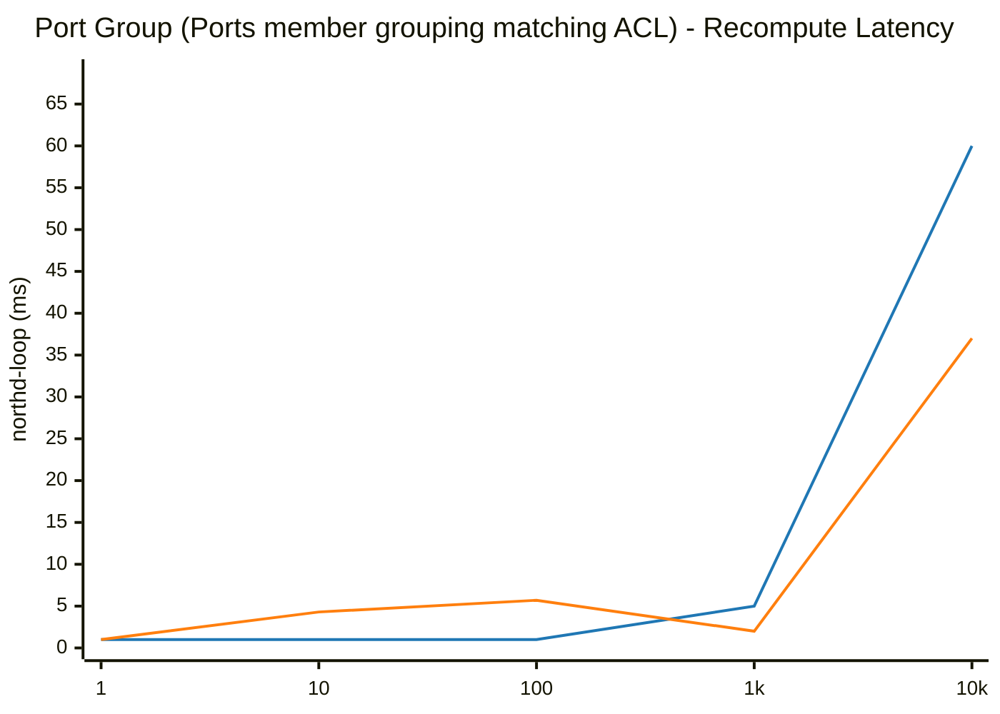

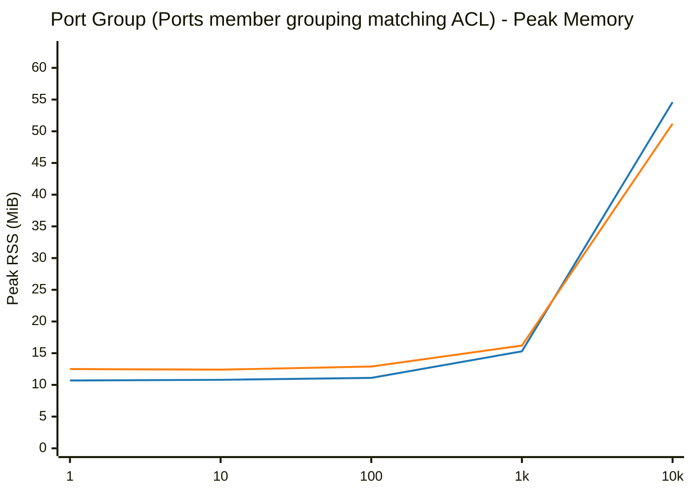

## Load Balancer (VIPs mapped to endpoints)

| Scale (N) | Phase / Metric | glibc malloc | jemalloc | Relative Difference |
|---|---|---|---|---|
| **1** | Baseline RSS | 10.55 MiB | 12.31 MiB | +16.7% |
| | Add Duration | 0.004 s | 0.004 s | ~Parity (±1%) |
| | Add Rate | 266 ops/s | 250 ops/s | -6.0% |
| | Recompute (`ovn-northd-loop`) | 3.9 ms | 1.0 ms | -74.5% |
| | Logical Flow (`lflow`) | 0.0 ms | 0.0 ms | N/A |
| | Peak RSS (`VmHWM`) | 10.68 MiB | 12.44 MiB | +16.5% |
| | Delete Duration | 0.004 s | 0.003 s | -25.0% |
| | Post-Delete Recompute | 1.0 ms | 1.0 ms | ~Parity (±1%) |
| | Post-Delete RSS | 10.68 MiB | 12.46 MiB | +16.7% |
| | **Retained Heap vs Baseline** | **+0.13 MiB** | **+0.15 MiB** | **+0.02 MiB** |
|---|---|---|---|---|
| **10** | Baseline RSS | 10.72 MiB | 12.33 MiB | +15.0% |
| | Add Duration | 0.003 s | 0.004 s | +33.3% |
| | Add Rate | 3,021 ops/s | 2,399 ops/s | -20.6% |
| | Recompute (`ovn-northd-loop`) | 1.0 ms | 5.9 ms | +486.4% |
| | Logical Flow (`lflow`) | 1.0 ms | 0.0 ms | -100.0% |
| | Peak RSS (`VmHWM`) | 11.02 MiB | 12.64 MiB | +14.7% |
| | Delete Duration | 0.004 s | 0.004 s | ~Parity (±1%) |
| | Post-Delete Recompute | 1.0 ms | 5.5 ms | +454.0% |
| | Post-Delete RSS | 11.02 MiB | 12.62 MiB | +14.5% |
| | **Retained Heap vs Baseline** | **+0.30 MiB** | **+0.29 MiB** | **-0.01 MiB** |
|---|---|---|---|---|
| **100** | Baseline RSS | 10.55 MiB | 12.38 MiB | +17.3% |
| | Add Duration | 0.016 s | 0.013 s | -18.8% |
| | Add Rate | 6,354 ops/s | 7,619 ops/s | +19.9% |
| | Recompute (`ovn-northd-loop`) | 1.0 ms | 1.0 ms | ~Parity (±1%) |
| | Logical Flow (`lflow`) | 1.0 ms | 0.0 ms | -100.0% |
| | Peak RSS (`VmHWM`) | 12.51 MiB | 13.91 MiB | +11.2% |
| | Delete Duration | 0.008 s | 0.006 s | -25.0% |
| | Post-Delete Recompute | 1.0 ms | 1.0 ms | ~Parity (±1%) |
| | Post-Delete RSS | 12.51 MiB | 13.24 MiB | +5.8% |
| | **Retained Heap vs Baseline** | **+1.96 MiB** | **+0.86 MiB** | **-1.10 MiB** |
|---|---|---|---|---|
| **1000** | Baseline RSS | 10.58 MiB | 12.38 MiB | +17.0% |
| | Add Duration | 0.114 s | 0.093 s | -18.4% |
| | Add Rate | 8,751 ops/s | 10,803 ops/s | +23.4% |
| | Recompute (`ovn-northd-loop`) | 9.0 ms | 6.0 ms | -33.3% |
| | Logical Flow (`lflow`) | 3.0 ms | 2.0 ms | -33.3% |
| | Peak RSS (`VmHWM`) | 27.37 MiB | 24.62 MiB | -10.0% |
| | Delete Duration | 0.056 s | 0.028 s | -50.0% |
| | Post-Delete Recompute | 5.0 ms | 5.3 ms | +6.7% |
| | Post-Delete RSS | 27.38 MiB | 14.35 MiB | -47.6% |
| | **Retained Heap vs Baseline** | **+16.80 MiB** | **+1.97 MiB** | **-14.83 MiB** |
|---|---|---|---|---|
| **5000** | Baseline RSS | 14.57 MiB | 15.48 MiB | +6.2% |
| | Add Duration | 0.531 s | 0.443 s | -16.6% |
| | Add Rate | 9,413 ops/s | 11,292 ops/s | +20.0% |
| | Recompute (`ovn-northd-loop`) | 51.0 ms | 41.0 ms | -19.6% |
| | Logical Flow (`lflow`) | 10.0 ms | 8.0 ms | -20.0% |
| | Peak RSS (`VmHWM`) | 83.85 MiB | 72.38 MiB | -13.7% |
| | Delete Duration | 0.286 s | 0.171 s | -40.2% |
| | Post-Delete Recompute | 14.0 ms | 8.0 ms | -42.9% |
| | Post-Delete RSS | 82.49 MiB | 18.49 MiB | -77.6% |
| | **Retained Heap vs Baseline** | **+67.92 MiB** | **+3.01 MiB** | **-64.91 MiB** |
|---|---|---|---|---|
| **10000** | Baseline RSS | 14.46 MiB | 15.57 MiB | +7.7% |
| | Add Duration | 1.261 s | 0.935 s | -25.9% |
| | Add Rate | 7,932 ops/s | 10,693 ops/s | +34.8% |
| | Recompute (`ovn-northd-loop`) | 112.0 ms | 85.0 ms | -24.1% |
| | Logical Flow (`lflow`) | 30.0 ms | 25.0 ms | -16.7% |
| | Peak RSS (`VmHWM`) | 141.38 MiB | 127.71 MiB | -9.7% |
| | Delete Duration | 0.655 s | 0.370 s | -43.5% |
| | Post-Delete Recompute | 30.0 ms | 18.0 ms | -40.0% |
| | Post-Delete RSS | 140.20 MiB | 19.96 MiB | -85.8% |
| | **Retained Heap vs Baseline** | **+125.74 MiB** | **+4.39 MiB** | **-121.35 MiB** |
|---|---|---|---|---|

### Visual Charts

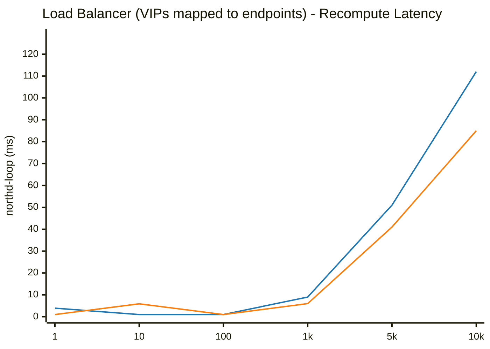

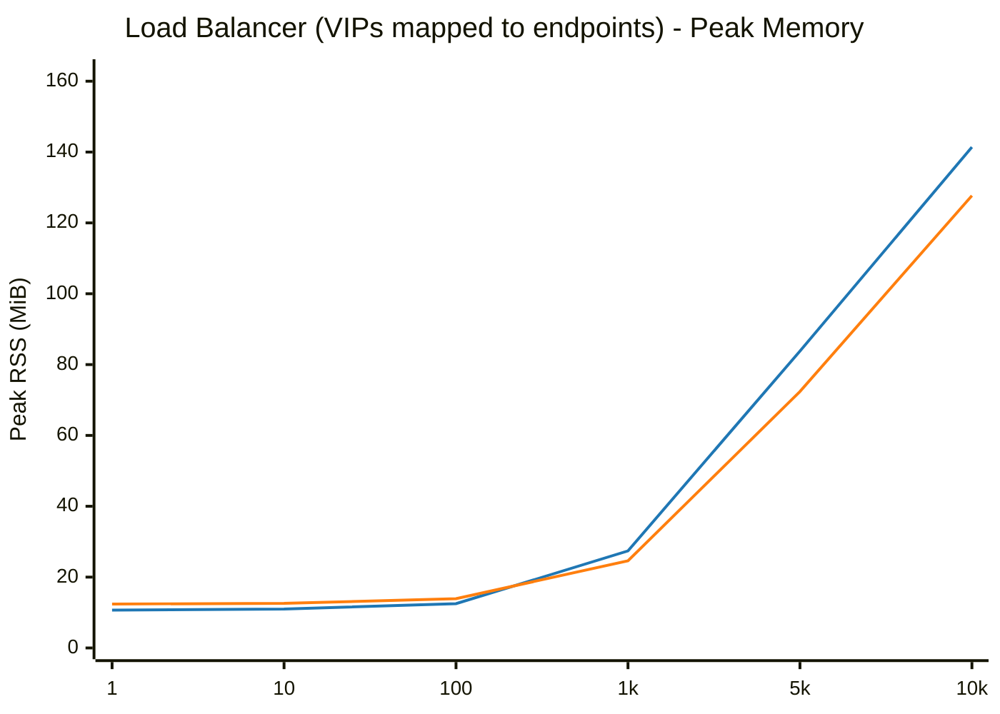

## OpenFlow Flows (OVS Control Plane)

| Scale (N) | Phase / Metric | glibc malloc | jemalloc | Relative Difference |
|---|---|---|---|---|
| **1** | Baseline RSS | 21.25 MiB | 25.93 MiB | +22.0% |
| | Add Duration | 0.003 s | 0.004 s | +33.3% |
| | Add Rate | 368 ops/s | 285 ops/s | -22.5% |
| | Peak RSS (`VmHWM`) | 21.48 MiB | 26.04 MiB | +21.2% |
| | Delete Duration | 0.003 s | 0.004 s | +33.3% |
| | Post-Delete RSS | 21.50 MiB | 26.02 MiB | +21.0% |
| | **Retained Heap vs Baseline** | **+0.25 MiB** | **+0.09 MiB** | **-0.16 MiB** |
|---|---|---|---|---|
| **10** | Baseline RSS | 21.35 MiB | 25.83 MiB | +21.0% |
| | Add Duration | 0.003 s | 0.006 s | +100.0% |
| | Add Rate | 3,762 ops/s | 1,796 ops/s | -52.2% |
| | Peak RSS (`VmHWM`) | 21.51 MiB | 26.03 MiB | +21.0% |
| | Delete Duration | 0.002 s | 0.004 s | +100.0% |
| | Post-Delete RSS | 21.54 MiB | 26.08 MiB | +21.1% |
| | **Retained Heap vs Baseline** | **+0.19 MiB** | **+0.25 MiB** | **+0.06 MiB** |
|---|---|---|---|---|
| **100** | Baseline RSS | 21.27 MiB | 25.86 MiB | +21.6% |
| | Add Duration | 0.007 s | 0.009 s | +28.6% |
| | Add Rate | 14,863 ops/s | 10,830 ops/s | -27.1% |
| | Peak RSS (`VmHWM`) | 21.43 MiB | 26.06 MiB | +21.6% |
| | Delete Duration | 0.003 s | 0.005 s | +66.7% |
| | Post-Delete RSS | 21.59 MiB | 26.11 MiB | +20.9% |
| | **Retained Heap vs Baseline** | **+0.32 MiB** | **+0.25 MiB** | **-0.07 MiB** |
|---|---|---|---|---|
| **1000** | Baseline RSS | 21.13 MiB | 25.82 MiB | +22.2% |
| | Add Duration | 0.030 s | 0.036 s | +20.0% |
| | Add Rate | 33,453 ops/s | 27,740 ops/s | -17.1% |
| | Peak RSS (`VmHWM`) | 22.01 MiB | 26.68 MiB | +21.2% |
| | Delete Duration | 0.003 s | 0.003 s | ~Parity (±1%) |
| | Post-Delete RSS | 22.25 MiB | 26.89 MiB | +20.9% |
| | **Retained Heap vs Baseline** | **+1.12 MiB** | **+1.07 MiB** | **-0.05 MiB** |
|---|---|---|---|---|
| **10000** | Baseline RSS | 21.23 MiB | 26.03 MiB | +22.6% |
| | Add Duration | 0.273 s | 0.267 s | -2.2% |
| | Add Rate | 36,676 ops/s | 37,393 ops/s | +2.0% |
| | Peak RSS (`VmHWM`) | 28.73 MiB | 33.51 MiB | +16.6% |
| | Delete Duration | 0.006 s | 0.006 s | ~Parity (±1%) |
| | Post-Delete RSS | 29.57 MiB | 27.23 MiB | -7.9% |
| | **Retained Heap vs Baseline** | **+8.34 MiB** | **+1.20 MiB** | **-7.14 MiB** |
|---|---|---|---|---|
| **100000** | Baseline RSS | 21.30 MiB | 25.86 MiB | +21.4% |
| | Add Duration | 2.941 s | 2.791 s | -5.1% |
| | Add Rate | 34,007 ops/s | 35,830 ops/s | +5.4% |
| | Peak RSS (`VmHWM`) | 95.27 MiB | 97.46 MiB | +2.3% |
| | Delete Duration | 0.029 s | 0.027 s | -6.9% |
| | Post-Delete RSS | 100.83 MiB | 27.44 MiB | -72.8% |
| | **Retained Heap vs Baseline** | **+79.53 MiB** | **+1.58 MiB** | **-77.95 MiB** |
|---|---|---|---|---|

### Visual Charts

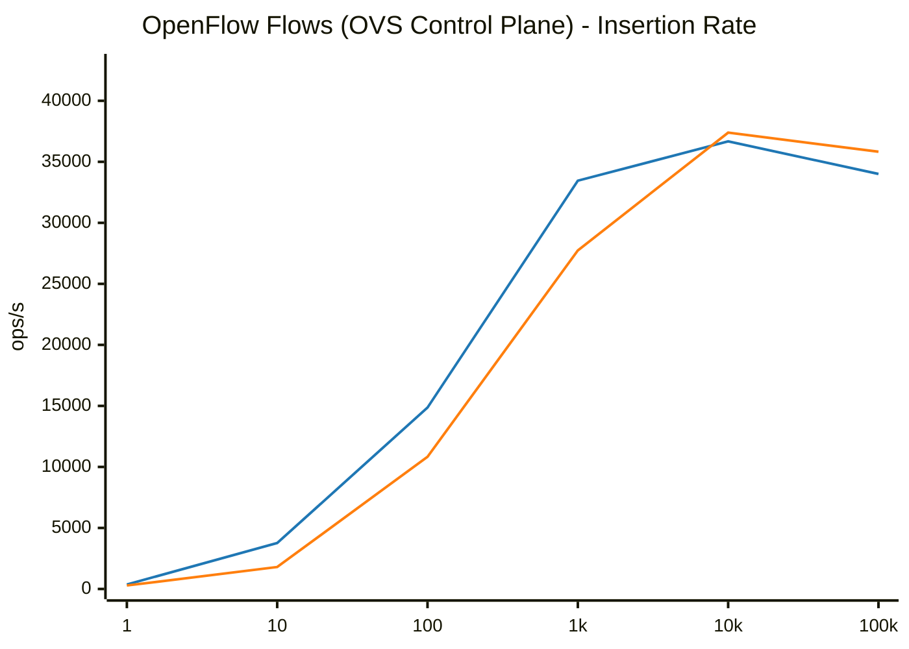

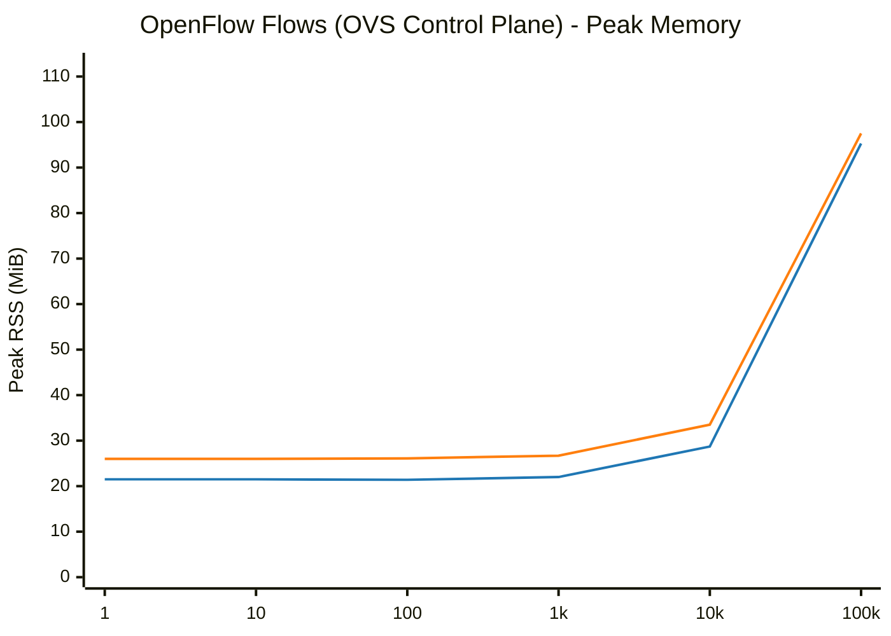

## OVS Datapath Packet Forwarding & Megaflow Cache

| Scale (N) | Phase / Metric | glibc malloc | jemalloc | Relative Difference |
|---|---|---|---|---|
| **1** | Baseline RSS | 21.56 MiB | 26.08 MiB | +21.0% |
| | Forwarding Duration | 0.002 s | 0.001 s | -50.0% |
| | Forwarding Rate | 446 pkts/s | 684 pkts/s | +53.6% |
| | Peak RSS (`VmHWM`) | 21.56 MiB | 26.08 MiB | +21.0% |
| | Flow Flush Duration (`dpctl/del-flows`) | 0.002 s | 0.002 s | ~Parity (±1%) |
| | Post-Delete RSS | 21.56 MiB | 26.12 MiB | +21.2% |
| | **Retained Heap vs Baseline** | **+0.00 MiB** | **+0.04 MiB** | **+0.04 MiB** |
|---|---|---|---|---|
| **10** | Baseline RSS | 21.34 MiB | 26.09 MiB | +22.3% |
| | Forwarding Duration | 0.002 s | 0.002 s | ~Parity (±1%) |
| | Forwarding Rate | 4,304 pkts/s | 4,659 pkts/s | +8.2% |
| | Peak RSS (`VmHWM`) | 21.34 MiB | 26.16 MiB | +22.6% |
| | Flow Flush Duration (`dpctl/del-flows`) | 0.002 s | 0.002 s | ~Parity (±1%) |
| | Post-Delete RSS | 21.40 MiB | 26.17 MiB | +22.3% |
| | **Retained Heap vs Baseline** | **+0.06 MiB** | **+0.08 MiB** | **+0.02 MiB** |
|---|---|---|---|---|
| **100** | Baseline RSS | 21.52 MiB | 26.08 MiB | +21.2% |
| | Forwarding Duration | 0.002 s | 0.001 s | -50.0% |
| | Forwarding Rate | 43,917 pkts/s | 71,633 pkts/s | +63.1% |
| | Peak RSS (`VmHWM`) | 21.52 MiB | 26.16 MiB | +21.6% |
| | Flow Flush Duration (`dpctl/del-flows`) | 0.002 s | 0.001 s | -50.0% |
| | Post-Delete RSS | 21.53 MiB | 26.14 MiB | +21.4% |
| | **Retained Heap vs Baseline** | **+0.01 MiB** | **+0.06 MiB** | **+0.05 MiB** |
|---|---|---|---|---|
| **1000** | Baseline RSS | 21.56 MiB | 25.98 MiB | +20.5% |
| | Forwarding Duration | 0.006 s | 0.006 s | ~Parity (±1%) |
| | Forwarding Rate | 161,786 pkts/s | 174,916 pkts/s | +8.1% |
| | Peak RSS (`VmHWM`) | 21.65 MiB | 26.09 MiB | +20.5% |
| | Flow Flush Duration (`dpctl/del-flows`) | 0.002 s | 0.002 s | ~Parity (±1%) |
| | Post-Delete RSS | 21.66 MiB | 26.16 MiB | +20.8% |
| | **Retained Heap vs Baseline** | **+0.10 MiB** | **+0.18 MiB** | **+0.08 MiB** |
|---|---|---|---|---|
| **10000** | Baseline RSS | 21.55 MiB | 26.06 MiB | +20.9% |
| | Forwarding Duration | 0.054 s | 0.053 s | -1.9% |
| | Forwarding Rate | 184,699 pkts/s | 187,034 pkts/s | +1.3% |
| | Peak RSS (`VmHWM`) | 21.66 MiB | 26.11 MiB | +20.5% |
| | Flow Flush Duration (`dpctl/del-flows`) | 0.002 s | 0.002 s | ~Parity (±1%) |
| | Post-Delete RSS | 21.66 MiB | 26.11 MiB | +20.5% |
| | **Retained Heap vs Baseline** | **+0.11 MiB** | **+0.05 MiB** | **-0.06 MiB** |
|---|---|---|---|---|
| **100000** | Baseline RSS | 21.45 MiB | 26.20 MiB | +22.1% |
| | Forwarding Duration | 0.538 s | 0.529 s | -1.7% |
| | Forwarding Rate | 185,947 pkts/s | 188,931 pkts/s | +1.6% |
| | Peak RSS (`VmHWM`) | 21.59 MiB | 26.27 MiB | +21.7% |
| | Flow Flush Duration (`dpctl/del-flows`) | 0.002 s | 0.002 s | ~Parity (±1%) |
| | Post-Delete RSS | 21.59 MiB | 26.30 MiB | +21.8% |
| | **Retained Heap vs Baseline** | **+0.14 MiB** | **+0.10 MiB** | **-0.04 MiB** |
|---|---|---|---|---|

### Visual Charts

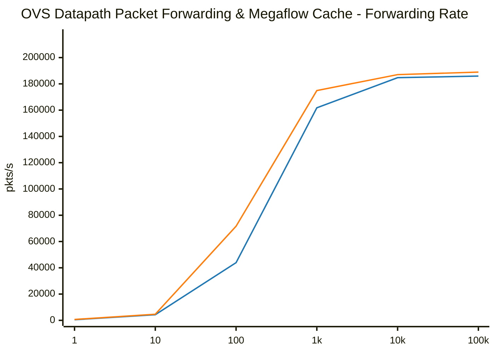

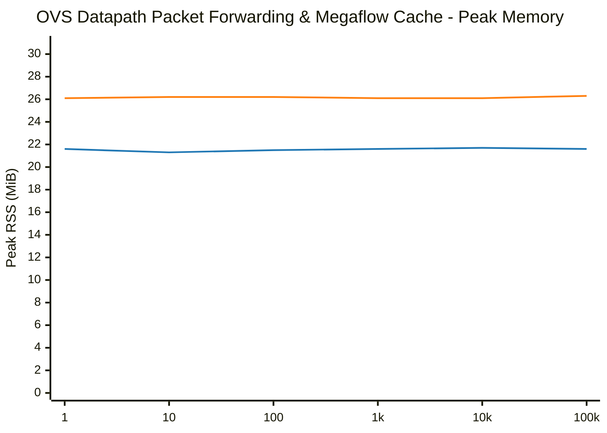

## Combined Workload (All objects scaled proportionally)

| Scale (N) | Phase / Metric | glibc malloc | jemalloc | Relative Difference |
|---|---|---|---|---|
| **1** | Baseline RSS | 10.29 MiB | 12.09 MiB | +17.5% |
| | Add Duration | 0.008 s | 0.007 s | -12.5% |
| | Add Rate | 122 ops/s | 139 ops/s | +13.4% |
| | Recompute (`ovn-northd-loop`) | 4.8 ms | 5.4 ms | +12.3% |
| | Logical Flow (`lflow`) | 0.0 ms | 0.0 ms | N/A |
| | Peak RSS (`VmHWM`) | 11.10 MiB | 12.88 MiB | +16.0% |
| | Delete Duration | 0.005 s | 0.003 s | -40.0% |
| | Post-Delete Recompute | 1.0 ms | 1.0 ms | ~Parity (±1%) |
| | Post-Delete RSS | 11.10 MiB | 12.73 MiB | +14.7% |
| | **Retained Heap vs Baseline** | **+0.81 MiB** | **+0.64 MiB** | **-0.17 MiB** |
|---|---|---|---|---|
| **10** | Baseline RSS | 10.27 MiB | 12.05 MiB | +17.3% |
| | Add Duration | 0.010 s | 0.011 s | +10.0% |
| | Add Rate | 1,011 ops/s | 912 ops/s | -9.7% |
| | Recompute (`ovn-northd-loop`) | 5.5 ms | 1.0 ms | -81.8% |
| | Logical Flow (`lflow`) | 0.0 ms | 0.0 ms | N/A |
| | Peak RSS (`VmHWM`) | 11.50 MiB | 13.18 MiB | +14.6% |
| | Delete Duration | 0.007 s | 0.003 s | -57.1% |
| | Post-Delete Recompute | 6.0 ms | 4.5 ms | -24.9% |
| | Post-Delete RSS | 11.50 MiB | 12.84 MiB | +11.7% |
| | **Retained Heap vs Baseline** | **+1.23 MiB** | **+0.79 MiB** | **-0.44 MiB** |
|---|---|---|---|---|
| **100** | Baseline RSS | 10.32 MiB | 12.08 MiB | +17.1% |
| | Add Duration | 0.027 s | 0.025 s | -7.4% |
| | Add Rate | 3,736 ops/s | 3,977 ops/s | +6.4% |
| | Recompute (`ovn-northd-loop`) | 1.0 ms | 2.0 ms | +100.0% |
| | Logical Flow (`lflow`) | 0.0 ms | 1.0 ms | N/A |
| | Peak RSS (`VmHWM`) | 13.82 MiB | 15.78 MiB | +14.2% |
| | Delete Duration | 0.016 s | 0.008 s | -50.0% |
| | Post-Delete Recompute | 5.0 ms | 5.7 ms | +13.9% |
| | Post-Delete RSS | 13.83 MiB | 13.35 MiB | -3.5% |
| | **Retained Heap vs Baseline** | **+3.51 MiB** | **+1.27 MiB** | **-2.24 MiB** |
|---|---|---|---|---|
| **1000** | Baseline RSS | 10.32 MiB | 11.87 MiB | +15.0% |
| | Add Duration | 0.321 s | 0.252 s | -21.5% |
| | Add Rate | 3,113 ops/s | 3,961 ops/s | +27.2% |
| | Recompute (`ovn-northd-loop`) | 14.0 ms | 10.0 ms | -28.6% |
| | Logical Flow (`lflow`) | 6.0 ms | 6.0 ms | ~Parity (±1%) |
| | Peak RSS (`VmHWM`) | 48.57 MiB | 43.36 MiB | -10.7% |
| | Delete Duration | 0.166 s | 0.080 s | -51.8% |
| | Post-Delete Recompute | 1.0 ms | 1.0 ms | ~Parity (±1%) |
| | Post-Delete RSS | 47.27 MiB | 14.60 MiB | -69.1% |
| | **Retained Heap vs Baseline** | **+36.95 MiB** | **+2.73 MiB** | **-34.22 MiB** |
|---|---|---|---|---|
| **5000** | Baseline RSS | 14.14 MiB | 15.23 MiB | +7.7% |
| | Add Duration | 1.740 s | 1.406 s | -19.2% |
| | Add Rate | 2,874 ops/s | 3,556 ops/s | +23.7% |
| | Recompute (`ovn-northd-loop`) | 84.0 ms | 69.0 ms | -17.9% |
| | Logical Flow (`lflow`) | 15.0 ms | 14.0 ms | -6.7% |
| | Peak RSS (`VmHWM`) | 184.18 MiB | 163.27 MiB | -11.4% |
| | Delete Duration | 0.929 s | 0.459 s | -50.6% |
| | Post-Delete Recompute | 11.0 ms | 8.0 ms | -27.3% |
| | Post-Delete RSS | 180.16 MiB | 20.95 MiB | -88.4% |
| | **Retained Heap vs Baseline** | **+166.02 MiB** | **+5.72 MiB** | **-160.30 MiB** |
|---|---|---|---|---|
| **10000** | Baseline RSS | 14.13 MiB | 15.22 MiB | +7.7% |
| | Add Duration | 3.715 s | 3.133 s | -15.7% |
| | Add Rate | 2,692 ops/s | 3,191 ops/s | +18.6% |
| | Recompute (`ovn-northd-loop`) | 183.0 ms | 141.0 ms | -23.0% |
| | Logical Flow (`lflow`) | 33.0 ms | 27.0 ms | -18.2% |
| | Peak RSS (`VmHWM`) | 378.94 MiB | 305.08 MiB | -19.5% |
| | Delete Duration | 2.002 s | 1.018 s | -49.2% |
| | Post-Delete Recompute | 19.0 ms | 14.0 ms | -26.3% |
| | Post-Delete RSS | 363.67 MiB | 23.50 MiB | -93.5% |
| | **Retained Heap vs Baseline** | **+349.54 MiB** | **+8.28 MiB** | **-341.26 MiB** |
|---|---|---|---|---|

### Visual Charts

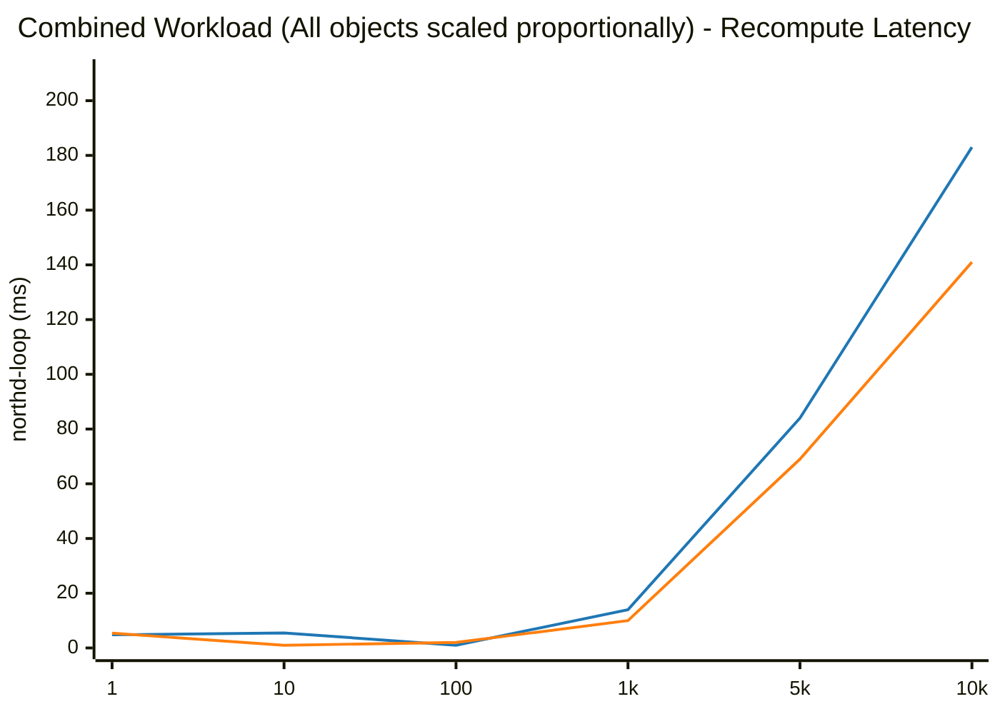

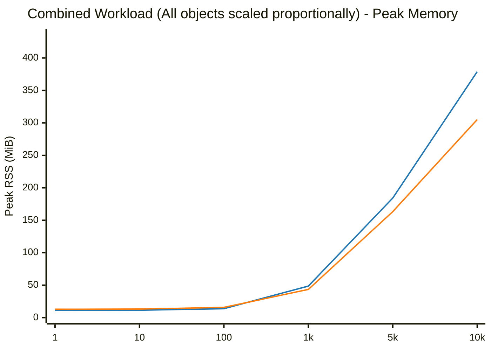

