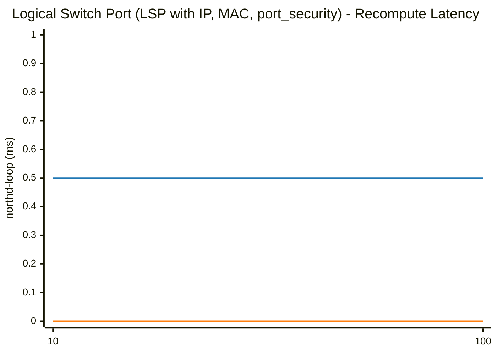
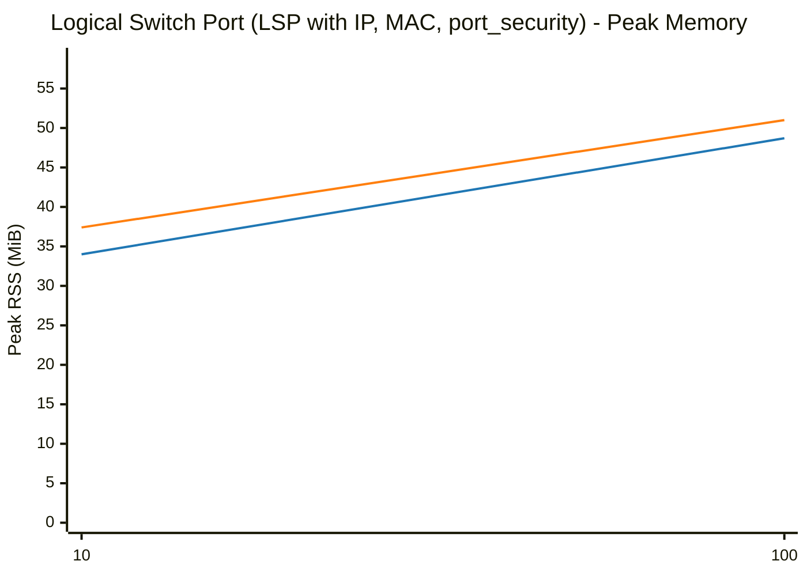
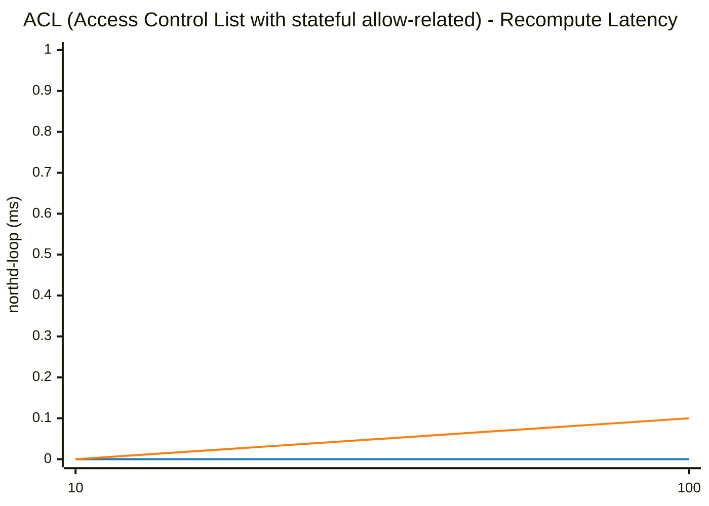
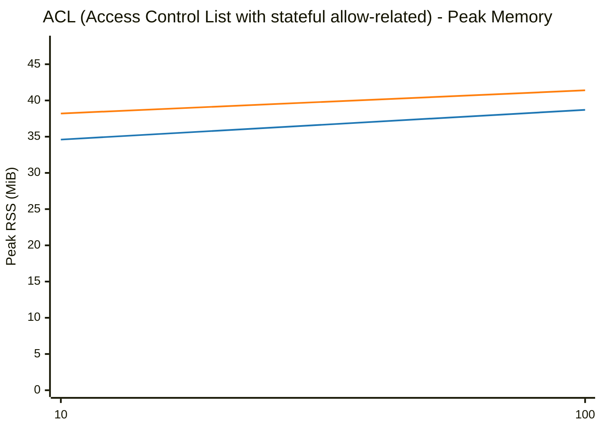
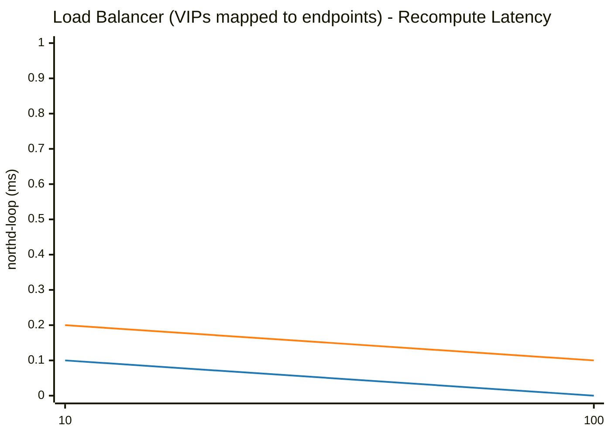
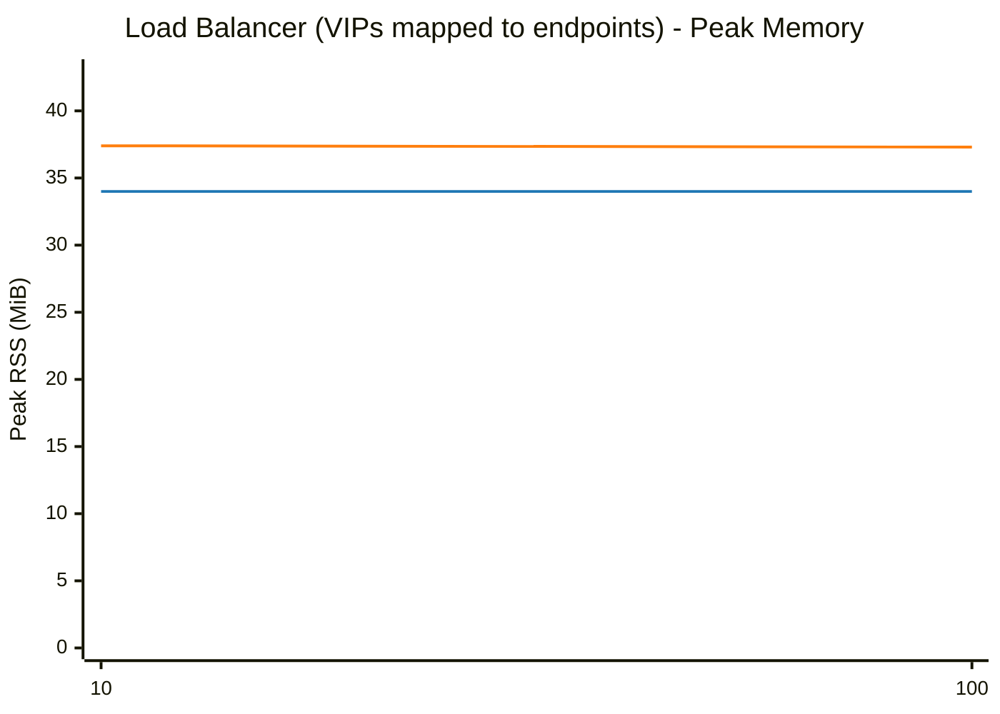
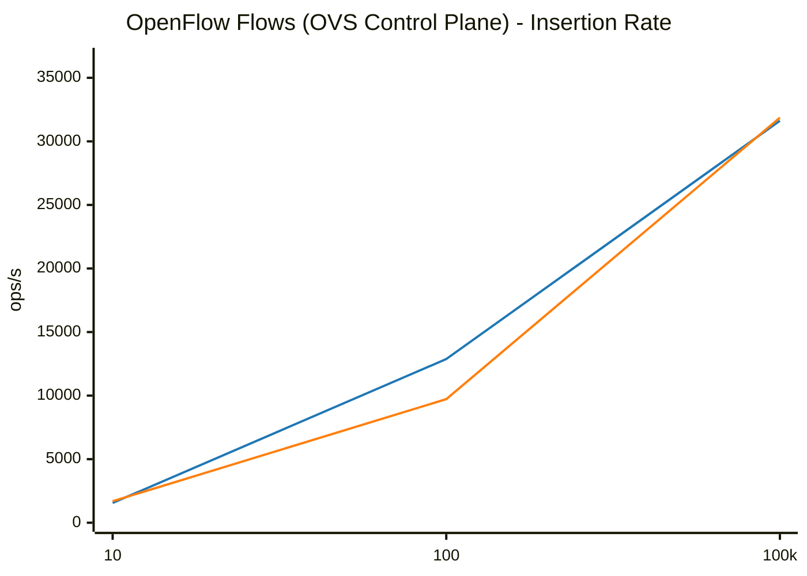
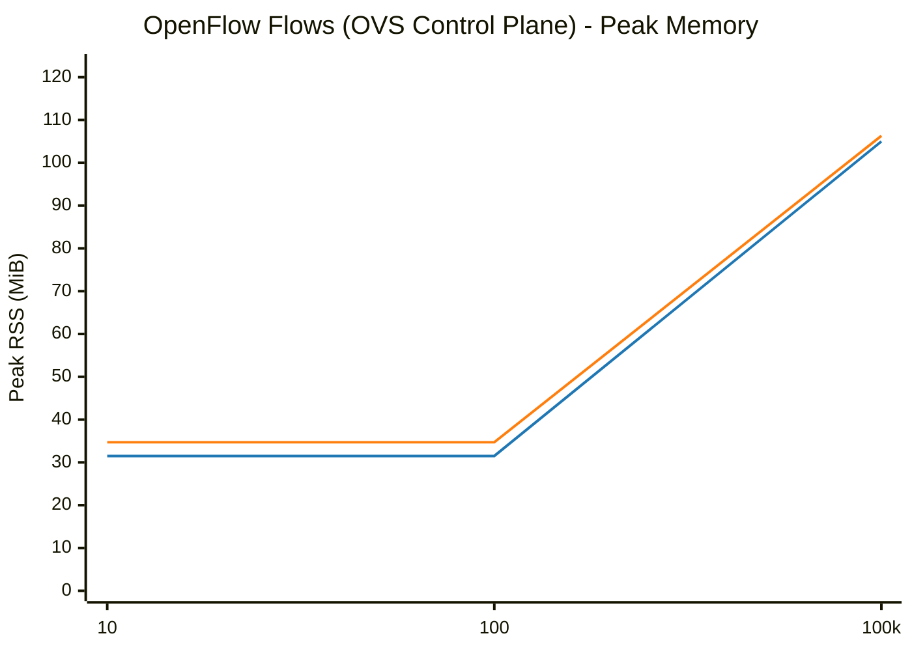

# OVS & OVN Scaling Benchmark: glibc malloc vs jemalloc

**Date:** 2026-10-13 23:20:02
**System:** Linux
**CPU:** Intel(R) Core(TM) Ultra 7 165H (22 vCPUs)
**Memory:** 62Gi
**Glibc Version:** ldd (GNU libc) 2.43
**Jemalloc Version:** 5.3.0

---

## Methodology

Each benchmark evaluates individual OVN/OVS objects, OpenFlow rule scaling, or combined workloads across powers of 10 (`1, 10, 100, 1,000, 10,000, 100,000`) through 3 lifecycle phases measuring the full OVN-Kubernetes pod stack (`ovn-northd`, `ovn-controller`, `ovs-vswitchd`, and `ovsdb-servers`):
1. **Baseline (Idle)**: Total Pod and per-daemon clean process RSS before creating objects.
2. **After Add (N)**: Time taken to commit $N$ objects via native OVSDB JSON-RPC, full recompute latency (`ovn-northd-loop` stopwatch), and Total Pod peak RSS (`VmHWM`) with per-daemon breakdown.
3. **After Remove (N)**: Time taken to delete all $N$ objects via native OVSDB JSON-RPC, post-deletion recompute latency, and retained heap memory (`Post-Deletion RSS - Baseline RSS`) measured after a wait period allowing page decay (`dirty_decay_ms:0,muzzy_decay_ms:0`).

---

## Logical Switch Port (LSP with IP, MAC, port_security)

| Scale (N) | Phase / Metric | glibc malloc | jemalloc | Relative Difference |
|---|---|---|---|---|
| **10** | Total Pod Baseline Heap (RssAnon) | 31.42 MiB | 34.93 MiB | +11.2% |
| | Add Duration | 0.005 s | 0.006 s | ~Parity (<1ms) |
| | Add Rate | 1,975 ops/s | 1,663 ops/s | -15.8% |
| | Recompute (`ovn-northd-loop`) | 0.5 ms | 0.0 ms | ~Parity (<1ms) |
| | Logical Flow (`lflow`) | 0.0 ms | 0.0 ms | N/A |
| | Total Pod Peak Heap (RssAnon) | 34.04 MiB | 37.43 MiB | +10.0% |
| | Delete Duration | 0.010 s | 0.010 s | ~Parity (<1ms) |
| | Post-Delete Recompute | 0.0 ms | 0.0 ms | N/A |
| | Total Pod Post-Delete Heap (RssAnon) | 33.66 MiB | 37.47 MiB | +11.3% |
| | **Total Pod Retained Heap** | **+2.24 MiB** | **+2.54 MiB** | **+0.30 MiB** |
| | ├─ `ovn-northd` (Peak / Retained Heap) | 6.74 / +0.05 MiB | 7.72 / +0.23 MiB | +14.5% / +0.18 MiB |
| | ├─ `ovn-controller` (Peak / Retained Heap) | 5.42 / +1.41 MiB | 5.75 / +1.42 MiB | +6.1% / +0.01 MiB |
| | ├─ `ovs-vswitchd` (Peak / Retained Heap) | 12.85 / +0.68 MiB | 14.37 / +0.62 MiB | +11.8% / -0.06 MiB |
| | ├─ `ovsdb-server (SB)` (Peak / Retained Heap) | 3.43 / +0.02 MiB | 3.59 / +0.10 MiB | +4.7% / +0.08 MiB |
| | ├─ `ovsdb-server (NB)` (Peak / Retained Heap) | 2.79 / +0.00 MiB | 2.95 / +0.03 MiB | +5.7% / +0.03 MiB |
| | ├─ `ovsdb-server (OVS)` (Peak / Retained Heap) | 2.81 / +0.08 MiB | 3.05 / +0.14 MiB | +8.5% / +0.06 MiB |
|---|---|---|---|---|
| **100** | Total Pod Baseline Heap (RssAnon) | 31.44 MiB | 34.93 MiB | +11.1% |
| | Add Duration | 0.019 s | 0.017 s | ~Parity (<1ms) |
| | Add Rate | 5,380 ops/s | 5,978 ops/s | +11.1% |
| | Recompute (`ovn-northd-loop`) | 0.5 ms | 0.0 ms | ~Parity (<1ms) |
| | Logical Flow (`lflow`) | 0.0 ms | 1.0 ms | N/A |
| | Total Pod Peak Heap (RssAnon) | 48.71 MiB | 50.95 MiB | +4.6% |
| | Delete Duration | 0.019 s | 0.015 s | ~Parity (<1ms) |
| | Post-Delete Recompute | 0.0 ms | 0.0 ms | N/A |
| | Total Pod Post-Delete Heap (RssAnon) | 47.15 MiB | 42.69 MiB | -9.5% |
| | **Total Pod Retained Heap** | **+15.71 MiB** | **+7.76 MiB** | **-7.95 MiB** |
| | ├─ `ovn-northd` (Peak / Retained Heap) | 9.10 / +0.69 MiB | 9.48 / +0.68 MiB | +4.2% / -0.01 MiB |
| | ├─ `ovn-controller` (Peak / Retained Heap) | 9.36 / +4.16 MiB | 10.78 / +3.61 MiB | +15.2% / -0.55 MiB |
| | ├─ `ovs-vswitchd` (Peak / Retained Heap) | 15.06 / +4.60 MiB | 17.22 / +2.13 MiB | +14.3% / -2.47 MiB |
| | ├─ `ovsdb-server (SB)` (Peak / Retained Heap) | 7.25 / +3.85 MiB | 5.91 / +0.47 MiB | -18.5% / -3.38 MiB |
| | ├─ `ovsdb-server (NB)` (Peak / Retained Heap) | 3.23 / +0.44 MiB | 3.40 / +0.23 MiB | +5.3% / -0.21 MiB |
| | ├─ `ovsdb-server (OVS)` (Peak / Retained Heap) | 4.71 / +1.97 MiB | 4.16 / +0.64 MiB | -11.7% / -1.33 MiB |
|---|---|---|---|---|

### Visual Charts

## ACL (Access Control List with stateful allow-related)

| Scale (N) | Phase / Metric | glibc malloc | jemalloc | Relative Difference |
|---|---|---|---|---|
| **10** | Total Pod Baseline Heap (RssAnon) | 33.58 MiB | 37.38 MiB | +11.3% |
| | Add Duration | 0.005 s | 0.007 s | ~Parity (<1ms) |
| | Add Rate | 1,831 ops/s | 1,424 ops/s | -22.2% |
| | Recompute (`ovn-northd-loop`) | 0.0 ms | 0.0 ms | N/A |
| | Logical Flow (`lflow`) | 0.0 ms | 1.0 ms | N/A |
| | Total Pod Peak Heap (RssAnon) | 34.63 MiB | 38.25 MiB | +10.5% |
| | Delete Duration | 0.006 s | 0.006 s | ~Parity (<1ms) |
| | Post-Delete Recompute | 0.2 ms | 0.0 ms | ~Parity (<1ms) |
| | Total Pod Post-Delete Heap (RssAnon) | 34.27 MiB | 37.87 MiB | +10.5% |
| | **Total Pod Retained Heap** | **+0.69 MiB** | **+0.49 MiB** | **-0.20 MiB** |
| | ├─ `ovn-northd` (Peak / Retained Heap) | 7.00 / +0.20 MiB | 7.83 / +0.15 MiB | +11.9% / -0.05 MiB |
| | ├─ `ovn-controller` (Peak / Retained Heap) | 5.42 / +0.08 MiB | 6.25 / +0.13 MiB | +15.3% / +0.05 MiB |
| | ├─ `ovs-vswitchd` (Peak / Retained Heap) | 12.93 / +0.11 MiB | 14.44 / +0.13 MiB | +11.7% / +0.02 MiB |
| | ├─ `ovsdb-server (SB)` (Peak / Retained Heap) | 3.69 / +0.30 MiB | 3.72 / +0.07 MiB | ~Parity (±1%) / -0.23 MiB |
| | ├─ `ovsdb-server (NB)` (Peak / Retained Heap) | 2.79 / +0.00 MiB | 2.96 / +0.01 MiB | +6.1% / +0.01 MiB |
| | ├─ `ovsdb-server (OVS)` (Peak / Retained Heap) | 2.80 / +0.00 MiB | 3.05 / +0.00 MiB | +8.9% / +0.00 MiB |
|---|---|---|---|---|
| **100** | Total Pod Baseline Heap (RssAnon) | 33.99 MiB | 37.35 MiB | +9.9% |
| | Add Duration | 0.009 s | 0.009 s | ~Parity (<1ms) |
| | Add Rate | 10,690 ops/s | 10,819 ops/s | +1.2% |
| | Recompute (`ovn-northd-loop`) | 0.0 ms | 0.1 ms | N/A |
| | Logical Flow (`lflow`) | 1.0 ms | 0.0 ms | ~Parity (<1ms) |
| | Total Pod Peak Heap (RssAnon) | 38.70 MiB | 41.35 MiB | +6.8% |
| | Delete Duration | 0.007 s | 0.006 s | ~Parity (<1ms) |
| | Post-Delete Recompute | 0.0 ms | 0.0 ms | ~Parity (<1ms) |
| | Total Pod Post-Delete Heap (RssAnon) | 36.94 MiB | 38.97 MiB | +5.5% |
| | **Total Pod Retained Heap** | **+2.95 MiB** | **+1.62 MiB** | **-1.33 MiB** |
| | ├─ `ovn-northd` (Peak / Retained Heap) | 8.00 / +0.58 MiB | 8.51 / +0.42 MiB | +6.4% / -0.16 MiB |
| | ├─ `ovn-controller` (Peak / Retained Heap) | 6.54 / -0.06 MiB | 7.44 / +0.34 MiB | +13.8% / +0.40 MiB |
| | ├─ `ovs-vswitchd` (Peak / Retained Heap) | 13.20 / +0.44 MiB | 14.64 / +0.38 MiB | +10.9% / -0.06 MiB |
| | ├─ `ovsdb-server (SB)` (Peak / Retained Heap) | 5.03 / +1.64 MiB | 4.53 / +0.25 MiB | -9.9% / -1.39 MiB |
| | ├─ `ovsdb-server (NB)` (Peak / Retained Heap) | 3.13 / +0.35 MiB | 3.18 / +0.22 MiB | +1.6% / -0.13 MiB |
| | ├─ `ovsdb-server (OVS)` (Peak / Retained Heap) | 2.80 / +0.00 MiB | 3.05 / +0.01 MiB | +8.9% / +0.01 MiB |
|---|---|---|---|---|

### Visual Charts

## Load Balancer (VIPs mapped to endpoints)

| Scale (N) | Phase / Metric | glibc malloc | jemalloc | Relative Difference |
|---|---|---|---|---|
| **10** | Total Pod Baseline Heap (RssAnon) | 34.00 MiB | 37.42 MiB | +10.1% |
| | Add Duration | 0.007 s | 0.005 s | ~Parity (<1ms) |
| | Add Rate | 1,451 ops/s | 1,850 ops/s | +27.6% |
| | Recompute (`ovn-northd-loop`) | 0.1 ms | 0.2 ms | ~Parity (<1ms) |
| | Logical Flow (`lflow`) | 0.0 ms | 0.0 ms | N/A |
| | Total Pod Peak Heap (RssAnon) | 34.00 MiB | 37.38 MiB | +9.9% |
| | Delete Duration | 0.007 s | 0.005 s | ~Parity (<1ms) |
| | Post-Delete Recompute | 0.0 ms | 0.0 ms | N/A |
| | Total Pod Post-Delete Heap (RssAnon) | 33.58 MiB | 37.42 MiB | +11.4% |
| | **Total Pod Retained Heap** | **-0.42 MiB** | **+0.00 MiB** | **+0.42 MiB** |
| | ├─ `ovn-northd` (Peak / Retained Heap) | 6.73 / +0.00 MiB | 7.71 / +0.01 MiB | +14.6% / +0.01 MiB |
| | ├─ `ovn-controller` (Peak / Retained Heap) | 5.42 / -0.43 MiB | 5.78 / +0.01 MiB | +6.6% / +0.44 MiB |
| | ├─ `ovs-vswitchd` (Peak / Retained Heap) | 12.85 / +0.01 MiB | 14.35 / +0.01 MiB | +11.7% / +0.00 MiB |
| | ├─ `ovsdb-server (SB)` (Peak / Retained Heap) | 3.41 / +0.00 MiB | 3.55 / -0.03 MiB | +4.1% / -0.03 MiB |
| | ├─ `ovsdb-server (NB)` (Peak / Retained Heap) | 2.79 / +0.00 MiB | 2.94 / +0.00 MiB | +5.4% / +0.00 MiB |
| | ├─ `ovsdb-server (OVS)` (Peak / Retained Heap) | 2.80 / +0.00 MiB | 3.05 / +0.00 MiB | +8.9% / +0.00 MiB |
|---|---|---|---|---|
| **100** | Total Pod Baseline Heap (RssAnon) | 34.00 MiB | 37.37 MiB | +9.9% |
| | Add Duration | 0.007 s | 0.007 s | ~Parity (<1ms) |
| | Add Rate | 13,552 ops/s | 14,054 ops/s | +3.7% |
| | Recompute (`ovn-northd-loop`) | 0.0 ms | 0.1 ms | N/A |
| | Logical Flow (`lflow`) | 0.0 ms | 0.0 ms | N/A |
| | Total Pod Peak Heap (RssAnon) | 34.01 MiB | 37.33 MiB | +9.8% |
| | Delete Duration | 0.006 s | 0.007 s | ~Parity (<1ms) |
| | Post-Delete Recompute | 0.5 ms | 0.5 ms | ~Parity (<1ms) |
| | Total Pod Post-Delete Heap (RssAnon) | 33.57 MiB | 37.36 MiB | +11.3% |
| | **Total Pod Retained Heap** | **-0.43 MiB** | **-0.01 MiB** | **+0.42 MiB** |
| | ├─ `ovn-northd` (Peak / Retained Heap) | 6.74 / +0.00 MiB | 7.69 / +0.00 MiB | +14.1% / +0.00 MiB |
| | ├─ `ovn-controller` (Peak / Retained Heap) | 5.42 / -0.44 MiB | 5.76 / +0.01 MiB | +6.3% / +0.45 MiB |
| | ├─ `ovs-vswitchd` (Peak / Retained Heap) | 12.85 / +0.01 MiB | 14.35 / +0.01 MiB | +11.7% / +0.00 MiB |
| | ├─ `ovsdb-server (SB)` (Peak / Retained Heap) | 3.41 / +0.00 MiB | 3.52 / -0.03 MiB | +3.2% / -0.03 MiB |
| | ├─ `ovsdb-server (NB)` (Peak / Retained Heap) | 2.79 / +0.00 MiB | 2.95 / +0.00 MiB | +5.7% / +0.00 MiB |
| | ├─ `ovsdb-server (OVS)` (Peak / Retained Heap) | 2.80 / +0.00 MiB | 3.06 / +0.00 MiB | +9.3% / +0.00 MiB |
|---|---|---|---|---|

### Visual Charts

## OpenFlow Flows (OVS Control Plane)

| Scale (N) | Phase / Metric | glibc malloc | jemalloc | Relative Difference |
|---|---|---|---|---|
| **10** | Total Pod Baseline Heap (RssAnon) | 31.35 MiB | 34.61 MiB | +10.4% |
| | Add Duration | 0.006 s | 0.006 s | ~Parity (<1ms) |
| | Add Rate | 1,555 ops/s | 1,691 ops/s | +8.7% |
| | Total Pod Peak Heap (RssAnon) | 31.48 MiB | 34.66 MiB | +10.1% |
| | Delete Duration | 0.004 s | 0.004 s | ~Parity (<1ms) |
| | Total Pod Post-Delete Heap (RssAnon) | 31.40 MiB | 34.73 MiB | +10.6% |
| | **Total Pod Retained Heap** | **+0.05 MiB** | **+0.12 MiB** | **+0.07 MiB** |
| | ├─ `ovn-northd` (Peak / Retained Heap) | 6.61 / -0.13 MiB | 7.38 / +0.01 MiB | +11.6% / +0.14 MiB |
| | ├─ `ovn-controller` (Peak / Retained Heap) | 3.61 / +0.01 MiB | 4.34 / +0.01 MiB | +20.2% / +0.00 MiB |
| | ├─ `ovs-vswitchd` (Peak / Retained Heap) | 12.34 / +0.17 MiB | 13.81 / +0.08 MiB | +11.9% / -0.09 MiB |
| | ├─ `ovsdb-server (SB)` (Peak / Retained Heap) | 3.38 / +0.00 MiB | 3.27 / +0.01 MiB | -3.3% / +0.01 MiB |
| | ├─ `ovsdb-server (NB)` (Peak / Retained Heap) | 2.79 / +0.00 MiB | 2.93 / +0.01 MiB | +5.0% / +0.01 MiB |
| | ├─ `ovsdb-server (OVS)` (Peak / Retained Heap) | 2.75 / +0.00 MiB | 2.93 / +0.00 MiB | +6.5% / +0.00 MiB |
|---|---|---|---|---|
| **100** | Total Pod Baseline Heap (RssAnon) | 31.37 MiB | 34.60 MiB | +10.3% |
| | Add Duration | 0.008 s | 0.010 s | ~Parity (<1ms) |
| | Add Rate | 12,875 ops/s | 9,720 ops/s | -24.5% |
| | Total Pod Peak Heap (RssAnon) | 31.50 MiB | 34.72 MiB | +10.2% |
| | Delete Duration | 0.003 s | 0.004 s | ~Parity (<1ms) |
| | Total Pod Post-Delete Heap (RssAnon) | 31.47 MiB | 34.79 MiB | +10.5% |
| | **Total Pod Retained Heap** | **+0.10 MiB** | **+0.19 MiB** | **+0.09 MiB** |
| | ├─ `ovn-northd` (Peak / Retained Heap) | 6.61 / -0.13 MiB | 7.38 / +0.01 MiB | +11.6% / +0.14 MiB |
| | ├─ `ovn-controller` (Peak / Retained Heap) | 3.61 / +0.01 MiB | 4.34 / +0.01 MiB | +20.2% / +0.00 MiB |
| | ├─ `ovs-vswitchd` (Peak / Retained Heap) | 12.36 / +0.22 MiB | 13.86 / +0.16 MiB | +12.1% / -0.06 MiB |
| | ├─ `ovsdb-server (SB)` (Peak / Retained Heap) | 3.38 / +0.00 MiB | 3.28 / +0.01 MiB | -3.0% / +0.01 MiB |
| | ├─ `ovsdb-server (NB)` (Peak / Retained Heap) | 2.79 / +0.00 MiB | 2.93 / +0.00 MiB | +5.0% / +0.00 MiB |
| | ├─ `ovsdb-server (OVS)` (Peak / Retained Heap) | 2.75 / +0.00 MiB | 2.93 / +0.00 MiB | +6.5% / +0.00 MiB |
|---|---|---|---|---|
| **100000** | Total Pod Baseline Heap (RssAnon) | 31.35 MiB | 34.63 MiB | +10.5% |
| | Add Duration | 3.162 s | 3.139 s | ~Parity (±1%) |
| | Add Rate | 31,622 ops/s | 31,862 ops/s | ~Parity (±1%) |
| | Total Pod Peak Heap (RssAnon) | 105.01 MiB | 106.26 MiB | +1.2% |
| | Delete Duration | 0.033 s | 0.029 s | ~Parity (<1ms) |
| | Total Pod Post-Delete Heap (RssAnon) | 110.57 MiB | 36.25 MiB | -67.2% |
| | **Total Pod Retained Heap** | **+79.22 MiB** | **+1.62 MiB** | **-77.60 MiB** |
| | ├─ `ovn-northd` (Peak / Retained Heap) | 6.47 / -0.14 MiB | 7.40 / +0.01 MiB | +14.4% / +0.15 MiB |
| | ├─ `ovn-controller` (Peak / Retained Heap) | 3.62 / +0.01 MiB | 4.36 / +0.01 MiB | +20.4% / +0.00 MiB |
| | ├─ `ovs-vswitchd` (Peak / Retained Heap) | 86.00 / +79.34 MiB | 85.34 / +1.58 MiB | ~Parity (±1%) / -77.76 MiB |
| | ├─ `ovsdb-server (SB)` (Peak / Retained Heap) | 3.38 / +0.00 MiB | 3.29 / +0.01 MiB | -2.7% / +0.01 MiB |
| | ├─ `ovsdb-server (NB)` (Peak / Retained Heap) | 2.79 / +0.00 MiB | 2.94 / +0.01 MiB | +5.4% / +0.01 MiB |
| | ├─ `ovsdb-server (OVS)` (Peak / Retained Heap) | 2.75 / +0.01 MiB | 2.93 / +0.00 MiB | +6.5% / -0.01 MiB |
|---|---|---|---|---|

### Visual Charts

