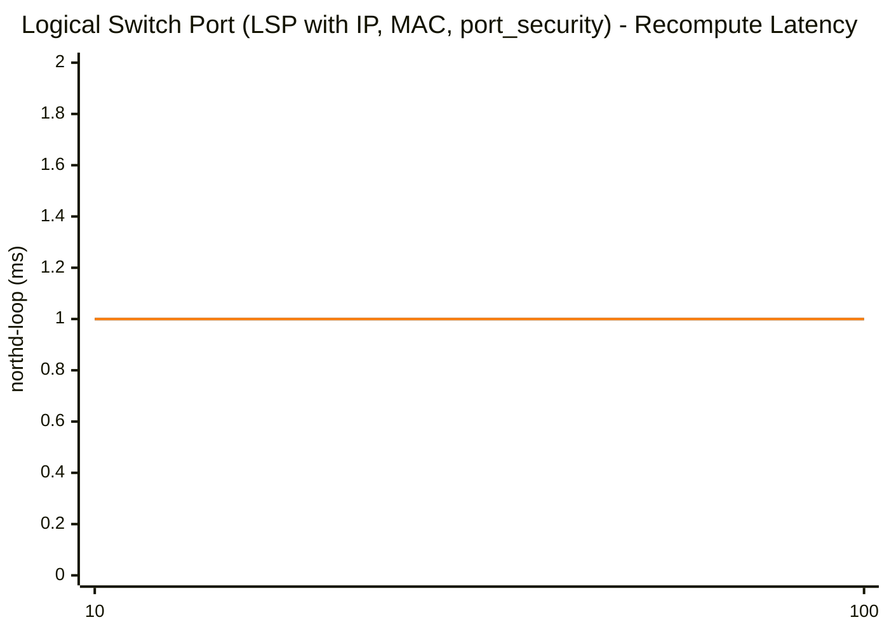
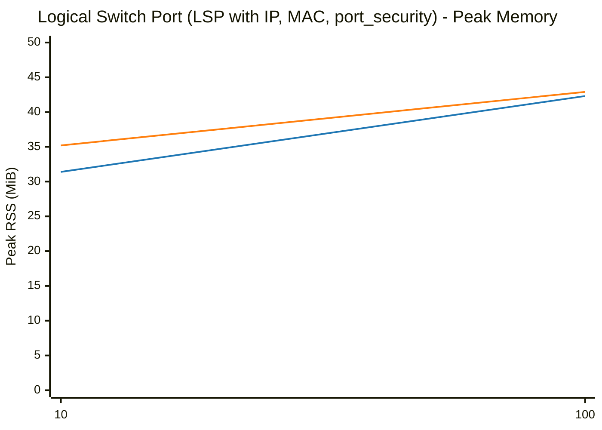

# OVS & OVN Scaling Benchmark: glibc malloc vs jemalloc

**Date:** 2026-10-13 21:58:32
**System:** Linux
**CPU:** Intel(R) Core(TM) Ultra 7 165H (22 vCPUs)
**Memory:** 62Gi
**Glibc Version:** ldd (GNU libc) 2.43
**Jemalloc Version:** 5.3.0

---

## Methodology

Each benchmark evaluates individual OVN/OVS objects, OpenFlow rule scaling, or combined workloads across powers of 10 (`1, 10, 100, 1,000, 10,000, 100,000`) through 3 lifecycle phases measuring the full OVN-Kubernetes pod stack (`ovn-northd`, `ovn-controller`, `ovs-vswitchd`, and `ovsdb-servers`):
1. **Baseline (Idle)**: Total Pod and per-daemon clean process RSS before creating objects.
2. **After Add (N)**: Time taken to commit $N$ objects via native OVSDB JSON-RPC, full recompute latency (`ovn-northd-loop` stopwatch), and Total Pod peak RSS (`VmHWM`) with per-daemon breakdown.
3. **After Remove (N)**: Time taken to delete all $N$ objects via native OVSDB JSON-RPC, post-deletion recompute latency, and retained heap memory (`Post-Deletion RSS - Baseline RSS`) measured after a wait period allowing page decay (`dirty_decay_ms:0,muzzy_decay_ms:0`).

---

## Logical Switch Port (LSP with IP, MAC, port_security)

| Scale (N) | Phase / Metric | glibc malloc | jemalloc | Relative Difference |
|---|---|---|---|---|
| **10** | Total Pod Baseline RSS | 31.09 MiB | 34.55 MiB | +11.1% |
| | Add Duration | 0.015 s | 0.014 s | -6.7% |
| | Add Rate | 680 ops/s | 720 ops/s | +5.8% |
| | Recompute (`ovn-northd-loop`) | 1.0 ms | 1.0 ms | ~Parity (±1%) |
| | Logical Flow (`lflow`) | 0.0 ms | 0.0 ms | N/A |
| | Total Pod Peak RSS (`VmHWM`) | 31.44 MiB | 35.25 MiB | +12.1% |
| | Delete Duration | 0.014 s | 0.012 s | -14.3% |
| | Post-Delete Recompute | 0.0 ms | 1.0 ms | N/A |
| | Total Pod Post-Delete RSS | 31.45 MiB | 35.31 MiB | +12.3% |
| | **Total Pod Retained Heap** | **+0.36 MiB** | **+0.76 MiB** | **+0.40 MiB** |
| | ├─ `ovn-northd` (Peak / Retained) | 6.71 / +0.06 MiB | 7.69 / +0.24 MiB | +14.6% / +0.18 MiB |
| | ├─ `ovn-controller` (Peak / Retained) | 3.52 / +0.08 MiB | 4.18 / +0.09 MiB | +18.7% / +0.01 MiB |
| | ├─ `ovs-vswitchd` (Peak / Retained) | 12.24 / +0.14 MiB | 13.77 / +0.17 MiB | +12.5% / +0.03 MiB |
| | ├─ `ovsdb-server (SB)` (Peak / Retained) | 3.38 / +0.02 MiB | 3.58 / +0.08 MiB | +5.9% / +0.06 MiB |
| | ├─ `ovsdb-server (NB)` (Peak / Retained) | 2.79 / +0.01 MiB | 2.97 / +0.05 MiB | +6.5% / +0.04 MiB |
| | ├─ `ovsdb-server (OVS)` (Peak / Retained) | 2.80 / +0.05 MiB | 3.06 / +0.13 MiB | +9.3% / +0.08 MiB |
|---|---|---|---|---|
| **100** | Total Pod Baseline RSS | 31.09 MiB | 34.55 MiB | +11.1% |
| | Add Duration | 0.025 s | 0.024 s | -4.0% |
| | Add Rate | 3,963 ops/s | 4,167 ops/s | +5.1% |
| | Recompute (`ovn-northd-loop`) | 1.0 ms | 1.0 ms | ~Parity (±1%) |
| | Logical Flow (`lflow`) | 0.0 ms | 0.0 ms | N/A |
| | Total Pod Peak RSS (`VmHWM`) | 42.34 MiB | 42.90 MiB | +1.3% |
| | Delete Duration | 0.019 s | 0.017 s | -10.5% |
| | Post-Delete Recompute | 1.0 ms | 1.0 ms | ~Parity (±1%) |
| | Total Pod Post-Delete RSS | 40.66 MiB | 38.07 MiB | -6.4% |
| | **Total Pod Retained Heap** | **+9.57 MiB** | **+3.52 MiB** | **-6.05 MiB** |
| | ├─ `ovn-northd` (Peak / Retained) | 9.08 / +0.87 MiB | 9.49 / +0.66 MiB | +4.5% / -0.21 MiB |
| | ├─ `ovn-controller` (Peak / Retained) | 4.29 / +0.81 MiB | 4.86 / +0.47 MiB | +13.3% / -0.34 MiB |
| | ├─ `ovs-vswitchd` (Peak / Retained) | 13.84 / +1.66 MiB | 15.16 / +0.83 MiB | +9.5% / -0.83 MiB |
| | ├─ `ovsdb-server (SB)` (Peak / Retained) | 7.23 / +3.87 MiB | 5.83 / +0.60 MiB | -19.4% / -3.27 MiB |
| | ├─ `ovsdb-server (NB)` (Peak / Retained) | 3.19 / +0.40 MiB | 3.40 / +0.29 MiB | +6.6% / -0.11 MiB |
| | ├─ `ovsdb-server (OVS)` (Peak / Retained) | 4.71 / +1.96 MiB | 4.16 / +0.67 MiB | -11.7% / -1.29 MiB |
|---|---|---|---|---|

### Visual Charts

