# OVS & OVN Scaling Benchmark: glibc malloc vs jemalloc

**Date:** 2026-10-13 19:28:12
**System:** Linux
**CPU:** Intel(R) Core(TM) Ultra 7 165H (22 vCPUs)
**Memory:** 62Gi
**Glibc Version:** ldd (GNU libc) 2.43
**Jemalloc Version:** 5.3.0

---

## Methodology

Each benchmark evaluates individual OVN/OVS objects, dataplane forwarding, or combined workloads across powers of 10 (`1, 10, 100, 1,000, 10,000, 100,000`) through 3 lifecycle phases using **native libovsdb** for database transactions:
1. **Baseline (Idle)**: Clean process RSS before creating objects.
2. **After Add (N)**: Time taken to commit $N$ objects via native OVSDB JSON-RPC, full recompute latency (`ovn-northd-loop` stopwatch), and peak RSS (`VmHWM`).
3. **After Remove (N)**: Time taken to delete all $N$ objects via native OVSDB JSON-RPC, post-deletion recompute latency, and retained heap memory (`Post-Deletion RSS - Baseline RSS`) measured after a wait period allowing page decay (`dirty_decay_ms:0,muzzy_decay_ms:0`).

---

## Logical Switch Port (LSP with IP, MAC, port_security)

| Scale (N) | Phase / Metric | glibc malloc | jemalloc | Relative Difference |
|---|---|---|---|---|
| **1** | Baseline RSS | 10.59 MiB | 12.28 MiB | +16.0% |
| | Add Duration | 0.004 s | 0.003 s | -25.0% |
| | Add Rate | 251 ops/s | 292 ops/s | +16.2% |
| | Recompute (`ovn-northd-loop`) | 5.9 ms | 5.0 ms | -16.6% |
| | Logical Flow (`lflow`) | 0.0 ms | 0.0 ms | N/A |
| | Peak RSS (`VmHWM`) | 10.65 MiB | 12.37 MiB | +16.2% |
| | Delete Duration | 0.004 s | 0.004 s | ~Parity (±1%) |
| | Post-Delete Recompute | 5.7 ms | 1.0 ms | -82.5% |
| | Post-Delete RSS | 10.65 MiB | 12.38 MiB | +16.2% |
| | **Retained Heap vs Baseline** | **+0.06 MiB** | **+0.10 MiB** | **+0.04 MiB** |
|---|---|---|---|---|
| **10** | Baseline RSS | 14.48 MiB | 15.51 MiB | +7.1% |
| | Add Duration | 0.008 s | 0.007 s | -12.5% |
| | Add Rate | 1,252 ops/s | 1,451 ops/s | +15.8% |
| | Recompute (`ovn-northd-loop`) | 1.0 ms | 1.0 ms | ~Parity (±1%) |
| | Logical Flow (`lflow`) | 0.0 ms | 0.0 ms | N/A |
| | Peak RSS (`VmHWM`) | 14.65 MiB | 15.80 MiB | +7.8% |
| | Delete Duration | 0.008 s | 0.007 s | -12.5% |
| | Post-Delete Recompute | 1.0 ms | 1.0 ms | ~Parity (±1%) |
| | Post-Delete RSS | 14.65 MiB | 15.80 MiB | +7.8% |
| | **Retained Heap vs Baseline** | **+0.17 MiB** | **+0.29 MiB** | **+0.12 MiB** |
|---|---|---|---|---|
| **100** | Baseline RSS | 10.55 MiB | 12.45 MiB | +18.0% |
| | Add Duration | 0.020 s | 0.020 s | ~Parity (±1%) |
| | Add Rate | 5,080 ops/s | 5,072 ops/s | ~Parity (±1%) |
| | Recompute (`ovn-northd-loop`) | 2.0 ms | 1.0 ms | -50.0% |
| | Logical Flow (`lflow`) | 1.0 ms | 0.0 ms | -100.0% |
| | Peak RSS (`VmHWM`) | 13.38 MiB | 15.24 MiB | +13.9% |
| | Delete Duration | 0.004 s | 0.004 s | ~Parity (±1%) |
| | Post-Delete Recompute | 1.0 ms | 2.0 ms | +100.0% |
| | Post-Delete RSS | 13.38 MiB | 15.33 MiB | +14.6% |
| | **Retained Heap vs Baseline** | **+2.83 MiB** | **+2.88 MiB** | **+0.05 MiB** |
|---|---|---|---|---|
| **1000** | Baseline RSS | 10.55 MiB | 12.39 MiB | +17.4% |
| | Add Duration | 0.311 s | 0.166 s | -46.6% |
| | Add Rate | 3,217 ops/s | 6,033 ops/s | +87.5% |
| | Recompute (`ovn-northd-loop`) | 26.0 ms | 9.0 ms | -65.4% |
| | Logical Flow (`lflow`) | 13.0 ms | 5.0 ms | -61.5% |
| | Peak RSS (`VmHWM`) | 36.80 MiB | 36.55 MiB | ~Parity (±1%) |
| | Delete Duration | 0.005 s | 0.005 s | ~Parity (±1%) |
| | Post-Delete Recompute | 13.0 ms | 9.0 ms | -30.8% |
| | Post-Delete RSS | 36.82 MiB | 36.67 MiB | ~Parity (±1%) |
| | **Retained Heap vs Baseline** | **+26.27 MiB** | **+24.28 MiB** | **-1.99 MiB** |
|---|---|---|---|---|
| **10000** | Baseline RSS | 10.71 MiB | 12.34 MiB | +15.2% |
| | Add Duration | 3.265 s | 2.203 s | -32.5% |
| | Add Rate | 3,062 ops/s | 4,539 ops/s | +48.2% |
| | Recompute (`ovn-northd-loop`) | 205.0 ms | 126.0 ms | -38.5% |
| | Logical Flow (`lflow`) | 100.0 ms | 76.0 ms | -24.0% |
| | Peak RSS (`VmHWM`) | 277.63 MiB | 231.16 MiB | -16.7% |
| | Delete Duration | 1.958 s | 0.736 s | -62.4% |
| | Post-Delete Recompute | 94.0 ms | 33.0 ms | -64.9% |
| | Post-Delete RSS | 277.85 MiB | 19.15 MiB | -93.1% |
| | **Retained Heap vs Baseline** | **+267.14 MiB** | **+6.81 MiB** | **-260.33 MiB** |
|---|---|---|---|---|

### Visual Charts

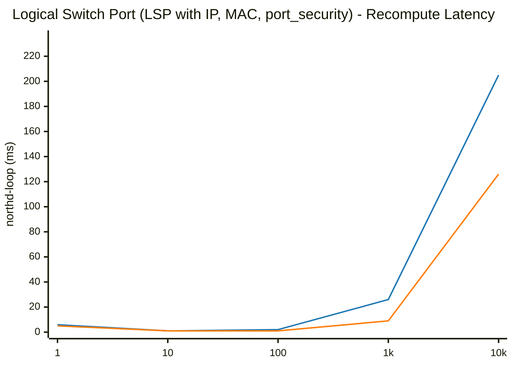

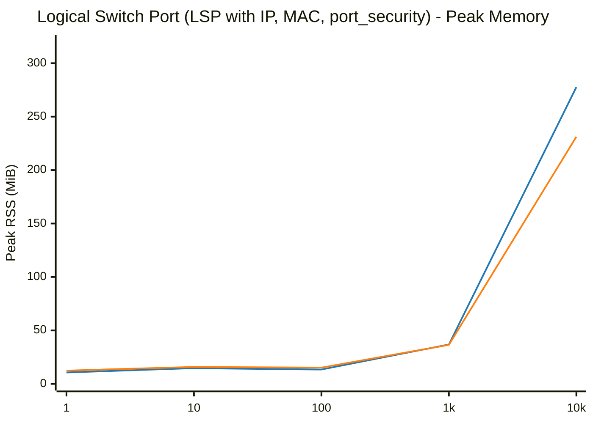

## ACL (Access Control List with stateful allow-related)

| Scale (N) | Phase / Metric | glibc malloc | jemalloc | Relative Difference |
|---|---|---|---|---|
| **1** | Baseline RSS | 10.59 MiB | 12.51 MiB | +18.1% |
| | Add Duration | 0.004 s | 0.004 s | ~Parity (±1%) |
| | Add Rate | 253 ops/s | 268 ops/s | +6.0% |
| | Recompute (`ovn-northd-loop`) | 1.0 ms | 5.6 ms | +463.4% |
| | Logical Flow (`lflow`) | 0.0 ms | 0.0 ms | N/A |
| | Peak RSS (`VmHWM`) | 10.67 MiB | 12.59 MiB | +18.0% |
| | Delete Duration | 0.004 s | 0.003 s | -25.0% |
| | Post-Delete Recompute | 1.0 ms | 5.1 ms | +412.6% |
| | Post-Delete RSS | 10.67 MiB | 12.59 MiB | +18.0% |
| | **Retained Heap vs Baseline** | **+0.08 MiB** | **+0.08 MiB** | **+0.00 MiB** |
|---|---|---|---|---|
| **10** | Baseline RSS | 14.48 MiB | 15.66 MiB | +8.1% |
| | Add Duration | 0.008 s | 0.007 s | -12.5% |
| | Add Rate | 1,270 ops/s | 1,497 ops/s | +17.8% |
| | Recompute (`ovn-northd-loop`) | 11.1 ms | 10.9 ms | -1.3% |
| | Logical Flow (`lflow`) | 0.0 ms | 0.0 ms | N/A |
| | Peak RSS (`VmHWM`) | 14.66 MiB | 15.82 MiB | +7.9% |
| | Delete Duration | 0.005 s | 0.006 s | +20.0% |
| | Post-Delete Recompute | 1.0 ms | 1.0 ms | ~Parity (±1%) |
| | Post-Delete RSS | 14.66 MiB | 15.84 MiB | +8.0% |
| | **Retained Heap vs Baseline** | **+0.18 MiB** | **+0.18 MiB** | **+0.00 MiB** |
|---|---|---|---|---|
| **100** | Baseline RSS | 10.61 MiB | 12.29 MiB | +15.8% |
| | Add Duration | 0.014 s | 0.010 s | -28.6% |
| | Add Rate | 7,123 ops/s | 9,778 ops/s | +37.3% |
| | Recompute (`ovn-northd-loop`) | 1.0 ms | 5.5 ms | +453.6% |
| | Logical Flow (`lflow`) | 0.0 ms | 0.0 ms | N/A |
| | Peak RSS (`VmHWM`) | 11.87 MiB | 13.68 MiB | +15.2% |
| | Delete Duration | 0.005 s | 0.004 s | -20.0% |
| | Post-Delete Recompute | 1.0 ms | 1.0 ms | ~Parity (±1%) |
| | Post-Delete RSS | 11.87 MiB | 13.69 MiB | +15.3% |
| | **Retained Heap vs Baseline** | **+1.26 MiB** | **+1.40 MiB** | **+0.14 MiB** |
|---|---|---|---|---|
| **1000** | Baseline RSS | 10.72 MiB | 12.39 MiB | +15.6% |
| | Add Duration | 0.066 s | 0.058 s | -12.1% |
| | Add Rate | 15,040 ops/s | 17,257 ops/s | +14.7% |
| | Recompute (`ovn-northd-loop`) | 4.0 ms | 3.0 ms | -25.0% |
| | Logical Flow (`lflow`) | 4.0 ms | 2.0 ms | -50.0% |
| | Peak RSS (`VmHWM`) | 20.77 MiB | 21.33 MiB | +2.7% |
| | Delete Duration | 0.006 s | 0.003 s | -50.0% |
| | Post-Delete Recompute | 3.0 ms | 3.0 ms | ~Parity (±1%) |
| | Post-Delete RSS | 20.77 MiB | 21.36 MiB | +2.8% |
| | **Retained Heap vs Baseline** | **+10.05 MiB** | **+8.97 MiB** | **-1.08 MiB** |
|---|---|---|---|---|
| **10000** | Baseline RSS | 10.57 MiB | 12.35 MiB | +16.8% |
| | Add Duration | 1.183 s | 0.703 s | -40.6% |
| | Add Rate | 8,454 ops/s | 14,222 ops/s | +68.2% |
| | Recompute (`ovn-northd-loop`) | 43.0 ms | 33.0 ms | -23.3% |
| | Logical Flow (`lflow`) | 37.0 ms | 30.0 ms | -18.9% |
| | Peak RSS (`VmHWM`) | 100.88 MiB | 91.35 MiB | -9.4% |
| | Delete Duration | 0.013 s | 0.010 s | -23.1% |
| | Post-Delete Recompute | 36.0 ms | 29.0 ms | -19.4% |
| | Post-Delete RSS | 98.89 MiB | 90.82 MiB | -8.2% |
| | **Retained Heap vs Baseline** | **+88.32 MiB** | **+78.47 MiB** | **-9.85 MiB** |
|---|---|---|---|---|

### Visual Charts

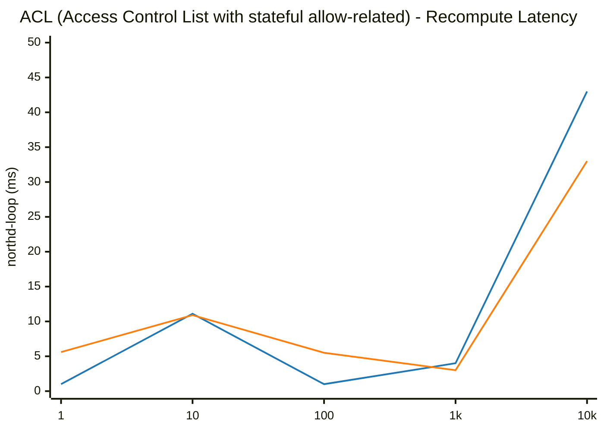

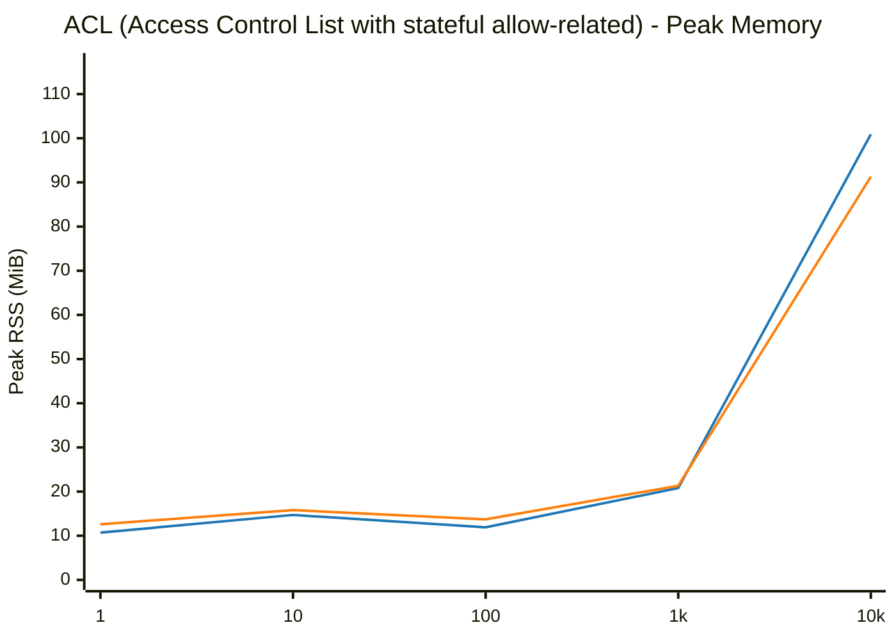

## Address Set (IP list matching ACL)

| Scale (N) | Phase / Metric | glibc malloc | jemalloc | Relative Difference |
|---|---|---|---|---|
| **1** | Baseline RSS | 10.66 MiB | 12.34 MiB | +15.8% |
| | Add Duration | 0.005 s | 0.004 s | -20.0% |
| | Add Rate | 214 ops/s | 261 ops/s | +21.8% |
| | Recompute (`ovn-northd-loop`) | 1.0 ms | 1.0 ms | ~Parity (±1%) |
| | Logical Flow (`lflow`) | 0.0 ms | 1.0 ms | N/A |
| | Peak RSS (`VmHWM`) | 10.75 MiB | 12.46 MiB | +15.9% |
| | Delete Duration | 0.004 s | 0.004 s | ~Parity (±1%) |
| | Post-Delete Recompute | 1.0 ms | 1.0 ms | ~Parity (±1%) |
| | Post-Delete RSS | 10.75 MiB | 12.47 MiB | +16.0% |
| | **Retained Heap vs Baseline** | **+0.09 MiB** | **+0.13 MiB** | **+0.04 MiB** |
|---|---|---|---|---|
| **10** | Baseline RSS | 14.44 MiB | 15.54 MiB | +7.6% |
| | Add Duration | 0.006 s | 0.007 s | +16.7% |
| | Add Rate | 1,609 ops/s | 1,505 ops/s | -6.4% |
| | Recompute (`ovn-northd-loop`) | 1.0 ms | 1.0 ms | ~Parity (±1%) |
| | Logical Flow (`lflow`) | 0.0 ms | 0.0 ms | N/A |
| | Peak RSS (`VmHWM`) | 14.53 MiB | 15.67 MiB | +7.8% |
| | Delete Duration | 0.007 s | 0.008 s | +14.3% |
| | Post-Delete Recompute | 8.4 ms | 1.0 ms | -88.0% |
| | Post-Delete RSS | 14.53 MiB | 15.68 MiB | +7.9% |
| | **Retained Heap vs Baseline** | **+0.09 MiB** | **+0.14 MiB** | **+0.05 MiB** |
|---|---|---|---|---|
| **100** | Baseline RSS | 10.57 MiB | 12.41 MiB | +17.4% |
| | Add Duration | 0.004 s | 0.004 s | ~Parity (±1%) |
| | Add Rate | 24,485 ops/s | 27,723 ops/s | +13.2% |
| | Recompute (`ovn-northd-loop`) | 5.4 ms | 4.8 ms | -11.2% |
| | Logical Flow (`lflow`) | 0.0 ms | 0.0 ms | N/A |
| | Peak RSS (`VmHWM`) | 10.68 MiB | 12.50 MiB | +17.0% |
| | Delete Duration | 0.004 s | 0.004 s | ~Parity (±1%) |
| | Post-Delete Recompute | 1.0 ms | 4.5 ms | +354.6% |
| | Post-Delete RSS | 10.68 MiB | 12.51 MiB | +17.1% |
| | **Retained Heap vs Baseline** | **+0.11 MiB** | **+0.10 MiB** | **-0.01 MiB** |
|---|---|---|---|---|
| **1000** | Baseline RSS | 10.55 MiB | 12.45 MiB | +18.0% |
| | Add Duration | 0.005 s | 0.004 s | -20.0% |
| | Add Rate | 192,196 ops/s | 265,533 ops/s | +38.2% |
| | Recompute (`ovn-northd-loop`) | 4.1 ms | 5.4 ms | +33.1% |
| | Logical Flow (`lflow`) | 0.0 ms | 0.0 ms | N/A |
| | Peak RSS (`VmHWM`) | 10.87 MiB | 12.79 MiB | +17.7% |
| | Delete Duration | 0.003 s | 0.004 s | +33.3% |
| | Post-Delete Recompute | 1.0 ms | 4.6 ms | +358.0% |
| | Post-Delete RSS | 10.87 MiB | 12.80 MiB | +17.8% |
| | **Retained Heap vs Baseline** | **+0.32 MiB** | **+0.35 MiB** | **+0.03 MiB** |
|---|---|---|---|---|
| **10000** | Baseline RSS | 10.56 MiB | 12.37 MiB | +17.1% |
| | Add Duration | 0.022 s | 0.023 s | +4.5% |
| | Add Rate | 461,957 ops/s | 436,891 ops/s | -5.4% |
| | Recompute (`ovn-northd-loop`) | 6.1 ms | 1.0 ms | -83.7% |
| | Logical Flow (`lflow`) | 0.0 ms | 0.0 ms | N/A |
| | Peak RSS (`VmHWM`) | 12.69 MiB | 14.51 MiB | +14.3% |
| | Delete Duration | 0.004 s | 0.003 s | -25.0% |
| | Post-Delete Recompute | 1.0 ms | 4.1 ms | +309.1% |
| | Post-Delete RSS | 12.69 MiB | 14.52 MiB | +14.4% |
| | **Retained Heap vs Baseline** | **+2.13 MiB** | **+2.15 MiB** | **+0.02 MiB** |
|---|---|---|---|---|

### Visual Charts

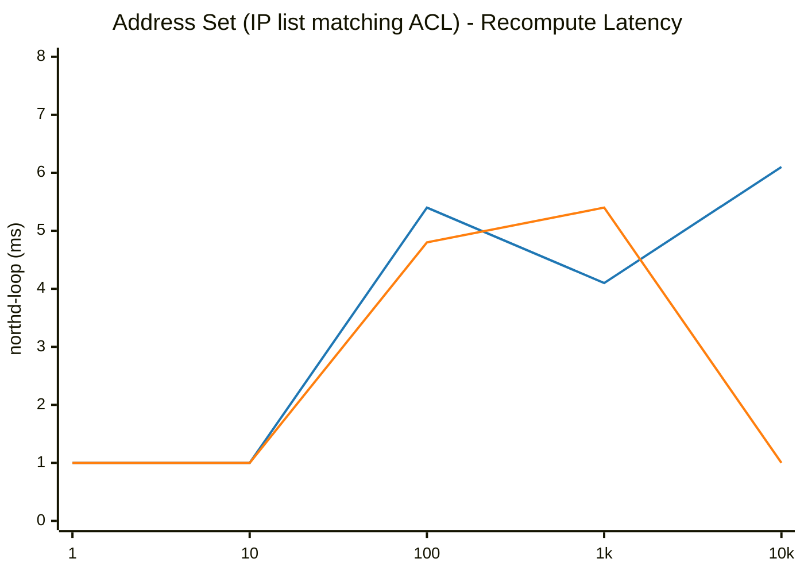

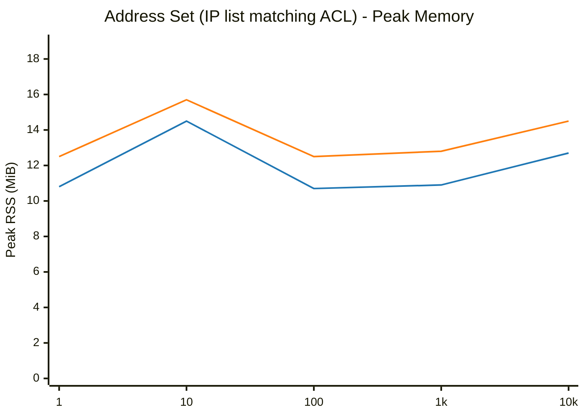

## Port Group (Ports member grouping matching ACL)

| Scale (N) | Phase / Metric | glibc malloc | jemalloc | Relative Difference |
|---|---|---|---|---|
| **1** | Baseline RSS | 10.61 MiB | 12.37 MiB | +16.6% |
| | Add Duration | 0.003 s | 0.004 s | +33.3% |
| | Add Rate | 341 ops/s | 283 ops/s | -16.9% |
| | Recompute (`ovn-northd-loop`) | 1.0 ms | 1.0 ms | ~Parity (±1%) |
| | Logical Flow (`lflow`) | 0.0 ms | 0.0 ms | N/A |
| | Peak RSS (`VmHWM`) | 10.61 MiB | 12.38 MiB | +16.7% |
| | Delete Duration | 0.004 s | 0.003 s | -25.0% |
| | Post-Delete Recompute | 1.0 ms | 1.0 ms | ~Parity (±1%) |
| | Post-Delete RSS | 10.61 MiB | 12.38 MiB | +16.7% |
| | **Retained Heap vs Baseline** | **+0.00 MiB** | **+0.01 MiB** | **+0.01 MiB** |
|---|---|---|---|---|
| **10** | Baseline RSS | 14.50 MiB | 15.62 MiB | +7.7% |
| | Add Duration | 0.008 s | 0.006 s | -25.0% |
| | Add Rate | 1,293 ops/s | 1,669 ops/s | +29.1% |
| | Recompute (`ovn-northd-loop`) | 1.0 ms | 11.7 ms | +1070.2% |
| | Logical Flow (`lflow`) | 0.0 ms | 0.0 ms | N/A |
| | Peak RSS (`VmHWM`) | 14.64 MiB | 15.71 MiB | +7.3% |
| | Delete Duration | 0.007 s | 0.008 s | +14.3% |
| | Post-Delete Recompute | 1.0 ms | 1.0 ms | ~Parity (±1%) |
| | Post-Delete RSS | 14.64 MiB | 15.73 MiB | +7.4% |
| | **Retained Heap vs Baseline** | **+0.14 MiB** | **+0.11 MiB** | **-0.03 MiB** |
|---|---|---|---|---|
| **100** | Baseline RSS | 11.15 MiB | 13.00 MiB | +16.6% |
| | Add Duration | 0.004 s | 0.004 s | ~Parity (±1%) |
| | Add Rate | 25,833 ops/s | 24,061 ops/s | -6.9% |
| | Recompute (`ovn-northd-loop`) | 1.0 ms | 1.0 ms | ~Parity (±1%) |
| | Logical Flow (`lflow`) | 0.0 ms | 0.0 ms | N/A |
| | Peak RSS (`VmHWM`) | 11.15 MiB | 13.00 MiB | +16.6% |
| | Delete Duration | 0.004 s | 0.003 s | -25.0% |
| | Post-Delete Recompute | 1.0 ms | 1.0 ms | ~Parity (±1%) |
| | Post-Delete RSS | 11.15 MiB | 13.00 MiB | +16.6% |
| | **Retained Heap vs Baseline** | **+0.00 MiB** | **+0.00 MiB** | **+0.00 MiB** |
|---|---|---|---|---|
| **1000** | Baseline RSS | 15.09 MiB | 16.71 MiB | +10.7% |
| | Add Duration | 0.006 s | 0.005 s | -16.7% |
| | Add Rate | 158,353 ops/s | 205,676 ops/s | +29.9% |
| | Recompute (`ovn-northd-loop`) | 3.0 ms | 3.0 ms | ~Parity (±1%) |
| | Logical Flow (`lflow`) | 0.0 ms | 1.0 ms | N/A |
| | Peak RSS (`VmHWM`) | 15.09 MiB | 16.71 MiB | +10.7% |
| | Delete Duration | 0.004 s | 0.004 s | ~Parity (±1%) |
| | Post-Delete Recompute | 3.0 ms | 4.0 ms | +33.3% |
| | Post-Delete RSS | 15.09 MiB | 16.71 MiB | +10.7% |
| | **Retained Heap vs Baseline** | **+0.00 MiB** | **+0.00 MiB** | **+0.00 MiB** |
|---|---|---|---|---|
| **10000** | Baseline RSS | 57.22 MiB | 53.77 MiB | -6.0% |
| | Add Duration | 0.025 s | 0.017 s | -32.0% |
| | Add Rate | 405,646 ops/s | 574,349 ops/s | +41.6% |
| | Recompute (`ovn-northd-loop`) | 49.0 ms | 36.0 ms | -26.5% |
| | Logical Flow (`lflow`) | 8.0 ms | 7.0 ms | -12.5% |
| | Peak RSS (`VmHWM`) | 58.22 MiB | 53.78 MiB | -7.6% |
| | Delete Duration | 0.013 s | 0.010 s | -23.1% |
| | Post-Delete Recompute | 49.0 ms | 34.0 ms | -30.6% |
| | Post-Delete RSS | 57.22 MiB | 53.78 MiB | -6.0% |
| | **Retained Heap vs Baseline** | **+0.00 MiB** | **+0.01 MiB** | **+0.01 MiB** |
|---|---|---|---|---|

### Visual Charts

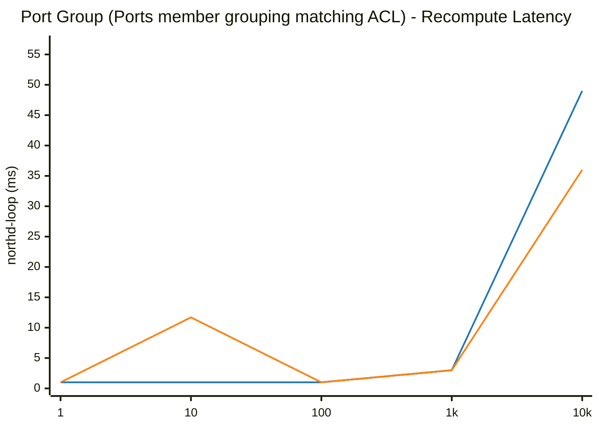

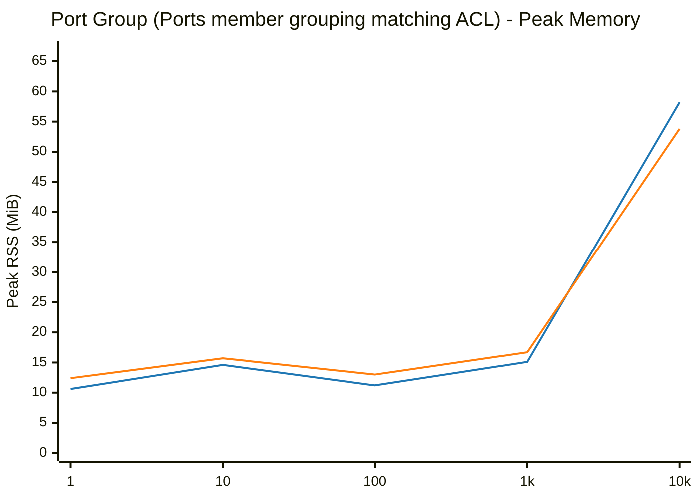

## Load Balancer (VIPs mapped to endpoints)

| Scale (N) | Phase / Metric | glibc malloc | jemalloc | Relative Difference |
|---|---|---|---|---|
| **1** | Baseline RSS | 10.60 MiB | 12.43 MiB | +17.3% |
| | Add Duration | 0.003 s | 0.004 s | +33.3% |
| | Add Rate | 323 ops/s | 277 ops/s | -14.3% |
| | Recompute (`ovn-northd-loop`) | 5.3 ms | 3.9 ms | -26.4% |
| | Logical Flow (`lflow`) | 0.0 ms | 0.0 ms | N/A |
| | Peak RSS (`VmHWM`) | 10.73 MiB | 12.49 MiB | +16.4% |
| | Delete Duration | 0.004 s | 0.004 s | ~Parity (±1%) |
| | Post-Delete Recompute | 1.0 ms | 5.5 ms | +451.7% |
| | Post-Delete RSS | 10.73 MiB | 12.52 MiB | +16.7% |
| | **Retained Heap vs Baseline** | **+0.13 MiB** | **+0.09 MiB** | **-0.04 MiB** |
|---|---|---|---|---|
| **10** | Baseline RSS | 14.46 MiB | 15.58 MiB | +7.7% |
| | Add Duration | 0.008 s | 0.006 s | -25.0% |
| | Add Rate | 1,255 ops/s | 1,592 ops/s | +26.8% |
| | Recompute (`ovn-northd-loop`) | 1.0 ms | 1.0 ms | ~Parity (±1%) |
| | Logical Flow (`lflow`) | 0.0 ms | 0.0 ms | N/A |
| | Peak RSS (`VmHWM`) | 14.71 MiB | 15.89 MiB | +8.0% |
| | Delete Duration | 0.009 s | 0.008 s | -11.1% |
| | Post-Delete Recompute | 1.0 ms | 1.0 ms | ~Parity (±1%) |
| | Post-Delete RSS | 14.71 MiB | 15.89 MiB | +8.0% |
| | **Retained Heap vs Baseline** | **+0.25 MiB** | **+0.31 MiB** | **+0.06 MiB** |
|---|---|---|---|---|
| **100** | Baseline RSS | 10.59 MiB | 12.41 MiB | +17.2% |
| | Add Duration | 0.013 s | 0.013 s | ~Parity (±1%) |
| | Add Rate | 7,446 ops/s | 7,731 ops/s | +3.8% |
| | Recompute (`ovn-northd-loop`) | 2.0 ms | 5.9 ms | +195.6% |
| | Logical Flow (`lflow`) | 1.0 ms | 0.0 ms | -100.0% |
| | Peak RSS (`VmHWM`) | 12.61 MiB | 14.23 MiB | +12.8% |
| | Delete Duration | 0.006 s | 0.006 s | ~Parity (±1%) |
| | Post-Delete Recompute | 1.0 ms | 1.0 ms | ~Parity (±1%) |
| | Post-Delete RSS | 12.60 MiB | 14.26 MiB | +13.2% |
| | **Retained Heap vs Baseline** | **+2.01 MiB** | **+1.85 MiB** | **-0.16 MiB** |
|---|---|---|---|---|
| **1000** | Baseline RSS | 10.63 MiB | 12.36 MiB | +16.3% |
| | Add Duration | 0.127 s | 0.076 s | -40.2% |
| | Add Rate | 7,895 ops/s | 13,150 ops/s | +66.5% |
| | Recompute (`ovn-northd-loop`) | 8.0 ms | 11.0 ms | +37.5% |
| | Logical Flow (`lflow`) | 2.0 ms | 3.0 ms | +50.0% |
| | Peak RSS (`VmHWM`) | 27.36 MiB | 26.86 MiB | -1.8% |
| | Delete Duration | 0.054 s | 0.030 s | -44.4% |
| | Post-Delete Recompute | 3.0 ms | 5.8 ms | +93.5% |
| | Post-Delete RSS | 27.36 MiB | 27.21 MiB | ~Parity (±1%) |
| | **Retained Heap vs Baseline** | **+16.73 MiB** | **+14.85 MiB** | **-1.88 MiB** |
|---|---|---|---|---|
| **5000** | Baseline RSS | 14.50 MiB | 15.34 MiB | +5.8% |
| | Add Duration | 3.010 s | 2.730 s | -9.3% |
| | Add Rate | 1,661 ops/s | 1,831 ops/s | +10.3% |
| | Recompute (`ovn-northd-loop`) | 52.0 ms | 36.0 ms | -30.8% |
| | Logical Flow (`lflow`) | 10.0 ms | 7.0 ms | -30.0% |
| | Peak RSS (`VmHWM`) | 62.09 MiB | 56.03 MiB | -9.8% |
| | Delete Duration | 0.936 s | 0.809 s | -13.6% |
| | Post-Delete Recompute | 0.0 ms | 0.0 ms | N/A |
| | Post-Delete RSS | 61.50 MiB | 56.01 MiB | -8.9% |
| | **Retained Heap vs Baseline** | **+47.00 MiB** | **+40.67 MiB** | **-6.33 MiB** |
|---|---|---|---|---|
| **10000** | Baseline RSS | 10.59 MiB | 12.44 MiB | +17.5% |
| | Add Duration | 1.957 s | 1.060 s | -45.8% |
| | Add Rate | 5,108 ops/s | 9,437 ops/s | +84.7% |
| | Recompute (`ovn-northd-loop`) | 137.0 ms | 76.0 ms | -44.5% |
| | Logical Flow (`lflow`) | 40.0 ms | 25.0 ms | -37.5% |
| | Peak RSS (`VmHWM`) | 153.99 MiB | 128.79 MiB | -16.4% |
| | Delete Duration | 1.095 s | 0.361 s | -67.0% |
| | Post-Delete Recompute | 102.0 ms | 20.0 ms | -80.4% |
| | Post-Delete RSS | 154.79 MiB | 126.28 MiB | -18.4% |
| | **Retained Heap vs Baseline** | **+144.20 MiB** | **+113.84 MiB** | **-30.36 MiB** |
|---|---|---|---|---|

### Visual Charts

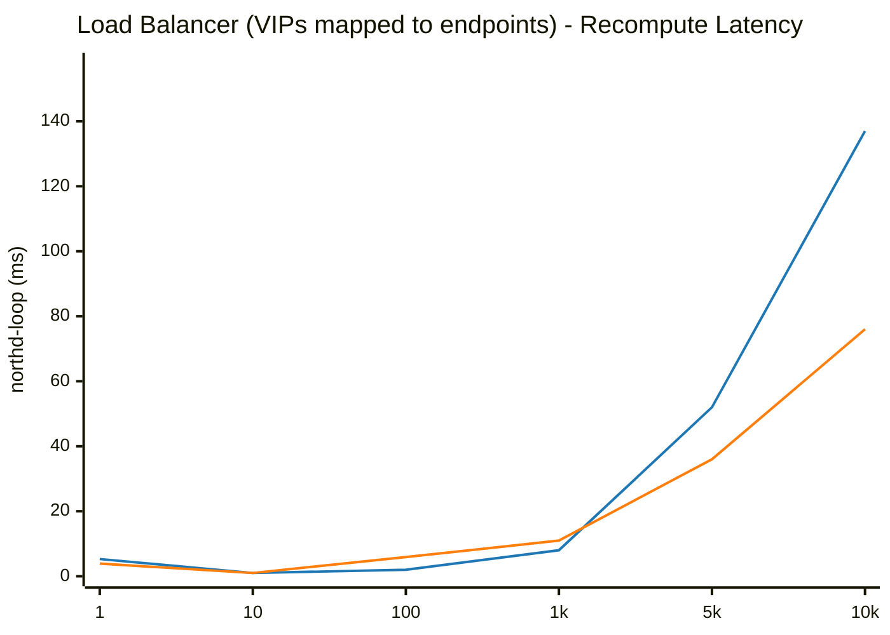

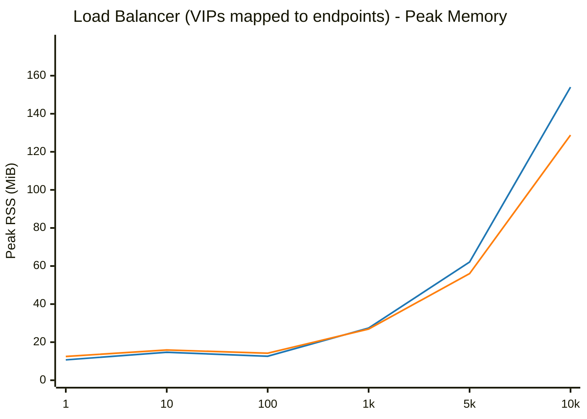

## OpenFlow Flows (OVS Control Plane)

| Scale (N) | Phase / Metric | glibc malloc | jemalloc | Relative Difference |
|---|---|---|---|---|
| **1** | Baseline RSS | 21.30 MiB | 26.05 MiB | +22.3% |
| | Add Duration | 0.004 s | 0.003 s | -25.0% |
| | Add Rate | 262 ops/s | 323 ops/s | +23.4% |
| | Peak RSS (`VmHWM`) | 21.54 MiB | 26.35 MiB | +22.3% |
| | Delete Duration | 0.003 s | 0.003 s | ~Parity (±1%) |
| | Post-Delete RSS | 21.55 MiB | 26.37 MiB | +22.4% |
| | **Retained Heap vs Baseline** | **+0.25 MiB** | **+0.32 MiB** | **+0.07 MiB** |
|---|---|---|---|---|
| **10** | Baseline RSS | 19.25 MiB | 21.38 MiB | +11.1% |
| | Add Duration | 0.006 s | 0.007 s | +16.7% |
| | Add Rate | 1,657 ops/s | 1,345 ops/s | -18.8% |
| | Peak RSS (`VmHWM`) | 19.60 MiB | 21.89 MiB | +11.7% |
| | Delete Duration | 0.004 s | 0.007 s | +75.0% |
| | Post-Delete RSS | 19.62 MiB | 21.97 MiB | +12.0% |
| | **Retained Heap vs Baseline** | **+0.37 MiB** | **+0.59 MiB** | **+0.22 MiB** |
|---|---|---|---|---|
| **100** | Baseline RSS | 21.18 MiB | 25.86 MiB | +22.1% |
| | Add Duration | 0.007 s | 0.009 s | +28.6% |
| | Add Rate | 15,304 ops/s | 11,251 ops/s | -26.5% |
| | Peak RSS (`VmHWM`) | 21.42 MiB | 26.28 MiB | +22.7% |
| | Delete Duration | 0.002 s | 0.004 s | +100.0% |
| | Post-Delete RSS | 21.59 MiB | 26.40 MiB | +22.3% |
| | **Retained Heap vs Baseline** | **+0.41 MiB** | **+0.54 MiB** | **+0.13 MiB** |
|---|---|---|---|---|
| **1000** | Baseline RSS | 21.24 MiB | 25.80 MiB | +21.5% |
| | Add Duration | 0.034 s | 0.031 s | -8.8% |
| | Add Rate | 29,394 ops/s | 32,178 ops/s | +9.5% |
| | Peak RSS (`VmHWM`) | 22.13 MiB | 26.68 MiB | +20.6% |
| | Delete Duration | 0.004 s | 0.005 s | +25.0% |
| | Post-Delete RSS | 22.29 MiB | 27.09 MiB | +21.5% |
| | **Retained Heap vs Baseline** | **+1.05 MiB** | **+1.29 MiB** | **+0.24 MiB** |
|---|---|---|---|---|
| **10000** | Baseline RSS | 21.30 MiB | 25.91 MiB | +21.6% |
| | Add Duration | 0.277 s | 0.279 s | ~Parity (±1%) |
| | Add Rate | 36,058 ops/s | 35,904 ops/s | ~Parity (±1%) |
| | Peak RSS (`VmHWM`) | 28.89 MiB | 33.40 MiB | +15.6% |
| | Delete Duration | 0.004 s | 0.005 s | +25.0% |
| | Post-Delete RSS | 29.73 MiB | 35.57 MiB | +19.6% |
| | **Retained Heap vs Baseline** | **+8.43 MiB** | **+9.66 MiB** | **+1.23 MiB** |
|---|---|---|---|---|
| **100000** | Baseline RSS | 19.06 MiB | 21.13 MiB | +10.9% |
| | Add Duration | 3.196 s | 3.110 s | -2.7% |
| | Add Rate | 31,292 ops/s | 32,158 ops/s | +2.8% |
| | Peak RSS (`VmHWM`) | 93.48 MiB | 93.12 MiB | ~Parity (±1%) |
| | Delete Duration | 0.031 s | 0.029 s | -6.5% |
| | Post-Delete RSS | 99.03 MiB | 104.20 MiB | +5.2% |
| | **Retained Heap vs Baseline** | **+79.97 MiB** | **+83.07 MiB** | **+3.10 MiB** |
|---|---|---|---|---|

### Visual Charts

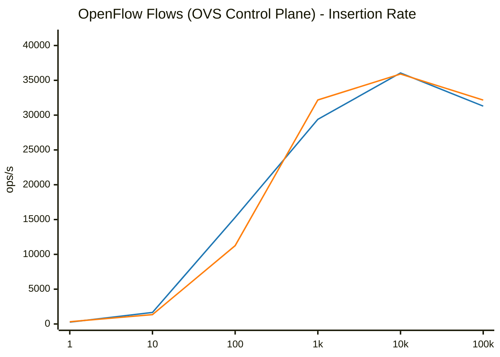

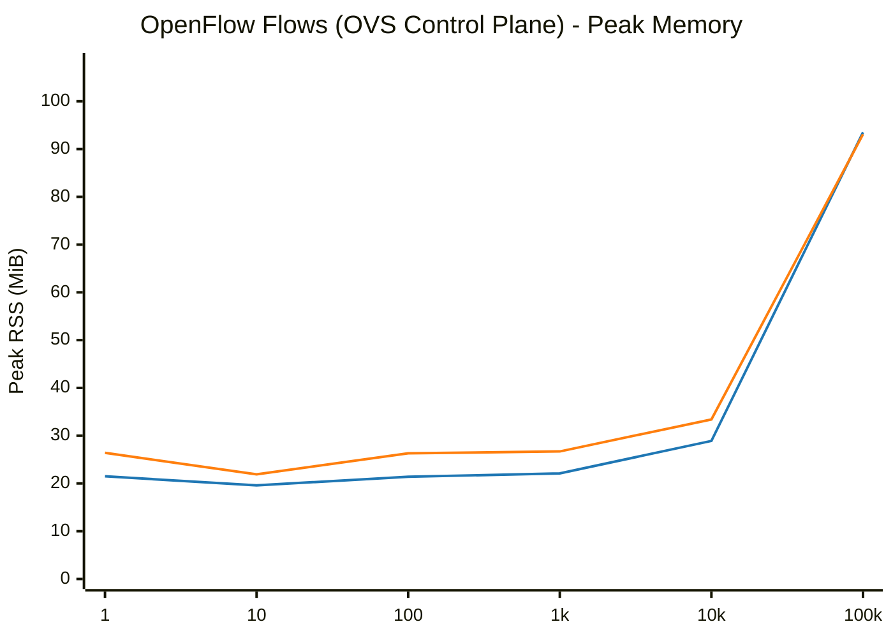

## OVS Datapath Packet Forwarding & Megaflow Cache

| Scale (N) | Phase / Metric | glibc malloc | jemalloc | Relative Difference |
|---|---|---|---|---|
| **1** | Baseline RSS | 21.44 MiB | 26.26 MiB | +22.5% |
| | Forwarding Duration | 0.004 s | 0.002 s | -50.0% |
| | Forwarding Rate | 228 pkts/s | 466 pkts/s | +104.1% |
| | Peak RSS (`VmHWM`) | 21.44 MiB | 26.26 MiB | +22.5% |
| | Flow Flush Duration (`dpctl/del-flows`) | 0.001 s | 0.002 s | +100.0% |
| | Post-Delete RSS | 21.45 MiB | 26.27 MiB | +22.5% |
| | **Retained Heap vs Baseline** | **+0.01 MiB** | **+0.01 MiB** | **+0.00 MiB** |
|---|---|---|---|---|
| **10** | Baseline RSS | 19.43 MiB | 21.73 MiB | +11.8% |
| | Forwarding Duration | 0.004 s | 0.006 s | +50.0% |
| | Forwarding Rate | 2,727 pkts/s | 1,790 pkts/s | -34.3% |
| | Peak RSS (`VmHWM`) | 19.52 MiB | 21.82 MiB | +11.8% |
| | Flow Flush Duration (`dpctl/del-flows`) | 0.003 s | 0.004 s | +33.3% |
| | Post-Delete RSS | 19.52 MiB | 21.82 MiB | +11.8% |
| | **Retained Heap vs Baseline** | **+0.09 MiB** | **+0.09 MiB** | **+0.00 MiB** |
|---|---|---|---|---|
| **100** | Baseline RSS | 21.57 MiB | 26.43 MiB | +22.5% |
| | Forwarding Duration | 0.002 s | 0.002 s | ~Parity (±1%) |
| | Forwarding Rate | 42,589 pkts/s | 40,016 pkts/s | -6.0% |
| | Peak RSS (`VmHWM`) | 21.57 MiB | 26.51 MiB | +22.9% |
| | Flow Flush Duration (`dpctl/del-flows`) | 0.002 s | 0.002 s | ~Parity (±1%) |
| | Post-Delete RSS | 21.57 MiB | 26.51 MiB | +22.9% |
| | **Retained Heap vs Baseline** | **+0.00 MiB** | **+0.08 MiB** | **+0.08 MiB** |
|---|---|---|---|---|
| **1000** | Baseline RSS | 21.45 MiB | 26.21 MiB | +22.2% |
| | Forwarding Duration | 0.004 s | 0.005 s | +25.0% |
| | Forwarding Rate | 244,259 pkts/s | 211,327 pkts/s | -13.5% |
| | Peak RSS (`VmHWM`) | 21.54 MiB | 26.33 MiB | +22.2% |
| | Flow Flush Duration (`dpctl/del-flows`) | 0.002 s | 0.002 s | ~Parity (±1%) |
| | Post-Delete RSS | 21.55 MiB | 26.33 MiB | +22.2% |
| | **Retained Heap vs Baseline** | **+0.10 MiB** | **+0.12 MiB** | **+0.02 MiB** |
|---|---|---|---|---|
| **10000** | Baseline RSS | 21.53 MiB | 26.31 MiB | +22.2% |
| | Forwarding Duration | 0.050 s | 0.053 s | +6.0% |
| | Forwarding Rate | 198,416 pkts/s | 187,504 pkts/s | -5.5% |
| | Peak RSS (`VmHWM`) | 21.64 MiB | 26.44 MiB | +22.2% |
| | Flow Flush Duration (`dpctl/del-flows`) | 0.002 s | 0.002 s | ~Parity (±1%) |
| | Post-Delete RSS | 21.64 MiB | 26.44 MiB | +22.2% |
| | **Retained Heap vs Baseline** | **+0.11 MiB** | **+0.13 MiB** | **+0.02 MiB** |
|---|---|---|---|---|
| **100000** | Baseline RSS | 19.45 MiB | 21.77 MiB | +11.9% |
| | Forwarding Duration | 0.991 s | 1.031 s | +4.0% |
| | Forwarding Rate | 100,902 pkts/s | 96,948 pkts/s | -3.9% |
| | Peak RSS (`VmHWM`) | 19.61 MiB | 21.81 MiB | +11.2% |
| | Flow Flush Duration (`dpctl/del-flows`) | 0.004 s | 0.004 s | ~Parity (±1%) |
| | Post-Delete RSS | 19.63 MiB | 21.91 MiB | +11.6% |
| | **Retained Heap vs Baseline** | **+0.18 MiB** | **+0.14 MiB** | **-0.04 MiB** |
|---|---|---|---|---|

### Visual Charts

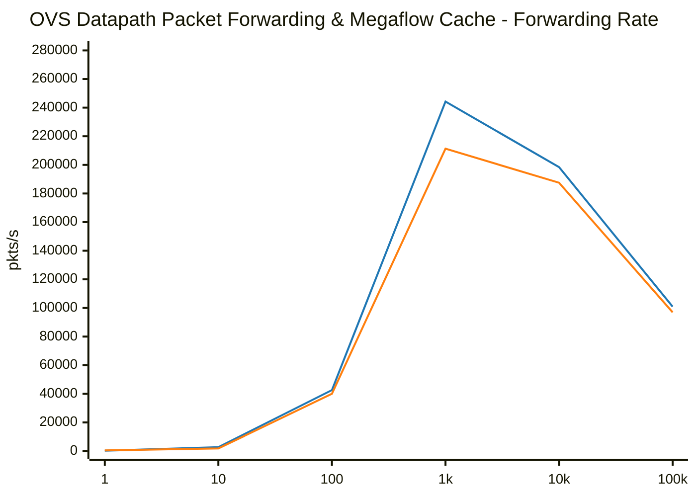

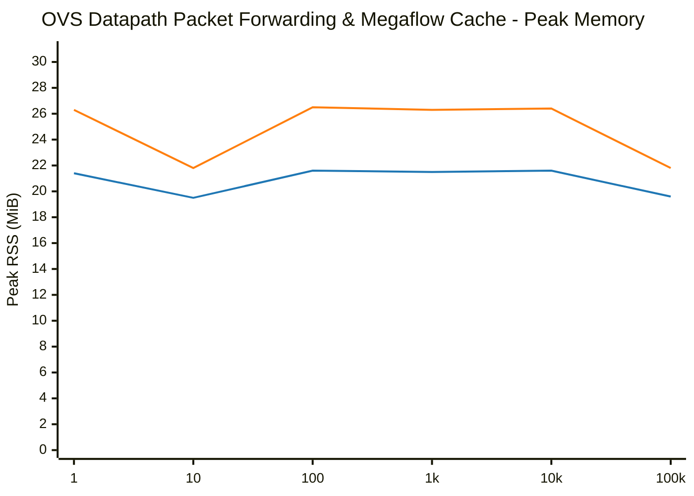

## Combined Workload (All objects scaled proportionally)

| Scale (N) | Phase / Metric | glibc malloc | jemalloc | Relative Difference |
|---|---|---|---|---|
| **1** | Baseline RSS | 10.27 MiB | 12.16 MiB | +18.4% |
| | Add Duration | 0.009 s | 0.007 s | -22.2% |
| | Add Rate | 109 ops/s | 144 ops/s | +31.5% |
| | Recompute (`ovn-northd-loop`) | 5.7 ms | 1.0 ms | -82.6% |
| | Logical Flow (`lflow`) | 0.0 ms | 0.0 ms | N/A |
| | Peak RSS (`VmHWM`) | 11.01 MiB | 13.09 MiB | +18.9% |
| | Delete Duration | 0.005 s | 0.004 s | -20.0% |
| | Post-Delete Recompute | 1.0 ms | 1.0 ms | ~Parity (±1%) |
| | Post-Delete RSS | 11.01 MiB | 13.12 MiB | +19.2% |
| | **Retained Heap vs Baseline** | **+0.74 MiB** | **+0.96 MiB** | **+0.22 MiB** |
|---|---|---|---|---|
| **10** | Baseline RSS | 14.11 MiB | 15.17 MiB | +7.5% |
| | Add Duration | 0.014 s | 0.009 s | -35.7% |
| | Add Rate | 721 ops/s | 1,087 ops/s | +50.7% |
| | Recompute (`ovn-northd-loop`) | 1.0 ms | 1.0 ms | ~Parity (±1%) |
| | Logical Flow (`lflow`) | 0.0 ms | 0.0 ms | N/A |
| | Peak RSS (`VmHWM`) | 15.34 MiB | 16.50 MiB | +7.6% |
| | Delete Duration | 0.006 s | 0.008 s | +33.3% |
| | Post-Delete Recompute | 1.0 ms | 1.0 ms | ~Parity (±1%) |
| | Post-Delete RSS | 15.34 MiB | 16.54 MiB | +7.8% |
| | **Retained Heap vs Baseline** | **+1.23 MiB** | **+1.37 MiB** | **+0.14 MiB** |
|---|---|---|---|---|
| **100** | Baseline RSS | 10.18 MiB | 12.10 MiB | +18.9% |
| | Add Duration | 0.027 s | 0.023 s | -14.8% |
| | Add Rate | 3,702 ops/s | 4,263 ops/s | +15.2% |
| | Recompute (`ovn-northd-loop`) | 2.0 ms | 1.0 ms | -50.0% |
| | Logical Flow (`lflow`) | 1.0 ms | 1.0 ms | ~Parity (±1%) |
| | Peak RSS (`VmHWM`) | 13.73 MiB | 15.56 MiB | +13.3% |
| | Delete Duration | 0.012 s | 0.007 s | -41.7% |
| | Post-Delete Recompute | 1.0 ms | 4.4 ms | +340.2% |
| | Post-Delete RSS | 14.00 MiB | 15.76 MiB | +12.6% |
| | **Retained Heap vs Baseline** | **+3.82 MiB** | **+3.66 MiB** | **-0.16 MiB** |
|---|---|---|---|---|
| **1000** | Baseline RSS | 10.13 MiB | 12.03 MiB | +18.8% |
| | Add Duration | 0.308 s | 0.215 s | -30.2% |
| | Add Rate | 3,246 ops/s | 4,655 ops/s | +43.4% |
| | Recompute (`ovn-northd-loop`) | 19.0 ms | 9.0 ms | -52.6% |
| | Logical Flow (`lflow`) | 9.0 ms | 5.0 ms | -44.4% |
| | Peak RSS (`VmHWM`) | 48.33 MiB | 45.29 MiB | -6.3% |
| | Delete Duration | 0.164 s | 0.068 s | -58.5% |
| | Post-Delete Recompute | 1.0 ms | 1.0 ms | ~Parity (±1%) |
| | Post-Delete RSS | 47.12 MiB | 46.09 MiB | -2.2% |
| | **Retained Heap vs Baseline** | **+36.99 MiB** | **+34.06 MiB** | **-2.93 MiB** |
|---|---|---|---|---|
| **5000** | Baseline RSS | 14.08 MiB | 15.09 MiB | +7.2% |
| | Add Duration | 16.420 s | 14.032 s | -14.5% |
| | Add Rate | 304 ops/s | 356 ops/s | +17.0% |
| | Recompute (`ovn-northd-loop`) | 85.0 ms | 68.0 ms | -20.0% |
| | Logical Flow (`lflow`) | 24.0 ms | 15.0 ms | -37.5% |
| | Peak RSS (`VmHWM`) | 141.71 MiB | 124.41 MiB | -12.2% |
| | Delete Duration | 0.927 s | 0.491 s | -47.0% |
| | Post-Delete Recompute | 0.0 ms | 1.0 ms | N/A |
| | Post-Delete RSS | 146.10 MiB | 133.06 MiB | -8.9% |
| | **Retained Heap vs Baseline** | **+132.02 MiB** | **+117.97 MiB** | **-14.05 MiB** |
|---|---|---|---|---|
| **10000** | Baseline RSS | 10.27 MiB | 12.12 MiB | +18.0% |
| | Add Duration | 4.922 s | 3.222 s | -34.5% |
| | Add Rate | 2,031 ops/s | 3,103 ops/s | +52.8% |
| | Recompute (`ovn-northd-loop`) | 196.0 ms | 116.0 ms | -40.8% |
| | Logical Flow (`lflow`) | 95.0 ms | 67.0 ms | -29.5% |
| | Peak RSS (`VmHWM`) | 387.84 MiB | 340.93 MiB | -12.1% |
| | Delete Duration | 2.908 s | 0.855 s | -70.6% |
| | Post-Delete Recompute | 59.0 ms | 19.0 ms | -67.8% |
| | Post-Delete RSS | 367.91 MiB | 276.63 MiB | -24.8% |
| | **Retained Heap vs Baseline** | **+357.64 MiB** | **+264.51 MiB** | **-93.13 MiB** |
|---|---|---|---|---|

### Visual Charts

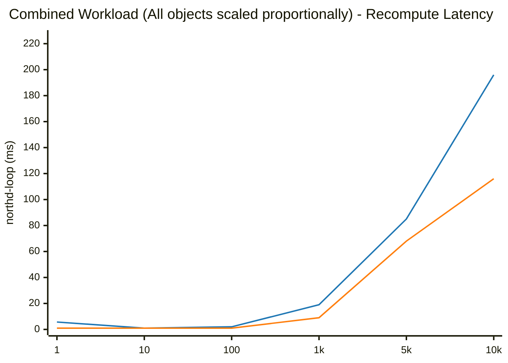

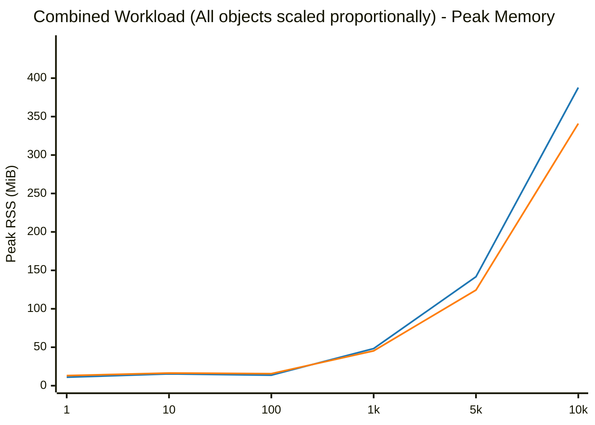

