# OVS & OVN Scaling Benchmark: glibc malloc vs jemalloc

**Date:** 2026-10-13 21:42:27
**System:** Linux
**CPU:** Intel(R) Core(TM) Ultra 7 165H (22 vCPUs)
**Memory:** 62Gi
**Glibc Version:** ldd (GNU libc) 2.43
**Jemalloc Version:** 5.3.0

---

## Methodology

Each benchmark evaluates individual OVN/OVS objects, OpenFlow rule scaling, or combined workloads across powers of 10 (`1, 10, 100, 1,000, 10,000, 100,000`) through 3 lifecycle phases measuring the full OVN-Kubernetes pod stack (`ovn-northd`, `ovn-controller`, `ovs-vswitchd`, and `ovsdb-servers`):
1. **Baseline (Idle)**: Total Pod and per-daemon clean process RSS before creating objects.
2. **After Add (N)**: Time taken to commit $N$ objects via native OVSDB JSON-RPC, full recompute latency (`ovn-northd-loop` stopwatch), and Total Pod peak RSS (`VmHWM`) with per-daemon breakdown.
3. **After Remove (N)**: Time taken to delete all $N$ objects via native OVSDB JSON-RPC, post-deletion recompute latency, and retained heap memory (`Post-Deletion RSS - Baseline RSS`) measured after a wait period allowing page decay (`dirty_decay_ms:0,muzzy_decay_ms:0`).

---

## Logical Switch Port (LSP with IP, MAC, port_security)

| Scale (N) | Phase / Metric | glibc malloc | jemalloc | Relative Difference |
|---|---|---|---|---|
| **1** | Total Pod Baseline RSS | 10.56 MiB | 12.34 MiB | +16.9% |
| | Add Duration | 0.004 s | 0.003 s | -25.0% |
| | Add Rate | 273 ops/s | 328 ops/s | +20.3% |
| | Recompute (`ovn-northd-loop`) | 1.0 ms | 1.0 ms | ~Parity (±1%) |
| | Logical Flow (`lflow`) | 0.0 ms | 0.0 ms | N/A |
| | Total Pod Peak RSS (`VmHWM`) | 10.56 MiB | 12.43 MiB | +17.7% |
| | Delete Duration | 0.004 s | 0.003 s | -25.0% |
| | Post-Delete Recompute | 1.0 ms | 5.3 ms | +432.7% |
| | Total Pod Post-Delete RSS | 10.54 MiB | 12.44 MiB | +18.0% |
| | **Total Pod Retained Heap** | **-0.02 MiB** | **+0.10 MiB** | **+0.12 MiB** |
|---|---|---|---|---|
| **10** | Total Pod Baseline RSS | 75.72 MiB | 80.45 MiB | +6.2% |
| | Add Duration | 0.006 s | 0.008 s | +33.3% |
| | Add Rate | 1,560 ops/s | 1,177 ops/s | -24.5% |
| | Recompute (`ovn-northd-loop`) | 1.0 ms | 1.0 ms | ~Parity (±1%) |
| | Logical Flow (`lflow`) | 0.0 ms | 0.0 ms | N/A |
| | Total Pod Peak RSS (`VmHWM`) | 75.90 MiB | 80.87 MiB | +6.5% |
| | Delete Duration | 0.008 s | 0.007 s | -12.5% |
| | Post-Delete Recompute | 1.0 ms | 1.0 ms | ~Parity (±1%) |
| | Total Pod Post-Delete RSS | 78.52 MiB | 83.58 MiB | +6.4% |
| | **Total Pod Retained Heap** | **+2.80 MiB** | **+3.13 MiB** | **+0.33 MiB** |
| | ├─ `ovn-northd` (Peak / Retained) | 14.69 / +0.58 MiB | 15.77 / +0.72 MiB | +7.4% / +0.14 MiB |
| | ├─ `ovn-controller` (Peak / Retained) | 12.06 / +0.33 MiB | 12.82 / +0.36 MiB | +6.3% / +0.03 MiB |
| | ├─ `ovs-vswitchd` (Peak / Retained) | 19.12 / +0.03 MiB | 21.41 / +0.02 MiB | +12.0% / -0.01 MiB |
| | ├─ `ovsdb-server (SB)` (Peak / Retained) | 10.43 / +0.62 MiB | 10.73 / +0.74 MiB | +2.9% / +0.12 MiB |
| | ├─ `ovsdb-server (NB)` (Peak / Retained) | 9.88 / +0.62 MiB | 10.10 / +0.67 MiB | +2.2% / +0.05 MiB |
| | ├─ `ovsdb-server (OVS)` (Peak / Retained) | 9.72 / +0.62 MiB | 10.04 / +0.62 MiB | +3.3% / +0.00 MiB |
|---|---|---|---|---|
| **100** | Total Pod Baseline RSS | 10.51 MiB | 12.44 MiB | +18.4% |
| | Add Duration | 0.020 s | 0.018 s | -10.0% |
| | Add Rate | 5,048 ops/s | 5,542 ops/s | +9.8% |
| | Recompute (`ovn-northd-loop`) | 1.0 ms | 1.0 ms | ~Parity (±1%) |
| | Logical Flow (`lflow`) | 1.0 ms | 0.0 ms | -100.0% |
| | Total Pod Peak RSS (`VmHWM`) | 13.39 MiB | 14.73 MiB | +10.0% |
| | Delete Duration | 0.007 s | 0.009 s | +28.6% |
| | Post-Delete Recompute | 1.0 ms | 4.5 ms | +350.6% |
| | Total Pod Post-Delete RSS | 11.13 MiB | 13.38 MiB | +20.2% |
| | **Total Pod Retained Heap** | **+0.62 MiB** | **+0.94 MiB** | **+0.32 MiB** |
|---|---|---|---|---|
| **1000** | Total Pod Baseline RSS | 10.66 MiB | 12.21 MiB | +14.5% |
| | Add Duration | 0.232 s | 0.175 s | -24.6% |
| | Add Rate | 4,303 ops/s | 5,708 ops/s | +32.6% |
| | Recompute (`ovn-northd-loop`) | 13.0 ms | 12.0 ms | -7.7% |
| | Logical Flow (`lflow`) | 7.0 ms | 5.0 ms | -28.6% |
| | Total Pod Peak RSS (`VmHWM`) | 36.91 MiB | 32.00 MiB | -13.3% |
| | Delete Duration | 0.105 s | 0.059 s | -43.8% |
| | Post-Delete Recompute | 6.1 ms | 6.1 ms | ~Parity (±1%) |
| | Total Pod Post-Delete RSS | 12.97 MiB | 14.82 MiB | +14.3% |
| | **Total Pod Retained Heap** | **+2.31 MiB** | **+2.61 MiB** | **+0.30 MiB** |
|---|---|---|---|---|
| **10000** | Total Pod Baseline RSS | 10.72 MiB | 12.36 MiB | +15.3% |
| | Add Duration | 3.386 s | 2.357 s | -30.4% |
| | Add Rate | 2,953 ops/s | 4,243 ops/s | +43.7% |
| | Recompute (`ovn-northd-loop`) | 227.0 ms | 124.0 ms | -45.4% |
| | Logical Flow (`lflow`) | 116.0 ms | 75.0 ms | -35.3% |
| | Total Pod Peak RSS (`VmHWM`) | 264.92 MiB | 224.70 MiB | -15.2% |
| | Delete Duration | 2.105 s | 0.752 s | -64.3% |
| | Post-Delete Recompute | 104.0 ms | 34.0 ms | -67.3% |
| | Total Pod Post-Delete RSS | 27.41 MiB | 19.28 MiB | -29.7% |
| | **Total Pod Retained Heap** | **+16.69 MiB** | **+6.92 MiB** | **-9.77 MiB** |
|---|---|---|---|---|

### Visual Charts

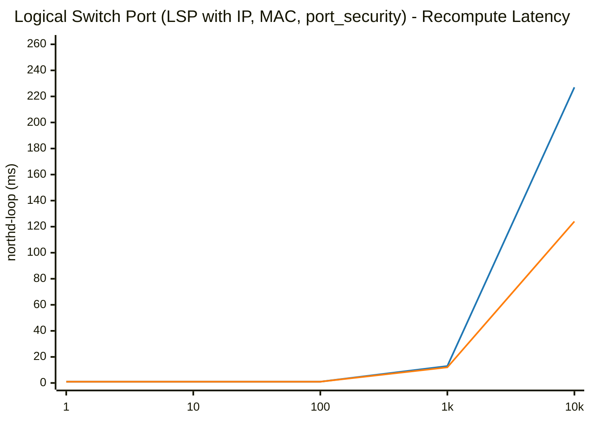

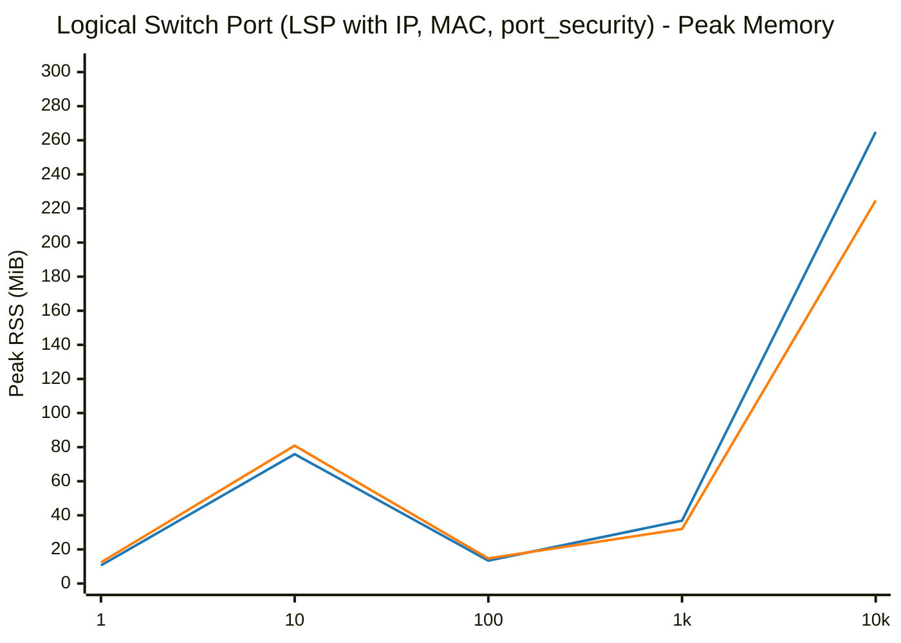

## ACL (Access Control List with stateful allow-related)

| Scale (N) | Phase / Metric | glibc malloc | jemalloc | Relative Difference |
|---|---|---|---|---|
| **1** | Total Pod Baseline RSS | 10.52 MiB | 12.35 MiB | +17.4% |
| | Add Duration | 0.004 s | 0.004 s | ~Parity (±1%) |
| | Add Rate | 243 ops/s | 256 ops/s | +5.4% |
| | Recompute (`ovn-northd-loop`) | 6.1 ms | 5.5 ms | -9.2% |
| | Logical Flow (`lflow`) | 0.0 ms | 0.0 ms | N/A |
| | Total Pod Peak RSS (`VmHWM`) | 10.60 MiB | 12.45 MiB | +17.5% |
| | Delete Duration | 0.004 s | 0.004 s | ~Parity (±1%) |
| | Post-Delete Recompute | 1.0 ms | 5.6 ms | +462.2% |
| | Total Pod Post-Delete RSS | 10.58 MiB | 12.44 MiB | +17.6% |
| | **Total Pod Retained Heap** | **+0.06 MiB** | **+0.09 MiB** | **+0.03 MiB** |
|---|---|---|---|---|
| **10** | Total Pod Baseline RSS | 10.58 MiB | 12.34 MiB | +16.6% |
| | Add Duration | 0.005 s | 0.004 s | -20.0% |
| | Add Rate | 1,992 ops/s | 2,776 ops/s | +39.4% |
| | Recompute (`ovn-northd-loop`) | 4.5 ms | 1.0 ms | -77.6% |
| | Logical Flow (`lflow`) | 0.0 ms | 0.0 ms | N/A |
| | Total Pod Peak RSS (`VmHWM`) | 10.77 MiB | 12.51 MiB | +16.2% |
| | Delete Duration | 0.003 s | 0.004 s | +33.3% |
| | Post-Delete Recompute | 5.3 ms | 1.0 ms | -81.1% |
| | Total Pod Post-Delete RSS | 10.69 MiB | 12.51 MiB | +17.0% |
| | **Total Pod Retained Heap** | **+0.11 MiB** | **+0.17 MiB** | **+0.06 MiB** |
|---|---|---|---|---|
| **100** | Total Pod Baseline RSS | 10.56 MiB | 12.32 MiB | +16.7% |
| | Add Duration | 0.010 s | 0.009 s | -10.0% |
| | Add Rate | 10,171 ops/s | 10,799 ops/s | +6.2% |
| | Recompute (`ovn-northd-loop`) | 1.0 ms | 1.0 ms | ~Parity (±1%) |
| | Logical Flow (`lflow`) | 1.0 ms | 1.0 ms | ~Parity (±1%) |
| | Total Pod Peak RSS (`VmHWM`) | 11.83 MiB | 13.24 MiB | +11.9% |
| | Delete Duration | 0.006 s | 0.005 s | -16.7% |
| | Post-Delete Recompute | 1.0 ms | 6.0 ms | +496.7% |
| | Total Pod Post-Delete RSS | 11.05 MiB | 12.86 MiB | +16.4% |
| | **Total Pod Retained Heap** | **+0.49 MiB** | **+0.54 MiB** | **+0.05 MiB** |
|---|---|---|---|---|
| **1000** | Total Pod Baseline RSS | 10.46 MiB | 12.44 MiB | +18.9% |
| | Add Duration | 0.083 s | 0.066 s | -20.5% |
| | Add Rate | 12,088 ops/s | 15,050 ops/s | +24.5% |
| | Recompute (`ovn-northd-loop`) | 5.0 ms | 3.0 ms | -40.0% |
| | Logical Flow (`lflow`) | 5.0 ms | 3.0 ms | -40.0% |
| | Total Pod Peak RSS (`VmHWM`) | 20.57 MiB | 19.94 MiB | -3.1% |
| | Delete Duration | 0.037 s | 0.026 s | -29.7% |
| | Post-Delete Recompute | 5.6 ms | 1.0 ms | -82.1% |
| | Total Pod Post-Delete RSS | 11.89 MiB | 13.54 MiB | +13.9% |
| | **Total Pod Retained Heap** | **+1.43 MiB** | **+1.10 MiB** | **-0.33 MiB** |
|---|---|---|---|---|
| **10000** | Total Pod Baseline RSS | 10.52 MiB | 12.36 MiB | +17.5% |
| | Add Duration | 1.114 s | 0.839 s | -24.7% |
| | Add Rate | 8,973 ops/s | 11,919 ops/s | +32.8% |
| | Recompute (`ovn-northd-loop`) | 34.0 ms | 50.0 ms | +47.1% |
| | Logical Flow (`lflow`) | 29.0 ms | 45.0 ms | +55.2% |
| | Total Pod Peak RSS (`VmHWM`) | 105.56 MiB | 90.34 MiB | -14.4% |
| | Delete Duration | 0.787 s | 0.335 s | -57.4% |
| | Post-Delete Recompute | 10.0 ms | 5.8 ms | -42.0% |
| | Total Pod Post-Delete RSS | 11.82 MiB | 14.88 MiB | +25.9% |
| | **Total Pod Retained Heap** | **+1.30 MiB** | **+2.52 MiB** | **+1.22 MiB** |
|---|---|---|---|---|

### Visual Charts

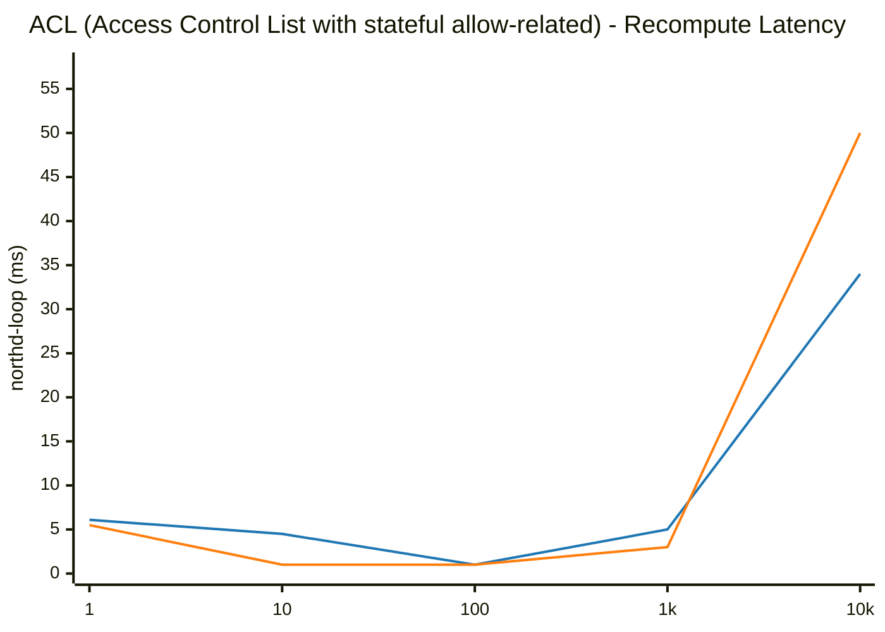

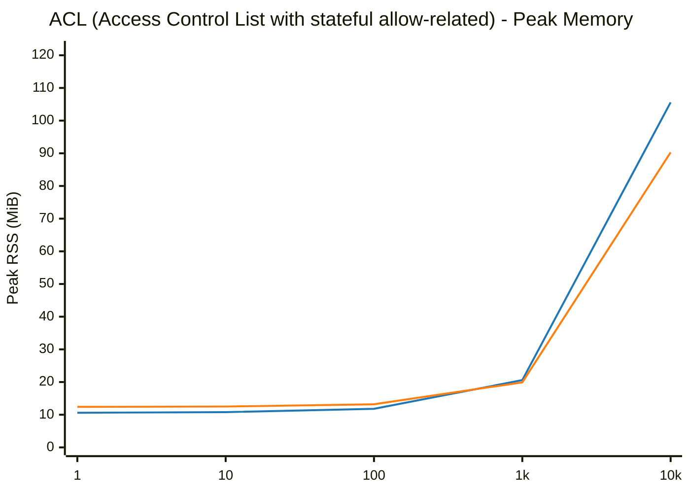

## Address Set (IP list matching ACL)

| Scale (N) | Phase / Metric | glibc malloc | jemalloc | Relative Difference |
|---|---|---|---|---|
| **1** | Total Pod Baseline RSS | 10.73 MiB | 12.30 MiB | +14.6% |
| | Add Duration | 0.006 s | 0.003 s | -50.0% |
| | Add Rate | 169 ops/s | 307 ops/s | +81.6% |
| | Recompute (`ovn-northd-loop`) | 1.0 ms | 1.0 ms | ~Parity (±1%) |
| | Logical Flow (`lflow`) | 0.0 ms | 1.0 ms | N/A |
| | Total Pod Peak RSS (`VmHWM`) | 10.81 MiB | 12.39 MiB | +14.6% |
| | Delete Duration | 0.004 s | 0.003 s | -25.0% |
| | Post-Delete Recompute | 1.0 ms | 3.8 ms | +276.3% |
| | Total Pod Post-Delete RSS | 10.79 MiB | 12.39 MiB | +14.8% |
| | **Total Pod Retained Heap** | **+0.06 MiB** | **+0.09 MiB** | **+0.03 MiB** |
|---|---|---|---|---|
| **10** | Total Pod Baseline RSS | 10.47 MiB | 12.30 MiB | +17.5% |
| | Add Duration | 0.004 s | 0.003 s | -25.0% |
| | Add Rate | 2,402 ops/s | 2,967 ops/s | +23.5% |
| | Recompute (`ovn-northd-loop`) | 1.0 ms | 1.0 ms | ~Parity (±1%) |
| | Logical Flow (`lflow`) | 0.0 ms | 0.0 ms | N/A |
| | Total Pod Peak RSS (`VmHWM`) | 10.56 MiB | 12.44 MiB | +17.8% |
| | Delete Duration | 0.004 s | 0.004 s | ~Parity (±1%) |
| | Post-Delete Recompute | 4.2 ms | 4.9 ms | +15.7% |
| | Total Pod Post-Delete RSS | 10.54 MiB | 12.40 MiB | +17.6% |
| | **Total Pod Retained Heap** | **+0.07 MiB** | **+0.10 MiB** | **+0.03 MiB** |
|---|---|---|---|---|
| **100** | Total Pod Baseline RSS | 10.56 MiB | 12.38 MiB | +17.2% |
| | Add Duration | 0.004 s | 0.004 s | ~Parity (±1%) |
| | Add Rate | 22,716 ops/s | 25,680 ops/s | +13.0% |
| | Recompute (`ovn-northd-loop`) | 5.6 ms | 5.6 ms | +1.6% |
| | Logical Flow (`lflow`) | 0.0 ms | 0.0 ms | N/A |
| | Total Pod Peak RSS (`VmHWM`) | 10.67 MiB | 12.54 MiB | +17.5% |
| | Delete Duration | 0.003 s | 0.003 s | ~Parity (±1%) |
| | Post-Delete Recompute | 1.0 ms | 5.2 ms | +423.1% |
| | Total Pod Post-Delete RSS | 10.64 MiB | 12.49 MiB | +17.4% |
| | **Total Pod Retained Heap** | **+0.08 MiB** | **+0.11 MiB** | **+0.03 MiB** |
|---|---|---|---|---|
| **1000** | Total Pod Baseline RSS | 10.58 MiB | 12.27 MiB | +16.0% |
| | Add Duration | 0.007 s | 0.005 s | -28.6% |
| | Add Rate | 148,853 ops/s | 196,889 ops/s | +32.3% |
| | Recompute (`ovn-northd-loop`) | 1.0 ms | 5.7 ms | +470.5% |
| | Logical Flow (`lflow`) | 0.0 ms | 0.0 ms | N/A |
| | Total Pod Peak RSS (`VmHWM`) | 10.89 MiB | 12.52 MiB | +15.0% |
| | Delete Duration | 0.004 s | 0.003 s | -25.0% |
| | Post-Delete Recompute | 5.7 ms | 1.0 ms | -82.4% |
| | Total Pod Post-Delete RSS | 10.71 MiB | 12.49 MiB | +16.6% |
| | **Total Pod Retained Heap** | **+0.13 MiB** | **+0.22 MiB** | **+0.09 MiB** |
|---|---|---|---|---|
| **10000** | Total Pod Baseline RSS | 10.57 MiB | 12.36 MiB | +16.9% |
| | Add Duration | 0.021 s | 0.018 s | -14.3% |
| | Add Rate | 478,125 ops/s | 554,323 ops/s | +15.9% |
| | Recompute (`ovn-northd-loop`) | 1.0 ms | 1.0 ms | ~Parity (±1%) |
| | Logical Flow (`lflow`) | 0.0 ms | 0.0 ms | N/A |
| | Total Pod Peak RSS (`VmHWM`) | 12.71 MiB | 14.16 MiB | +11.4% |
| | Delete Duration | 0.003 s | 0.004 s | +33.3% |
| | Post-Delete Recompute | 5.8 ms | 1.0 ms | -82.7% |
| | Total Pod Post-Delete RSS | 10.76 MiB | 12.52 MiB | +16.4% |
| | **Total Pod Retained Heap** | **+0.19 MiB** | **+0.16 MiB** | **-0.03 MiB** |
|---|---|---|---|---|

### Visual Charts

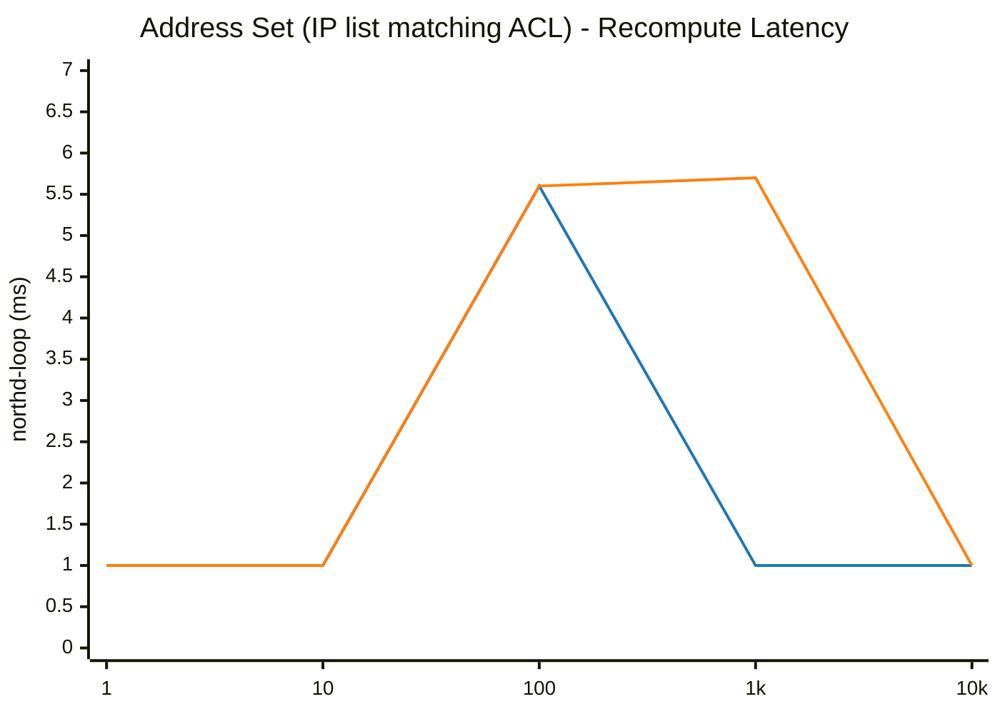

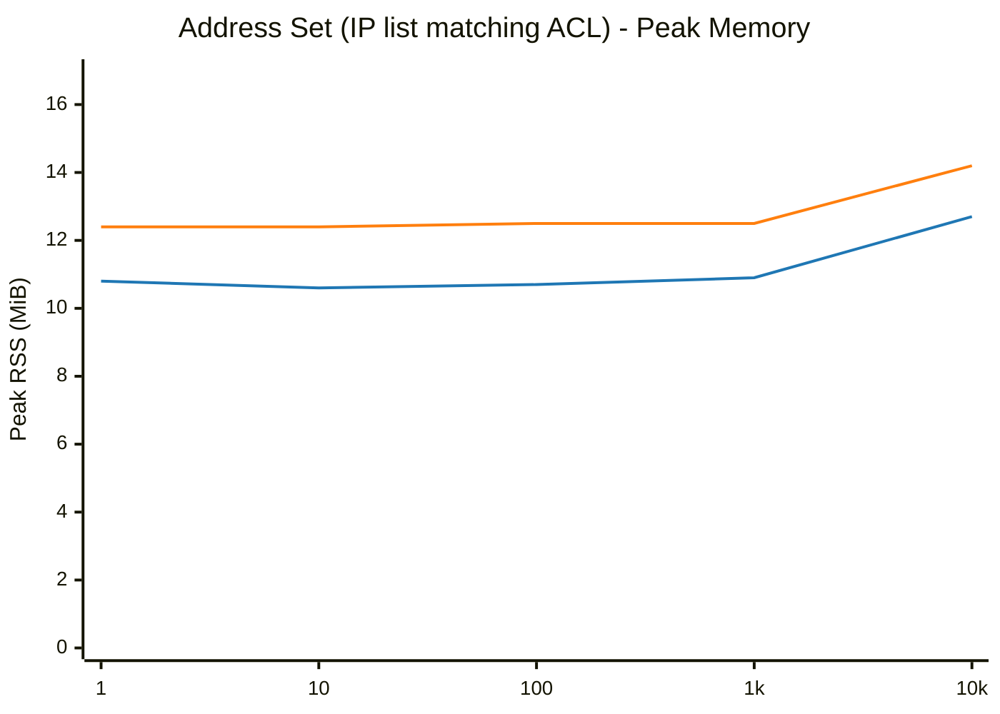

## Port Group (Ports member grouping matching ACL)

| Scale (N) | Phase / Metric | glibc malloc | jemalloc | Relative Difference |
|---|---|---|---|---|
| **1** | Total Pod Baseline RSS | 10.53 MiB | 12.37 MiB | +17.5% |
| | Add Duration | 0.004 s | 0.004 s | ~Parity (±1%) |
| | Add Rate | 240 ops/s | 270 ops/s | +12.4% |
| | Recompute (`ovn-northd-loop`) | 4.9 ms | 1.0 ms | -79.4% |
| | Logical Flow (`lflow`) | 0.0 ms | 0.0 ms | N/A |
| | Total Pod Peak RSS (`VmHWM`) | 10.62 MiB | 12.49 MiB | +17.6% |
| | Delete Duration | 0.003 s | 0.003 s | ~Parity (±1%) |
| | Post-Delete Recompute | 1.0 ms | 5.1 ms | +411.6% |
| | Total Pod Post-Delete RSS | 10.59 MiB | 12.46 MiB | +17.7% |
| | **Total Pod Retained Heap** | **+0.06 MiB** | **+0.09 MiB** | **+0.03 MiB** |
|---|---|---|---|---|
| **10** | Total Pod Baseline RSS | 14.47 MiB | 15.51 MiB | +7.2% |
| | Add Duration | 0.009 s | 0.011 s | +22.2% |
| | Add Rate | 1,140 ops/s | 922 ops/s | -19.1% |
| | Recompute (`ovn-northd-loop`) | 1.0 ms | 1.0 ms | ~Parity (±1%) |
| | Logical Flow (`lflow`) | 0.0 ms | 0.0 ms | N/A |
| | Total Pod Peak RSS (`VmHWM`) | 14.61 MiB | 15.64 MiB | +7.0% |
| | Delete Duration | 0.008 s | 0.007 s | -12.5% |
| | Post-Delete Recompute | 1.0 ms | 1.0 ms | ~Parity (±1%) |
| | Total Pod Post-Delete RSS | 15.02 MiB | 16.11 MiB | +7.3% |
| | **Total Pod Retained Heap** | **+0.55 MiB** | **+0.61 MiB** | **+0.06 MiB** |
|---|---|---|---|---|
| **100** | Total Pod Baseline RSS | 10.89 MiB | 12.79 MiB | +17.4% |
| | Add Duration | 0.005 s | 0.004 s | -20.0% |
| | Add Rate | 18,501 ops/s | 22,446 ops/s | +21.3% |
| | Recompute (`ovn-northd-loop`) | 1.0 ms | 5.0 ms | +400.2% |
| | Logical Flow (`lflow`) | 0.0 ms | 0.0 ms | N/A |
| | Total Pod Peak RSS (`VmHWM`) | 10.93 MiB | 12.92 MiB | +18.2% |
| | Delete Duration | 0.006 s | 0.004 s | -33.3% |
| | Post-Delete Recompute | 1.0 ms | 4.6 ms | +364.2% |
| | Total Pod Post-Delete RSS | 10.68 MiB | 12.78 MiB | +19.7% |
| | **Total Pod Retained Heap** | **-0.21 MiB** | **-0.01 MiB** | **+0.20 MiB** |
|---|---|---|---|---|
| **1000** | Total Pod Baseline RSS | 15.06 MiB | 16.17 MiB | +7.4% |
| | Add Duration | 0.012 s | 0.009 s | -25.0% |
| | Add Rate | 80,729 ops/s | 111,794 ops/s | +38.5% |
| | Recompute (`ovn-northd-loop`) | 3.0 ms | 4.0 ms | +33.3% |
| | Logical Flow (`lflow`) | 0.0 ms | 0.0 ms | N/A |
| | Total Pod Peak RSS (`VmHWM`) | 15.10 MiB | 16.37 MiB | +8.4% |
| | Delete Duration | 0.020 s | 0.017 s | -15.0% |
| | Post-Delete Recompute | 1.0 ms | 1.0 ms | ~Parity (±1%) |
| | Total Pod Post-Delete RSS | 11.50 MiB | 14.12 MiB | +22.8% |
| | **Total Pod Retained Heap** | **-3.56 MiB** | **-2.05 MiB** | **+1.51 MiB** |
|---|---|---|---|---|
| **10000** | Total Pod Baseline RSS | 57.32 MiB | 49.05 MiB | -14.4% |
| | Add Duration | 0.099 s | 0.070 s | -29.3% |
| | Add Rate | 100,731 ops/s | 142,013 ops/s | +41.0% |
| | Recompute (`ovn-northd-loop`) | 49.0 ms | 40.0 ms | -18.4% |
| | Logical Flow (`lflow`) | 7.0 ms | 6.0 ms | -14.3% |
| | Total Pod Peak RSS (`VmHWM`) | 58.76 MiB | 50.93 MiB | -13.3% |
| | Delete Duration | 0.288 s | 0.211 s | -26.7% |
| | Post-Delete Recompute | 36.0 ms | 24.0 ms | -33.3% |
| | Total Pod Post-Delete RSS | 12.14 MiB | 15.11 MiB | +24.5% |
| | **Total Pod Retained Heap** | **-45.18 MiB** | **-33.94 MiB** | **+11.24 MiB** |
|---|---|---|---|---|

### Visual Charts

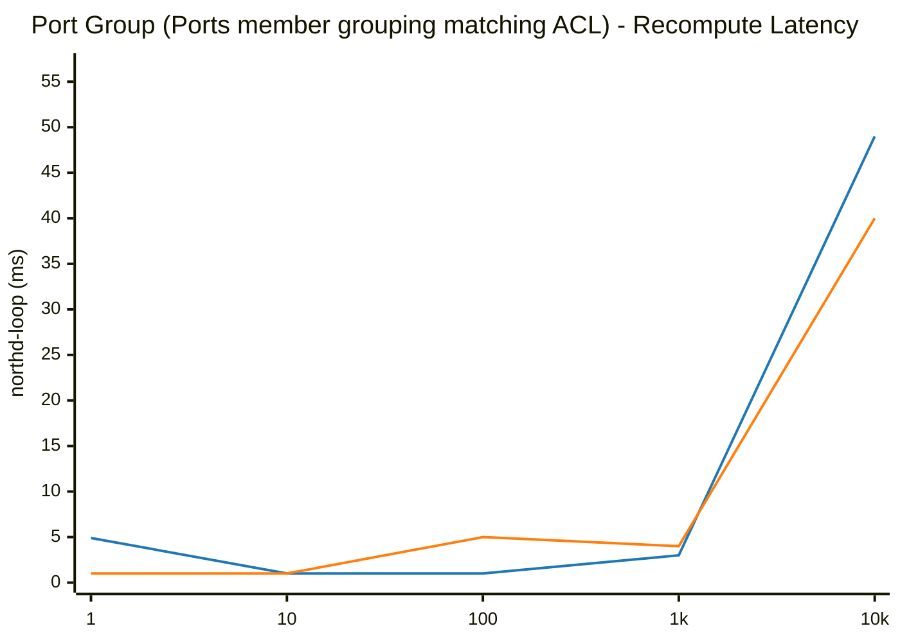

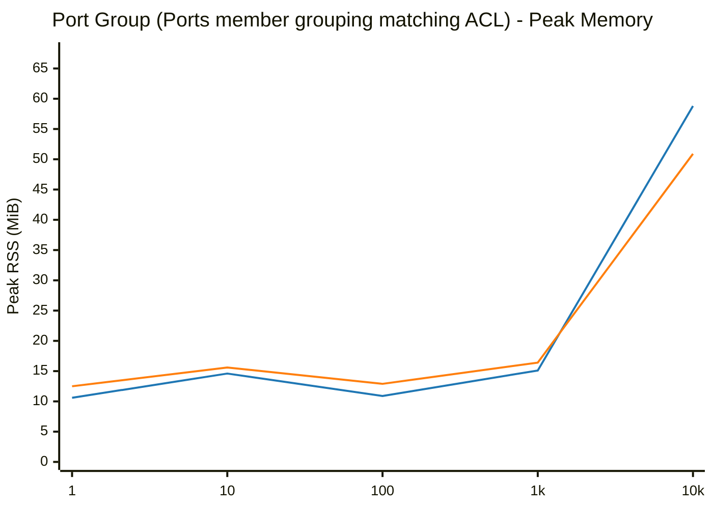

## Load Balancer (VIPs mapped to endpoints)

| Scale (N) | Phase / Metric | glibc malloc | jemalloc | Relative Difference |
|---|---|---|---|---|
| **1** | Total Pod Baseline RSS | 10.56 MiB | 12.21 MiB | +15.6% |
| | Add Duration | 0.004 s | 0.004 s | ~Parity (±1%) |
| | Add Rate | 259 ops/s | 261 ops/s | ~Parity (±1%) |
| | Recompute (`ovn-northd-loop`) | 1.0 ms | 1.0 ms | ~Parity (±1%) |
| | Logical Flow (`lflow`) | 0.0 ms | 0.0 ms | N/A |
| | Total Pod Peak RSS (`VmHWM`) | 10.69 MiB | 12.34 MiB | +15.4% |
| | Delete Duration | 0.003 s | 0.003 s | ~Parity (±1%) |
| | Post-Delete Recompute | 4.8 ms | 1.0 ms | -79.2% |
| | Total Pod Post-Delete RSS | 10.65 MiB | 12.35 MiB | +16.0% |
| | **Total Pod Retained Heap** | **+0.09 MiB** | **+0.14 MiB** | **+0.05 MiB** |
|---|---|---|---|---|
| **10** | Total Pod Baseline RSS | 10.55 MiB | 12.36 MiB | +17.2% |
| | Add Duration | 0.004 s | 0.004 s | ~Parity (±1%) |
| | Add Rate | 2,498 ops/s | 2,333 ops/s | -6.6% |
| | Recompute (`ovn-northd-loop`) | 1.0 ms | 1.0 ms | ~Parity (±1%) |
| | Logical Flow (`lflow`) | 0.0 ms | 1.0 ms | N/A |
| | Total Pod Peak RSS (`VmHWM`) | 10.80 MiB | 12.70 MiB | +17.6% |
| | Delete Duration | 0.004 s | 0.003 s | -25.0% |
| | Post-Delete Recompute | 1.0 ms | 5.9 ms | +492.0% |
| | Total Pod Post-Delete RSS | 10.73 MiB | 12.71 MiB | +18.5% |
| | **Total Pod Retained Heap** | **+0.18 MiB** | **+0.35 MiB** | **+0.17 MiB** |
|---|---|---|---|---|
| **100** | Total Pod Baseline RSS | 10.73 MiB | 12.22 MiB | +13.9% |
| | Add Duration | 0.013 s | 0.014 s | +7.7% |
| | Add Rate | 7,830 ops/s | 7,361 ops/s | -6.0% |
| | Recompute (`ovn-northd-loop`) | 1.0 ms | 2.0 ms | +100.0% |
| | Logical Flow (`lflow`) | 0.0 ms | 1.0 ms | N/A |
| | Total Pod Peak RSS (`VmHWM`) | 12.75 MiB | 13.73 MiB | +7.7% |
| | Delete Duration | 0.007 s | 0.004 s | -42.9% |
| | Post-Delete Recompute | 1.0 ms | 5.7 ms | +472.6% |
| | Total Pod Post-Delete RSS | 11.37 MiB | 13.15 MiB | +15.7% |
| | **Total Pod Retained Heap** | **+0.64 MiB** | **+0.93 MiB** | **+0.29 MiB** |
|---|---|---|---|---|
| **1000** | Total Pod Baseline RSS | 10.73 MiB | 12.37 MiB | +15.3% |
| | Add Duration | 0.114 s | 0.105 s | -7.9% |
| | Add Rate | 8,758 ops/s | 9,533 ops/s | +8.8% |
| | Recompute (`ovn-northd-loop`) | 8.0 ms | 6.0 ms | -25.0% |
| | Logical Flow (`lflow`) | 2.0 ms | 2.0 ms | ~Parity (±1%) |
| | Total Pod Peak RSS (`VmHWM`) | 27.18 MiB | 24.64 MiB | -9.3% |
| | Delete Duration | 0.060 s | 0.029 s | -51.7% |
| | Post-Delete Recompute | 5.0 ms | 1.0 ms | -80.0% |
| | Total Pod Post-Delete RSS | 12.68 MiB | 14.25 MiB | +12.4% |
| | **Total Pod Retained Heap** | **+1.95 MiB** | **+1.88 MiB** | **-0.07 MiB** |
|---|---|---|---|---|
| **5000** | Total Pod Baseline RSS | 14.57 MiB | 15.48 MiB | +6.2% |
| | Add Duration | 0.531 s | 0.443 s | -16.6% |
| | Add Rate | 9,413 ops/s | 11,292 ops/s | +20.0% |
| | Recompute (`ovn-northd-loop`) | 51.0 ms | 41.0 ms | -19.6% |
| | Logical Flow (`lflow`) | 10.0 ms | 8.0 ms | -20.0% |
| | Total Pod Peak RSS (`VmHWM`) | 83.85 MiB | 72.38 MiB | -13.7% |
| | Delete Duration | 0.286 s | 0.171 s | -40.2% |
| | Post-Delete Recompute | 14.0 ms | 8.0 ms | -42.9% |
| | Total Pod Post-Delete RSS | 82.49 MiB | 18.49 MiB | -77.6% |
| | **Total Pod Retained Heap** | **+67.92 MiB** | **+3.01 MiB** | **-64.91 MiB** |
|---|---|---|---|---|
| **10000** | Total Pod Baseline RSS | 10.73 MiB | 12.45 MiB | +16.0% |
| | Add Duration | 1.767 s | 1.136 s | -35.7% |
| | Add Rate | 5,658 ops/s | 8,799 ops/s | +55.5% |
| | Recompute (`ovn-northd-loop`) | 150.0 ms | 89.0 ms | -40.7% |
| | Logical Flow (`lflow`) | 44.0 ms | 27.0 ms | -38.6% |
| | Total Pod Peak RSS (`VmHWM`) | 182.79 MiB | 129.73 MiB | -29.0% |
| | Delete Duration | 1.097 s | 0.402 s | -63.4% |
| | Post-Delete Recompute | 85.0 ms | 29.0 ms | -65.9% |
| | Total Pod Post-Delete RSS | 20.80 MiB | 16.46 MiB | -20.9% |
| | **Total Pod Retained Heap** | **+10.07 MiB** | **+4.01 MiB** | **-6.06 MiB** |
|---|---|---|---|---|

### Visual Charts

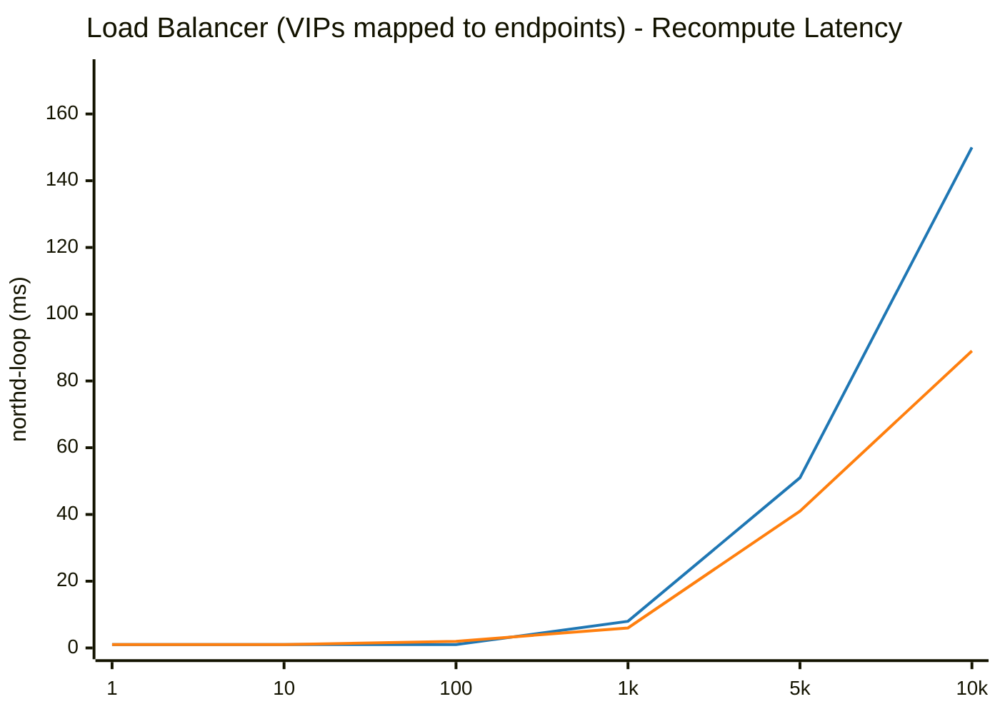

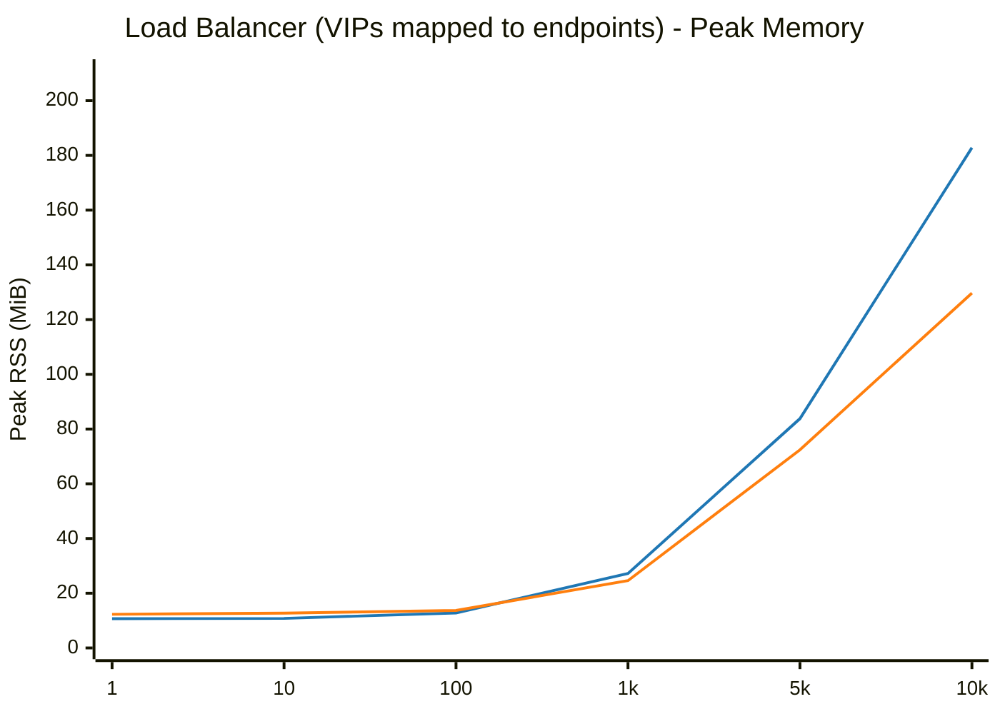

## OpenFlow Flows (OVS Control Plane)

| Scale (N) | Phase / Metric | glibc malloc | jemalloc | Relative Difference |
|---|---|---|---|---|
| **1** | Total Pod Baseline RSS | 21.45 MiB | 25.82 MiB | +20.4% |
| | Add Duration | 0.003 s | 0.005 s | +66.7% |
| | Add Rate | 351 ops/s | 195 ops/s | -44.4% |
| | Total Pod Peak RSS (`VmHWM`) | 21.59 MiB | 25.96 MiB | +20.2% |
| | Delete Duration | 0.002 s | 0.004 s | +100.0% |
| | Total Pod Post-Delete RSS | 21.61 MiB | 25.94 MiB | +20.0% |
| | **Total Pod Retained Heap** | **+0.16 MiB** | **+0.12 MiB** | **-0.04 MiB** |
|---|---|---|---|---|
| **10** | Total Pod Baseline RSS | 74.71 MiB | 79.71 MiB | +6.7% |
| | Add Duration | 0.005 s | 0.004 s | -20.0% |
| | Add Rate | 2,203 ops/s | 2,532 ops/s | +14.9% |
| | Total Pod Peak RSS (`VmHWM`) | 74.71 MiB | 79.71 MiB | +6.7% |
| | Delete Duration | 0.005 s | 0.005 s | ~Parity (±1%) |
| | Total Pod Post-Delete RSS | 77.37 MiB | 82.42 MiB | +6.5% |
| | **Total Pod Retained Heap** | **+2.66 MiB** | **+2.71 MiB** | **+0.05 MiB** |
| | ├─ `ovn-northd` (Peak / Retained) | 14.11 / +0.44 MiB | 15.20 / +0.46 MiB | +7.7% / +0.02 MiB |
| | ├─ `ovn-controller` (Peak / Retained) | 12.00 / +0.32 MiB | 12.96 / +0.35 MiB | +8.0% / +0.03 MiB |
| | ├─ `ovs-vswitchd` (Peak / Retained) | 19.23 / +0.03 MiB | 21.18 / +0.03 MiB | +10.1% / +0.00 MiB |
| | ├─ `ovsdb-server (SB)` (Peak / Retained) | 9.80 / +0.62 MiB | 10.26 / +0.62 MiB | +4.7% / +0.00 MiB |
| | ├─ `ovsdb-server (NB)` (Peak / Retained) | 9.78 / +0.63 MiB | 10.02 / +0.63 MiB | +2.5% / +0.00 MiB |
| | ├─ `ovsdb-server (OVS)` (Peak / Retained) | 9.79 / +0.62 MiB | 10.09 / +0.62 MiB | +3.1% / +0.00 MiB |
|---|---|---|---|---|
| **100** | Total Pod Baseline RSS | 21.21 MiB | 25.92 MiB | +22.2% |
| | Add Duration | 0.007 s | 0.007 s | ~Parity (±1%) |
| | Add Rate | 14,718 ops/s | 13,821 ops/s | -6.1% |
| | Total Pod Peak RSS (`VmHWM`) | 21.45 MiB | 26.20 MiB | +22.1% |
| | Delete Duration | 0.003 s | 0.004 s | +33.3% |
| | Total Pod Post-Delete RSS | 21.61 MiB | 26.31 MiB | +21.7% |
| | **Total Pod Retained Heap** | **+0.40 MiB** | **+0.39 MiB** | **-0.01 MiB** |
|---|---|---|---|---|
| **1000** | Total Pod Baseline RSS | 21.42 MiB | 25.91 MiB | +21.0% |
| | Add Duration | 0.035 s | 0.038 s | +8.6% |
| | Add Rate | 28,388 ops/s | 26,208 ops/s | -7.7% |
| | Total Pod Peak RSS (`VmHWM`) | 22.25 MiB | 26.68 MiB | +19.9% |
| | Delete Duration | 0.002 s | 0.003 s | +50.0% |
| | Total Pod Post-Delete RSS | 22.42 MiB | 26.82 MiB | +19.6% |
| | **Total Pod Retained Heap** | **+1.00 MiB** | **+0.91 MiB** | **-0.09 MiB** |
|---|---|---|---|---|
| **10000** | Total Pod Baseline RSS | 21.26 MiB | 25.84 MiB | +21.5% |
| | Add Duration | 0.281 s | 0.306 s | +8.9% |
| | Add Rate | 35,532 ops/s | 32,713 ops/s | -7.9% |
| | Total Pod Peak RSS (`VmHWM`) | 28.84 MiB | 33.29 MiB | +15.4% |
| | Delete Duration | 0.005 s | 0.007 s | +40.0% |
| | Total Pod Post-Delete RSS | 29.69 MiB | 26.83 MiB | -9.6% |
| | **Total Pod Retained Heap** | **+8.43 MiB** | **+0.99 MiB** | **-7.44 MiB** |
|---|---|---|---|---|
| **100000** | Total Pod Baseline RSS | 74.81 MiB | 79.38 MiB | +6.1% |
| | Add Duration | 0.006 s | 0.004 s | -33.3% |
| | Add Rate | 16,583,747 ops/s | 26,838,432 ops/s | +61.8% |
| | Total Pod Peak RSS (`VmHWM`) | 74.81 MiB | 79.38 MiB | +6.1% |
| | Delete Duration | 0.003 s | 0.003 s | ~Parity (±1%) |
| | Total Pod Post-Delete RSS | 77.48 MiB | 82.07 MiB | +5.9% |
| | **Total Pod Retained Heap** | **+2.67 MiB** | **+2.69 MiB** | **+0.02 MiB** |
| | ├─ `ovn-northd` (Peak / Retained) | 14.12 / +0.43 MiB | 15.18 / +0.46 MiB | +7.5% / +0.03 MiB |
| | ├─ `ovn-controller` (Peak / Retained) | 12.03 / +0.33 MiB | 12.82 / +0.34 MiB | +6.6% / +0.01 MiB |
| | ├─ `ovs-vswitchd` (Peak / Retained) | 19.39 / +0.04 MiB | 21.19 / +0.02 MiB | +9.3% / -0.02 MiB |
| | ├─ `ovsdb-server (SB)` (Peak / Retained) | 9.74 / +0.63 MiB | 10.19 / +0.62 MiB | +4.6% / -0.01 MiB |
| | ├─ `ovsdb-server (NB)` (Peak / Retained) | 9.79 / +0.62 MiB | 10.04 / +0.62 MiB | +2.6% / +0.00 MiB |
| | ├─ `ovsdb-server (OVS)` (Peak / Retained) | 9.74 / +0.62 MiB | 9.96 / +0.63 MiB | +2.3% / +0.01 MiB |
|---|---|---|---|---|

### Visual Charts

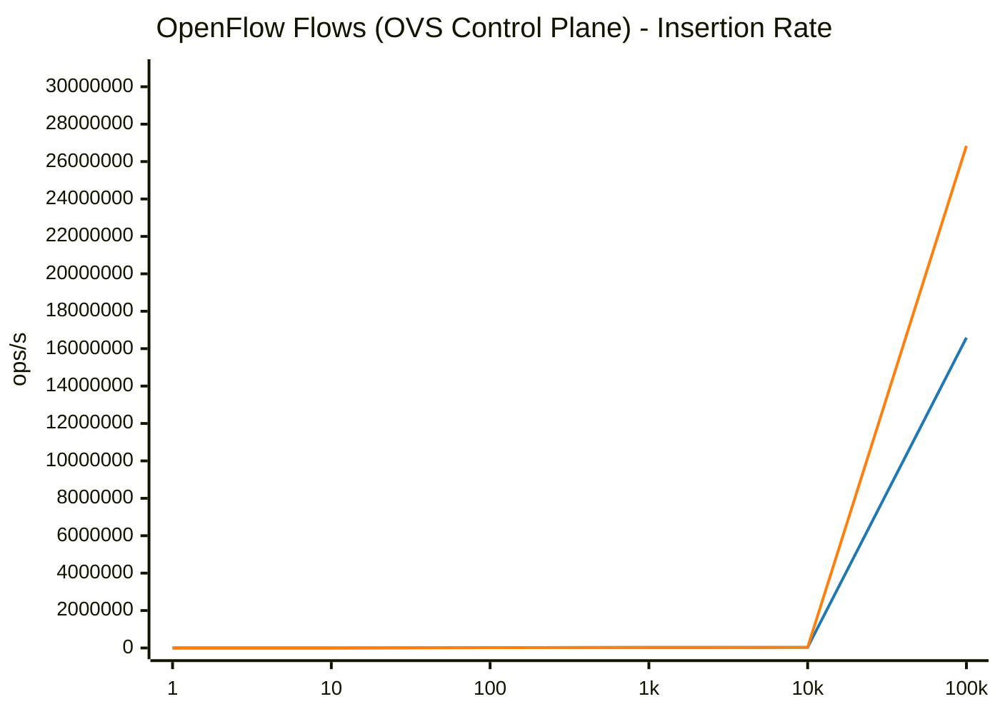

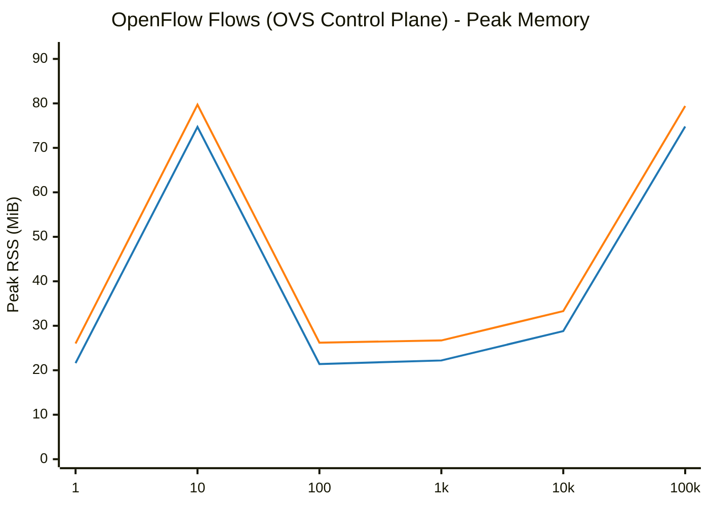

## Combined Workload (All objects scaled proportionally)

| Scale (N) | Phase / Metric | glibc malloc | jemalloc | Relative Difference |
|---|---|---|---|---|
| **1** | Total Pod Baseline RSS | 10.18 MiB | 12.03 MiB | +18.2% |
| | Add Duration | 0.008 s | 0.007 s | -12.5% |
| | Add Rate | 124 ops/s | 137 ops/s | +10.5% |
| | Recompute (`ovn-northd-loop`) | 4.9 ms | 5.3 ms | +8.0% |
| | Logical Flow (`lflow`) | 0.0 ms | 0.0 ms | N/A |
| | Total Pod Peak RSS (`VmHWM`) | 11.05 MiB | 12.78 MiB | +15.7% |
| | Delete Duration | 0.004 s | 0.004 s | ~Parity (±1%) |
| | Post-Delete Recompute | 1.0 ms | 5.0 ms | +402.3% |
| | Total Pod Post-Delete RSS | 10.58 MiB | 12.64 MiB | +19.5% |
| | **Total Pod Retained Heap** | **+0.40 MiB** | **+0.61 MiB** | **+0.21 MiB** |
|---|---|---|---|---|
| **10** | Total Pod Baseline RSS | 10.28 MiB | 12.03 MiB | +17.0% |
| | Add Duration | 0.013 s | 0.010 s | -23.1% |
| | Add Rate | 768 ops/s | 1,051 ops/s | +36.8% |
| | Recompute (`ovn-northd-loop`) | 1.0 ms | 5.2 ms | +417.2% |
| | Logical Flow (`lflow`) | 0.0 ms | 0.0 ms | N/A |
| | Total Pod Peak RSS (`VmHWM`) | 11.45 MiB | 13.23 MiB | +15.5% |
| | Delete Duration | 0.004 s | 0.004 s | ~Parity (±1%) |
| | Post-Delete Recompute | 1.0 ms | 5.0 ms | +397.3% |
| | Total Pod Post-Delete RSS | 10.71 MiB | 12.89 MiB | +20.4% |
| | **Total Pod Retained Heap** | **+0.43 MiB** | **+0.86 MiB** | **+0.43 MiB** |
|---|---|---|---|---|
| **100** | Total Pod Baseline RSS | 10.25 MiB | 12.07 MiB | +17.8% |
| | Add Duration | 0.033 s | 0.031 s | -6.1% |
| | Add Rate | 3,025 ops/s | 3,268 ops/s | +8.0% |
| | Recompute (`ovn-northd-loop`) | 2.0 ms | 2.0 ms | ~Parity (±1%) |
| | Logical Flow (`lflow`) | 2.0 ms | 1.0 ms | -50.0% |
| | Total Pod Peak RSS (`VmHWM`) | 14.81 MiB | 15.69 MiB | +5.9% |
| | Delete Duration | 0.015 s | 0.009 s | -40.0% |
| | Post-Delete Recompute | 1.0 ms | 1.0 ms | ~Parity (±1%) |
| | Total Pod Post-Delete RSS | 11.09 MiB | 13.27 MiB | +19.7% |
| | **Total Pod Retained Heap** | **+0.84 MiB** | **+1.20 MiB** | **+0.36 MiB** |
|---|---|---|---|---|
| **1000** | Total Pod Baseline RSS | 10.21 MiB | 12.11 MiB | +18.6% |
| | Add Duration | 0.303 s | 0.243 s | -19.8% |
| | Add Rate | 3,304 ops/s | 4,112 ops/s | +24.5% |
| | Recompute (`ovn-northd-loop`) | 11.0 ms | 9.0 ms | -18.2% |
| | Logical Flow (`lflow`) | 6.0 ms | 5.0 ms | -16.7% |
| | Total Pod Peak RSS (`VmHWM`) | 48.49 MiB | 42.61 MiB | -12.1% |
| | Delete Duration | 0.172 s | 0.078 s | -54.7% |
| | Post-Delete Recompute | 1.0 ms | 4.8 ms | +375.7% |
| | Total Pod Post-Delete RSS | 11.73 MiB | 14.77 MiB | +25.9% |
| | **Total Pod Retained Heap** | **+1.52 MiB** | **+2.66 MiB** | **+1.14 MiB** |
|---|---|---|---|---|
| **5000** | Total Pod Baseline RSS | 14.14 MiB | 15.23 MiB | +7.7% |
| | Add Duration | 1.740 s | 1.406 s | -19.2% |
| | Add Rate | 2,874 ops/s | 3,556 ops/s | +23.7% |
| | Recompute (`ovn-northd-loop`) | 84.0 ms | 69.0 ms | -17.9% |
| | Logical Flow (`lflow`) | 15.0 ms | 14.0 ms | -6.7% |
| | Total Pod Peak RSS (`VmHWM`) | 184.18 MiB | 163.27 MiB | -11.4% |
| | Delete Duration | 0.929 s | 0.459 s | -50.6% |
| | Post-Delete Recompute | 11.0 ms | 8.0 ms | -27.3% |
| | Total Pod Post-Delete RSS | 180.16 MiB | 20.95 MiB | -88.4% |
| | **Total Pod Retained Heap** | **+166.02 MiB** | **+5.72 MiB** | **-160.30 MiB** |
|---|---|---|---|---|
| **10000** | Total Pod Baseline RSS | 10.38 MiB | 12.04 MiB | +16.0% |
| | Add Duration | 4.824 s | 4.112 s | -14.8% |
| | Add Rate | 2,072 ops/s | 2,431 ops/s | +17.3% |
| | Recompute (`ovn-northd-loop`) | 205.0 ms | 162.0 ms | -21.0% |
| | Logical Flow (`lflow`) | 105.0 ms | 91.0 ms | -13.3% |
| | Total Pod Peak RSS (`VmHWM`) | 403.65 MiB | 314.30 MiB | -22.1% |
| | Delete Duration | 3.000 s | 1.265 s | -57.8% |
| | Post-Delete Recompute | 68.0 ms | 33.0 ms | -51.5% |
| | Total Pod Post-Delete RSS | 14.60 MiB | 20.49 MiB | +40.3% |
| | **Total Pod Retained Heap** | **+4.22 MiB** | **+8.45 MiB** | **+4.23 MiB** |
|---|---|---|---|---|

### Visual Charts

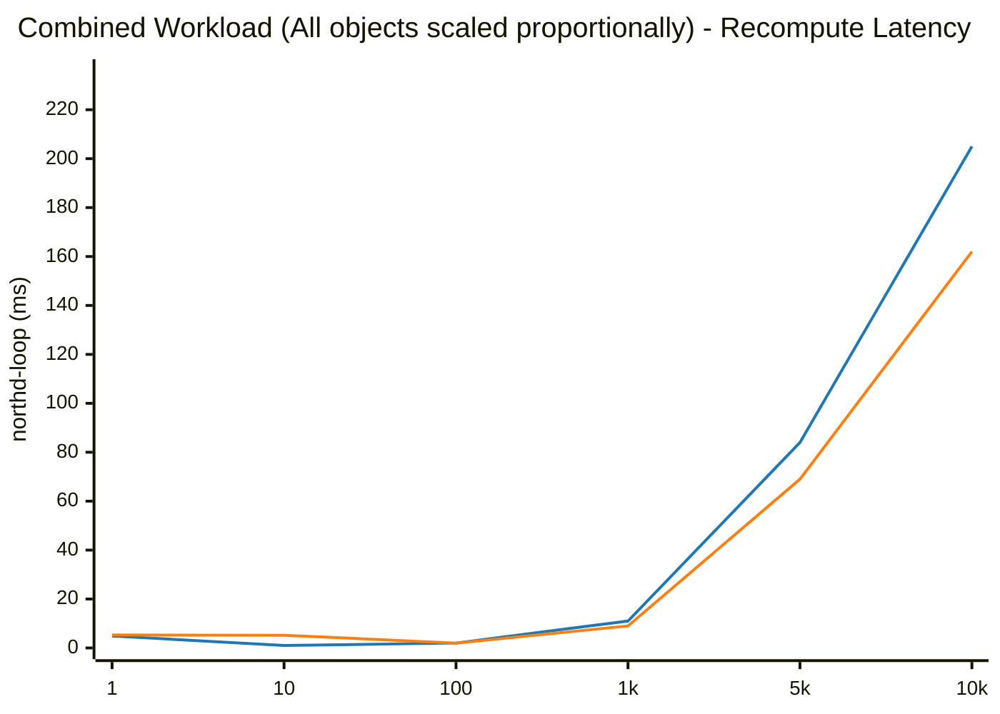

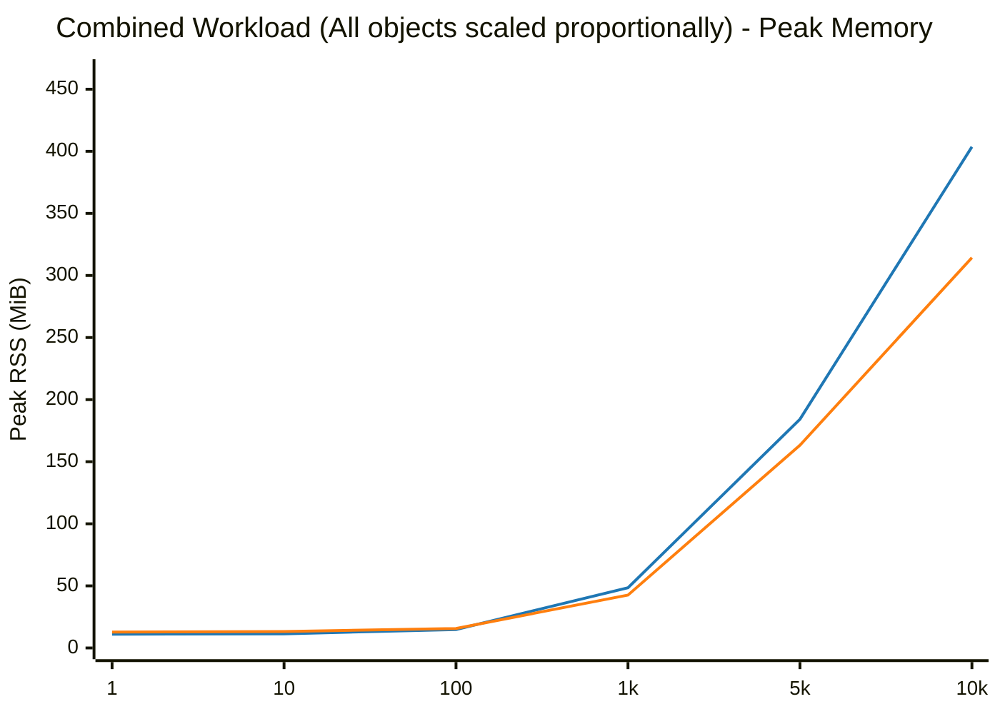

