# OVS & OVN Scaling Benchmark: glibc malloc vs jemalloc

**Date:** 2026-10-14 10:21:13
**System:** Linux
**CPU:** Intel(R) Core(TM) Ultra 7 165H (22 vCPUs)
**Memory:** 62Gi
**Glibc Version:** ldd (GNU libc) 2.43
**Jemalloc Version:** 5.3.0

---

## Methodology

Each benchmark evaluates individual OVN/OVS objects, OpenFlow rule scaling, or combined workloads across powers of 10 (`1, 10, 100, 1,000, 10,000, 100,000`) through 3 lifecycle phases measuring the full OVN-Kubernetes pod stack (`ovn-northd`, `ovn-controller`, `ovs-vswitchd`, and `ovsdb-servers`):
1. **Baseline (Idle)**: Total Pod and per-daemon clean process RSS before creating objects.
2. **After Add (N)**: Time taken to commit $N$ objects via native OVSDB JSON-RPC, full recompute latency (`ovn-northd-loop` stopwatch), and Total Pod peak RSS (`VmHWM`) with per-daemon breakdown.
3. **After Remove (N)**: Time taken to delete all $N$ objects via native OVSDB JSON-RPC, post-deletion recompute latency, and retained heap memory (`Post-Deletion RSS - Baseline RSS`) measured after a wait period allowing page decay (`dirty_decay_ms:0,muzzy_decay_ms:0`).

---

## Logical Switch Port (LSP with IP, MAC, port_security)

| Scale (N) | Phase / Metric | glibc malloc | jemalloc | Relative Difference |
|---|---|---|---|---|
| **1** | Total Pod Baseline Heap (RssAnon) | 27.54 MiB | 31.68 MiB | +15.0% |
| | Add Duration | 0.005 s | 0.006 s | +20.0% |
| | Add Rate | 196 ops/s | 161 ops/s | -17.7% |
| | Recompute (`ovn-northd-loop`) | 0.2 ms | 0.0 ms | ~Parity (<1ms) |
| | Logical Flow (`lflow`) | 0.0 ms | 0.0 ms | N/A |
| | Total Pod Peak Heap (RssAnon) | 28.75 MiB | 32.82 MiB | +14.2% |
| | Delete Duration | 0.010 s | 0.009 s | -10.0% |
| | Post-Delete Recompute | 0.1 ms | 0.1 ms | ~Parity (<1ms) |
| | Total Pod Post-Delete Heap (RssAnon) | 28.30 MiB | 32.93 MiB | +16.4% |
| | **Total Pod Retained Heap** | **+0.76 MiB** | **+1.25 MiB** | **+0.49 MiB** |
| | ├─ `ovn-northd` (Peak / Retained Heap) | 5.96 / -0.03 MiB | 6.90 / -0.02 MiB | +15.8% / +0.01 MiB |
| | ├─ `ovn-controller` (Peak / Retained Heap) | 3.96 / +0.85 MiB | 4.76 / +0.87 MiB | +20.2% / +0.02 MiB |
| | ├─ `ovs-vswitchd` (Peak / Retained Heap) | 12.08 / +0.31 MiB | 13.66 / +0.32 MiB | +13.1% / +0.01 MiB |
| | ├─ `ovsdb-server (SB)` (Peak / Retained Heap) | 2.63 / -0.14 MiB | 2.79 / +0.01 MiB | +6.1% / +0.15 MiB |
| | ├─ `ovsdb-server (NB)` (Peak / Retained Heap) | 2.09 / -0.14 MiB | 2.36 / -0.01 MiB | +12.9% / +0.13 MiB |
| | ├─ `ovsdb-server (OVS)` (Peak / Retained Heap) | 2.03 / -0.09 MiB | 2.35 / +0.08 MiB | +15.8% / +0.17 MiB |
|---|---|---|---|---|
| **10** | Total Pod Baseline Heap (RssAnon) | 27.57 MiB | 31.70 MiB | +15.0% |
| | Add Duration | 0.005 s | 0.006 s | +20.0% |
| | Add Rate | 1,973 ops/s | 1,604 ops/s | -18.7% |
| | Recompute (`ovn-northd-loop`) | 0.0 ms | 0.2 ms | ~Parity (<1ms) |
| | Logical Flow (`lflow`) | 0.0 ms | 1.0 ms | N/A |
| | Total Pod Peak Heap (RssAnon) | 30.17 MiB | 34.05 MiB | +12.9% |
| | Delete Duration | 0.009 s | 0.010 s | +11.1% |
| | Post-Delete Recompute | 0.0 ms | 0.1 ms | N/A |
| | Total Pod Post-Delete Heap (RssAnon) | 29.51 MiB | 34.11 MiB | +15.6% |
| | **Total Pod Retained Heap** | **+1.94 MiB** | **+2.41 MiB** | **+0.47 MiB** |
| | ├─ `ovn-northd` (Peak / Retained Heap) | 6.07 / +0.05 MiB | 7.11 / +0.18 MiB | +17.1% / +0.13 MiB |
| | ├─ `ovn-controller` (Peak / Retained Heap) | 4.84 / +1.32 MiB | 5.24 / +1.36 MiB | +8.3% / +0.04 MiB |
| | ├─ `ovs-vswitchd` (Peak / Retained Heap) | 12.39 / +0.68 MiB | 13.96 / +0.59 MiB | +12.7% / -0.09 MiB |
| | ├─ `ovsdb-server (SB)` (Peak / Retained Heap) | 2.67 / -0.05 MiB | 2.89 / +0.06 MiB | +8.2% / +0.11 MiB |
| | ├─ `ovsdb-server (NB)` (Peak / Retained Heap) | 2.10 / -0.09 MiB | 2.39 / +0.03 MiB | +13.8% / +0.12 MiB |
| | ├─ `ovsdb-server (OVS)` (Peak / Retained Heap) | 2.10 / +0.03 MiB | 2.46 / +0.19 MiB | +17.1% / +0.16 MiB |
|---|---|---|---|---|
| **100** | Total Pod Baseline Heap (RssAnon) | 27.51 MiB | 31.65 MiB | +15.0% |
| | Add Duration | 0.019 s | 0.018 s | -5.3% |
| | Add Rate | 5,374 ops/s | 5,596 ops/s | +4.1% |
| | Recompute (`ovn-northd-loop`) | 0.1 ms | 0.0 ms | ~Parity (<1ms) |
| | Logical Flow (`lflow`) | 1.0 ms | 0.0 ms | ~Parity (<1ms) |
| | Total Pod Peak Heap (RssAnon) | 39.59 MiB | 40.12 MiB | +1.3% |
| | Delete Duration | 0.019 s | 0.013 s | -31.6% |
| | Post-Delete Recompute | 0.0 ms | 0.1 ms | ~Parity (<1ms) |
| | Total Pod Post-Delete Heap (RssAnon) | 37.51 MiB | 38.22 MiB | +1.9% |
| | **Total Pod Retained Heap** | **+10.00 MiB** | **+6.57 MiB** | **-3.43 MiB** |
| | ├─ `ovn-northd` (Peak / Retained Heap) | 8.43 / +0.83 MiB | 8.88 / +0.76 MiB | +5.3% / -0.07 MiB |
| | ├─ `ovn-controller` (Peak / Retained Heap) | 4.84 / +3.37 MiB | 5.21 / +2.78 MiB | +7.6% / -0.59 MiB |
| | ├─ `ovs-vswitchd` (Peak / Retained Heap) | 13.53 / +3.72 MiB | 14.88 / +1.85 MiB | +10.0% / -1.87 MiB |
| | ├─ `ovsdb-server (SB)` (Peak / Retained Heap) | 6.26 / +0.81 MiB | 4.77 / +0.40 MiB | -23.8% / -0.41 MiB |
| | ├─ `ovsdb-server (NB)` (Peak / Retained Heap) | 2.53 / +0.16 MiB | 2.82 / +0.22 MiB | +11.5% / +0.06 MiB |
| | ├─ `ovsdb-server (OVS)` (Peak / Retained Heap) | 4.00 / +1.11 MiB | 3.56 / +0.56 MiB | -11.0% / -0.55 MiB |
|---|---|---|---|---|
| **1000** | Total Pod Baseline Heap (RssAnon) | 27.55 MiB | 31.69 MiB | +15.0% |
| | Add Duration | 0.195 s | 0.174 s | -10.8% |
| | Add Rate | 5,125 ops/s | 5,736 ops/s | +11.9% |
| | Recompute (`ovn-northd-loop`) | 1.0 ms | 0.3 ms | -74.5% |
| | Logical Flow (`lflow`) | 6.0 ms | 6.0 ms | ~Parity (±1%) |
| | Total Pod Peak Heap (RssAnon) | 160.50 MiB | 149.79 MiB | -6.7% |
| | Delete Duration | 0.347 s | 0.277 s | -20.2% |
| | Post-Delete Recompute | 0.8 ms | 0.1 ms | ~Parity (<1ms) |
| | Total Pod Post-Delete Heap (RssAnon) | 68.22 MiB | 50.36 MiB | -26.2% |
| | **Total Pod Retained Heap** | **+40.67 MiB** | **+18.67 MiB** | **-22.00 MiB** |
| | ├─ `ovn-northd` (Peak / Retained Heap) | 29.03 / +1.85 MiB | 24.84 / +2.28 MiB | -14.4% / +0.43 MiB |
| | ├─ `ovn-controller` (Peak / Retained Heap) | 46.48 / +11.68 MiB | 52.63 / +9.28 MiB | +13.2% / -2.40 MiB |
| | ├─ `ovs-vswitchd` (Peak / Retained Heap) | 30.88 / +20.49 MiB | 34.91 / +5.27 MiB | +13.1% / -15.22 MiB |
| | ├─ `ovsdb-server (SB)` (Peak / Retained Heap) | 32.88 / +2.80 MiB | 20.60 / +0.86 MiB | -37.3% / -1.94 MiB |
| | ├─ `ovsdb-server (NB)` (Peak / Retained Heap) | 7.00 / +1.06 MiB | 5.11 / +0.60 MiB | -27.0% / -0.46 MiB |
| | ├─ `ovsdb-server (OVS)` (Peak / Retained Heap) | 14.23 / +2.79 MiB | 11.70 / +0.38 MiB | -17.8% / -2.41 MiB |
|---|---|---|---|---|
| **10000** | Total Pod Baseline Heap (RssAnon) | 27.57 MiB | 31.63 MiB | +14.7% |
| | Add Duration | 2.827 s | 2.472 s | -12.6% |
| | Add Rate | 3,536 ops/s | 4,045 ops/s | +14.4% |
| | Recompute (`ovn-northd-loop`) | 9.0 ms | 3.1 ms | -65.8% |
| | Logical Flow (`lflow`) | 170.0 ms | 126.0 ms | -25.9% |
| | Total Pod Peak Heap (RssAnon) | 1238.35 MiB | 1049.73 MiB | -15.2% |
| | Delete Duration | 18.718 s | 14.336 s | -23.4% |
| | Post-Delete Recompute | 0.1 ms | 0.0 ms | ~Parity (<1ms) |
| | Total Pod Post-Delete Heap (RssAnon) | 490.11 MiB | 264.76 MiB | -46.0% |
| | **Total Pod Retained Heap** | **+462.54 MiB** | **+233.13 MiB** | **-229.41 MiB** |
| | ├─ `ovn-northd` (Peak / Retained Heap) | 226.26 / +5.66 MiB | 187.88 / +5.80 MiB | -17.0% / +0.14 MiB |
| | ├─ `ovn-controller` (Peak / Retained Heap) | 412.63 / +207.20 MiB | 441.67 / +100.95 MiB | +7.0% / -106.25 MiB |
| | ├─ `ovs-vswitchd` (Peak / Retained Heap) | 117.43 / +133.09 MiB | 120.31 / +112.95 MiB | +2.5% / -20.14 MiB |
| | ├─ `ovsdb-server (SB)` (Peak / Retained Heap) | 316.80 / +4.08 MiB | 187.70 / +6.46 MiB | -40.8% / +2.38 MiB |
| | ├─ `ovsdb-server (NB)` (Peak / Retained Heap) | 45.88 / +1.72 MiB | 26.76 / +1.35 MiB | -41.7% / -0.37 MiB |
| | ├─ `ovsdb-server (OVS)` (Peak / Retained Heap) | 119.35 / +110.79 MiB | 85.41 / +5.62 MiB | -28.4% / -105.17 MiB |
|---|---|---|---|---|

### Visual Charts

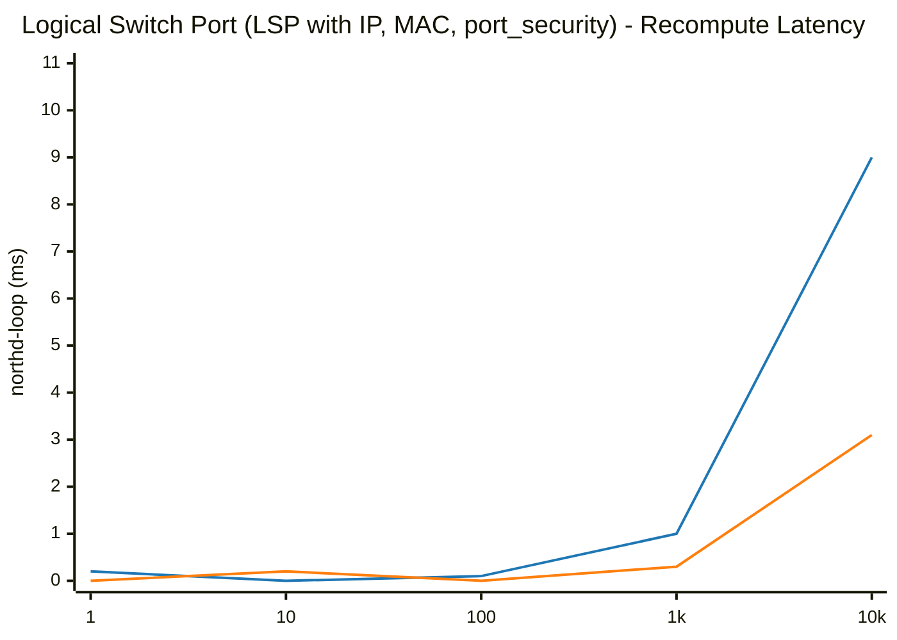

## ACL (Access Control List with stateful allow-related)

| Scale (N) | Phase / Metric | glibc malloc | jemalloc | Relative Difference |
|---|---|---|---|---|
| **1** | Total Pod Baseline Heap (RssAnon) | 30.13 MiB | 34.08 MiB | +13.1% |
| | Add Duration | 0.004 s | 0.004 s | ~Parity (±1%) |
| | Add Rate | 245 ops/s | 228 ops/s | -7.0% |
| | Recompute (`ovn-northd-loop`) | 0.5 ms | 0.1 ms | ~Parity (<1ms) |
| | Logical Flow (`lflow`) | 0.0 ms | 1.0 ms | N/A |
| | Total Pod Peak Heap (RssAnon) | 30.46 MiB | 34.67 MiB | +13.8% |
| | Delete Duration | 0.005 s | 0.005 s | ~Parity (±1%) |
| | Post-Delete Recompute | 0.0 ms | 0.0 ms | N/A |
| | Total Pod Post-Delete Heap (RssAnon) | 29.77 MiB | 34.49 MiB | +15.9% |
| | **Total Pod Retained Heap** | **-0.36 MiB** | **+0.41 MiB** | **+0.77 MiB** |
| | ├─ `ovn-northd` (Peak / Retained Heap) | 6.22 / +0.08 MiB | 7.21 / +0.07 MiB | +15.9% / -0.01 MiB |
| | ├─ `ovn-controller` (Peak / Retained Heap) | 4.85 / -0.42 MiB | 5.61 / +0.09 MiB | +15.7% / +0.51 MiB |
| | ├─ `ovs-vswitchd` (Peak / Retained Heap) | 12.44 / +0.08 MiB | 14.03 / +0.11 MiB | +12.8% / +0.03 MiB |
| | ├─ `ovsdb-server (SB)` (Peak / Retained Heap) | 2.77 / +0.00 MiB | 2.96 / +0.06 MiB | +6.9% / +0.06 MiB |
| | ├─ `ovsdb-server (NB)` (Peak / Retained Heap) | 2.09 / -0.09 MiB | 2.39 / +0.02 MiB | +14.4% / +0.11 MiB |
| | ├─ `ovsdb-server (OVS)` (Peak / Retained Heap) | 2.09 / -0.01 MiB | 2.47 / +0.06 MiB | +18.2% / +0.07 MiB |
|---|---|---|---|---|
| **10** | Total Pod Baseline Heap (RssAnon) | 30.11 MiB | 34.07 MiB | +13.2% |
| | Add Duration | 0.005 s | 0.006 s | +20.0% |
| | Add Rate | 2,021 ops/s | 1,813 ops/s | -10.3% |
| | Recompute (`ovn-northd-loop`) | 0.1 ms | 0.0 ms | ~Parity (<1ms) |
| | Logical Flow (`lflow`) | 1.0 ms | 0.0 ms | ~Parity (<1ms) |
| | Total Pod Peak Heap (RssAnon) | 30.68 MiB | 34.97 MiB | +14.0% |
| | Delete Duration | 0.005 s | 0.005 s | ~Parity (±1%) |
| | Post-Delete Recompute | 0.0 ms | 0.0 ms | N/A |
| | Total Pod Post-Delete Heap (RssAnon) | 29.96 MiB | 34.62 MiB | +15.6% |
| | **Total Pod Retained Heap** | **-0.15 MiB** | **+0.55 MiB** | **+0.70 MiB** |
| | ├─ `ovn-northd` (Peak / Retained Heap) | 6.33 / +0.16 MiB | 7.32 / +0.11 MiB | +15.6% / -0.05 MiB |
| | ├─ `ovn-controller` (Peak / Retained Heap) | 4.85 / -0.39 MiB | 5.70 / +0.13 MiB | +17.5% / +0.52 MiB |
| | ├─ `ovs-vswitchd` (Peak / Retained Heap) | 12.46 / +0.11 MiB | 14.05 / +0.12 MiB | +12.8% / +0.01 MiB |
| | ├─ `ovsdb-server (SB)` (Peak / Retained Heap) | 2.89 / +0.02 MiB | 3.04 / +0.09 MiB | +5.2% / +0.07 MiB |
| | ├─ `ovsdb-server (NB)` (Peak / Retained Heap) | 2.06 / -0.04 MiB | 2.40 / +0.03 MiB | +16.5% / +0.07 MiB |
| | ├─ `ovsdb-server (OVS)` (Peak / Retained Heap) | 2.09 / -0.01 MiB | 2.46 / +0.07 MiB | +17.7% / +0.08 MiB |
|---|---|---|---|---|
| **100** | Total Pod Baseline Heap (RssAnon) | 30.16 MiB | 34.08 MiB | +13.0% |
| | Add Duration | 0.012 s | 0.010 s | -16.7% |
| | Add Rate | 8,576 ops/s | 9,635 ops/s | +12.4% |
| | Recompute (`ovn-northd-loop`) | 0.1 ms | 0.5 ms | ~Parity (<1ms) |
| | Logical Flow (`lflow`) | 0.0 ms | 0.0 ms | N/A |
| | Total Pod Peak Heap (RssAnon) | 34.67 MiB | 37.87 MiB | +9.2% |
| | Delete Duration | 0.008 s | 0.006 s | -25.0% |
| | Post-Delete Recompute | 0.0 ms | 0.2 ms | N/A |
| | Total Pod Post-Delete Heap (RssAnon) | 31.26 MiB | 35.70 MiB | +14.2% |
| | **Total Pod Retained Heap** | **+1.10 MiB** | **+1.62 MiB** | **+0.52 MiB** |
| | ├─ `ovn-northd` (Peak / Retained Heap) | 7.32 / +0.53 MiB | 7.92 / +0.47 MiB | +8.2% / -0.06 MiB |
| | ├─ `ovn-controller` (Peak / Retained Heap) | 5.90 / -0.18 MiB | 6.92 / +0.32 MiB | +17.3% / +0.50 MiB |
| | ├─ `ovs-vswitchd` (Peak / Retained Heap) | 12.74 / +0.44 MiB | 14.27 / +0.37 MiB | +12.0% / -0.07 MiB |
| | ├─ `ovsdb-server (SB)` (Peak / Retained Heap) | 4.18 / +0.26 MiB | 3.68 / +0.19 MiB | -12.0% / -0.07 MiB |
| | ├─ `ovsdb-server (NB)` (Peak / Retained Heap) | 2.43 / +0.07 MiB | 2.60 / +0.21 MiB | +7.0% / +0.14 MiB |
| | ├─ `ovsdb-server (OVS)` (Peak / Retained Heap) | 2.10 / -0.02 MiB | 2.48 / +0.06 MiB | +18.1% / +0.08 MiB |
|---|---|---|---|---|
| **1000** | Total Pod Baseline Heap (RssAnon) | 30.15 MiB | 34.10 MiB | +13.1% |
| | Add Duration | 0.072 s | 0.126 s | +75.0% |
| | Add Rate | 13,794 ops/s | 7,911 ops/s | -42.7% |
| | Recompute (`ovn-northd-loop`) | 0.0 ms | 0.1 ms | ~Parity (<1ms) |
| | Logical Flow (`lflow`) | 4.0 ms | 5.0 ms | +25.0% |
| | Total Pod Peak Heap (RssAnon) | 68.10 MiB | 62.66 MiB | -8.0% |
| | Delete Duration | 0.030 s | 0.033 s | +10.0% |
| | Post-Delete Recompute | 0.5 ms | 0.0 ms | ~Parity (<1ms) |
| | Total Pod Post-Delete Heap (RssAnon) | 36.86 MiB | 38.94 MiB | +5.6% |
| | **Total Pod Retained Heap** | **+6.71 MiB** | **+4.84 MiB** | **-1.87 MiB** |
| | ├─ `ovn-northd` (Peak / Retained Heap) | 15.81 / +1.26 MiB | 14.07 / +1.25 MiB | -11.0% / -0.01 MiB |
| | ├─ `ovn-controller` (Peak / Retained Heap) | 16.75 / +0.41 MiB | 18.57 / +1.29 MiB | +10.9% / +0.88 MiB |
| | ├─ `ovs-vswitchd` (Peak / Retained Heap) | 15.14 / +3.51 MiB | 14.83 / +0.94 MiB | -2.0% / -2.57 MiB |
| | ├─ `ovsdb-server (SB)` (Peak / Retained Heap) | 13.66 / +0.81 MiB | 8.58 / +0.59 MiB | -37.2% / -0.22 MiB |
| | ├─ `ovsdb-server (NB)` (Peak / Retained Heap) | 4.65 / +0.72 MiB | 4.14 / +0.71 MiB | -11.0% / -0.01 MiB |
| | ├─ `ovsdb-server (OVS)` (Peak / Retained Heap) | 2.09 / +0.00 MiB | 2.47 / +0.06 MiB | +18.2% / +0.06 MiB |
|---|---|---|---|---|
| **10000** | Total Pod Baseline Heap (RssAnon) | 30.14 MiB | 34.07 MiB | +13.0% |
| | Add Duration | 1.072 s | 0.802 s | -25.2% |
| | Add Rate | 9,327 ops/s | 12,467 ops/s | +33.7% |
| | Recompute (`ovn-northd-loop`) | 1.7 ms | 1.5 ms | -10.5% |
| | Logical Flow (`lflow`) | 97.0 ms | 90.0 ms | -7.2% |
| | Total Pod Peak Heap (RssAnon) | 376.41 MiB | 300.80 MiB | -20.1% |
| | Delete Duration | 0.732 s | 0.386 s | -47.3% |
| | Post-Delete Recompute | 0.0 ms | 0.0 ms | ~Parity (<1ms) |
| | Total Pod Post-Delete Heap (RssAnon) | 65.92 MiB | 47.24 MiB | -28.3% |
| | **Total Pod Retained Heap** | **+35.78 MiB** | **+13.17 MiB** | **-22.61 MiB** |
| | ├─ `ovn-northd` (Peak / Retained Heap) | 96.14 / +1.71 MiB | 74.56 / +2.52 MiB | -22.4% / +0.81 MiB |
| | ├─ `ovn-controller` (Peak / Retained Heap) | 124.61 / +1.01 MiB | 126.07 / +5.18 MiB | +1.2% / +4.17 MiB |
| | ├─ `ovs-vswitchd` (Peak / Retained Heap) | 33.00 / +30.71 MiB | 19.31 / +1.56 MiB | -41.5% / -29.15 MiB |
| | ├─ `ovsdb-server (SB)` (Peak / Retained Heap) | 95.27 / +1.27 MiB | 60.27 / +2.38 MiB | -36.7% / +1.11 MiB |
| | ├─ `ovsdb-server (NB)` (Peak / Retained Heap) | 25.30 / +1.09 MiB | 18.12 / +1.46 MiB | -28.4% / +0.37 MiB |
| | ├─ `ovsdb-server (OVS)` (Peak / Retained Heap) | 2.09 / -0.01 MiB | 2.47 / +0.07 MiB | +18.2% / +0.08 MiB |
|---|---|---|---|---|

### Visual Charts

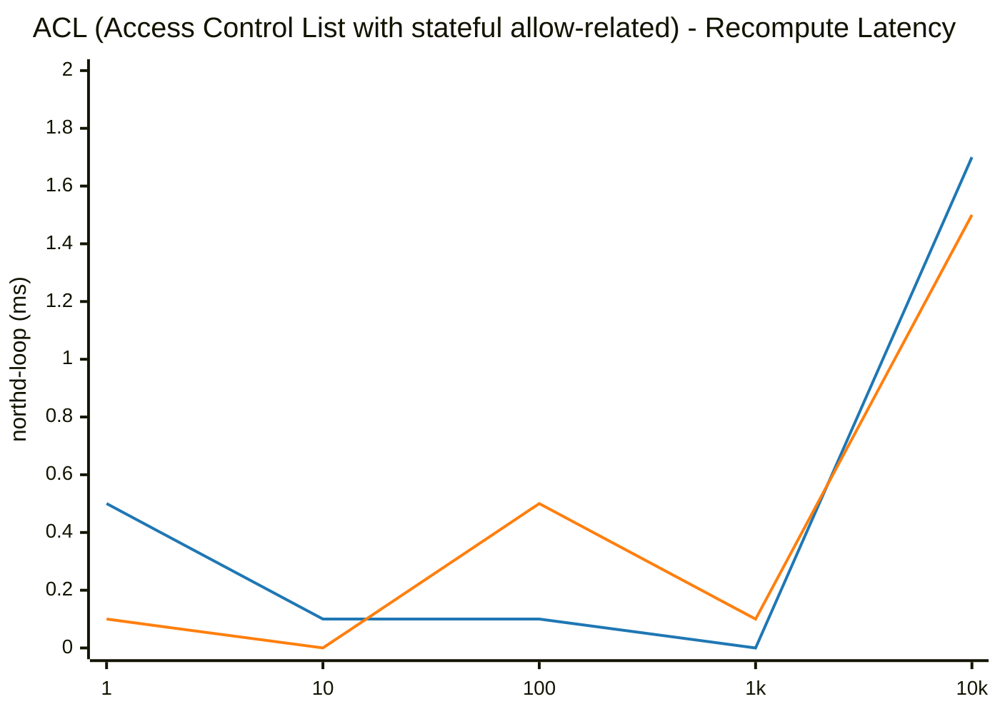

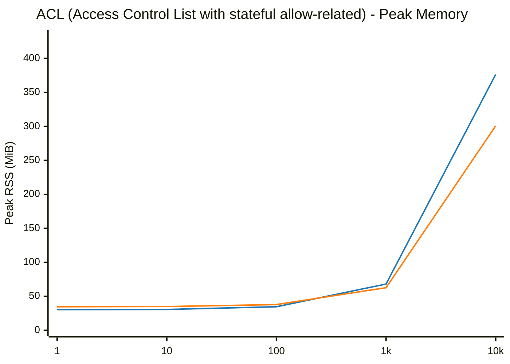

## Address Set (IP list matching ACL)

| Scale (N) | Phase / Metric | glibc malloc | jemalloc | Relative Difference |
|---|---|---|---|---|
| **1** | Total Pod Baseline Heap (RssAnon) | 30.14 MiB | 34.11 MiB | +13.2% |
| | Add Duration | 0.005 s | 0.005 s | ~Parity (±1%) |
| | Address Insertion Rate | 207 addrs/s | 201 addrs/s | -2.8% |
| | Recompute (`ovn-northd-loop`) | 0.0 ms | 0.1 ms | N/A |
| | Logical Flow (`lflow`) | 0.0 ms | 0.0 ms | N/A |
| | Total Pod Peak Heap (RssAnon) | 30.48 MiB | 34.72 MiB | +13.9% |
| | Delete Duration | 0.005 s | 0.005 s | ~Parity (±1%) |
| | Post-Delete Recompute | 0.0 ms | 0.0 ms | N/A |
| | Total Pod Post-Delete Heap (RssAnon) | 29.81 MiB | 34.54 MiB | +15.9% |
| | **Total Pod Retained Heap** | **-0.33 MiB** | **+0.43 MiB** | **+0.76 MiB** |
| | ├─ `ovn-northd` (Peak / Retained Heap) | 6.22 / +0.12 MiB | 7.24 / +0.08 MiB | +16.4% / -0.04 MiB |
| | ├─ `ovn-controller` (Peak / Retained Heap) | 4.84 / -0.41 MiB | 5.62 / +0.11 MiB | +16.1% / +0.52 MiB |
| | ├─ `ovs-vswitchd` (Peak / Retained Heap) | 12.44 / +0.08 MiB | 14.05 / +0.11 MiB | +12.9% / +0.03 MiB |
| | ├─ `ovsdb-server (SB)` (Peak / Retained Heap) | 2.78 / -0.02 MiB | 2.95 / +0.05 MiB | +6.1% / +0.07 MiB |
| | ├─ `ovsdb-server (NB)` (Peak / Retained Heap) | 2.10 / -0.09 MiB | 2.39 / +0.02 MiB | +13.8% / +0.11 MiB |
| | ├─ `ovsdb-server (OVS)` (Peak / Retained Heap) | 2.10 / -0.01 MiB | 2.47 / +0.06 MiB | +17.6% / +0.07 MiB |
|---|---|---|---|---|
| **10** | Total Pod Baseline Heap (RssAnon) | 30.14 MiB | 34.00 MiB | +12.8% |
| | Add Duration | 0.005 s | 0.005 s | ~Parity (±1%) |
| | Address Insertion Rate | 1,954 addrs/s | 1,967 addrs/s | ~Parity (±1%) |
| | Recompute (`ovn-northd-loop`) | 0.5 ms | 0.1 ms | ~Parity (<1ms) |
| | Logical Flow (`lflow`) | 1.0 ms | 0.0 ms | ~Parity (<1ms) |
| | Total Pod Peak Heap (RssAnon) | 30.51 MiB | 34.66 MiB | +13.6% |
| | Delete Duration | 0.005 s | 0.005 s | ~Parity (±1%) |
| | Post-Delete Recompute | 0.5 ms | 0.0 ms | ~Parity (<1ms) |
| | Total Pod Post-Delete Heap (RssAnon) | 29.86 MiB | 34.52 MiB | +15.6% |
| | **Total Pod Retained Heap** | **-0.28 MiB** | **+0.52 MiB** | **+0.80 MiB** |
| | ├─ `ovn-northd` (Peak / Retained Heap) | 6.23 / +0.10 MiB | 7.18 / +0.14 MiB | +15.2% / +0.04 MiB |
| | ├─ `ovn-controller` (Peak / Retained Heap) | 4.85 / -0.38 MiB | 5.63 / +0.12 MiB | +16.1% / +0.50 MiB |
| | ├─ `ovs-vswitchd` (Peak / Retained Heap) | 12.46 / +0.10 MiB | 14.06 / +0.13 MiB | +12.8% / +0.03 MiB |
| | ├─ `ovsdb-server (SB)` (Peak / Retained Heap) | 2.78 / +0.01 MiB | 2.92 / +0.05 MiB | +5.0% / +0.04 MiB |
| | ├─ `ovsdb-server (NB)` (Peak / Retained Heap) | 2.10 / -0.10 MiB | 2.39 / +0.02 MiB | +13.8% / +0.12 MiB |
| | ├─ `ovsdb-server (OVS)` (Peak / Retained Heap) | 2.09 / -0.01 MiB | 2.48 / +0.06 MiB | +18.7% / +0.07 MiB |
|---|---|---|---|---|
| **100** | Total Pod Baseline Heap (RssAnon) | 29.68 MiB | 34.04 MiB | +14.7% |
| | Add Duration | 0.004 s | 0.005 s | +25.0% |
| | Address Insertion Rate | 24,709 addrs/s | 19,677 addrs/s | -20.4% |
| | Recompute (`ovn-northd-loop`) | 0.5 ms | 0.0 ms | ~Parity (<1ms) |
| | Logical Flow (`lflow`) | 0.0 ms | 0.0 ms | N/A |
| | Total Pod Peak Heap (RssAnon) | 30.91 MiB | 35.13 MiB | +13.7% |
| | Delete Duration | 0.004 s | 0.005 s | +25.0% |
| | Post-Delete Recompute | 0.0 ms | 0.0 ms | N/A |
| | Total Pod Post-Delete Heap (RssAnon) | 30.18 MiB | 34.95 MiB | +15.8% |
| | **Total Pod Retained Heap** | **+0.50 MiB** | **+0.91 MiB** | **+0.41 MiB** |
| | ├─ `ovn-northd` (Peak / Retained Heap) | 6.24 / +0.12 MiB | 7.25 / +0.11 MiB | +16.2% / -0.01 MiB |
| | ├─ `ovn-controller` (Peak / Retained Heap) | 5.02 / +0.10 MiB | 5.84 / +0.30 MiB | +16.3% / +0.20 MiB |
| | ├─ `ovs-vswitchd` (Peak / Retained Heap) | 12.68 / +0.37 MiB | 14.24 / +0.37 MiB | +12.3% / +0.00 MiB |
| | ├─ `ovsdb-server (SB)` (Peak / Retained Heap) | 2.79 / +0.00 MiB | 2.92 / +0.05 MiB | +4.7% / +0.05 MiB |
| | ├─ `ovsdb-server (NB)` (Peak / Retained Heap) | 2.09 / -0.09 MiB | 2.40 / +0.02 MiB | +14.8% / +0.11 MiB |
| | ├─ `ovsdb-server (OVS)` (Peak / Retained Heap) | 2.09 / +0.00 MiB | 2.48 / +0.06 MiB | +18.7% / +0.06 MiB |
|---|---|---|---|---|
| **1000** | Total Pod Baseline Heap (RssAnon) | 30.11 MiB | 34.04 MiB | +13.1% |
| | Add Duration | 0.006 s | 0.006 s | ~Parity (±1%) |
| | Address Insertion Rate | 158,353 addrs/s | 160,102 addrs/s | +1.1% |
| | Recompute (`ovn-northd-loop`) | 0.0 ms | 0.0 ms | ~Parity (<1ms) |
| | Logical Flow (`lflow`) | 1.0 ms | 1.0 ms | ~Parity (<1ms) |
| | Total Pod Peak Heap (RssAnon) | 38.17 MiB | 38.52 MiB | ~Parity (±1%) |
| | Delete Duration | 0.004 s | 0.004 s | ~Parity (±1%) |
| | Post-Delete Recompute | 0.5 ms | 0.0 ms | ~Parity (<1ms) |
| | Total Pod Post-Delete Heap (RssAnon) | 32.94 MiB | 35.87 MiB | +8.9% |
| | **Total Pod Retained Heap** | **+2.83 MiB** | **+1.83 MiB** | **-1.00 MiB** |
| | ├─ `ovn-northd` (Peak / Retained Heap) | 6.38 / +0.20 MiB | 7.35 / +0.22 MiB | +15.2% / +0.02 MiB |
| | ├─ `ovn-controller` (Peak / Retained Heap) | 9.73 / -0.30 MiB | 7.68 / +0.65 MiB | -21.1% / +0.95 MiB |
| | ├─ `ovs-vswitchd` (Peak / Retained Heap) | 15.02 / +2.94 MiB | 15.51 / +0.69 MiB | +3.3% / -2.25 MiB |
| | ├─ `ovsdb-server (SB)` (Peak / Retained Heap) | 2.88 / +0.04 MiB | 3.06 / +0.12 MiB | +6.3% / +0.08 MiB |
| | ├─ `ovsdb-server (NB)` (Peak / Retained Heap) | 2.07 / -0.04 MiB | 2.45 / +0.08 MiB | +18.4% / +0.12 MiB |
| | ├─ `ovsdb-server (OVS)` (Peak / Retained Heap) | 2.09 / -0.01 MiB | 2.47 / +0.07 MiB | +18.2% / +0.08 MiB |
|---|---|---|---|---|
| **10000** | Total Pod Baseline Heap (RssAnon) | 30.15 MiB | 34.06 MiB | +13.0% |
| | Add Duration | 0.030 s | 0.020 s | -33.3% |
| | Address Insertion Rate | 332,634 addrs/s | 506,688 addrs/s | +52.3% |
| | Recompute (`ovn-northd-loop`) | 0.0 ms | 0.0 ms | ~Parity (<1ms) |
| | Logical Flow (`lflow`) | 1.0 ms | 0.0 ms | ~Parity (<1ms) |
| | Total Pod Peak Heap (RssAnon) | 49.34 MiB | 57.37 MiB | +16.3% |
| | Delete Duration | 0.006 s | 0.005 s | -16.7% |
| | Post-Delete Recompute | 0.5 ms | 0.0 ms | ~Parity (<1ms) |
| | Total Pod Post-Delete Heap (RssAnon) | 58.94 MiB | 37.39 MiB | -36.6% |
| | **Total Pod Retained Heap** | **+28.79 MiB** | **+3.33 MiB** | **-25.46 MiB** |
| | ├─ `ovn-northd` (Peak / Retained Heap) | 7.65 / +0.27 MiB | 8.66 / +0.22 MiB | +13.2% / -0.05 MiB |
| | ├─ `ovn-controller` (Peak / Retained Heap) | 20.66 / -0.04 MiB | 25.77 / +2.11 MiB | +24.7% / +2.15 MiB |
| | ├─ `ovs-vswitchd` (Peak / Retained Heap) | 12.40 / +28.53 MiB | 13.96 / +0.78 MiB | +12.6% / -27.75 MiB |
| | ├─ `ovsdb-server (SB)` (Peak / Retained Heap) | 3.75 / +0.11 MiB | 3.52 / +0.06 MiB | -6.1% / -0.05 MiB |
| | ├─ `ovsdb-server (NB)` (Peak / Retained Heap) | 2.79 / -0.08 MiB | 2.99 / +0.09 MiB | +7.2% / +0.17 MiB |
| | ├─ `ovsdb-server (OVS)` (Peak / Retained Heap) | 2.09 / +0.00 MiB | 2.47 / +0.07 MiB | +18.2% / +0.07 MiB |
|---|---|---|---|---|

### Visual Charts

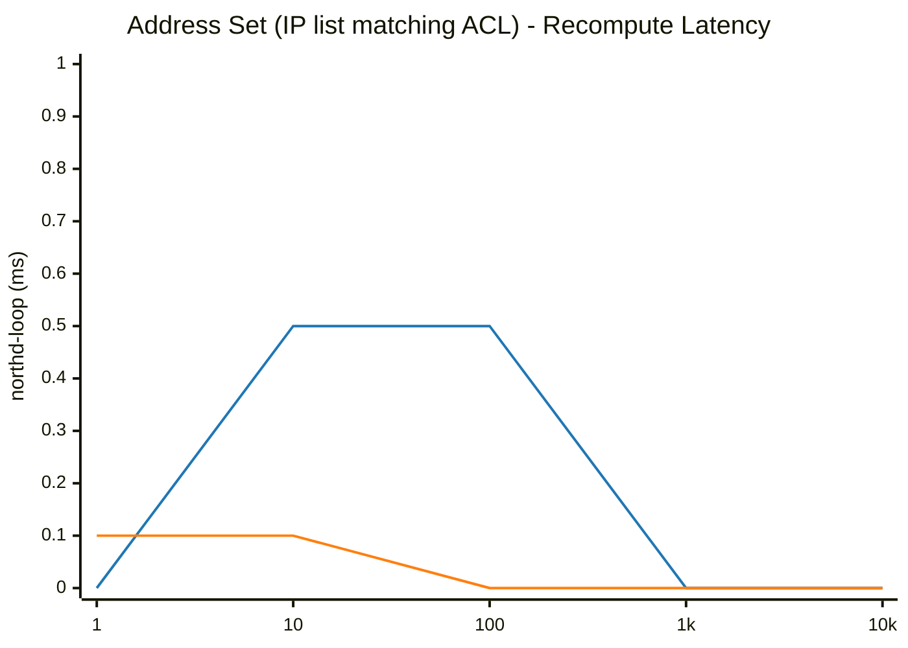

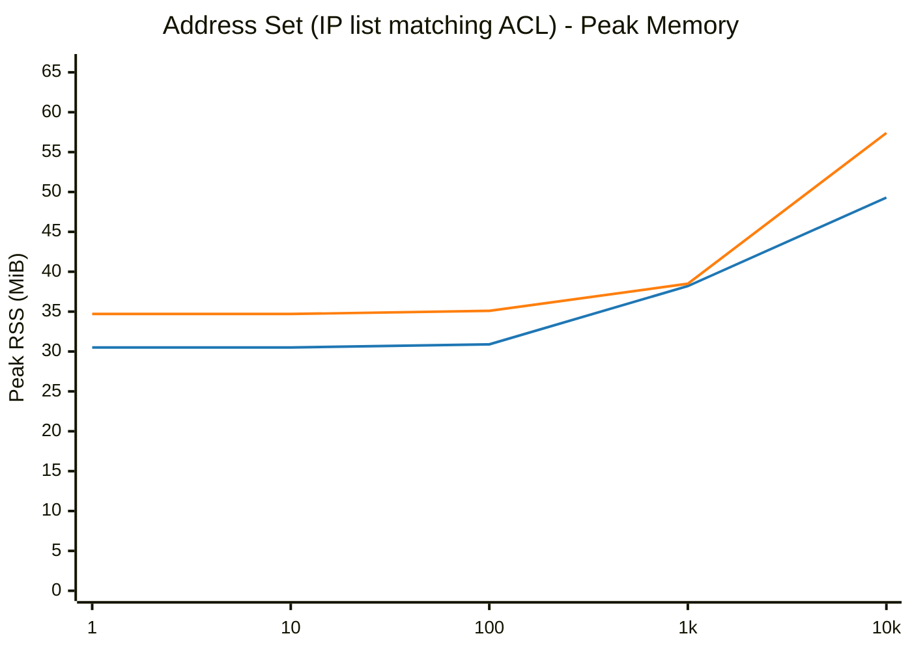

## Port Group (Ports member grouping matching ACL)

| Scale (N) | Phase / Metric | glibc malloc | jemalloc | Relative Difference |
|---|---|---|---|---|
| **1** | Total Pod Baseline Heap (RssAnon) | 27.51 MiB | 31.69 MiB | +15.2% |
| | Add Duration | 0.011 s | 0.012 s | +9.1% |
| | Add Rate | 90 ops/s | 83 ops/s | -7.0% |
| | Recompute (`ovn-northd-loop`) | 0.0 ms | 0.1 ms | N/A |
| | Logical Flow (`lflow`) | 0.0 ms | 1.0 ms | N/A |
| | Total Pod Peak Heap (RssAnon) | 29.28 MiB | 33.46 MiB | +14.3% |
| | Delete Duration | 0.009 s | 0.009 s | ~Parity (±1%) |
| | Post-Delete Recompute | 0.0 ms | 0.1 ms | N/A |
| | Total Pod Post-Delete Heap (RssAnon) | 28.64 MiB | 33.20 MiB | +15.9% |
| | **Total Pod Retained Heap** | **+1.13 MiB** | **+1.51 MiB** | **+0.38 MiB** |
| | ├─ `ovn-northd` (Peak / Retained Heap) | 6.06 / +0.05 MiB | 6.97 / +0.08 MiB | +15.0% / +0.03 MiB |
| | ├─ `ovn-controller` (Peak / Retained Heap) | 4.35 / +1.01 MiB | 5.18 / +1.01 MiB | +19.1% / +0.00 MiB |
| | ├─ `ovs-vswitchd` (Peak / Retained Heap) | 12.13 / +0.38 MiB | 13.71 / +0.36 MiB | +13.0% / -0.02 MiB |
| | ├─ `ovsdb-server (SB)` (Peak / Retained Heap) | 2.65 / -0.13 MiB | 2.90 / +0.00 MiB | +9.4% / +0.13 MiB |
| | ├─ `ovsdb-server (NB)` (Peak / Retained Heap) | 2.06 / -0.10 MiB | 2.35 / -0.01 MiB | +14.1% / +0.09 MiB |
| | ├─ `ovsdb-server (OVS)` (Peak / Retained Heap) | 2.03 / -0.08 MiB | 2.35 / +0.07 MiB | +15.8% / +0.15 MiB |
|---|---|---|---|---|
| **10** | Total Pod Baseline Heap (RssAnon) | 27.55 MiB | 31.66 MiB | +14.9% |
| | Add Duration | 0.013 s | 0.013 s | ~Parity (±1%) |
| | Add Rate | 775 ops/s | 774 ops/s | ~Parity (±1%) |
| | Recompute (`ovn-northd-loop`) | 0.1 ms | 0.0 ms | ~Parity (<1ms) |
| | Logical Flow (`lflow`) | 0.0 ms | 0.0 ms | N/A |
| | Total Pod Peak Heap (RssAnon) | 30.50 MiB | 34.90 MiB | +14.4% |
| | Delete Duration | 0.010 s | 0.010 s | ~Parity (±1%) |
| | Post-Delete Recompute | 0.0 ms | 0.0 ms | N/A |
| | Total Pod Post-Delete Heap (RssAnon) | 30.10 MiB | 34.66 MiB | +15.1% |
| | **Total Pod Retained Heap** | **+2.55 MiB** | **+3.00 MiB** | **+0.45 MiB** |
| | ├─ `ovn-northd` (Peak / Retained Heap) | 6.22 / +0.17 MiB | 7.25 / +0.34 MiB | +16.6% / +0.17 MiB |
| | ├─ `ovn-controller` (Peak / Retained Heap) | 4.75 / +1.60 MiB | 5.73 / +1.59 MiB | +20.6% / -0.01 MiB |
| | ├─ `ovs-vswitchd` (Peak / Retained Heap) | 12.55 / +0.82 MiB | 14.09 / +0.72 MiB | +12.3% / -0.10 MiB |
| | ├─ `ovsdb-server (SB)` (Peak / Retained Heap) | 2.79 / +0.01 MiB | 2.96 / +0.10 MiB | +6.1% / +0.09 MiB |
| | ├─ `ovsdb-server (NB)` (Peak / Retained Heap) | 2.09 / -0.08 MiB | 2.40 / +0.05 MiB | +14.8% / +0.13 MiB |
| | ├─ `ovsdb-server (OVS)` (Peak / Retained Heap) | 2.10 / +0.03 MiB | 2.47 / +0.20 MiB | +17.6% / +0.17 MiB |
|---|---|---|---|---|
| **100** | Total Pod Baseline Heap (RssAnon) | 27.56 MiB | 31.68 MiB | +14.9% |
| | Add Duration | 0.025 s | 0.023 s | -8.0% |
| | Add Rate | 3,984 ops/s | 4,308 ops/s | +8.1% |
| | Recompute (`ovn-northd-loop`) | 0.0 ms | 0.0 ms | ~Parity (<1ms) |
| | Logical Flow (`lflow`) | 1.0 ms | 0.0 ms | ~Parity (<1ms) |
| | Total Pod Peak Heap (RssAnon) | 43.07 MiB | 42.71 MiB | ~Parity (±1%) |
| | Delete Duration | 0.021 s | 0.017 s | -19.0% |
| | Post-Delete Recompute | 0.0 ms | 0.2 ms | ~Parity (<1ms) |
| | Total Pod Post-Delete Heap (RssAnon) | 38.59 MiB | 39.55 MiB | +2.5% |
| | **Total Pod Retained Heap** | **+11.03 MiB** | **+7.87 MiB** | **-3.16 MiB** |
| | ├─ `ovn-northd` (Peak / Retained Heap) | 8.45 / +1.14 MiB | 9.00 / +1.17 MiB | +6.5% / +0.03 MiB |
| | ├─ `ovn-controller` (Peak / Retained Heap) | 7.64 / +3.84 MiB | 7.25 / +3.41 MiB | -5.1% / -0.43 MiB |
| | ├─ `ovs-vswitchd` (Peak / Retained Heap) | 14.15 / +3.72 MiB | 15.10 / +1.92 MiB | +6.7% / -1.80 MiB |
| | ├─ `ovsdb-server (SB)` (Peak / Retained Heap) | 6.27 / +1.19 MiB | 4.92 / +0.52 MiB | -21.5% / -0.67 MiB |
| | ├─ `ovsdb-server (NB)` (Peak / Retained Heap) | 2.57 / +0.15 MiB | 2.85 / +0.28 MiB | +10.9% / +0.13 MiB |
| | ├─ `ovsdb-server (OVS)` (Peak / Retained Heap) | 3.99 / +0.99 MiB | 3.59 / +0.57 MiB | -10.0% / -0.42 MiB |
|---|---|---|---|---|
| **1000** | Total Pod Baseline Heap (RssAnon) | 27.57 MiB | 31.68 MiB | +14.9% |
| | Add Duration | 0.490 s | 0.495 s | +1.0% |
| | Add Rate | 2,042 ops/s | 2,019 ops/s | -1.1% |
| | Recompute (`ovn-northd-loop`) | 0.3 ms | 0.7 ms | ~Parity (<1ms) |
| | Logical Flow (`lflow`) | 6.0 ms | 5.0 ms | -16.7% |
| | Total Pod Peak Heap (RssAnon) | 167.58 MiB | 143.99 MiB | -14.1% |
| | Delete Duration | 0.311 s | 0.244 s | -21.5% |
| | Post-Delete Recompute | 0.0 ms | 0.0 ms | ~Parity (<1ms) |
| | Total Pod Post-Delete Heap (RssAnon) | 68.19 MiB | 48.92 MiB | -28.3% |
| | **Total Pod Retained Heap** | **+40.62 MiB** | **+17.24 MiB** | **-23.38 MiB** |
| | ├─ `ovn-northd` (Peak / Retained Heap) | 28.71 / +2.43 MiB | 24.89 / +2.71 MiB | -13.3% / +0.28 MiB |
| | ├─ `ovn-controller` (Peak / Retained Heap) | 54.08 / +11.13 MiB | 50.27 / +8.33 MiB | -7.0% / -2.80 MiB |
| | ├─ `ovs-vswitchd` (Peak / Retained Heap) | 29.02 / +18.96 MiB | 30.90 / +4.03 MiB | +6.5% / -14.93 MiB |
| | ├─ `ovsdb-server (SB)` (Peak / Retained Heap) | 34.43 / +3.16 MiB | 21.09 / +1.04 MiB | -38.7% / -2.12 MiB |
| | ├─ `ovsdb-server (NB)` (Peak / Retained Heap) | 7.00 / +1.22 MiB | 5.09 / +0.69 MiB | -27.3% / -0.53 MiB |
| | ├─ `ovsdb-server (OVS)` (Peak / Retained Heap) | 14.34 / +3.72 MiB | 11.75 / +0.44 MiB | -18.1% / -3.28 MiB |
|---|---|---|---|---|
| **10000** | Total Pod Baseline Heap (RssAnon) | 27.58 MiB | 31.70 MiB | +14.9% |
| | Add Duration | 74.004 s | 66.561 s | -10.1% |
| | Add Rate | 135 ops/s | 150 ops/s | +11.2% |
| | Recompute (`ovn-northd-loop`) | 4.0 ms | 3.4 ms | -15.5% |
| | Logical Flow (`lflow`) | 132.0 ms | 113.0 ms | -14.4% |
| | Total Pod Peak Heap (RssAnon) | 1261.76 MiB | 1001.45 MiB | -20.6% |
| | Delete Duration | 17.020 s | 13.615 s | -20.0% |
| | Post-Delete Recompute | 0.6 ms | 0.0 ms | ~Parity (<1ms) |
| | Total Pod Post-Delete Heap (RssAnon) | 376.28 MiB | 206.82 MiB | -45.0% |
| | **Total Pod Retained Heap** | **+348.70 MiB** | **+175.12 MiB** | **-173.58 MiB** |
| | ├─ `ovn-northd` (Peak / Retained Heap) | 227.25 / +6.11 MiB | 188.59 / +6.06 MiB | -17.0% / -0.05 MiB |
| | ├─ `ovn-controller` (Peak / Retained Heap) | 412.49 / +86.44 MiB | 393.89 / +42.35 MiB | -4.5% / -44.09 MiB |
| | ├─ `ovs-vswitchd` (Peak / Retained Heap) | 122.82 / +140.43 MiB | 117.82 / +111.11 MiB | -4.1% / -29.32 MiB |
| | ├─ `ovsdb-server (SB)` (Peak / Retained Heap) | 333.07 / +4.26 MiB | 188.80 / +6.48 MiB | -43.3% / +2.22 MiB |
| | ├─ `ovsdb-server (NB)` (Peak / Retained Heap) | 46.40 / +1.64 MiB | 29.78 / +1.96 MiB | -35.8% / +0.32 MiB |
| | ├─ `ovsdb-server (OVS)` (Peak / Retained Heap) | 119.73 / +109.82 MiB | 82.57 / +7.16 MiB | -31.0% / -102.66 MiB |
|---|---|---|---|---|

### Visual Charts

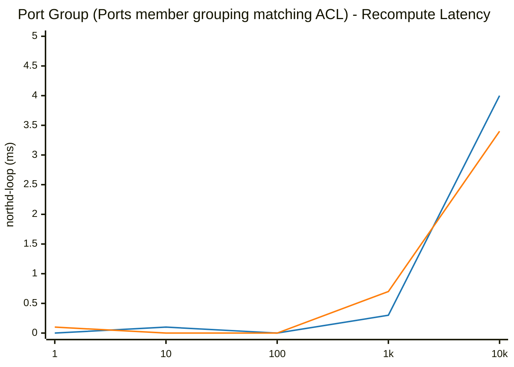

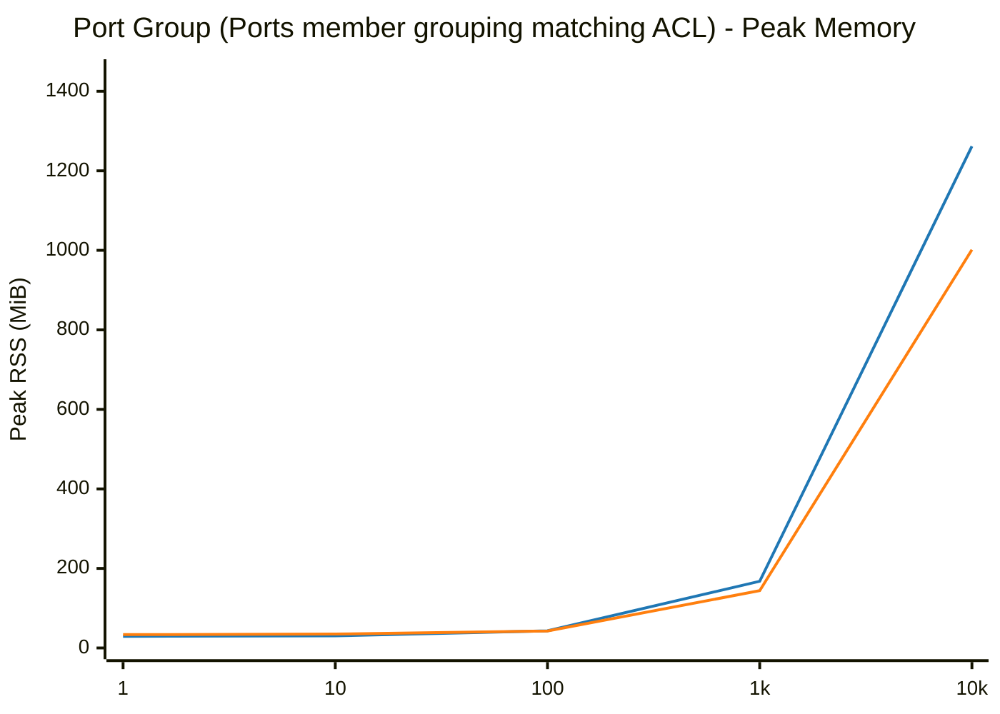

## Load Balancer (VIPs mapped to endpoints)

| Scale (N) | Phase / Metric | glibc malloc | jemalloc | Relative Difference |
|---|---|---|---|---|
| **1** | Total Pod Baseline Heap (RssAnon) | 30.12 MiB | 34.03 MiB | +13.0% |
| | Add Duration | 0.004 s | 0.005 s | +25.0% |
| | Add Rate | 235 ops/s | 220 ops/s | -6.3% |
| | Recompute (`ovn-northd-loop`) | 0.0 ms | 0.1 ms | N/A |
| | Logical Flow (`lflow`) | 1.0 ms | 0.0 ms | ~Parity (<1ms) |
| | Total Pod Peak Heap (RssAnon) | 30.12 MiB | 34.03 MiB | +13.0% |
| | Delete Duration | 0.005 s | 0.005 s | ~Parity (±1%) |
| | Post-Delete Recompute | 0.0 ms | 0.5 ms | ~Parity (<1ms) |
| | Total Pod Post-Delete Heap (RssAnon) | 29.45 MiB | 34.14 MiB | +15.9% |
| | **Total Pod Retained Heap** | **-0.67 MiB** | **+0.11 MiB** | **+0.78 MiB** |
| | ├─ `ovn-northd` (Peak / Retained Heap) | 6.07 / -0.02 MiB | 7.07 / +0.01 MiB | +16.5% / +0.03 MiB |
| | ├─ `ovn-controller` (Peak / Retained Heap) | 4.84 / -0.51 MiB | 5.24 / -0.01 MiB | +8.3% / +0.50 MiB |
| | ├─ `ovs-vswitchd` (Peak / Retained Heap) | 12.40 / +0.00 MiB | 13.95 / +0.01 MiB | +12.5% / +0.01 MiB |
| | ├─ `ovsdb-server (SB)` (Peak / Retained Heap) | 2.66 / -0.07 MiB | 2.91 / +0.02 MiB | +9.4% / +0.09 MiB |
| | ├─ `ovsdb-server (NB)` (Peak / Retained Heap) | 2.06 / -0.06 MiB | 2.39 / +0.01 MiB | +16.0% / +0.07 MiB |
| | ├─ `ovsdb-server (OVS)` (Peak / Retained Heap) | 2.09 / -0.01 MiB | 2.47 / +0.07 MiB | +18.2% / +0.08 MiB |
|---|---|---|---|---|
| **10** | Total Pod Baseline Heap (RssAnon) | 29.70 MiB | 34.07 MiB | +14.7% |
| | Add Duration | 0.005 s | 0.005 s | ~Parity (±1%) |
| | Add Rate | 2,106 ops/s | 1,996 ops/s | -5.2% |
| | Recompute (`ovn-northd-loop`) | 0.2 ms | 0.8 ms | ~Parity (<1ms) |
| | Logical Flow (`lflow`) | 0.0 ms | 0.0 ms | N/A |
| | Total Pod Peak Heap (RssAnon) | 29.70 MiB | 34.06 MiB | +14.7% |
| | Delete Duration | 0.005 s | 0.006 s | +20.0% |
| | Post-Delete Recompute | 0.6 ms | 0.0 ms | ~Parity (<1ms) |
| | Total Pod Post-Delete Heap (RssAnon) | 29.43 MiB | 34.16 MiB | +16.1% |
| | **Total Pod Retained Heap** | **-0.27 MiB** | **+0.09 MiB** | **+0.36 MiB** |
| | ├─ `ovn-northd` (Peak / Retained Heap) | 6.06 / -0.02 MiB | 7.10 / +0.01 MiB | +17.2% / +0.03 MiB |
| | ├─ `ovn-controller` (Peak / Retained Heap) | 4.40 / -0.08 MiB | 5.23 / +0.00 MiB | +18.9% / +0.08 MiB |
| | ├─ `ovs-vswitchd` (Peak / Retained Heap) | 12.40 / +0.00 MiB | 13.95 / +0.01 MiB | +12.5% / +0.01 MiB |
| | ├─ `ovsdb-server (SB)` (Peak / Retained Heap) | 2.66 / -0.07 MiB | 2.91 / +0.01 MiB | +9.4% / +0.08 MiB |
| | ├─ `ovsdb-server (NB)` (Peak / Retained Heap) | 2.09 / -0.09 MiB | 2.39 / +0.00 MiB | +14.4% / +0.09 MiB |
| | ├─ `ovsdb-server (OVS)` (Peak / Retained Heap) | 2.09 / -0.01 MiB | 2.48 / +0.06 MiB | +18.7% / +0.07 MiB |
|---|---|---|---|---|
| **100** | Total Pod Baseline Heap (RssAnon) | 30.14 MiB | 34.02 MiB | +12.9% |
| | Add Duration | 0.005 s | 0.005 s | ~Parity (±1%) |
| | Add Rate | 20,868 ops/s | 18,807 ops/s | -9.9% |
| | Recompute (`ovn-northd-loop`) | 0.1 ms | 0.0 ms | ~Parity (<1ms) |
| | Logical Flow (`lflow`) | 0.0 ms | 0.0 ms | N/A |
| | Total Pod Peak Heap (RssAnon) | 30.14 MiB | 34.02 MiB | +12.9% |
| | Delete Duration | 0.005 s | 0.005 s | ~Parity (±1%) |
| | Post-Delete Recompute | 0.2 ms | 0.0 ms | ~Parity (<1ms) |
| | Total Pod Post-Delete Heap (RssAnon) | 29.49 MiB | 34.08 MiB | +15.6% |
| | **Total Pod Retained Heap** | **-0.65 MiB** | **+0.06 MiB** | **+0.71 MiB** |
| | ├─ `ovn-northd` (Peak / Retained Heap) | 6.06 / -0.02 MiB | 7.09 / -0.01 MiB | +17.0% / +0.01 MiB |
| | ├─ `ovn-controller` (Peak / Retained Heap) | 4.85 / -0.51 MiB | 5.24 / +0.00 MiB | +8.0% / +0.51 MiB |
| | ├─ `ovs-vswitchd` (Peak / Retained Heap) | 12.39 / +0.00 MiB | 13.96 / +0.00 MiB | +12.7% / +0.00 MiB |
| | ├─ `ovsdb-server (SB)` (Peak / Retained Heap) | 2.65 / -0.04 MiB | 2.85 / +0.01 MiB | +7.5% / +0.05 MiB |
| | ├─ `ovsdb-server (NB)` (Peak / Retained Heap) | 2.10 / -0.08 MiB | 2.40 / +0.00 MiB | +14.3% / +0.08 MiB |
| | ├─ `ovsdb-server (OVS)` (Peak / Retained Heap) | 2.09 / +0.00 MiB | 2.48 / +0.06 MiB | +18.7% / +0.06 MiB |
|---|---|---|---|---|
| **1000** | Total Pod Baseline Heap (RssAnon) | 30.15 MiB | 34.10 MiB | +13.1% |
| | Add Duration | 0.008 s | 0.007 s | -12.5% |
| | Add Rate | 118,666 ops/s | 136,369 ops/s | +14.9% |
| | Recompute (`ovn-northd-loop`) | 0.0 ms | 0.5 ms | N/A |
| | Logical Flow (`lflow`) | 0.0 ms | 0.0 ms | N/A |
| | Total Pod Peak Heap (RssAnon) | 30.15 MiB | 34.10 MiB | +13.1% |
| | Delete Duration | 0.005 s | 0.005 s | ~Parity (±1%) |
| | Post-Delete Recompute | 0.0 ms | 0.1 ms | N/A |
| | Total Pod Post-Delete Heap (RssAnon) | 29.47 MiB | 34.16 MiB | +15.9% |
| | **Total Pod Retained Heap** | **-0.68 MiB** | **+0.06 MiB** | **+0.74 MiB** |
| | ├─ `ovn-northd` (Peak / Retained Heap) | 6.06 / -0.02 MiB | 7.11 / +0.00 MiB | +17.3% / +0.02 MiB |
| | ├─ `ovn-controller` (Peak / Retained Heap) | 4.85 / -0.51 MiB | 5.24 / -0.01 MiB | +8.0% / +0.50 MiB |
| | ├─ `ovs-vswitchd` (Peak / Retained Heap) | 12.39 / +0.00 MiB | 13.95 / +0.00 MiB | +12.6% / +0.00 MiB |
| | ├─ `ovsdb-server (SB)` (Peak / Retained Heap) | 2.66 / -0.05 MiB | 2.91 / +0.02 MiB | +9.4% / +0.07 MiB |
| | ├─ `ovsdb-server (NB)` (Peak / Retained Heap) | 2.10 / -0.08 MiB | 2.41 / -0.01 MiB | +14.8% / +0.07 MiB |
| | ├─ `ovsdb-server (OVS)` (Peak / Retained Heap) | 2.09 / -0.02 MiB | 2.48 / +0.06 MiB | +18.7% / +0.08 MiB |
|---|---|---|---|---|
| **10000** | Total Pod Baseline Heap (RssAnon) | 30.14 MiB | 34.09 MiB | +13.1% |
| | Add Duration | 0.023 s | 0.022 s | -4.3% |
| | Add Rate | 429,996 ops/s | 457,498 ops/s | +6.4% |
| | Recompute (`ovn-northd-loop`) | 0.0 ms | 0.2 ms | N/A |
| | Logical Flow (`lflow`) | 1.0 ms | 0.0 ms | ~Parity (<1ms) |
| | Total Pod Peak Heap (RssAnon) | 30.14 MiB | 34.02 MiB | +12.9% |
| | Delete Duration | 0.005 s | 0.005 s | ~Parity (±1%) |
| | Post-Delete Recompute | 0.1 ms | 0.5 ms | ~Parity (<1ms) |
| | Total Pod Post-Delete Heap (RssAnon) | 29.46 MiB | 34.12 MiB | +15.8% |
| | **Total Pod Retained Heap** | **-0.68 MiB** | **+0.03 MiB** | **+0.71 MiB** |
| | ├─ `ovn-northd` (Peak / Retained Heap) | 6.06 / -0.02 MiB | 7.11 / -0.01 MiB | +17.3% / +0.01 MiB |
| | ├─ `ovn-controller` (Peak / Retained Heap) | 4.85 / -0.51 MiB | 5.24 / +0.00 MiB | +8.0% / +0.51 MiB |
| | ├─ `ovs-vswitchd` (Peak / Retained Heap) | 12.39 / +0.00 MiB | 13.96 / +0.00 MiB | +12.7% / +0.00 MiB |
| | ├─ `ovsdb-server (SB)` (Peak / Retained Heap) | 2.65 / -0.05 MiB | 2.91 / -0.01 MiB | +9.8% / +0.04 MiB |
| | ├─ `ovsdb-server (NB)` (Peak / Retained Heap) | 2.10 / -0.09 MiB | 2.34 / -0.02 MiB | +11.4% / +0.07 MiB |
| | ├─ `ovsdb-server (OVS)` (Peak / Retained Heap) | 2.09 / -0.01 MiB | 2.46 / +0.07 MiB | +17.7% / +0.08 MiB |
|---|---|---|---|---|

### Visual Charts

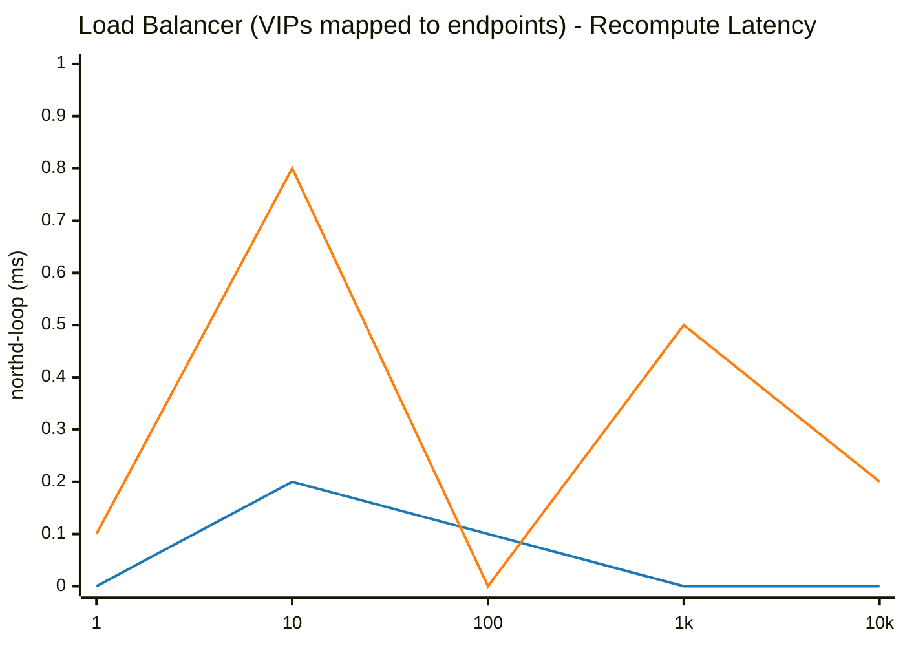

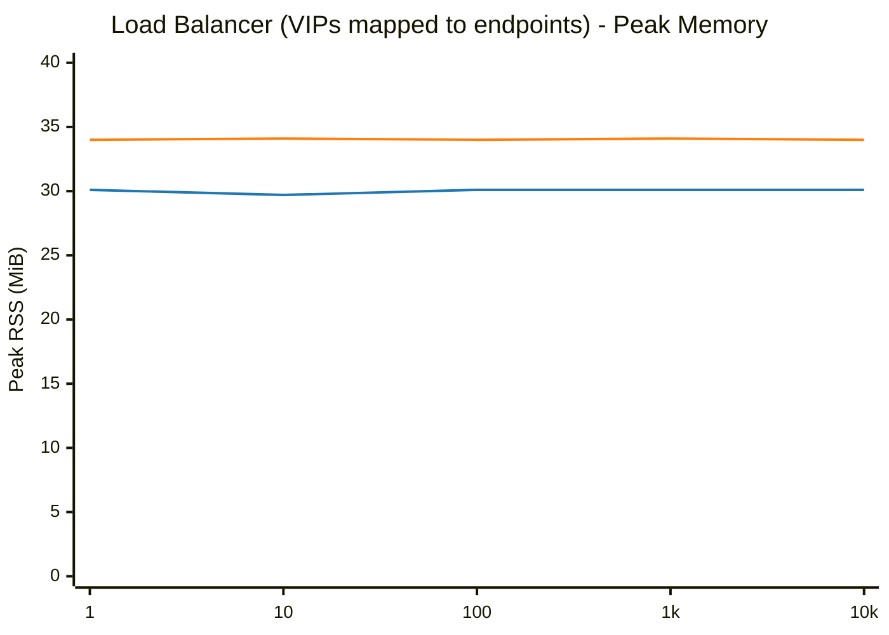

## OpenFlow Flows (OVS Control Plane)

| Scale (N) | Phase / Metric | glibc malloc | jemalloc | Relative Difference |
|---|---|---|---|---|
| **1** | Total Pod Baseline Heap (RssAnon) | 27.36 MiB | 31.49 MiB | +15.1% |
| | Add Duration | 0.004 s | 0.004 s | ~Parity (±1%) |
| | Add Rate | 236 ops/s | 257 ops/s | +8.6% |
| | Total Pod Peak Heap (RssAnon) | 27.48 MiB | 31.56 MiB | +14.8% |
| | Delete Duration | 0.003 s | 0.003 s | ~Parity (±1%) |
| | Total Pod Post-Delete Heap (RssAnon) | 26.87 MiB | 31.63 MiB | +17.7% |
| | **Total Pod Retained Heap** | **-0.49 MiB** | **+0.14 MiB** | **+0.63 MiB** |
| | ├─ `ovn-northd` (Peak / Retained Heap) | 5.92 / -0.13 MiB | 6.86 / +0.00 MiB | +15.9% / +0.13 MiB |
| | ├─ `ovn-controller` (Peak / Retained Heap) | 3.03 / +0.00 MiB | 3.90 / +0.00 MiB | +28.7% / +0.00 MiB |
| | ├─ `ovs-vswitchd` (Peak / Retained Heap) | 11.89 / +0.12 MiB | 13.43 / +0.08 MiB | +13.0% / -0.04 MiB |
| | ├─ `ovsdb-server (SB)` (Peak / Retained Heap) | 2.51 / -0.19 MiB | 2.66 / -0.02 MiB | +6.0% / +0.17 MiB |
| | ├─ `ovsdb-server (NB)` (Peak / Retained Heap) | 2.09 / -0.16 MiB | 2.37 / +0.01 MiB | +13.4% / +0.17 MiB |
| | ├─ `ovsdb-server (OVS)` (Peak / Retained Heap) | 2.04 / -0.13 MiB | 2.34 / +0.07 MiB | +14.7% / +0.20 MiB |
|---|---|---|---|---|
| **10** | Total Pod Baseline Heap (RssAnon) | 27.35 MiB | 31.43 MiB | +14.9% |
| | Add Duration | 0.005 s | 0.005 s | ~Parity (±1%) |
| | Add Rate | 2,018 ops/s | 2,151 ops/s | +6.6% |
| | Total Pod Peak Heap (RssAnon) | 27.47 MiB | 31.51 MiB | +14.7% |
| | Delete Duration | 0.003 s | 0.004 s | +33.3% |
| | Total Pod Post-Delete Heap (RssAnon) | 26.92 MiB | 31.59 MiB | +17.3% |
| | **Total Pod Retained Heap** | **-0.43 MiB** | **+0.16 MiB** | **+0.59 MiB** |
| | ├─ `ovn-northd` (Peak / Retained Heap) | 5.92 / -0.11 MiB | 6.81 / +0.00 MiB | +15.0% / +0.11 MiB |
| | ├─ `ovn-controller` (Peak / Retained Heap) | 3.03 / +0.00 MiB | 3.88 / +0.00 MiB | +28.1% / +0.00 MiB |
| | ├─ `ovs-vswitchd` (Peak / Retained Heap) | 11.89 / +0.16 MiB | 13.44 / +0.10 MiB | +13.0% / -0.06 MiB |
| | ├─ `ovsdb-server (SB)` (Peak / Retained Heap) | 2.50 / -0.20 MiB | 2.66 / +0.00 MiB | +6.4% / +0.20 MiB |
| | ├─ `ovsdb-server (NB)` (Peak / Retained Heap) | 2.09 / -0.15 MiB | 2.38 / +0.01 MiB | +13.9% / +0.16 MiB |
| | ├─ `ovsdb-server (OVS)` (Peak / Retained Heap) | 2.04 / -0.13 MiB | 2.34 / +0.05 MiB | +14.7% / +0.18 MiB |
|---|---|---|---|---|
| **100** | Total Pod Baseline Heap (RssAnon) | 27.35 MiB | 31.47 MiB | +15.1% |
| | Add Duration | 0.007 s | 0.008 s | +14.3% |
| | Add Rate | 13,342 ops/s | 12,493 ops/s | -6.4% |
| | Total Pod Peak Heap (RssAnon) | 27.47 MiB | 31.61 MiB | +15.1% |
| | Delete Duration | 0.003 s | 0.003 s | ~Parity (±1%) |
| | Total Pod Post-Delete Heap (RssAnon) | 26.97 MiB | 31.69 MiB | +17.5% |
| | **Total Pod Retained Heap** | **-0.38 MiB** | **+0.22 MiB** | **+0.60 MiB** |
| | ├─ `ovn-northd` (Peak / Retained Heap) | 5.92 / -0.10 MiB | 6.80 / +0.00 MiB | +14.9% / +0.10 MiB |
| | ├─ `ovn-controller` (Peak / Retained Heap) | 3.03 / +0.00 MiB | 3.90 / +0.00 MiB | +28.7% / +0.00 MiB |
| | ├─ `ovs-vswitchd` (Peak / Retained Heap) | 11.89 / +0.19 MiB | 13.50 / +0.17 MiB | +13.5% / -0.02 MiB |
| | ├─ `ovsdb-server (SB)` (Peak / Retained Heap) | 2.51 / -0.20 MiB | 2.70 / -0.02 MiB | +7.6% / +0.18 MiB |
| | ├─ `ovsdb-server (NB)` (Peak / Retained Heap) | 2.09 / -0.15 MiB | 2.38 / +0.01 MiB | +13.9% / +0.16 MiB |
| | ├─ `ovsdb-server (OVS)` (Peak / Retained Heap) | 2.03 / -0.12 MiB | 2.33 / +0.06 MiB | +14.8% / +0.18 MiB |
|---|---|---|---|---|
| **1000** | Total Pod Baseline Heap (RssAnon) | 27.36 MiB | 31.41 MiB | +14.8% |
| | Add Duration | 0.043 s | 0.039 s | -9.3% |
| | Add Rate | 23,421 ops/s | 25,355 ops/s | +8.3% |
| | Total Pod Peak Heap (RssAnon) | 28.10 MiB | 32.13 MiB | +14.3% |
| | Delete Duration | 0.003 s | 0.003 s | ~Parity (±1%) |
| | Total Pod Post-Delete Heap (RssAnon) | 27.72 MiB | 32.08 MiB | +15.7% |
| | **Total Pod Retained Heap** | **+0.36 MiB** | **+0.67 MiB** | **+0.31 MiB** |
| | ├─ `ovn-northd` (Peak / Retained Heap) | 5.92 / -0.10 MiB | 6.80 / +0.00 MiB | +14.9% / +0.10 MiB |
| | ├─ `ovn-controller` (Peak / Retained Heap) | 3.03 / +0.00 MiB | 3.89 / +0.00 MiB | +28.4% / +0.00 MiB |
| | ├─ `ovs-vswitchd` (Peak / Retained Heap) | 12.51 / +0.93 MiB | 14.07 / +0.61 MiB | +12.5% / -0.32 MiB |
| | ├─ `ovsdb-server (SB)` (Peak / Retained Heap) | 2.51 / -0.20 MiB | 2.66 / -0.01 MiB | +6.0% / +0.19 MiB |
| | ├─ `ovsdb-server (NB)` (Peak / Retained Heap) | 2.09 / -0.14 MiB | 2.37 / +0.02 MiB | +13.4% / +0.16 MiB |
| | ├─ `ovsdb-server (OVS)` (Peak / Retained Heap) | 2.04 / -0.13 MiB | 2.34 / +0.05 MiB | +14.7% / +0.18 MiB |
|---|---|---|---|---|
| **10000** | Total Pod Baseline Heap (RssAnon) | 27.36 MiB | 31.50 MiB | +15.1% |
| | Add Duration | 0.337 s | 0.293 s | -13.1% |
| | Add Rate | 29,679 ops/s | 34,183 ops/s | +15.2% |
| | Total Pod Peak Heap (RssAnon) | 34.80 MiB | 38.91 MiB | +11.8% |
| | Delete Duration | 0.006 s | 0.006 s | ~Parity (±1%) |
| | Total Pod Post-Delete Heap (RssAnon) | 35.04 MiB | 32.49 MiB | -7.3% |
| | **Total Pod Retained Heap** | **+7.68 MiB** | **+0.99 MiB** | **-6.69 MiB** |
| | ├─ `ovn-northd` (Peak / Retained Heap) | 5.92 / -0.12 MiB | 6.81 / +0.00 MiB | +15.0% / +0.12 MiB |
| | ├─ `ovn-controller` (Peak / Retained Heap) | 3.03 / +0.00 MiB | 3.88 / +0.00 MiB | +28.1% / +0.00 MiB |
| | ├─ `ovs-vswitchd` (Peak / Retained Heap) | 19.20 / +8.29 MiB | 20.77 / +0.94 MiB | +8.2% / -7.35 MiB |
| | ├─ `ovsdb-server (SB)` (Peak / Retained Heap) | 2.51 / -0.20 MiB | 2.73 / -0.02 MiB | +8.8% / +0.18 MiB |
| | ├─ `ovsdb-server (NB)` (Peak / Retained Heap) | 2.10 / -0.16 MiB | 2.38 / +0.01 MiB | +13.3% / +0.17 MiB |
| | ├─ `ovsdb-server (OVS)` (Peak / Retained Heap) | 2.04 / -0.13 MiB | 2.34 / +0.06 MiB | +14.7% / +0.19 MiB |
|---|---|---|---|---|
| **100000** | Total Pod Baseline Heap (RssAnon) | 27.37 MiB | 31.44 MiB | +14.9% |
| | Add Duration | 2.984 s | 3.063 s | +2.6% |
| | Add Rate | 33,506 ops/s | 32,646 ops/s | -2.6% |
| | Total Pod Peak Heap (RssAnon) | 101.06 MiB | 102.88 MiB | +1.8% |
| | Delete Duration | 0.037 s | 0.027 s | -27.0% |
| | Total Pod Post-Delete Heap (RssAnon) | 106.16 MiB | 32.90 MiB | -69.0% |
| | **Total Pod Retained Heap** | **+78.79 MiB** | **+1.46 MiB** | **-77.33 MiB** |
| | ├─ `ovn-northd` (Peak / Retained Heap) | 5.84 / -0.09 MiB | 6.82 / +0.00 MiB | +16.8% / +0.09 MiB |
| | ├─ `ovn-controller` (Peak / Retained Heap) | 3.03 / +0.00 MiB | 3.89 / +0.00 MiB | +28.4% / +0.00 MiB |
| | ├─ `ovs-vswitchd` (Peak / Retained Heap) | 85.55 / +79.35 MiB | 84.80 / +1.39 MiB | ~Parity (±1%) / -77.96 MiB |
| | ├─ `ovsdb-server (SB)` (Peak / Retained Heap) | 2.51 / -0.20 MiB | 2.67 / -0.01 MiB | +6.4% / +0.19 MiB |
| | ├─ `ovsdb-server (NB)` (Peak / Retained Heap) | 2.09 / -0.14 MiB | 2.37 / +0.02 MiB | +13.4% / +0.16 MiB |
| | ├─ `ovsdb-server (OVS)` (Peak / Retained Heap) | 2.04 / -0.13 MiB | 2.33 / +0.06 MiB | +14.2% / +0.19 MiB |
|---|---|---|---|---|

### Visual Charts

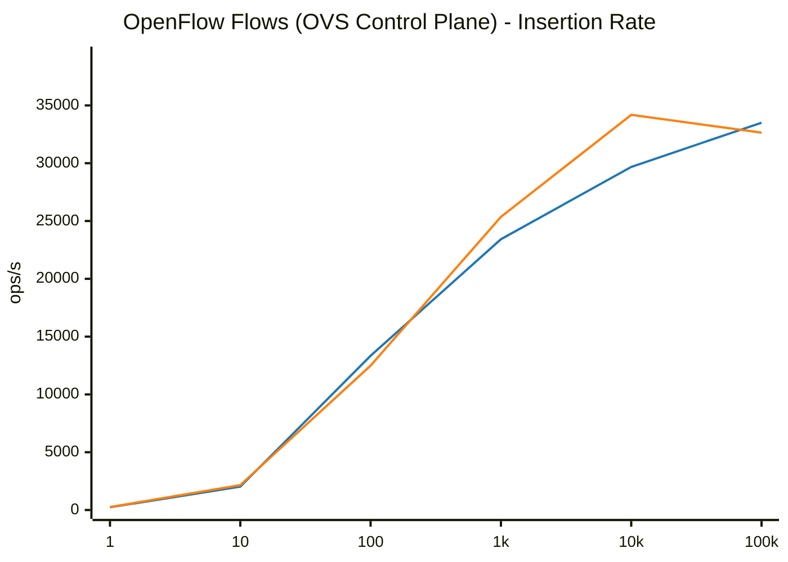

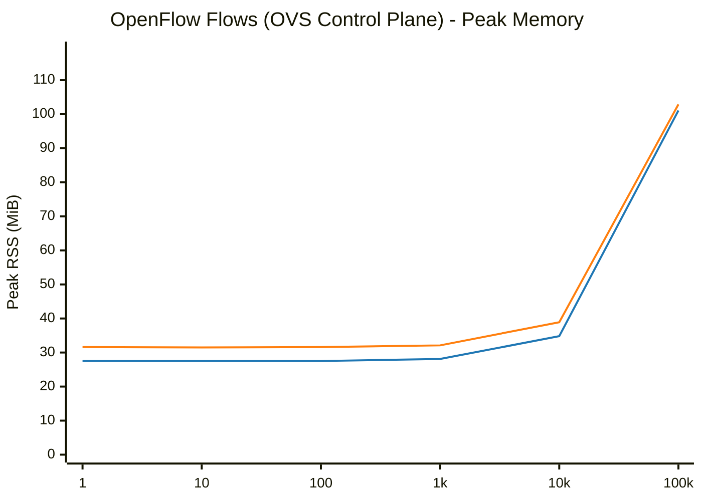

## Combined Workload (All objects scaled proportionally)

| Scale (N) | Phase / Metric | glibc malloc | jemalloc | Relative Difference |
|---|---|---|---|---|
| **1** | Total Pod Baseline Heap (RssAnon) | 27.50 MiB | 31.45 MiB | +14.4% |
| | Add Duration | 0.011 s | 0.012 s | +9.1% |
| | Add Rate | 89 ops/s | 80 ops/s | -10.6% |
| | Recompute (`ovn-northd-loop`) | 0.0 ms | 0.0 ms | N/A |
| | Logical Flow (`lflow`) | 1.0 ms | 0.0 ms | ~Parity (<1ms) |
| | Total Pod Peak Heap (RssAnon) | 31.26 MiB | 35.47 MiB | +13.5% |
| | Delete Duration | 0.009 s | 0.009 s | ~Parity (±1%) |
| | Post-Delete Recompute | 0.0 ms | 0.0 ms | N/A |
| | Total Pod Post-Delete Heap (RssAnon) | 29.25 MiB | 33.61 MiB | +14.9% |
| | **Total Pod Retained Heap** | **+1.75 MiB** | **+2.16 MiB** | **+0.41 MiB** |
| | ├─ `ovn-northd` (Peak / Retained Heap) | 6.37 / +0.22 MiB | 7.35 / +0.32 MiB | +15.4% / +0.10 MiB |
| | ├─ `ovn-controller` (Peak / Retained Heap) | 5.27 / +0.97 MiB | 6.27 / +0.77 MiB | +19.0% / -0.20 MiB |
| | ├─ `ovs-vswitchd` (Peak / Retained Heap) | 12.37 / +0.84 MiB | 13.95 / +0.81 MiB | +12.8% / -0.03 MiB |
| | ├─ `ovsdb-server (SB)` (Peak / Retained Heap) | 3.12 / -0.06 MiB | 3.19 / +0.18 MiB | +2.2% / +0.24 MiB |
| | ├─ `ovsdb-server (NB)` (Peak / Retained Heap) | 2.10 / -0.13 MiB | 2.36 / +0.01 MiB | +12.4% / +0.14 MiB |
| | ├─ `ovsdb-server (OVS)` (Peak / Retained Heap) | 2.03 / -0.09 MiB | 2.35 / +0.07 MiB | +15.8% / +0.16 MiB |
|---|---|---|---|---|
| **10** | Total Pod Baseline Heap (RssAnon) | 27.34 MiB | 31.47 MiB | +15.1% |
| | Add Duration | 0.014 s | 0.014 s | ~Parity (±1%) |
| | Add Rate | 715 ops/s | 703 ops/s | -1.6% |
| | Recompute (`ovn-northd-loop`) | 0.0 ms | 0.1 ms | ~Parity (<1ms) |
| | Logical Flow (`lflow`) | 1.0 ms | 1.0 ms | ~Parity (<1ms) |
| | Total Pod Peak Heap (RssAnon) | 32.85 MiB | 37.44 MiB | +14.0% |
| | Delete Duration | 0.011 s | 0.010 s | -9.1% |
| | Post-Delete Recompute | 0.0 ms | 0.0 ms | ~Parity (<1ms) |
| | Total Pod Post-Delete Heap (RssAnon) | 30.57 MiB | 34.65 MiB | +13.3% |
| | **Total Pod Retained Heap** | **+3.23 MiB** | **+3.18 MiB** | **-0.05 MiB** |
| | ├─ `ovn-northd` (Peak / Retained Heap) | 6.68 / +0.34 MiB | 7.70 / +0.58 MiB | +15.3% / +0.24 MiB |
| | ├─ `ovn-controller` (Peak / Retained Heap) | 5.83 / +1.44 MiB | 6.98 / +0.99 MiB | +19.7% / -0.45 MiB |
| | ├─ `ovs-vswitchd` (Peak / Retained Heap) | 12.66 / +1.14 MiB | 14.41 / +1.10 MiB | +13.8% / -0.04 MiB |
| | ├─ `ovsdb-server (SB)` (Peak / Retained Heap) | 3.52 / +0.31 MiB | 3.48 / +0.28 MiB | -1.1% / -0.03 MiB |
| | ├─ `ovsdb-server (NB)` (Peak / Retained Heap) | 2.06 / -0.03 MiB | 2.41 / +0.05 MiB | +17.0% / +0.08 MiB |
| | ├─ `ovsdb-server (OVS)` (Peak / Retained Heap) | 2.10 / +0.03 MiB | 2.46 / +0.18 MiB | +17.1% / +0.15 MiB |
|---|---|---|---|---|
| **100** | Total Pod Baseline Heap (RssAnon) | 27.69 MiB | 31.48 MiB | +13.7% |
| | Add Duration | 0.038 s | 0.038 s | ~Parity (±1%) |
| | Add Rate | 2,659 ops/s | 2,615 ops/s | -1.7% |
| | Recompute (`ovn-northd-loop`) | 0.0 ms | 0.0 ms | ~Parity (<1ms) |
| | Logical Flow (`lflow`) | 1.0 ms | 1.0 ms | ~Parity (<1ms) |
| | Total Pod Peak Heap (RssAnon) | 48.88 MiB | 49.87 MiB | +2.0% |
| | Delete Duration | 0.023 s | 0.019 s | -17.4% |
| | Post-Delete Recompute | 0.5 ms | 0.0 ms | ~Parity (<1ms) |
| | Total Pod Post-Delete Heap (RssAnon) | 38.66 MiB | 37.94 MiB | -1.9% |
| | **Total Pod Retained Heap** | **+10.97 MiB** | **+6.46 MiB** | **-4.51 MiB** |
| | ├─ `ovn-northd` (Peak / Retained Heap) | 9.67 / +0.88 MiB | 9.88 / +1.04 MiB | +2.2% / +0.16 MiB |
| | ├─ `ovn-controller` (Peak / Retained Heap) | 8.73 / +3.10 MiB | 10.82 / +1.81 MiB | +23.9% / -1.29 MiB |
| | ├─ `ovs-vswitchd` (Peak / Retained Heap) | 16.21 / +5.10 MiB | 16.96 / +2.55 MiB | +4.6% / -2.55 MiB |
| | ├─ `ovsdb-server (SB)` (Peak / Retained Heap) | 7.61 / +0.48 MiB | 5.66 / +0.32 MiB | -25.6% / -0.16 MiB |
| | ├─ `ovsdb-server (NB)` (Peak / Retained Heap) | 2.67 / +0.39 MiB | 2.97 / +0.31 MiB | +11.2% / -0.08 MiB |
| | ├─ `ovsdb-server (OVS)` (Peak / Retained Heap) | 3.99 / +1.02 MiB | 3.58 / +0.43 MiB | -10.3% / -0.59 MiB |
|---|---|---|---|---|
| **1000** | Total Pod Baseline Heap (RssAnon) | 27.38 MiB | 31.44 MiB | +14.8% |
| | Add Duration | 0.660 s | 0.660 s | ~Parity (±1%) |
| | Add Rate | 1,516 ops/s | 1,515 ops/s | ~Parity (±1%) |
| | Recompute (`ovn-northd-loop`) | 0.3 ms | 0.6 ms | ~Parity (<1ms) |
| | Logical Flow (`lflow`) | 10.0 ms | 10.0 ms | ~Parity (±1%) |
| | Total Pod Peak Heap (RssAnon) | 175.43 MiB | 164.82 MiB | -6.0% |
| | Delete Duration | 0.425 s | 0.301 s | -29.2% |
| | Post-Delete Recompute | 0.1 ms | 0.0 ms | ~Parity (<1ms) |
| | Total Pod Post-Delete Heap (RssAnon) | 70.13 MiB | 45.19 MiB | -35.6% |
| | **Total Pod Retained Heap** | **+42.75 MiB** | **+13.75 MiB** | **-29.00 MiB** |
| | ├─ `ovn-northd` (Peak / Retained Heap) | 34.73 / +3.03 MiB | 30.52 / +2.69 MiB | -12.1% / -0.34 MiB |
| | ├─ `ovn-controller` (Peak / Retained Heap) | 59.91 / +8.36 MiB | 66.19 / +3.83 MiB | +10.5% / -4.53 MiB |
| | ├─ `ovs-vswitchd` (Peak / Retained Heap) | 28.36 / +17.61 MiB | 26.80 / +4.69 MiB | -5.5% / -12.92 MiB |
| | ├─ `ovsdb-server (SB)` (Peak / Retained Heap) | 30.27 / +2.69 MiB | 23.18 / +1.42 MiB | -23.4% / -1.27 MiB |
| | ├─ `ovsdb-server (NB)` (Peak / Retained Heap) | 7.21 / +1.10 MiB | 6.29 / +0.70 MiB | -12.8% / -0.40 MiB |
| | ├─ `ovsdb-server (OVS)` (Peak / Retained Heap) | 14.95 / +9.96 MiB | 11.84 / +0.42 MiB | -20.8% / -9.54 MiB |
|---|---|---|---|---|
| **10000** | Total Pod Baseline Heap (RssAnon) | 27.47 MiB | 31.43 MiB | +14.4% |
| | Add Duration | 72.279 s | 69.650 s | -3.6% |
| | Add Rate | 138 ops/s | 143 ops/s | +3.8% |
| | Recompute (`ovn-northd-loop`) | 3.6 ms | 5.7 ms | +55.9% |
| | Logical Flow (`lflow`) | 111.0 ms | 102.0 ms | -8.1% |
| | Total Pod Peak Heap (RssAnon) | 1313.13 MiB | 1144.38 MiB | -12.9% |
| | Delete Duration | 16.807 s | 13.724 s | -18.3% |
| | Post-Delete Recompute | 0.1 ms | 0.0 ms | ~Parity (<1ms) |
| | Total Pod Post-Delete Heap (RssAnon) | 572.47 MiB | 292.43 MiB | -48.9% |
| | **Total Pod Retained Heap** | **+545.00 MiB** | **+261.00 MiB** | **-284.00 MiB** |
| | ├─ `ovn-northd` (Peak / Retained Heap) | 294.05 / +6.64 MiB | 235.89 / +7.06 MiB | -19.8% / +0.42 MiB |
| | ├─ `ovn-controller` (Peak / Retained Heap) | 450.00 / +297.61 MiB | 459.40 / +144.36 MiB | +2.1% / -153.25 MiB |
| | ├─ `ovs-vswitchd` (Peak / Retained Heap) | 118.29 / +117.55 MiB | 123.85 / +94.05 MiB | +4.7% / -23.50 MiB |
| | ├─ `ovsdb-server (SB)` (Peak / Retained Heap) | 282.94 / +11.54 MiB | 201.33 / +9.10 MiB | -28.8% / -2.44 MiB |
| | ├─ `ovsdb-server (NB)` (Peak / Retained Heap) | 49.72 / +3.10 MiB | 39.39 / +2.19 MiB | -20.8% / -0.91 MiB |
| | ├─ `ovsdb-server (OVS)` (Peak / Retained Heap) | 118.13 / +108.56 MiB | 84.52 / +4.24 MiB | -28.5% / -104.32 MiB |
|---|---|---|---|---|

### Visual Charts

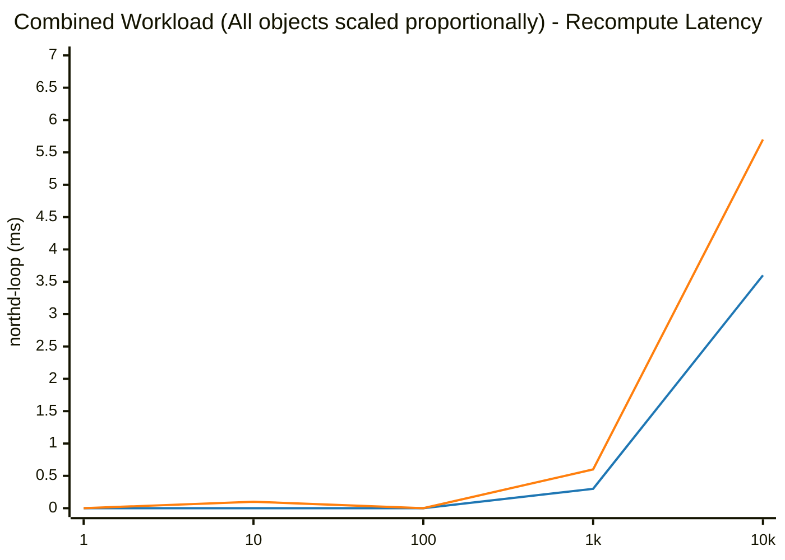

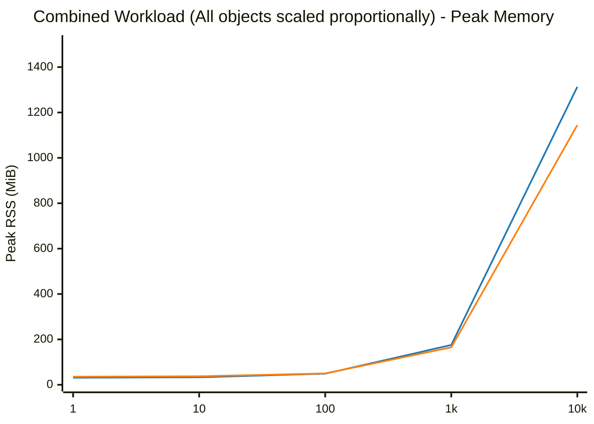

